# 分子スクリーニングと材料探索：たくさんの候補から、よい分子を選ぶ研究

!!! abstract "このページで分かること"
    「光る分子がほしい」「電気をよく流す分子がほしい」というとき、候補になる分子は数えきれないほどあります。
    この分野では、その中から見込みのあるものを計算でふるい分け、実験する分子を数個まで絞り込みます。
    どんな順番でふるうのか、何を手がかり（記述子）にするのか、どこまで信じてよいのかを紹介します。

    | 節 | 内容 |
    |---|---|
    | 1 | この分野が答えようとしている問い |
    | 2 | 計算スクリーニングの考え方（漏斗） |
    | 3 | 化学空間とデータベース |
    | 4 | 記述子と目的関数 |
    | 5 | 有機エレクトロニクスと発光材料 |
    | 6 | ベイズ最適化、能動学習、生成モデル |
    | 7 | ハイスループット計算の常識 |

!!! tip "ひとことで言うと"
    砂浜で落とし物を探す作業に似ています。
    砂浜全体を 1 粒ずつ調べるのは無理なので、まず金属探知機でざっと当たりをつけ、怪しい場所だけ手で掘ります。
    金属探知機にあたるのが速い計算（力場や半経験的方法、機械学習）、手で掘るのが高い計算（DFT や TDDFT）、最後に拾い上げて確かめるのが合成と測定です。
    この分野の腕の見せどころは、「どの道具を、どの順番で、どこまで信じて使うか」の設計にあります。

## 1. この分野が答えようとしている問い

材料の研究では、「こういう性質の分子がほしい」という注文が先にあります。
たとえば、近赤外（目に見えないほど波長の長い光）で光る分子、青色でしかも色のにじみが小さい発光体、正孔（電子の抜け穴）をよく運ぶ分子、といった注文です。
ところが、その注文に合う分子を人間の勘だけで思いつくのは簡単ではありません。
炭素と水素と窒素を組み合わせるだけでも、候補の数はすぐに数万、数億になります。

そこでこの分野は、次の問いに答えようとします。

- **候補をどうやって並べるか**：考えられる分子をもれなく列挙する方法は何か。
- **どうやってふるうか**：全部を正確に計算する時間はない。どの計算で、どの順にふるうか。
- **何を見ればよいか**：ほしい性質を、計算できる量（記述子）にどう翻訳するか。
- **どこまで当たるか**：計算で選んだ分子は、本当に合成して測ると良いのか。

最後の問いが、この分野を実験と強く結びつけています。
計算だけで終わらず、合成して測り、予測が当たったかどうかで方法の良し悪しが決まります。

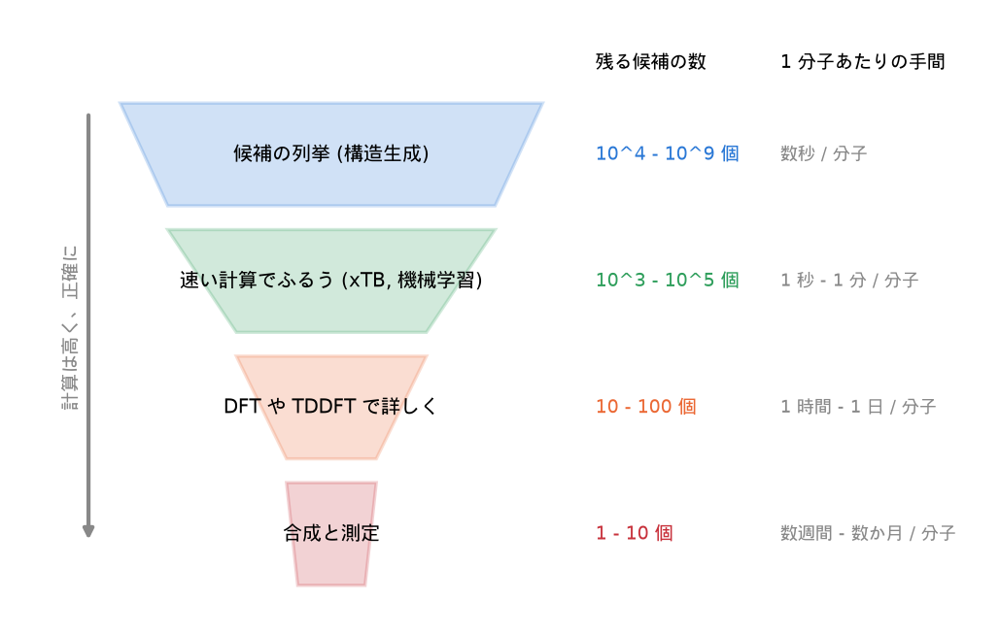

**図 1**　スクリーニングの漏斗（模式図）です。上に行くほど候補は多く、1 分子あたりにかけられる計算の手間は小さくなります。下に行くほど候補は少なく、計算は高く正確になります。数は分野によって変わります。

## 2. 計算スクリーニングの考え方

### 2.1 漏斗の形に組み立てる

計算スクリーニング（virtual screening、仮想スクリーニング）の基本は、図 1 の漏斗です。
考え方は単純で、**安い計算は数をこなし、高い計算は選ばれたものだけに使う**、これだけです。
実際の手順は次の 4 段です。

1. **列挙**：骨格（分子の土台になる環構造）と置換基の組み合わせを決め、考えられる構造をすべて書き出します。文字列表現の SMILES（分子を 1 行の文字で表す書き方）で生成することが多いです。
2. **前処理**：平面の構造式を 3 次元の座標にし、配座（分子の折れ曲がり方）を作ります。ここで半経験的な方法（GFN2-xTB など）を使って構造を軽く整えます [Bannwarth 2019]。
3. **本計算**：残った候補に DFT や TDDFT をかけ、ほしい性質に直結する量を計算します。
4. **実験**：上位の数個を合成し、測定します。

各段で候補が 1 桁から 2 桁ずつ減るので、全体として「10 万個から 2 個」のような絞り込みができます。

### 2.2 化学空間の中を探している

分子 1 個を、いくつかの数（記述子）の組として表すと、分子は空間の中の 1 点になります。
この空間を**化学空間**（chemical space）と呼びます。
スクリーニングは、この空間の中で「注文に合う領域」に入る点を探す作業だと言えます。

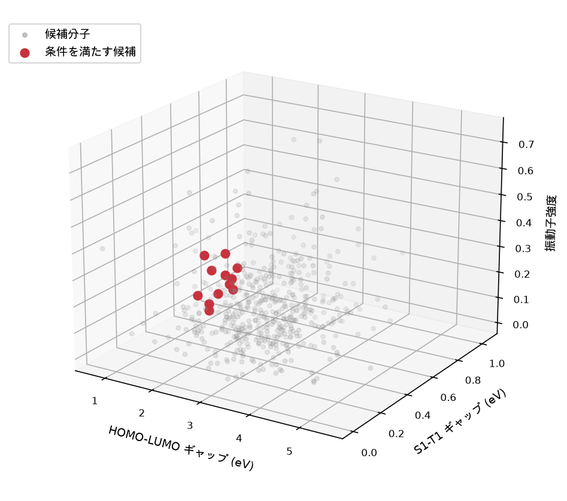

**図 2**　記述子を 3 つ選んで軸にした化学空間の模式図です。灰色の点が候補分子、赤い点が 3 つの条件（ここでは HOMO-LUMO ギャップが 2.6〜3.1 eV、S1-T1 ギャップが 0.2 eV 未満、振動子強度が 0.25 以上）をすべて満たす候補です。乱数で作った模式図で、実在の分子ではありません。条件を 1 つ増やすたびに、残る点が急に減るのが分かります。

### この界隈の常識

- 漏斗の各段は、「見逃し（本当は良いのに落とす）」と「無駄打ち（悪いのに残す）」の釣り合いで設計します。上の段ほど、見逃しを減らす側に倒します。
- 速い計算の役目は、順位を正しくつけることであって、絶対値を当てることではありません。
- 候補の数が多いほど良いわけではありません。合成できない構造が増えるだけのこともあります。

## 3. 化学空間とデータベース

### 3.1 化学空間はとにかく広い

薬になる程度の大きさの有機分子は、1060 種類あるとよく言われます。
この数は直接数えたものではなく、組み合わせからの見積もりです。
実際に数えた例としては、GDB-17 があります。
これは炭素、窒素、酸素、硫黄、ハロゲンの重原子 17 個までの分子を列挙したデータベースで、1664 億個（166.4 billion）の分子が入っています [Ruddigkeit 2012]。

一方、人間が実際に作って報告した分子は、けた違いに少ない数です。
PubChem は、実在が報告された化合物を集めた公開データベースです [Kim 2023]。
ZINC20 は、業者から買える化合物を集めたもので、ドッキング（創薬のページで扱います）向けの 3 次元構造が付いています [Irwin 2020]。

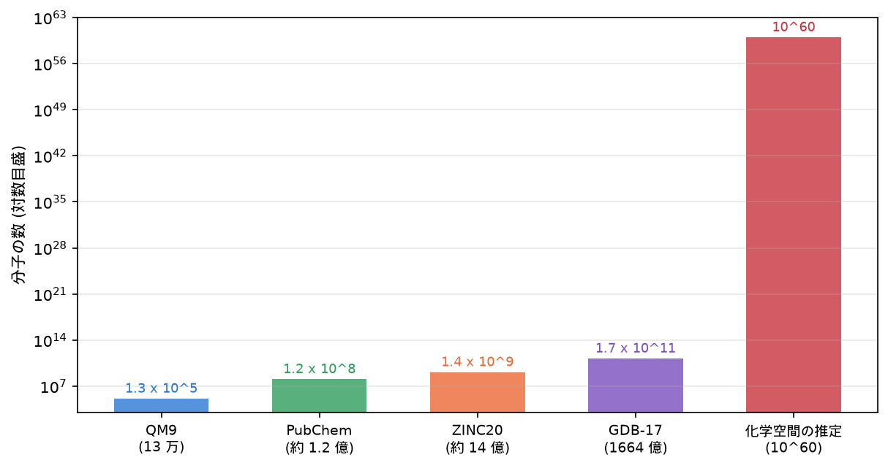

**図 3**　代表的なデータベースの大きさです。縦軸は対数目盛で、1 目盛が 107 倍に当たります。計算で扱える数（左の 3 つ）と、化学空間全体の見積もり（右端）の差が、この分野の出発点です。1060 は見積もりの値です。

### 3.2 量子化学の計算値が付いたデータベース

スクリーニングで機械学習を使うには、学習のお手本になる計算値が要ります。
よく使われるのが QM9 です。
重原子 9 個までの有機分子 13 万 4 千個について、B3LYP で最適化した構造と、エネルギー、双極子モーメント、HOMO-LUMO ギャップなどが入っています [Ramakrishnan 2014]。

QM9 は手軽ですが、分子が小さく、理論のレベルも 1 種類です。
自分の目的（たとえば近赤外の発光）に合う値が入っているとは限りません。
そのため、実際の研究では「目的に合わせてデータを自分で作る」ことが多くなります。
5 節で紹介する研究も、まず自分たちで数百から数千個の分子を計算し、それを学習データにしています。

### この界隈の常識

- 「化学空間は 1060」は見積もりの数字です。正確な値ではありません。
- 公開データベースの分子は、作りやすい反応で作られたものに偏っています。つまり、データベースは化学空間の代表ではありません。
- データセットを使うときは、理論のレベル（汎関数と基底関数）を必ず確かめます。詳しくは機械学習と量子化学の講義ノート [第 6 回](../courses/ml-chem/06-datasets.md) を見てください。

## 4. 記述子と目的関数

### 4.1 ほしい性質を、計算できる量に翻訳する

「よく光る分子がほしい」という注文は、そのままでは計算できません。
計算できる量に翻訳する必要があります。
よく使われる翻訳は次のとおりです。

| ほしい性質 | 計算する量（記述子） | ねらい |
|---|---|---|
| 色（吸収・発光の波長） | 励起エネルギー、HOMO-LUMO ギャップ | 小さいほど長波長（赤い側） |
| 光の吸いやすさ・光りやすさ | 振動子強度、遷移双極子モーメント | 大きいほど強く光る |
| 三重項から一重項に戻れるか | S1-T1 ギャップ（ΔEST） | 小さいほど逆項間交差が速い |
| 電荷の運びやすさ | 再配置エネルギー、移動積分 | 再配置エネルギーが小さく、移動積分が大きいほど速い |
| 作れそうか・壊れにくいか | 結合あたりの原子化エネルギー、合成しやすさの指標 | 大きい（安定）ほどよい |

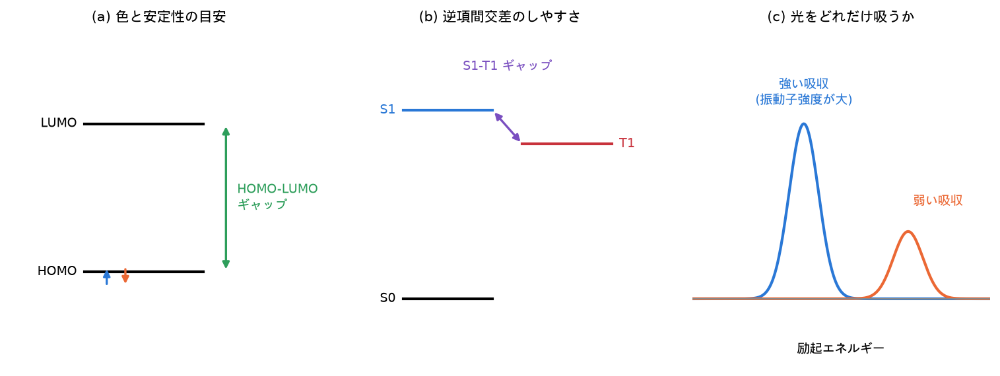

**図 4**　代表的な記述子の模式図です。(a) 占有軌道の一番上（HOMO）と空軌道の一番下（LUMO）の差。青の上向きの矢印が α 電子、橙の下向きの矢印が β 電子です。(b) 一番低い励起一重項 S1 と三重項 T1 の差。(c) 振動子強度は、吸収の山の高さ（強さ）に対応します。

### 4.2 電荷輸送の記述子

有機半導体では、電荷（電子や正孔）が分子から分子へ飛び移って運ばれます。
このとき効くのが、**再配置エネルギー**と**移動積分**の 2 つです。
再配置エネルギーは、電荷が入ったり出たりしたときに分子の形が変わる分のエネルギーで、小さいほど飛び移りやすくなります。
移動積分は、隣り合う分子の軌道がどれだけ重なっているかを表す量です。
この 2 つで電荷の移動度を見積もる考え方は、有機半導体の標準的な総説にまとめられています [Coropceanu 2007]。

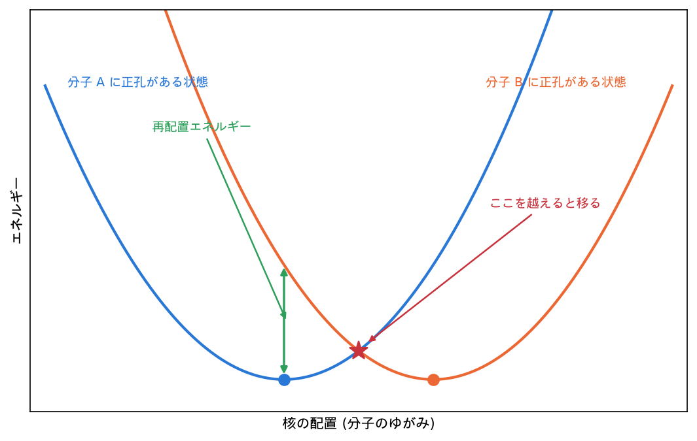

**図 5**　電荷の移動を説明する 2 本の放物線（模式図）です。横軸は核の配置、青は分子 A に正孔がある状態、橙は分子 B に正孔がある状態のエネルギーです。緑の矢印が再配置エネルギー（分子 A の構造のまま、正孔が分子 B に移ったときのエネルギーの上がり分）、赤い星が交差点です。放物線が横にずれているほど再配置エネルギーが大きく、交差点が高くなって移りにくくなります。

### 4.3 目的関数と、性質の地形

記述子が決まると、スクリーニングは「目的関数を最大にする分子を探す」問題になります。
目的関数は、ふつう複数の記述子を組み合わせて作ります。
たとえば「励起エネルギーが 1.7 eV 付近で、振動子強度が大きく、原子化エネルギーも十分大きい」といった形です。

分子を少し変えると記述子も少し変わるので、化学空間の上に「性質の地形」が描けます。

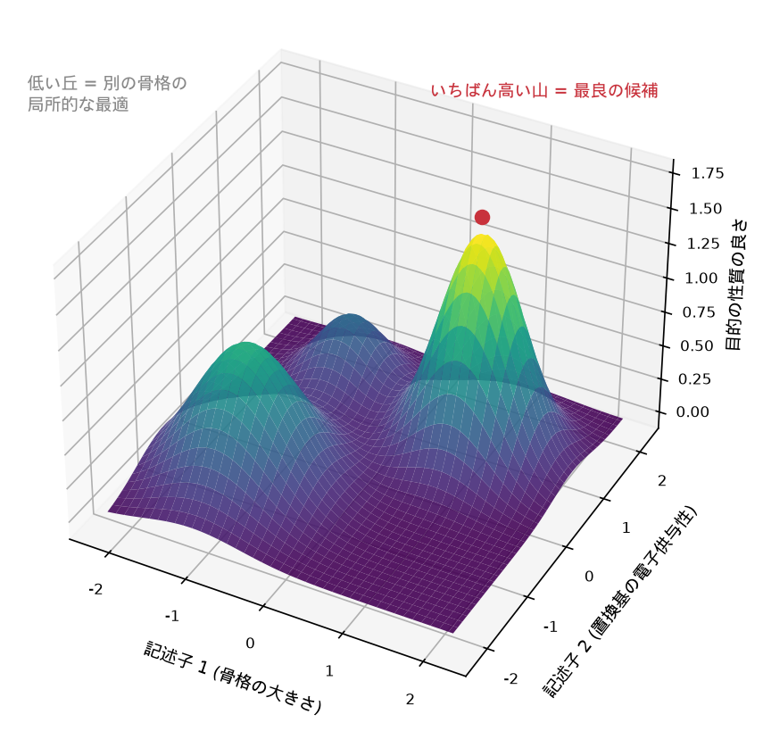

**図 6**　2 つの記述子を軸にした、目的関数の地形の模式図です。高いところほど良い分子です。山が 1 つではなく、低い丘がいくつもあるところが大事です。丘の 1 つに登りきってしまうと、そこより良い山があっても気づけません。これが、探索の方法を工夫する理由です。

### この界隈の常識

- 記述子は「計算が速く、実験値とよく相関し、意味が分かる」ものが良い記述子です。3 つを同時に満たすものはめったにありません。
- 記述子と実験値の相関は、だいたい同じ骨格の中でしか成り立ちません。骨格をまたぐと崩れることがよくあります。
- 垂直励起エネルギー（構造を変えずに励起したときのエネルギー）と、実際の発光波長は別物です。比べるときは、どちらの量かをはっきりさせます。
- 汎関数の選び方で励起エネルギーは簡単に 0.3 eV ほど動きます。電荷移動を含む励起には、長距離補正を入れた汎関数（CAM-B3LYP など）が使われます [Yanai 2004]。

## 5. 有機エレクトロニクスと発光材料

この分野で成果が見えやすいのが、有機 EL（OLED）の材料です。
ここでは、計算で候補を選び、実際に合成して確かめた研究を 3 つ紹介します。

### 5.1 近赤外で光るホウ素入りの分子を選び出す

Hattori らは、ペリレンという平らな芳香族分子の骨格にホウ素 2 個とチオフェン環 2 個を組み込んだ分子を考えました [Hattori 2024]。
ホウ素を 2 個入れると、もとの分子から電子を 2 個抜いた状態と同じ電子数になり、電子状態が大きく変わります。
この考え方で作れる構造を網羅的に生成すると、約 2500 個になりました。
著者らはその全部を TDDFT で計算し、垂直励起エネルギー、遷移双極子モーメント、結合あたりの原子化エネルギーの 3 つで候補を選びました。
選ばれた候補の 1 つを実際に合成したところ、トルエン中で 724 nm（近赤外）に発光し、発光量子収率は 0.40 でした。

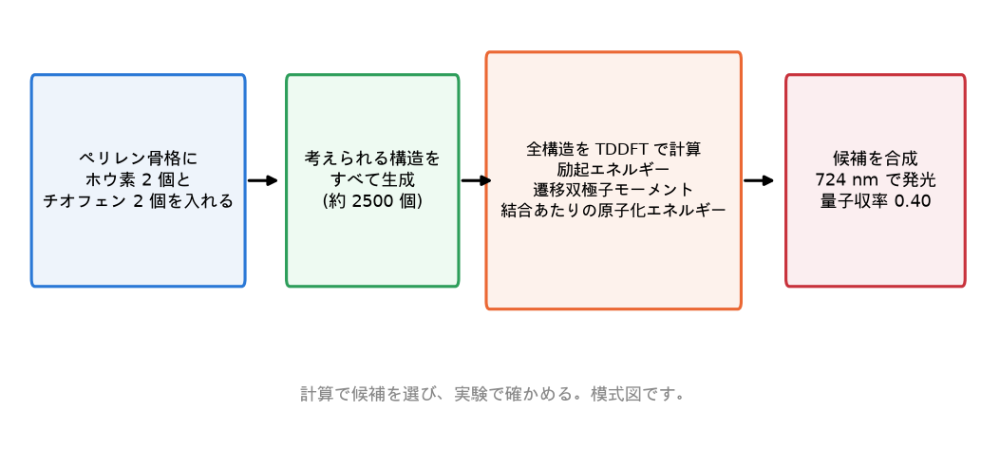

**図 7**　Hattori らの研究の流れ（模式図）です。数値は論文の報告値です [Hattori 2024]。全候補を TDDFT で計算してしまえる規模（約 2500 個）なら、機械学習を使わずに力づくで計算する選択もあります。

### 5.2 機械学習で青色の TADF 発光体を見つける

TADF（熱活性化遅延蛍光）は、三重項の励起子を熱の力で一重項に戻し、蛍光として取り出す仕組みです [Uoyama 2012]。
三重項は本来光らずに捨てられるので、これを使えるようにすると効率が上がります。
鍵になるのは S1-T1 ギャップで、小さいほど逆項間交差（三重項から一重項に戻る過程）が速くなります。
ただし、実際の速度はギャップだけでは決まりません。
Hagai らは 121 個の多重共鳴型 TADF 分子を調べ、スピン軌道相互作用と振動の効果を合わせて扱わないと逆項間交差の速度定数が合わないことを示しました [Hagai 2024]。

その後、同じグループは青色の TADF 発光体をスクリーニングで探しました [Hagai 2026]。
手順は次のとおりです。

1. ホウ素を使わず、炭素・水素・窒素だけからなる 13 環の骨格を列挙し、19 518 個の候補を作る。
2. そのうち約 1000 個を量子化学で計算し、発光エネルギーと S1-T1 ギャップを求める。
3. その値でグラフニューラルネットワークを学習させ、3 次元構造を用意できた 17 000 個あまりに予測を広げる。
4. 上位の約 50 個を高いレベルの計算で確かめ、合成のしやすさも考えて 2 個を選ぶ。
5. 合成すると、半値全幅 17〜19 nm という非常に狭い深青色の発光を示した。実験的な S1-T1 ギャップは 0.13〜0.19 eV。素子にしたときの電界発光は 456 nm と 481 nm で、外部量子効率は最大 35.2 % に達した。

この研究では、予測を全体に広げたことで、発光エネルギーと S1-T1 ギャップの間に強い負の相関（相関係数 −0.75）があることも見えました。
つまり、青いほどギャップが小さい傾向があり、小さなギャップの候補は青色の領域に多く含まれる、ということです。

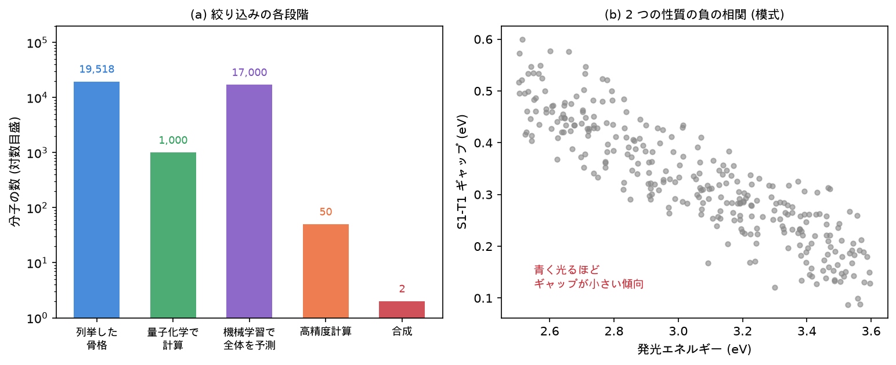

**図 8**　(a) Hagai らの研究で、各段階に残った分子の数です（論文の報告値から作図）[Hagai 2026]。縦軸は対数目盛です。3 番目の棒は「計算した数」ではなく「機械学習で予測した数」で、ここだけ数が増えるのが機械学習を使う利点です。(b) 発光エネルギーと S1-T1 ギャップの負の相関の模式図（乱数で作図、実データではありません）。

### 5.3 正孔輸送材料を炭化水素で作る

発光体だけでなく、電荷を運ぶ層の材料も重要です。
正孔輸送材料には、長くトリアリールアミン（窒素を含む分子）が使われてきました。
Morinaka らは、平らでないナノグラフェンである HBT（hexabenzo[a,c,fg,j,l,op]tetracene）が、炭素と水素だけでできているのに、トリアリールアミンに匹敵する正孔輸送材料になることを報告しました [Morinaka 2024]。
X 線構造解析と量子化学計算を組み合わせ、分子が複数の方向に軌道の相互作用（移動積分）を持つことを示しています。
また、ねじれた骨格のおかげで固体膜が結晶化しにくく、素子の寿命が長くなることも報告されました。

### 5.4 もっと大きな規模のスクリーニング

大規模スクリーニングの草分けが、Harvard Clean Energy Project です [Hachmann 2011]。
有機太陽電池の材料を目標に、世界中の計算機の空き時間を借りて計算を回し、230 万個の分子骨格について 1 億 5000 万回の DFT 計算を行いました [Hachmann 2014]。

有機 EL では、Gómez-Bombarelli らの研究が代表例です [Gómez-Bombarelli 2016]。
160 万個の候補のうち 40 万個あまりを TDDFT で計算し、機械学習で順位づけしてから候補を選びました。
選ばれた分子を合成して素子にしたところ、外部量子効率は最大 22 % でした。

### この界隈の常識

- 計算で選んだ候補を合成してもらえるかどうかは、共同研究の相手が「作れる」と思うかどうかで決まります。合成しやすさは、精度と同じくらい大事な判断材料です。
- 「計算で何万個を調べた」という数字そのものには意味がありません。見るべきは、最後に合成した分子が良かったかどうかです。
- 有機 EL の性能は、分子単体ではなく素子（膜の作り方、層の構成、添加物）でも決まります。分子の計算だけで素子の効率は予測できません。
- 外部量子効率（EQE）は、素子に流した電子 1 個あたり、外に出てくる光子の数の割合です。蛍光材料では理論上の上限がおよそ 5 % とされ、TADF はこの上限を超えるための仕組みです。

## 6. ベイズ最適化、能動学習、生成モデル

### 6.1 全部計算しないで済ませる

候補が 100 万個あると、全部を DFT で計算するのは現実的ではありません。
そこで、「計算した分だけ賢くなる」仕組みを入れます。

**能動学習**（active learning）は、次の繰り返しです。

1. 少数の分子を計算して、機械学習モデルを作る。
2. モデルで残り全部を予測し、予測と不確かさを得る。
3. 「良さそうなもの」と「分からないもの」を選んで、次に計算する。
4. 計算結果をデータに足して、モデルを作り直す。

**ベイズ最適化**（Bayesian optimization）は、この選び方を数式にしたものです。
予測値と不確かさを合わせた獲得関数（acquisition function）を作り、それが最大の分子を次に計算します。

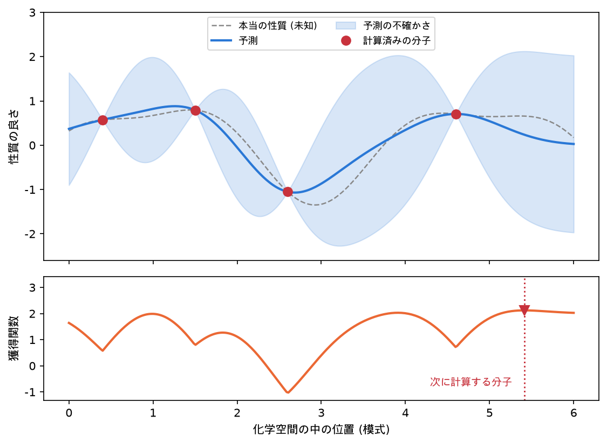

**図 9**　ベイズ最適化の模式図です。上は、4 個だけ計算した時点でのモデルの予測（青の線）と不確かさ（薄い青の帯）、灰色の破線が本当の性質です。下は獲得関数で、その最大の位置（赤い点線）が次に計算する分子です。計算済みの点の近くでは不確かさが小さく、遠い場所では大きくなるので、「良さそうな場所」と「まだ見ていない場所」の両方が候補になります。

Graff らは、この考え方を仮想スクリーニングに当てはめ、候補全体のごく一部だけを計算して、上位の分子の大半を見つけられることを示しました [Graff 2021]。
反応条件の最適化でも同じ考え方が使われ、ベイズ最適化が熟練した化学者より良い条件に早くたどり着いた例が報告されています [Shields 2021]。

### 6.2 複数の目的をどう釣り合わせるか

実際の注文は、たいてい 1 つではありません。
「長波長で、しかも強く光る」のように、たがいに引っ張り合う条件が並びます。
このとき使うのが**パレート最前線**（Pareto front）の考え方です。
「ほかのどの候補にも、すべての目的で負けていない」候補を集めたものが、パレート最前線です。

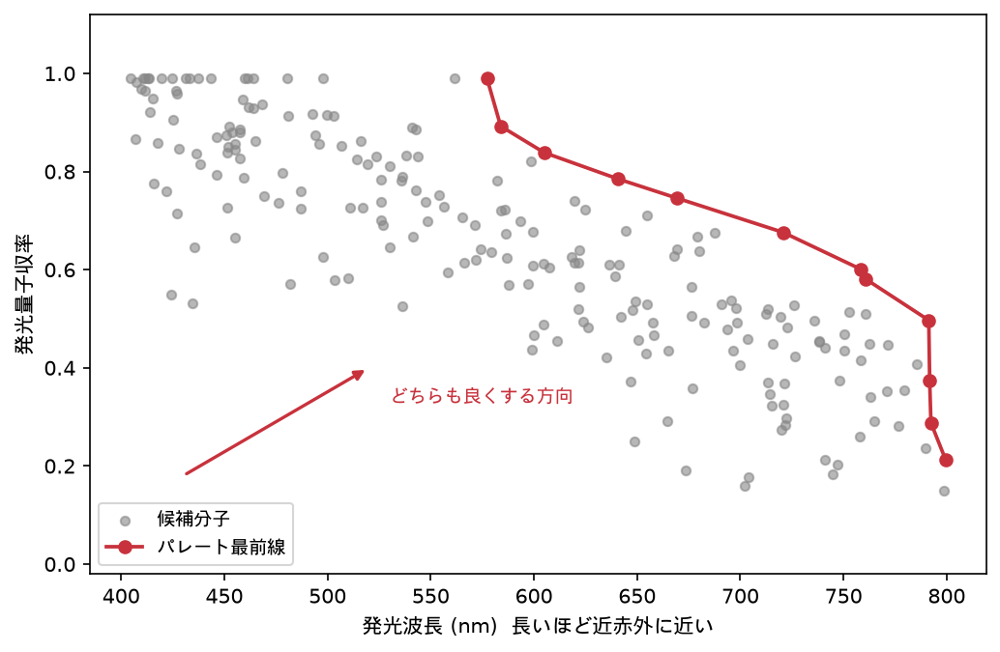

**図 10**　2 つの目的（発光波長と発光量子収率）のパレート最前線の模式図です（乱数で作図）。赤い線の上の分子は、「波長を伸ばすには収率をあきらめ、収率を上げるには波長をあきらめる」という関係にあります。どれを選ぶかは、最後は用途が決めます。

### 6.3 生成モデル

ここまでは「既にある候補の中から選ぶ」方法でした。
これに対し、**生成モデル**は新しい分子を作り出します。
Gómez-Bombarelli らは、分子を連続的なベクトルに変換する自己符号化器（オートエンコーダ）を学習させ、ベクトル空間の上で性質を最適化してから分子に戻す方法を提案しました [Gómez-Bombarelli 2018]。
最近は、拡散モデルや大規模言語モデルを使う方法も次々に出ていますが、「出てきた分子が本当に合成できるか」は今も課題です。

### この界隈の常識

- 能動学習とベイズ最適化は、本質的に同じ道具です。探索（まだ見ていない場所を見る）と活用（良さそうな場所を深く見る）の釣り合いを取っています。
- モデルの不確かさの見積もりは、当てにならないこともあります。アンサンブル（複数のモデルの食い違い）で測るのが実務的な方法です。
- 生成モデルが出した分子は、まず合成のしやすさでふるいます。そこで大半が落ちます。
- この話題は、機械学習の講義ノート [第 10 回](../courses/ml-basics/10-uncertainty-active-learning.md) と内容が重なります。

## 7. ハイスループット計算の常識

### 7.1 手順を機械に任せる

分子 1 個の計算は簡単でも、1 万個になると話が変わります。
入力を作り、投入し、失敗を見つけ、やり直し、結果を集める、という作業を人手でやるのは無理です。
そのため、この分野では**ワークフロー**（計算の手順を自動で回す仕組み）を組むことが仕事の半分を占めます。

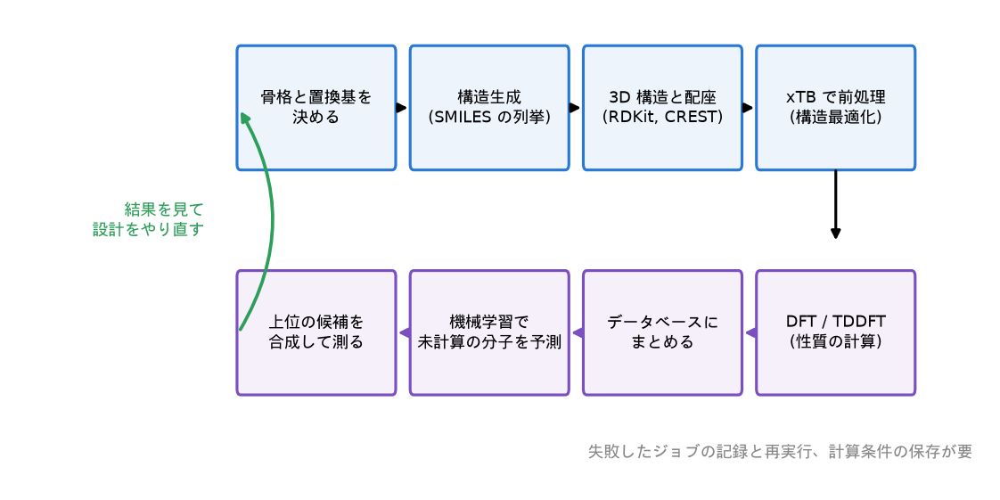

**図 11**　ハイスループット計算の流れの模式図です。上の段が構造の準備、下の段が計算と学習です。緑の矢印のように、結果を見て設計をやり直す輪が回ります。失敗したジョブの記録、計算条件の保存、同じ分子を二度計算しない仕組みが欠かせません。

### 7.2 やってみると分かること

- **構造最適化が一番よく失敗します。** 収束しない、思ってもみない構造に落ちる、といった失敗が数 % の割合で出ます。失敗を自動で見つけて記録しないと、あとで数が合わなくなります。
- **配座の扱いで結果が変わります。** 柔らかい分子では、どの配座を選んだかで励起エネルギーが 0.1 eV 以上動くことがあります。
- **半経験的方法は、構造を作るのに使い、エネルギーの比較には使わない**のが無難です。GFN2-xTB は構造の生成には十分な精度があります [Bannwarth 2019]。
- **計算条件を必ず残します。** 汎関数、基底関数、溶媒モデル、プログラムの版を記録していないと、半年後に自分の結果を再現できません。

### この界隈の常識

- 1 分子あたりの計算時間 × 候補数が、そのまま必要な計算機の時間になります。設計の最初に見積もります。
- 同じ精度なら、速いほうが正義です。ただし「速いが順位がでたらめ」な方法は使えません。
- データの管理（どの分子をどの条件で計算したか）が、研究の寿命を決めます。

## この分野でよく出てくる言葉

| 言葉 | 意味 |
|---|---|
| 仮想スクリーニング | 合成する前に、計算で候補をふるい分けること |
| 化学空間 | 分子を記述子の組で表したときの、点の集まりとしての空間 |
| 記述子 | 分子を数で表したもの。計算で求める量や、構造から数える量 |
| ハイスループット計算 | たくさんの分子を自動で計算すること |
| SMILES | 分子を 1 行の文字列で表す書き方 |
| 配座 | 結合を回したときにできる、分子の形のちがい |
| 目的関数 | 「良さ」を 1 つの数で表した式。これを最大（最小）にする |
| パレート最前線 | 複数の目的のどれでも負けていない候補の集まり |
| 能動学習 | 次に計算する分子をモデル自身に選ばせる進め方 |
| 獲得関数 | ベイズ最適化で、次に調べる点を決める式 |
| 再配置エネルギー | 電荷が出入りしたときの、構造の変化に伴うエネルギー |
| 移動積分 | 隣り合う分子の軌道の重なりを表す量 |
| TADF | 熱活性化遅延蛍光。三重項を熱で一重項に戻して光らせる仕組み |
| 外部量子効率 | 流した電子 1 個あたりに外へ出る光子の数の割合 |
| 半値全幅 | 発光の山の、高さが半分になるところの幅。小さいほど色が純粋 |

## この分野の常識：まとめ

1. スクリーニングは漏斗です。安い計算で数をこなし、高い計算は少数に使います。
2. 化学空間は 1060 と見積もられるほど広く、全部を計算することは原理的に不可能です。
3. 公開データベースは化学空間の代表ではありません。作りやすい分子に偏っています。
4. ほしい性質は、必ず計算できる記述子に翻訳します。翻訳の良し悪しが結果を決めます。
5. 記述子と実験値の相関は、骨格をまたぐと崩れることがよくあります。
6. 速い計算に求めるのは絶対値ではなく、順位の正しさです。
7. 目的はたいてい複数あり、パレート最前線で釣り合いを見ます。
8. 能動学習とベイズ最適化で、計算する分子の数を大きく減らせます。
9. 生成モデルの出力は、合成のしやすさでふるうまでは候補とは呼べません。
10. 最後に合成して測るまで、スクリーニングは完成しません。実験との共同研究が前提の分野です。
11. ワークフローとデータの管理は、計算手法と同じくらい研究の質を左右します。

## 最初に読むとよい文献

- 有機半導体の電荷輸送の総説 [Coropceanu 2007]：再配置エネルギーと移動積分の考え方が、ていねいに説明されています。
- 機械学習と材料科学の総説 [Butler 2018]：この分野で機械学習が何に使われているかを、広く見渡せます。
- 大規模スクリーニングの最初期の例 [Hachmann 2011]：計算資源の使い方まで含めて、規模の感覚がつかめます。
- 計算と実験をつないだ有機 EL の研究 [Gómez-Bombarelli 2016]：スクリーニングから合成、素子までの一通りが 1 本に入っています。
- TADF の最初の報告 [Uoyama 2012]：この分野の目標を決めた論文です。

## 講義ノートとの関係

- 励起状態の計算の基礎：[量子化学の理論 第 19 回　TDDFT](../courses/qc-theory/19-tddft.md)
- 汎関数の選び方：[量子化学の理論 第 16 回　汎関数](../courses/qc-theory/16-functionals.md)
- 記述子の作り方：[機械学習と量子化学 第 2 回　記述子](../courses/ml-chem/02-descriptors.md)
- データセットの読み方：[機械学習と量子化学 第 6 回　データセット](../courses/ml-chem/06-datasets.md)
- 不確かさと能動学習：[機械学習の基礎 第 10 回　不確かさと能動学習](../courses/ml-basics/10-uncertainty-active-learning.md)
- 計算の進め方：[計算化学プログラム 第 1 回　計算の流れ](../courses/packages/01-workflow.md)

## 参考文献

- C. Bannwarth, S. Ehlert, S. Grimme, "GFN2-xTB—An Accurate and Broadly Parametrized Self-Consistent Tight-Binding Quantum Chemical Method with Multipole Electrostatics and Density-Dependent Dispersion Contributions", J. Chem. Theory Comput. 15, 1652-1671 (2019). DOI: [10.1021/acs.jctc.8b01176](https://doi.org/10.1021/acs.jctc.8b01176)
- K. T. Butler, D. W. Davies, H. Cartwright, O. Isayev, A. Walsh, "Machine learning for molecular and materials science", Nature 559, 547-555 (2018). DOI: [10.1038/s41586-018-0337-2](https://doi.org/10.1038/s41586-018-0337-2)
- V. Coropceanu, J. Cornil, D. A. da Silva Filho, Y. Olivier, R. Silbey, J.-L. Brédas, "Charge Transport in Organic Semiconductors", Chem. Rev. 107, 926-952 (2007). DOI: [10.1021/cr050140x](https://doi.org/10.1021/cr050140x)
- R. Gómez-Bombarelli, J. Aguilera-Iparraguirre, T. D. Hirzel, D. Duvenaud, D. Maclaurin, M. A. Blood-Forsythe, H. S. Chae, M. Einzinger, D.-G. Ha, T. Wu, G. Markopoulos, S. Jeon, H. Kang, H. Miyazaki, "Design of efficient molecular organic light-emitting diodes by a high-throughput virtual screening and experimental approach", Nat. Mater. 15, 1120-1127 (2016). DOI: [10.1038/nmat4717](https://doi.org/10.1038/nmat4717)
- R. Gómez-Bombarelli, J. N. Wei, D. Duvenaud, J. M. Hernández-Lobato, B. Sánchez-Lengeling, D. Sheberla, J. Aguilera-Iparraguirre, T. D. Hirzel, R. P. Adams, A. Aspuru-Guzik, "Automatic Chemical Design Using a Data-Driven Continuous Representation of Molecules", ACS Cent. Sci. 4, 268-276 (2018). DOI: [10.1021/acscentsci.7b00572](https://doi.org/10.1021/acscentsci.7b00572)
- D. E. Graff, E. I. Shakhnovich, C. W. Coley, "Accelerating high-throughput virtual screening through molecular pool-based active learning", Chem. Sci. 12, 7866-7881 (2021). DOI: [10.1039/D0SC06805E](https://doi.org/10.1039/D0SC06805E)
- J. Hachmann, R. Olivares-Amaya, S. Atahan-Evrenk, C. Amador-Bedolla, R. S. Sánchez-Carrera, A. Gold-Parker, L. Vogt, A. M. Brockway, A. Aspuru-Guzik, "The Harvard Clean Energy Project: Large-Scale Computational Screening and Design of Organic Photovoltaics on the World Community Grid", J. Phys. Chem. Lett. 2, 2241-2251 (2011). DOI: [10.1021/jz200866s](https://doi.org/10.1021/jz200866s)
- J. Hachmann, R. Olivares-Amaya, A. Jinich, A. L. Appleton, M. A. Blood-Forsythe, L. R. Seress, C. Román-Salgado, K. Trepte, S. Atahan-Evrenk, S. Er, S. Shrestha, R. Mondal, A. Sokolov, Z. Bao, A. Aspuru-Guzik, "Lead candidates for high-performance organic photovoltaics from high-throughput quantum chemistry – the Harvard Clean Energy Project", Energy Environ. Sci. 7, 698-704 (2014). DOI: [10.1039/C3EE42756K](https://doi.org/10.1039/C3EE42756K)
- M. Hagai, N. Inai, T. Yasuda, K. J. Fujimoto, T. Yanai, "Extended theoretical modeling of reverse intersystem crossing for thermally activated delayed fluorescence materials", Sci. Adv. 10, eadk3219 (2024). DOI: [10.1126/sciadv.adk3219](https://doi.org/10.1126/sciadv.adk3219)
- M. Hagai, J. Sun, J. Lee, K. J. Fujimoto, S. Yamaguchi, T. Yasuda, T. Yanai, "Machine-Learning-Guided Discovery of Boron-Free Narrowband Blue Thermally Activated Delayed Fluorescence Emitters", Angew. Chem. Int. Ed. 65, e2731055 (2026). DOI: [10.1002/anie.2731055](https://doi.org/10.1002/anie.2731055)
- I. Hattori, M. Hagai, M. Ito, M. Sakai, H. Narita, K. J. Fujimoto, T. Yanai, S. Yamaguchi, "In Silico Screening and Experimental Verification of Near-Infrared-Emissive Two-Boron-Doped Polycyclic Aromatic Hydrocarbons", Angew. Chem. Int. Ed. 63, e202403829 (2024). DOI: [10.1002/anie.202403829](https://doi.org/10.1002/anie.202403829)
- J. J. Irwin, K. G. Tang, J. Young, C. Dandarchuluun, B. R. Wong, M. Khurelbaatar, Y. S. Moroz, J. Mayfield, R. A. Sayle, "ZINC20—A Free Ultralarge-Scale Chemical Database for Ligand Discovery", J. Chem. Inf. Model. 60, 6065-6073 (2020). DOI: [10.1021/acs.jcim.0c00675](https://doi.org/10.1021/acs.jcim.0c00675)
- S. Kim, J. Chen, T. Cheng, A. Gindulyte, J. He, S. He, Q. Li, B. A. Shoemaker, P. A. Thiessen, B. Yu, L. Zaslavsky, J. Zhang, E. E. Bolton, "PubChem 2023 update", Nucleic Acids Res. 51, D1373-D1380 (2022). DOI: [10.1093/nar/gkac956](https://doi.org/10.1093/nar/gkac956)
- Y. Morinaka, H. Ito, K. J. Fujimoto, T. Yanai, Y. Ono, T. Tanaka, K. Itami, "Nonplanar Nanographene: A Hydrocarbon Hole-Transporting Material That Competes with Triarylamines", Angew. Chem. Int. Ed. 63, e202409619 (2024). DOI: [10.1002/anie.202409619](https://doi.org/10.1002/anie.202409619)
- N. Noto, A. Yada, T. Yanai, S. Saito, "Machine-Learning Classification for the Prediction of Catalytic Activity of Organic Photosensitizers in the Nickel(II)-Salt-Induced Synthesis of Phenols", Angew. Chem. Int. Ed. 62, e202219107 (2023). DOI: [10.1002/anie.202219107](https://doi.org/10.1002/anie.202219107)
- R. Ramakrishnan, P. O. Dral, M. Rupp, O. A. von Lilienfeld, "Quantum chemistry structures and properties of 134 kilo molecules", Sci. Data 1, 140022 (2014). DOI: [10.1038/sdata.2014.22](https://doi.org/10.1038/sdata.2014.22)
- L. Ruddigkeit, R. van Deursen, L. C. Blum, J.-L. Reymond, "Enumeration of 166 Billion Organic Small Molecules in the Chemical Universe Database GDB-17", J. Chem. Inf. Model. 52, 2864-2875 (2012). DOI: [10.1021/ci300415d](https://doi.org/10.1021/ci300415d)
- B. J. Shields, J. Stevens, J. Li, M. Parasram, F. Damani, J. I. M. Alvarado, J. M. Janey, R. P. Adams, A. G. Doyle, "Bayesian reaction optimization as a tool for chemical synthesis", Nature 590, 89-96 (2021). DOI: [10.1038/s41586-021-03213-y](https://doi.org/10.1038/s41586-021-03213-y)
- H. Uoyama, K. Goushi, K. Shizu, H. Nomura, C. Adachi, "Highly efficient organic light-emitting diodes from delayed fluorescence", Nature 492, 234-238 (2012). DOI: [10.1038/nature11687](https://doi.org/10.1038/nature11687)
- T. Yanai, D. P. Tew, N. C. Handy, "A new hybrid exchange-correlation functional using the Coulomb-attenuating method (CAM-B3LYP)", Chem. Phys. Lett. 393, 51-57 (2004). DOI: [10.1016/j.cplett.2004.06.011](https://doi.org/10.1016/j.cplett.2004.06.011)

## 関連リンク

- RDKit（分子の生成と操作のための公開ライブラリ）：<https://www.rdkit.org/>
- xtb（GFN-xTB の公式実装）：<https://xtb-docs.readthedocs.io/>
- PubChem：<https://pubchem.ncbi.nlm.nih.gov/>
