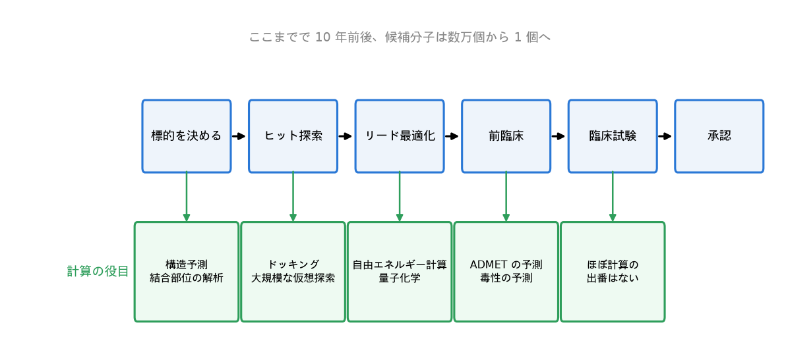
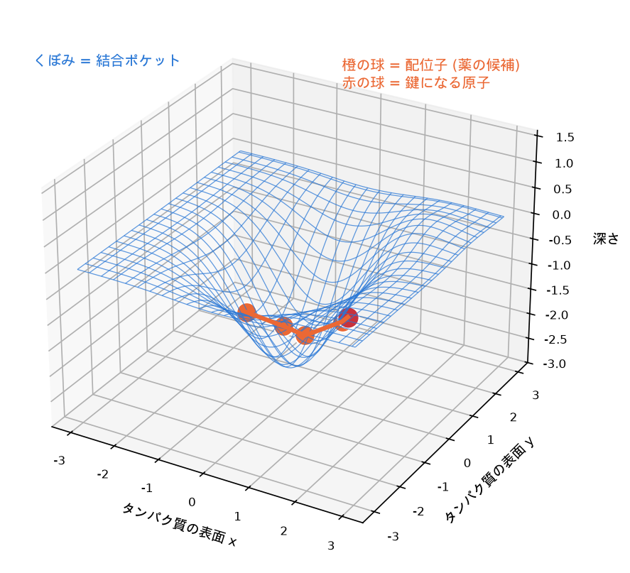
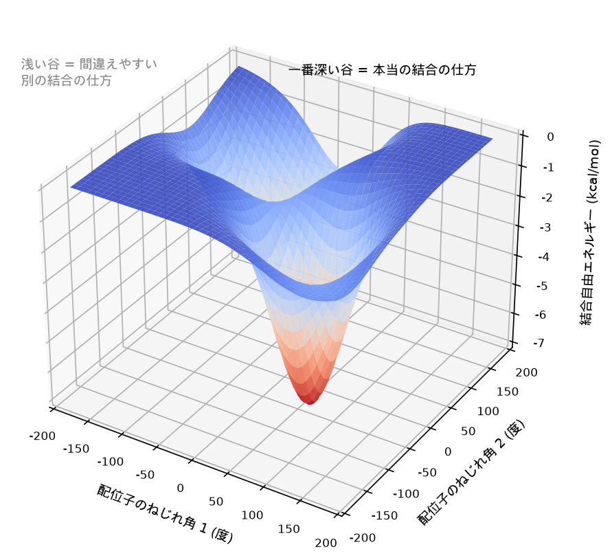
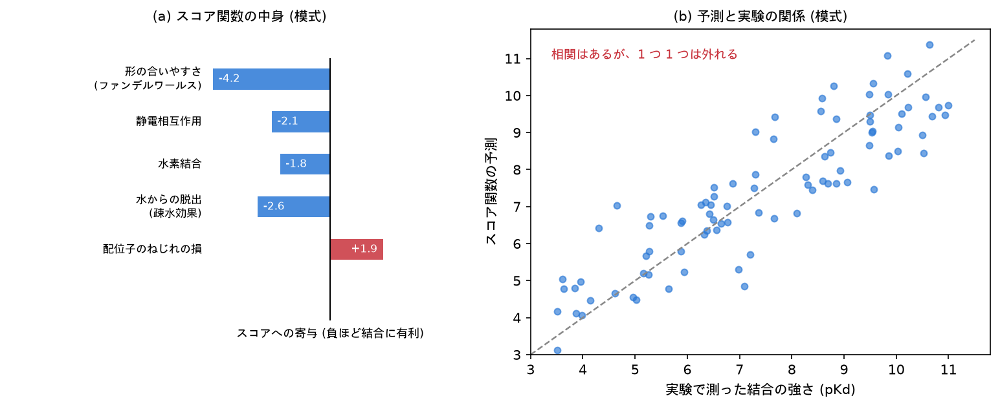
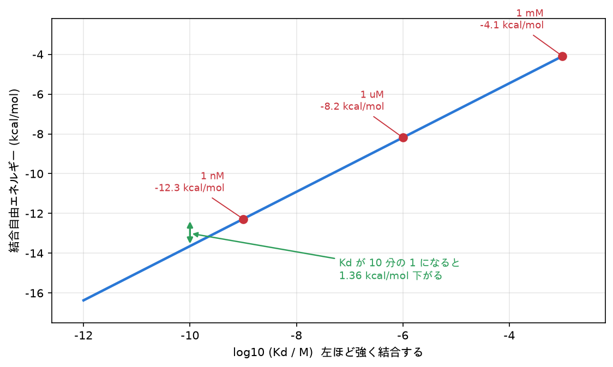
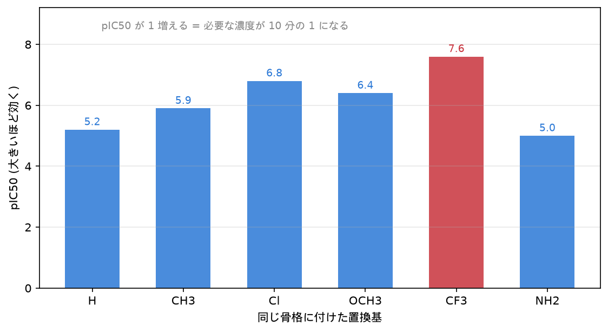
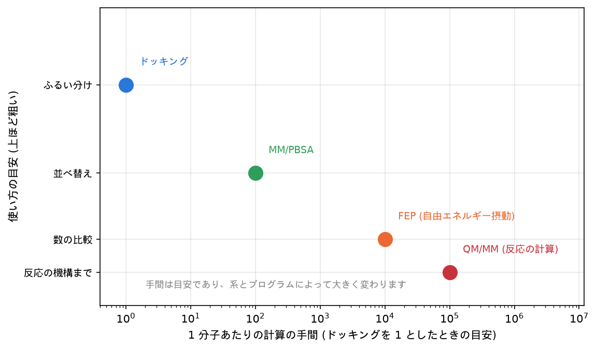
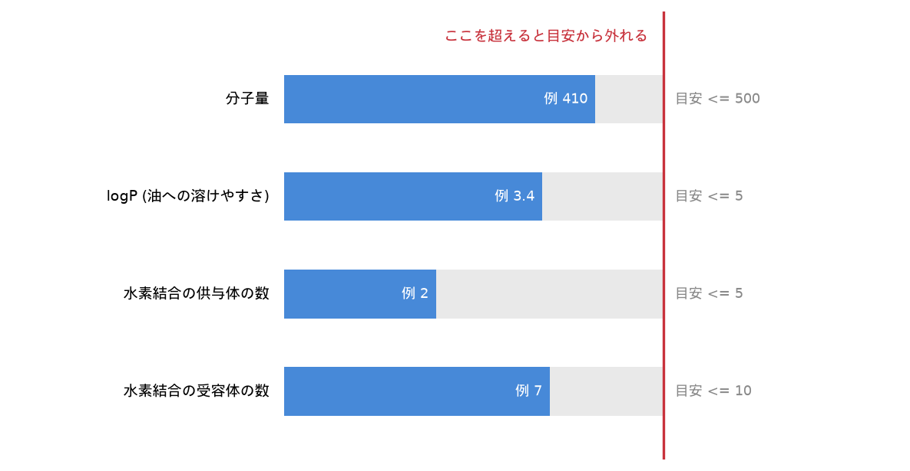

# 創薬と製薬：薬の候補を計算で探す研究

!!! abstract "このページで分かること"
    薬は、病気に関わるタンパク質に結びついて、その働きを止めたり助けたりする分子です。
    この分野では、どの分子がどれくらい強く結びつくかを計算で予測し、合成して試す分子を絞り込みます。
    ドッキングから自由エネルギー計算、量子化学まで、手間と正確さの違う道具をどう使い分けるのかを紹介します。

    | 節 | 内容 |
    |---|---|
    | 1 | この分野が答えようとしている問い |
    | 2 | 標的と結合ポケット |
    | 3 | ドッキングとスコア関数 |
    | 4 | 結合の強さをどう表すか |
    | 5 | 分子動力学と結合自由エネルギー |
    | 6 | 量子化学の役割：共有結合する薬 |
    | 7 | ADMET と薬らしさ |

!!! tip "ひとことで言うと"
    鍵と鍵穴の話です。
    病気に関わるタンパク質が鍵穴、薬の候補が鍵で、計算は「この鍵は、この鍵穴にどれくらいぴったり入るか」を見積もります。
    ただし、本物の鍵穴は固い金属ではなく、水に浸かった柔らかいゼリーのようなもので、形を変えます。
    しかも、鍵が入ったときに追い出される水の分子まで数に入れる必要があります。
    この「柔らかさ」と「水」が、計算を難しくしている正体です。

## 1. この分野が答えようとしている問い

新しい薬が世に出るまでには、長い時間とお金がかかります。
DiMasi らの推計では、承認された新薬 1 つあたりの自己負担の研究開発費は平均 13.95 億ドル（2013 年のドル）で、承認後の研究開発費まで含めると 28.70 億ドルになります [DiMasi 2016]。
しかも、臨床試験に進んだ候補の多くは途中で脱落します。

この分野の計算は、「実験でしか分からないことを計算で減らす」ことを目指しています。
具体的には、次の問いです。

- **どの分子が結びつくか**：何百万、何億という候補のうち、どれが標的に結合しそうか。
- **どんな形で結びつくか**：ポケットの中で、分子はどの向きでどう収まるか。
- **どれくらい強く結びつくか**：結合の強さを、実験と比べられる数で出せるか。
- **どうやって効くか**：結合するだけか、化学反応まで起こすか。その機構は何か。
- **薬として成り立つか**：吸収され、代謝されすぎず、毒性がないか。

**図 1**　創薬の流れ（模式図）と、各段階での計算の役目です。計算が強いのは左側（標的からリード最適化まで）で、右に行くほど実験と臨床の比重が大きくなります。

## 2. 標的と結合ポケット

### 2.1 標的とポケット

薬の標的は、たいていタンパク質です。
酵素（化学反応を進める働きを持つタンパク質）や、受容体（signal を受け取るタンパク質）が代表です。
タンパク質の表面にはくぼみがあり、そこに小さな分子がはまります。
このくぼみを**結合ポケット**、はまる分子を**配位子**（リガンド、ligand）と呼びます。

薬が効く仕組みは、たいてい次のどれかです。

- ポケットをふさいで、本来の基質が入れないようにする（阻害剤）。
- 受容体にはまって、信号を出させる（作動薬）または出させない（拮抗薬）。

**図 2**　タンパク質の表面と結合ポケットの模式図です。青い網がタンパク質の表面、くぼみが結合ポケット、橙の球が配位子（薬の候補）、赤い球が結合の鍵になる原子です。実際のポケットはこんなに滑らかではなく、側鎖がでこぼこし、水の分子が詰まっています。

タンパク質の構造は、X 線結晶構造解析やクライオ電子顕微鏡で調べます。
構造が得られない場合は、予測を使います。
AlphaFold の登場で、配列だけから実験に近い精度の構造が得られる場合が増えました [Jumper 2021]。
ただし、予測構造は側鎖の向きが実際と違うことがあり、ドッキングにそのまま使うと結果が悪くなることもあります。

### 2.2 計算が解いている問題

配位子がポケットに入る向きは 1 通りではありません。
位置、向き、分子のねじれ方を変えると、無数の「入り方」ができます。
計算は、その中から一番安定な入り方を探します。

**図 3**　配位子の 2 つのねじれ角を軸にした、結合自由エネルギーの地形の模式図です。谷が深いほど安定な入り方です。谷がいくつもあるので、浅い谷に落ち込んで「これが答えだ」と間違えることがあります。実際の探索は、ねじれ角だけでなく位置と向きも含めた、もっと高い次元の空間で行われます。

### この界隈の常識

- 標的が決まっていない段階では、計算はほとんど役に立ちません。ここで紹介する方法はどれも「このタンパク質のこのポケットに、どの分子がはまるか」を問う形をしていて、相手が決まらないと問いが立たないからです。まず「どのタンパク質を狙うか」が勝負です。
- 構造が 1 つあれば十分、ということはありません。ポケットは配位子に合わせて形を変えるからです（誘導適合）。ある配位子と一緒に結晶化した構造は、その配位子に合わせた形になっているので、別の配位子を入れるとうまく入らないことがあります。対策として、複数の結晶構造を使うか、MD で動かした構造を何通りか使います。
- ポケットの中の水は、追い出されると自由になり、結合を助けます。ポケットの中では、水は狭い場所に閉じ込められて動きが制限されているからです。そこから出て自由になることで得をします。ただし、タンパク質と良い水素結合を作っている水を追い出す場合は、逆に損をします。どちらになるかは水の 1 個ごとに違うので、水を一律に無視すると予測は外れます。

## 3. ドッキングとスコア関数

### 3.1 ドッキングとは

**ドッキング**（docking）は、配位子をポケットに入れる向きと形を探し、それぞれに点数（スコア）をつける計算です。
2 つの部分からできています。

1. **探索**：入り方（位置、向き、ねじれ角）を変えながら、候補となる配置を作る。
2. **採点**：各配置の「結合の良さ」をスコア関数で数にする。

スコア関数は、物理に基づく項（ファンデルワールス相互作用、静電相互作用、水素結合、疎水効果）と、経験的な項を組み合わせた式です。
分子力学の力場に近い形をしていますが、速さを優先して大きく単純化されています。
AutoDock Vina のように、経験的な項を実験データに合わせて決めたものが広く使われています [Trott 2010]。

**図 4**　(a) スコア関数の中身の模式図です。青い棒は結合に有利な寄与、赤い棒は不利な寄与です（値は説明のための例であり、特定の系の計算値ではありません）。(b) 予測と実験の関係の模式図です。全体として相関はあるのに、1 つ 1 つを見ると大きく外れる、というのがこの分野の現実です。

### 3.2 ドッキングの限界

!!! question "「ドッキングのスコアは結合の強さではない」と言われるのはなぜ？"
    **そもそもスコアとは**：スコアは、配位子の 1 つの配置に対して、スコア関数という式が返す 1 個の数です。ふつう kcal/mol の単位が付いているので、結合自由エネルギーに見えます。

    **なぜ結合の強さではないのか**：結合自由エネルギーは、本来「自由エネルギー」であって、エネルギーではありません。この違いが鍵です。自由エネルギーには、次の 3 つが入っていなければなりません。

    1. **水の出入り**：ポケットの中にも、配位子のまわりにも水が付いています。結合するには、その水を追い出す必要があります。追い出された水は自由になるので、結合を助ける向きに効くこともあれば、水素結合を失って損をすることもあります。どちらになるかは、ポケットの形と水の数で変わります。
    2. **動きの制限（エントロピー）**：結合すると、配位子は自由に動き回れなくなり、ねじれ角も固定されます。回れる結合が 1 本増えるごとに、結合は不利になります。
    3. **タンパク質の形の変化**：ポケットは、配位子に合わせて形を変えます（誘導適合）。その変形にもエネルギーが要ります。

    ドッキングのスコア関数は、速さのためにこの 3 つをほとんど省いています。水は多くの場合、ポケットから取り除いて計算します。エントロピーは、回れる結合の数に比例する項などで、ごく粗く見積もります。タンパク質は、たいてい固定したままです。つまり、スコアは「形がどれくらいぴったりはまるか」の点数であって、結合自由エネルギーの近似値ではありません。図 4(b) のように、全体の傾向としては相関があるのに、1 つ 1 つでは大きく外れるのは、そのためです。

    **では何に使うのか・どう確かめるか**：ドッキングは、**形を当てる**のと**粗く順位をつける**のに使います。形が当たっているかは、結晶構造が分かっている複合体で、予測した配置と実験の配置のずれ（RMSD）が 2 Å 以内かどうかで測るのが習わしです。順位づけの力は、CASF のようなベンチマークで、項目ごとに分けて測ります（3.3 節）。結合の強さの数字がほしいときは、ドッキングではなく 5 節の自由エネルギー計算に進みます。

### 3.3 スコア関数を良くする研究

ドッキングは、結合の形を当てるのは得意ですが、結合の強さを当てるのは苦手です。
そこで、機械学習でスコア関数を改良する研究が進んでいます。

Fujimoto らは、統計から作った PMF スコア（既知の複合体構造の中で、どの原子の組がどれくらいの距離に現れやすいかを集計したスコア）に、配位子とタンパク質の構造を表すフィンガープリント（構造の特徴を 0 と 1 の並びで表したもの）を記述子として加え、LASSO と LightGBM で回帰しました [Fujimoto 2022]。
テストデータで、予測した結合の強さと実験値のピアソンの相関係数は 0.79 となり、従来のスコア関数を上回りました。
さらに、どの記述子が効いているかを調べ、化学的な意味づけも与えています。

スコア関数の良し悪しは、共通のベンチマークで比べます。
よく使われるのが CASF で、「結合の強さを当てる力」「順位をつける力」「本物を偽物から見分ける力」「正しい配置を選ぶ力」を分けて測ります [Su 2018]。
分けて測るのは、得意不得意が項目によってまったく違うからです。

### 3.4 大規模な仮想探索

ドッキングは 1 分子あたり数秒から数分なので、計算機を並べれば億の単位をさばけます。
Lyu らは、注文して作れる化合物を 1 億個以上ドッキングし、上位の分子を合成して試験しました [Lyu 2019]。
その結果、81 の新しい骨格が見つかり、そのうち 30 個がサブマイクロモル（1 マイクロモル濃度より低い濃度で効く）の活性を示しました。
D4 ドーパミン受容体に対しては、180 pM という非常に強い作動薬も得られています。

### この界隈の常識

- ドッキングのスコアは、結合自由エネルギーの近似値ではありません。水の出入り、エントロピー、タンパク質の変形が入っていないからです（3.2 節）。順位をつけるための点数だと思ってください。
- 同じ化合物でも、プログラムが違えば順位が変わります。スコア関数の項の形も、重みを合わせた実験データも、プログラムごとに違うからです。そこで、複数のプログラムで共通して上位に来るものを選ぶ、という使い方をします。
- 「ドッキングで結合エネルギーを計算した」という表現は、この界隈では歓迎されません。「スコアを求めた」と言います。前者だと、物理的な意味のある量を求めたように聞こえてしまうからです。
- 配位子の形の候補（配座）とプロトン化の状態（どこに水素が付いているか）の準備で、結果が大きく変わります。プロトンが 1 個付くかどうかで電荷が変わり、静電相互作用の項が丸ごと変わるからです。アミンやカルボン酸は、pH 7 付近で状態が変わりやすいので要注意です。
- 見つかった「ヒット」の多くは偽物です。スコアの高い順に並べると、たまたま大きくて表面にべったり接する分子や、計算の都合で点数が高く出る分子が上位に来るからです。実験で確かめるまでは候補にすぎません。

## 4. 結合の強さをどう表すか

### 4.1 Kd、IC50、pIC50、ΔG

結合の強さの表し方はいくつもあり、会話ではごちゃまぜに出てきます。
どれも「どれくらい薄い濃度で効くか」を表していますが、測り方と向きが違います。

| 記号 | 意味 | 小さい・大きいとどちら？ |
|---|---|---|
| Kd（解離定数） | 複合体が半分ほどける濃度 | 小さいほど強い |
| IC50 | 働きを半分に抑えるのに必要な濃度 | 小さいほど強い |
| pIC50 | IC50（モル濃度）の常用対数の符号を変えたもの | 大きいほど強い |
| ΔG（結合自由エネルギー） | 結合に伴う自由エネルギーの変化 | 負に大きいほど強い |

Kd と ΔG は、次の式で結ばれています。

$$
\Delta G = RT \ln K_\mathrm{d}
$$

ここで $R$ は気体定数、$T$ は温度です（Kd は 1 mol/L を単位にした無次元の値として扱います）。
室温（298 K）では $RT$ = 0.593 kcal/mol です。
この式から、**結合の強さが 10 倍になることと、ΔG が 1.36 kcal/mol 下がることは同じ**だと分かります。

**図 5**　Kd と結合自由エネルギーの関係です（298 K で作図）。横軸は Kd の常用対数、縦軸が ΔG です。1 nM の結合は約 −12.3 kcal/mol に当たります。計算で 1 kcal/mol 外すと、結合の強さを 5 倍以上読み違えることになります。

### 4.2 構造活性相関

同じ骨格の分子の一部だけを変えて、効き目がどう変わるかを調べるのが**構造活性相関**（SAR、structure-activity relationship）です。
創薬の現場では、この表を囲んで議論が進みます。

**図 6**　構造活性相関の模式図です（値は説明のための例です）。同じ骨格の 1 か所だけを変えて、pIC50 を比べます。pIC50 が 1 増えることは、必要な濃度が 10 分の 1 になることを意味します。計算に求められているのは、この棒の高さの差（1 kcal/mol 程度の違い）を当てることです。

!!! question "「IC50 ではなく pIC50 で比べる」のはなぜ？"
    **そもそも pIC50 とは**：IC50（モル濃度）の常用対数をとり、符号を変えた値です。IC50 が 1 μM（10−6 mol/L）なら pIC50 は 6、10 nM なら 8 です。1 増えるごとに、必要な濃度が 10 分の 1 になります。

    **なぜ対数にするのか**：理由は 3 つあります。第 1 に、効き目の違いが掛け算で効くからです。候補の IC50 は、10 μM から 1 nM まで 4 桁にわたって散らばります。このまま平均や誤差を計算すると、弱い化合物の 1 μM の差ばかりが目立ち、強い化合物の 10 倍の改良が見えなくなります。対数にすれば、「何倍よくなったか」が同じ幅の差として表れます。第 2 に、自由エネルギーと直線で結ばれるからです。4.1 節の式のとおり、ΔG は結合定数の対数に比例します。pIC50 を 1 上げることは、おおよそ 1.36 kcal/mol の改良にあたります。つまり、pIC50 は計算値と直接比べられる物差しです。第 3 に、向きがそろうからです。IC50 は小さいほど良く、pIC50 は大きいほど良いので、グラフが「上ほど良い」になり、図 6 のように読みやすくなります。

    **どう使うか**：予測の良し悪しも、pIC50 の単位で測ります。「平均絶対誤差 0.5 対数単位」なら、濃度にして約 3 倍の読み違いです。ただし、この換算には注意が要ります。IC50 と Kd は別の量で、両者は基質の濃度に依存する関係で結ばれます。したがって、pIC50 を 1.36 kcal/mol 刻みの自由エネルギーに読み替えてよいのは、同じ測定条件で測った、同じ結合の仕方をする分子どうしを比べるときだけです。

### この界隈の常識

- IC50 は測定条件で変わります。基質と酵素が同じポケットを取り合うので、基質の濃度を上げれば、同じ薬でも効きにくく見えるからです。別の論文の値をそのまま比べてはいけません。
- 「活性が 10 倍上がった」は、エネルギーでいえば 1.36 kcal/mol の違いにすぎません。室温の熱エネルギー（$RT$ = 0.593 kcal/mol）の 2 倍ほどで、計算の誤差に埋もれやすい大きさです。計算にとっては厳しい精度です。
- リード最適化の段階で計算に求められるのは、絶対値ではなく「この置換基とあの置換基、どちらが良いか」の判断です。合成できる分子は限られていて、知りたいのは次に作るべき 1 個だからです。絶対値がそろって外れていても、順番が当たっていれば役に立ちます。

## 5. 分子動力学と結合自由エネルギー

### 5.1 熱力学サイクルで差を取る

!!! question "「ちゃんとやるなら FEP が必要」と言われるのはなぜ？"
    **そもそも自由エネルギーとは**：エネルギーが「1 つの構造の高さ」なのに対し、自由エネルギーは「その状態に入れる構造が何通りあるか」まで含めた量です。実験で測る結合の強さは、後者です。薬が結合するかどうかは、1 つのぴったりの形の深さだけでなく、薬とタンパク質と水が動き回れる自由をどれだけ失うかでも決まるからです。

    **なぜドッキングや 1 点の計算では足りないのか**：ドッキングのスコアは、たった 1 つの配置について式を 1 回評価した数です（3.2 節）。実際には、配位子もタンパク質も水も、室温で絶えず動いています。結合したあとの状態は、数えきれない構造の集まりです。この「何通りあるか」を数えるには、分子動力学（MD）で構造をたくさん集めて平均する必要があります。さらに、水の出入りを正しく扱うには、水の分子を明に置いた計算が要ります。

    **なぜ「差」を計算するのか**：結合自由エネルギーそのものを計算しようとすると、薬をポケットから完全に引き抜いて水の中へ移す過程を追うことになり、途中で水が入れ替わる大きな変化を全部数えなければなりません。計算の誤差も大きくなります。そこで FEP（自由エネルギー摂動）では、よく似た 2 つの配位子 A と B の**差**だけを求めます。図 7 の熱力学サイクルを一周すると自由エネルギーの変化の合計は 0 になるので、測りにくい縦の 2 本（結合そのもの）を計算せずに、その差 ΔΔG が出ます。横の 2 本は「A を B に作りかえる」という、計算機の中だけの小さな変化です。置換基 1 個の違いなら、変わる部分が小さいので、誤差も小さく済みます。

    **どう確かめるか**：第 1 に、同じ計算を逆向き（B から A へ）にも行い、符号を変えた値が一致するかを見ます（ヒステリシス）。第 2 に、A → B → C → A のように輪になる経路を回り、合計が 0 になるかを確かめます（サイクル閉包）。第 3 に、実験値の分かっている分子を何個か混ぜておき、それが当たるかで信頼度を測ります。Wang らの検証では、摂動全体での二乗平均平方根誤差はおよそ 1.1 kcal/mol でした [Wang 2015]。4 節で見たとおり、1.36 kcal/mol が活性 10 倍分なので、これは「10 倍の改良を見分けられるかどうか」という水準です。

結合自由エネルギーをまともに計算するのは大変です。
そこで、**差**だけを計算する工夫が使われます。
それが**自由エネルギー摂動**（FEP、free energy perturbation）です。

考え方は図 7 の熱力学サイクルです。
配位子 A と B の結合の強さの差を知りたいとき、「A を B に作りかえる」という計算機の中だけの変化を 2 回行います。
1 回目は水の中で、2 回目は複合体の中でです。
サイクルを一周すると自由エネルギーの変化の合計は 0 になるので、測りにくい縦の 2 本（結合そのもの）を計算せずに、その差 ΔΔG が求まります。

**図 7**　相対結合自由エネルギーを求める熱力学サイクルです。縦の矢印が実験で測れる結合、横の矢印が計算機の中だけで行う作りかえです。横の 2 本を計算すれば、縦の差 ΔΔG が出ます。

Wang らは、この手法を力場と手順ごと整備し、200 個の配位子を含む系で検証しました [Wang 2015]。
摂動全体での二乗平均平方根誤差はおよそ 1.1 kcal/mol で、実際の創薬プロジェクトに使うと、合成した化合物のうち効かないものの割合が減ったと報告しています。

もっと手軽な方法が **MM/PBSA**（および MM/GBSA）です。
複合体の分子動力学の軌跡を取り、各瞬間の構造について力場のエネルギーと溶媒和自由エネルギーを足し合わせて平均します。
FEP より桁違いに速い代わりに、精度は落ち、系によって当たり外れが大きいことが知られています [Genheden 2015]。

### 5.2 手間と使い道

**図 8**　主な方法の手間と使い道の模式図です。横軸はドッキングを 1 としたときの 1 分子あたりの手間の目安（対数目盛）、縦軸は何に使えるかです。手間は系とプログラムによって大きく変わるので、目安として見てください。

実務では、この 4 つを順に使います。
ドッキングで数百万から数個へ、MM/PBSA で並べ替え、FEP で最終候補を比べ、反応が関わるときだけ量子化学を使う、という流れです。

### この界隈の常識

- FEP で意味のある比較ができるのは、構造がよく似た分子どうしです。横の矢印（A を B に作りかえる変化）が小さいほど誤差が小さいからです。骨格が変わると、作りかえの途中で水やタンパク質の構造が大きく動き、MD の時間内では平均が収束しません。
- 計算が合わない原因の上位は、プロトン化の状態の取り違え、水の扱い、タンパク質の構造変化の 3 つです。どれも「結合の前後で何が入れ替わるか」を決める要素で、間違えると差の取り方そのものがずれます。
- 予測の精度を測るときは、相関係数だけでなく誤差の大きさ（kcal/mol）も見ます。相関係数は、強い分子と弱い分子が広く散らばっているデータほど自動的に良く見えるからです。活性のそろったリード最適化の段階では、相関係数は低く出るのが普通で、それでも誤差が小さければ役に立ちます。
- 予測を盲検（答えを知らずに予測する）で競う催しがあり、その結果が方法の実力の目安になります [Parks 2020]。答えを見てから手順を調整すると、どんな方法でも当たるように見えてしまうからです。

## 6. 量子化学の役割：共有結合する薬

### 6.1 なぜ量子化学が要るのか

ここまでの方法は、結合が「くっつくだけ」であることを前提にしています。
しかし、薬の中には標的と**化学結合を作ってしまう**ものがあります。
これを共有結合阻害剤と呼びます。
いったんは危険視されましたが、今では重要な一群として扱われています [Singh 2011]。

化学結合を作る過程は、電子の組み換えそのものです。
ここで、力場では扱えないという壁にぶつかります。
力場は、結合を「決まった長さで伸び縮みするばね」として書いているからです。
どの原子とどの原子が結合しているかは、計算を始める前に人が決めて表に書き込みます。
ばねは伸ばせば伸ばすほどエネルギーが上がり続けるので、切れません。
新しい結合も、表にない以上はできません。
つまり力場は、原理的に結合の生成・切断を表せない仕組みになっています。
一方、量子化学は電子の分布を解いて求めるので、電子が移れば結合も移ります。
そこで、反応に関わる部分だけを量子化学で扱う方法が使われます。
代表的なのが次の 2 つです。

- **QM/MM**：反応に関わる原子だけを量子化学で、残りを力場で扱う方法です。Warshel と Levitt が酵素反応に適用したのが始まりです [Warshel 1976]。
- **FMO 法**（フラグメント分子軌道法）：タンパク質をアミノ酸残基などの小さなかたまりに分け、1 個ずつと 2 個ずつの組を量子化学で計算して全体を組み立てる方法です [Kitaura 1999], [Fedorov 2007]。どの残基が結合にどれだけ効いているかを、残基ごとの相互作用エネルギーとして出せるのが利点です。

**図 9**　(a) QM/MM では、反応に関わる中心（赤）だけを量子化学で解き、周りは力場で扱います。(b) FMO 法では、系をかたまりに分け、2 個ずつの組で計算します。番号はかたまりの例です。どちらも模式図です。

### 6.2 オシメルチニブが EGFR を止める仕組み

オシメルチニブは、肺がんの治療に使われる薬で、EGFR（上皮成長因子受容体）というタンパク質のシステイン残基（Cys797）と共有結合します [Cross 2014]。
では、その結合はどんな段階を踏んで作られるのでしょうか。

Kondo らは、ONIOM 法による QM/MM 計算でこの反応を調べました [Kondo 2026]。
分かったのは、律速の段階が「疑似協奏的」（pseudoconcerted）であることです。
つまり、(i) Cys797 の S-H からプロトンが外れ、(ii) 生じた硫黄が薬のアクリルアミド基を攻撃し、(iii) 薬自身の末端のアンモニウムがカルボニル酸素にプロトンを渡す、という 3 つが 1 つの遷移状態の中で同時に進みます。
薬が自分でプロトンを供給して反応を進める、という点が新しい指摘です。

**図 10**　オシメルチニブと EGFR の共有結合が作られる過程の自由エネルギー図です。論文の値から作図しました [Kondo 2026]。反応物を 0 とすると、律速の遷移状態 TS1 は 15.2 kcal/mol、中間体は −11.7 kcal/mol、生成物は −21.3 kcal/mol（野生型）です。中間体から生成物までの 2 つ目の遷移状態は、基準の取り方を確かめられなかったので省いています。

同じ論文は、変異型（T790M）のほうが生成物がわずかに安定（−22.0 kcal/mol）になることも示し、その理由を Asp855 との静電的な相互作用の違いに求めています。
そのうえで、「プロトンを渡せるアミンを適切な位置に置く」「Asp855 との接触を強める」といった、次の世代の阻害剤の設計指針を提案しています。

### 6.3 新型コロナウイルスの標的での例

同じ考え方は、ウイルスの標的にも使われました。
ナファモスタットとカモスタットは、どちらも TMPRSS2 というヒトのタンパク質分解酵素のセリン残基と共有結合して、ウイルスの侵入を妨げます。
構造がよく似ているのに、ナファモスタットのほうが強く効きます。

Fujimoto らは、まずドッキングと自由エネルギーの解析で、どの残基が結合に効いているかを調べました [Fujimoto 2022]。
Asp435 が両方の結合に大きく効き、Glu299 はナファモスタットとだけ強く相互作用していました。
ところが、新しく合成した誘導体では、予測した結合の強さと抗ウイルス活性が対応しませんでした。
エステル結合をアミド結合に変えると活性が大きく落ちたことから、効き目を決めているのは結合の強さではなく、共有結合の作りやすさだろう、と結論しています。

この予想を量子化学で確かめたのが、続く研究です [Kondo 2023]。
分子のかたまりと連続誘電体モデル（周りの溶媒を均一な媒質として扱う近似）を組み合わせて、アシル化反応のエネルギー変化を計算しました。
その結果、ナファモスタットの強い阻害は、アシル中間体が安定であることと、アシル化の活性化エネルギーが低いことで説明できました。

### この界隈の常識

- 共有結合阻害剤では、結合の強さ（熱力学）より、反応の速さ（速度論）が効き目を決めます。いったん化学結合ができてしまえば、ほどけないからです。結合が平衡で決まる薬では、濃度が下がれば薬は外れます。共有結合の場合は外れないので、問われるのは「ポケットにいる間に反応できるか」、つまり速さになります。
- 反応の計算では、QM 領域にどの原子を入れるかで答えが変わります。境界のすぐ外に電荷を持つ残基があると、その静電場が QM 領域の電子に効くのに、力場側では電子が応答しないからです。領域を少しずつ広げ、障壁の高さが変わらなくなったことを確かめます。
- 量子化学で出した障壁の高さは、実験から見積もった値と数 kcal/mol ずれることがあります。原因になりやすいのはエントロピーの扱いです。計算では、分子が気体の中で自由に回転・並進するという仮定で見積もることが多いのに対し、タンパク質の中では配位子は既に捕まっていて、その自由をあらかた失っているからです。
- FMO 法は、残基ごとの寄与を見られるので、創薬の現場で「どの残基を狙うか」の議論に使われます。全体のエネルギーが 1 個出るだけでは、次にどこを変えればよいか分からないからです。

## 7. ADMET と薬らしさ

### 7.1 結合するだけでは薬にならない

どれだけ強く結合しても、口から飲んで体の中で標的まで届かなければ薬になりません。
そこで、次の 5 つをまとめて **ADMET** と呼び、早い段階から見積もります。

- 吸収（Absorption）、分布（Distribution）、代謝（Metabolism）、排出（Excretion）、毒性（Toxicity）

早い段階から見るのには理由があります。
結合の強さは、置換基を変えながら少しずつ上げていけます。
ところが、吸収されにくさや毒性は、分子の骨格そのものから来ていることが多く、あとから直そうとすると骨格ごと作り直しになります。
強い化合物を作り込んでから「飲んでも吸収されない」と分かるのが、いちばん損の大きい失敗です。

### 7.2 Lipinski の 5 の法則

!!! question "「Lipinski の 5 の法則」が持ち出されるのはなぜ？"
    **そもそも何の目安か**：経口薬（口から飲む薬）になりやすい分子の目安で、分子量 500 以下、logP 5 以下、水素結合の供与体 5 個以下、受容体 10 個以下、という 4 つの条件からなります [Lipinski 1997]。logP は、油（オクタノール）と水に分子を入れたときの濃度の比の対数で、大きいほど油になじみます。供与体は O-H や N-H のように水素を差し出せる部分、受容体は酸素や窒素のように水素を受け取れる部分です。

    **なぜこの 4 つなのか**：薬が腸から吸収されるには、細胞をつつむ膜を通り抜ける必要があります。膜の内側は油の層なので、通り抜けには次の 2 つが要ります。1 つは、油になじむこと。水になじみすぎる分子（logP が小さい）は、膜に入れません。もう 1 つは、水の衣を脱げること。水の中にいる分子は、極性のある部分に水の分子が水素結合で付いています。膜に入るには、その水を全部はがさなければなりません。水素結合のできる部分が多いほど、はがすのに要るエネルギーが大きくなります。これが、供与体と受容体の数に上限が付く理由です。分子量の上限は、大きい分子ほど膜の中を通り抜けにくく、拡散も遅いことに対応します。逆に、油になじみすぎる分子（logP が大きい）も困ります。膜の中にとどまってしまい、水にも溶けないからです。つまり 4 つの条件は、「水にも油にもほどほどになじみ、脱ぐべき水の衣が軽い分子」という 1 つの要請を、数えられる形に分けたものです。

    **どう使い、どこで外れるか**：合成する前に構造式から数えられるので、スクリーニングの早い段階のふるいに使います。ただし、これは統計的な傾向であって、物理法則ではありません。細胞の側に、分子を能動的に取り込む仕組み（トランスポーター）があるからです。その助けを借りる分子は、条件を外れていても吸収されます。抗生物質の一部や、注射で投与する薬は、はじめから対象外です。そのため実務では、「外れた分子を捨てる規則」ではなく、「外れたなら、吸収について追加で確かめることリスト」として使います。

**図 11**　Lipinski の目安の模式図です。棒の長さが目安に対する割合で、赤い線が目安の上限です（例の値は説明のためのものです）。目安であって規則ではありません。実際の薬にも、外れるものがたくさんあります。

### この界隈の常識

- 「5 の法則」は、吸収されやすさについての経験則です。外れたからといって薬にならないわけではありません。取り込みの仕組みを使う分子や、飲み薬以外の薬には当てはまらないからです。
- ADMET の予測は、ほとんどが機械学習です。吸収や毒性は、体の中のたくさんのタンパク質が絡んだ結果で、どれを計算すればよいかがそもそも決まらないからです。相手が 1 つに決まらないので、量子化学の出番は、代謝の反応機構のように「どの結合が切れるか」が問題になる場面に限られます。
- 毒性の予測は、どんな分野でもいちばん難しい部分です。毒性のある化合物のデータは、安全な化合物に比べてはるかに少なく、しかも「何も起きなかった」記録は論文になりにくいので、学習データが偏っているからです。計算で「毒性なし」と出ても、安全性の根拠にはなりません。

## この分野でよく出てくる言葉

| 言葉 | 意味 |
|---|---|
| 標的 | 薬が働きかける相手のタンパク質 |
| 配位子（リガンド） | タンパク質に結合する小さな分子 |
| 結合ポケット | タンパク質表面の、配位子がはまるくぼみ |
| ドッキング | 配位子の入り方を探し、スコアをつける計算 |
| スコア関数 | ドッキングで配置に点数をつける式 |
| ヒット | 最初に見つかった、活性のある分子 |
| リード | ヒットを改良した、開発の出発点になる分子 |
| SAR | 構造活性相関。構造の変化と効き目の変化の関係 |
| IC50 | 働きを半分に抑えるのに要る濃度 |
| pIC50 | IC50 の対数をとった値。大きいほど効く |
| Kd | 解離定数。小さいほど強く結合する |
| FEP | 自由エネルギー摂動。結合の強さの差を計算する方法 |
| MM/PBSA | 力場と連続溶媒モデルで結合の強さを見積もる方法 |
| QM/MM | 一部を量子化学、残りを力場で扱う方法 |
| FMO 法 | 系をかたまりに分けて量子化学で解く方法 |
| 共有結合阻害剤 | 標的と化学結合を作って働きを止める薬 |
| ADMET | 吸収、分布、代謝、排出、毒性の 5 つ |
| ケムインフォマティクス | 分子の情報を計算機で扱う分野 |

## この分野の常識：まとめ

知らないと会話についていけないことを、理由とともに挙げます。

1. 計算が強いのは、標的が決まってからリード最適化までの段階です。計算の問いが「このポケットにどの分子がはまるか」の形をしているので、ポケットが決まらないと始まらないからです。
2. ドッキングのスコアは順位づけの点数であって、結合自由エネルギーではありません。水の出入り、動きの制限、タンパク質の変形が式に入っていないからです。
3. 結合の形を当てるのと、結合の強さを当てるのは、難しさがまったく違います。形は、ぶつからずに収まる置き方がほぼ 1 通りに決まるので当たります。強さは、上の 3 つを全部数え上げないと出ません。
4. 効き目が 10 倍変わることは、エネルギーでは 1.36 kcal/mol の違いにすぎません。結合の強さが自由エネルギーの指数で効くからです。計算の誤差に埋もれやすい大きさです。
5. FEP は似た分子どうしの比較に使い、骨格が変わる比較には使いません。作りかえる部分が大きいほど、MD で集めた構造の平均が収束しないからです。
6. プロトン化の状態と水の扱いが、予測を外す主な原因です。プロトンが 1 個動くだけで電荷が変わり、水 1 個の出入りで自由エネルギーが kcal/mol の単位で変わるからです。
7. 共有結合阻害剤では、結合の強さより反応の速さが効き目を決めます。できた結合はほどけないので、問題は「ポケットにいる間に反応できるか」になるからです。
8. 量子化学の出番は、反応が関わる場面と、相互作用を残基ごとに分けたい場面です。力場は結合の生成・切断を書けず、1 個の全エネルギーでは設計の指針が出ないからです。
9. 強く結合することと、薬になることは別の話です。吸収、代謝、毒性は骨格そのものから来ることが多く、あとから直せないからです。ADMET で落ちる候補がたくさんあります。
10. 計算で見つけた候補は、合成して測るまでは候補にすぎません。スコアの上位には、計算の都合で高く出る分子が混じるからです。偽物のほうが多いのが普通です。

## 最初に読むとよい文献

- 共有結合薬の総説 [Singh 2011]：なぜ一度は避けられ、どう見直されたかが分かります。
- MM/PBSA の総説 [Genheden 2015]：どこまで当たるか、何に注意するかが具体的に書かれています。
- FMO 法の解説 [Fedorov 2007]：大きな系を分割して解く考え方の入門になります。
- スコア関数のベンチマーク [Su 2018]：スコア関数の実力を、項目ごとに知ることができます。
- 盲検の予測の結果 [Parks 2020]：予測がどこで当たり、どこで外れるかが生の形で分かります。

## 講義ノートとの関係

- 計算の全体の流れ：[計算化学プログラム 第 1 回　計算の流れ](../courses/packages/01-workflow.md)
- 分子の構造の扱い：[計算化学プログラム 第 2 回　構造](../courses/packages/02-structures.md)
- 汎関数の選び方：[量子化学の理論 第 16 回　汎関数](../courses/qc-theory/16-functionals.md)
- 分散力の扱い（タンパク質と配位子の相互作用で重要）：[量子化学の理論 第 17 回　分散力](../courses/qc-theory/17-dispersion.md)
- 記述子とフィンガープリント：[機械学習と量子化学 第 2 回　記述子](../courses/ml-chem/02-descriptors.md)

## 参考文献

- D. A. E. Cross, S. E. Ashton, S. Ghiorghiu, C. Eberlein, C. A. Nebhan, P. J. Spitzler, J. P. Orme, M. R. V. Finlay, R. A. Ward, M. J. Mellor, G. Hughes, A. Rahi, V. N. Jacobs, M. Red Brewer, "AZD9291, an Irreversible EGFR TKI, Overcomes T790M-Mediated Resistance to EGFR Inhibitors in Lung Cancer", Cancer Discov. 4, 1046-1061 (2014). DOI: [10.1158/2159-8290.CD-14-0337](https://doi.org/10.1158/2159-8290.CD-14-0337)
- J. A. DiMasi, H. G. Grabowski, R. W. Hansen, "Innovation in the pharmaceutical industry: New estimates of R&D costs", J. Health Econ. 47, 20-33 (2016). DOI: [10.1016/j.jhealeco.2016.01.012](https://doi.org/10.1016/j.jhealeco.2016.01.012)
- D. G. Fedorov, K. Kitaura, "Extending the Power of Quantum Chemistry to Large Systems with the Fragment Molecular Orbital Method", J. Phys. Chem. A 111, 6904-6914 (2007). DOI: [10.1021/jp0716740](https://doi.org/10.1021/jp0716740)
- K. J. Fujimoto, S. Minami, T. Yanai, "Machine-Learning- and Knowledge-Based Scoring Functions Incorporating Ligand and Protein Fingerprints", ACS Omega 7, 19030-19039 (2022). DOI: [10.1021/acsomega.2c02822](https://doi.org/10.1021/acsomega.2c02822)
- K. J. Fujimoto, D. Hobbs, M. Umeda, A. Nagata, R. Yamaguchi, Y. Sato, A. Sato, K. Ohmatsu, T. Ooi, T. Yanai, H. Kimura, T. Murata, "In Silico Analysis and Synthesis of Nafamostat Derivatives and Evaluation of Their Anti-SARS-CoV-2 Activity", Viruses 14, 389 (2022). DOI: [10.3390/v14020389](https://doi.org/10.3390/v14020389)
- S. Genheden, U. Ryde, "The MM/PBSA and MM/GBSA methods to estimate ligand-binding affinities", Expert Opin. Drug Discov. 10, 449-461 (2015). DOI: [10.1517/17460441.2015.1032936](https://doi.org/10.1517/17460441.2015.1032936)
- J. Jumper, R. Evans, A. Pritzel, T. Green, M. Figurnov, O. Ronneberger, K. Tunyasuvunakool, R. Bates, A. Žídek, A. Potapenko, A. Bridgland, C. Meyer, S. A. A. Kohl, A. J. Ballard, "Highly accurate protein structure prediction with AlphaFold", Nature 596, 583-589 (2021). DOI: [10.1038/s41586-021-03819-2](https://doi.org/10.1038/s41586-021-03819-2)
- K. Kitaura, E. Ikeo, T. Asada, T. Nakano, M. Uebayasi, "Fragment molecular orbital method: an approximate computational method for large molecules", Chem. Phys. Lett. 313, 701-706 (1999). DOI: [10.1016/S0009-2614(99)00874-X](https://doi.org/10.1016/S0009-2614(99)00874-X)
- A. Kondo, K. J. Fujimoto, T. Yanai, "A quantum chemical study on the anti-SARS-CoV-2 activity of TMPRSS2 inhibitors", Phys. Chem. Chem. Phys. 25, 20597-20605 (2023). DOI: [10.1039/D3CP01723K](https://doi.org/10.1039/D3CP01723K)
- A. Kondo, K. J. Fujimoto, S. Koda, S. Saito, T. Yanai, "Osimertinib's Proton-Catalyzed, Pseudoconcerted EGFR Inhibition Guides Next-Generation Inhibitor Design", J. Chem. Inf. Model. 66, 1203-1213 (2026). DOI: [10.1021/acs.jcim.5c02787](https://doi.org/10.1021/acs.jcim.5c02787)
- C. A. Lipinski, F. Lombardo, B. W. Dominy, P. J. Feeney, "Experimental and computational approaches to estimate solubility and permeability in drug discovery and development settings", Adv. Drug Deliv. Rev. 23, 3-25 (1997). DOI: [10.1016/S0169-409X(96)00423-1](https://doi.org/10.1016/S0169-409X(96)00423-1)
- J. Lyu, S. Wang, T. E. Balius, I. Singh, A. Levit, Y. S. Moroz, M. J. O'Meara, T. Che, E. Algaa, K. Tolmachova, A. A. Tolmachev, B. K. Shoichet, B. L. Roth, J. J. Irwin, "Ultra-large library docking for discovering new chemotypes", Nature 566, 224-229 (2019). DOI: [10.1038/s41586-019-0917-9](https://doi.org/10.1038/s41586-019-0917-9)
- C. D. Parks, Z. Gaieb, M. Chiu, H. Yang, C. Shao, W. P. Walters, J. M. Jansen, G. McGaughey, R. A. Lewis, S. D. Bembenek, M. K. Ameriks, T. Mirzadegan, S. K. Burley, R. E. Amaro, M. K. Gilson, "D3R grand challenge 4: blind prediction of protein-ligand poses, affinity rankings, and relative binding free energies", J. Comput. Aided Mol. Des. 34, 99-119 (2020). DOI: [10.1007/s10822-020-00289-y](https://doi.org/10.1007/s10822-020-00289-y)
- J. Singh, R. C. Petter, T. A. Baillie, A. Whitty, "The resurgence of covalent drugs", Nat. Rev. Drug Discov. 10, 307-317 (2011). DOI: [10.1038/nrd3410](https://doi.org/10.1038/nrd3410)
- M. Su, Q. Yang, Y. Du, G. Feng, Z. Liu, Y. Li, R. Wang, "Comparative Assessment of Scoring Functions: The CASF-2016 Update", J. Chem. Inf. Model. 59, 895-913 (2018). DOI: [10.1021/acs.jcim.8b00545](https://doi.org/10.1021/acs.jcim.8b00545)
- O. Trott, A. J. Olson, "AutoDock Vina: Improving the speed and accuracy of docking with a new scoring function, efficient optimization, and multithreading", J. Comput. Chem. 31, 455-461 (2009). DOI: [10.1002/jcc.21334](https://doi.org/10.1002/jcc.21334)
- L. Wang, Y. Wu, Y. Deng, B. Kim, L. Pierce, G. Krilov, D. Lupyan, S. Robinson, M. K. Dahlgren, J. Greenwood, D. L. Romero, C. Masse, J. L. Knight, T. Steinbrecher, "Accurate and Reliable Prediction of Relative Ligand Binding Potency in Prospective Drug Discovery by Way of a Modern Free-Energy Calculation Protocol and Force Field", J. Am. Chem. Soc. 137, 2695-2703 (2015). DOI: [10.1021/ja512751q](https://doi.org/10.1021/ja512751q)
- A. Warshel, M. Levitt, "Theoretical studies of enzymic reactions: Dielectric, electrostatic and steric stabilization of the carbonium ion in the reaction of lysozyme", J. Mol. Biol. 103, 227-249 (1976). DOI: [10.1016/0022-2836(76)90311-9](https://doi.org/10.1016/0022-2836(76)90311-9)

## 関連リンク

- Protein Data Bank（タンパク質の立体構造の公開データベース）：<https://www.rcsb.org/>
- AutoDock Vina：<https://vina.scripps.edu/>
- PDBbind と CASF のベンチマーク：<http://www.pdbbind.org.cn/>
