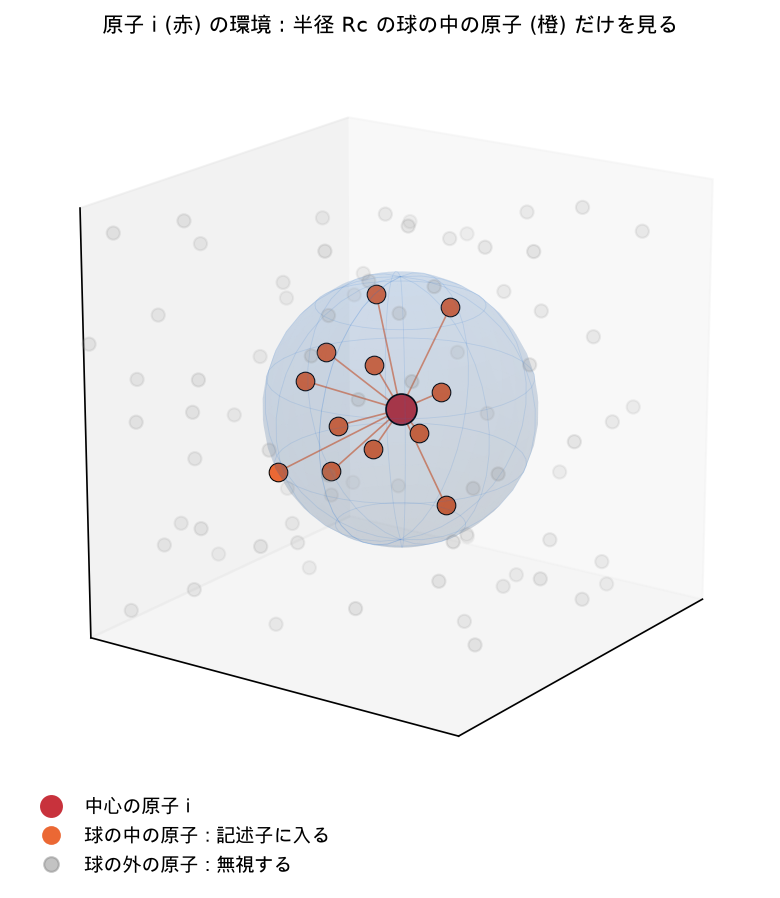
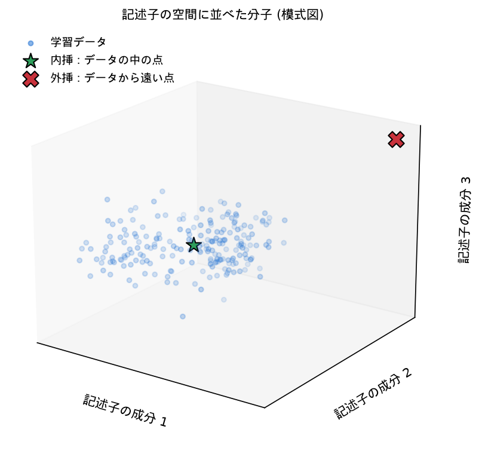
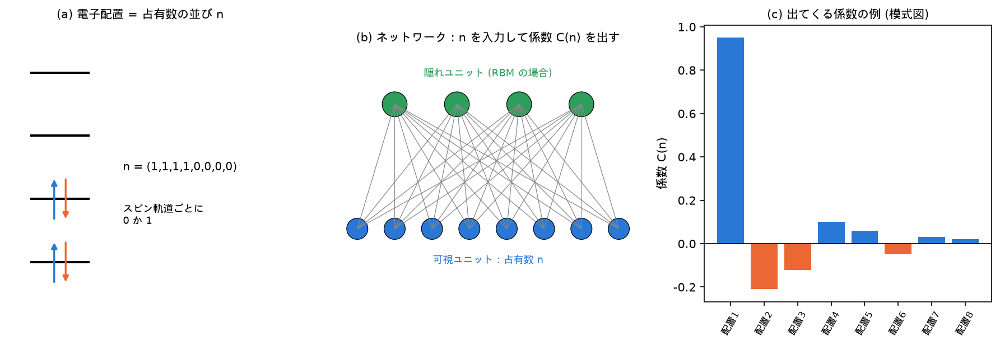
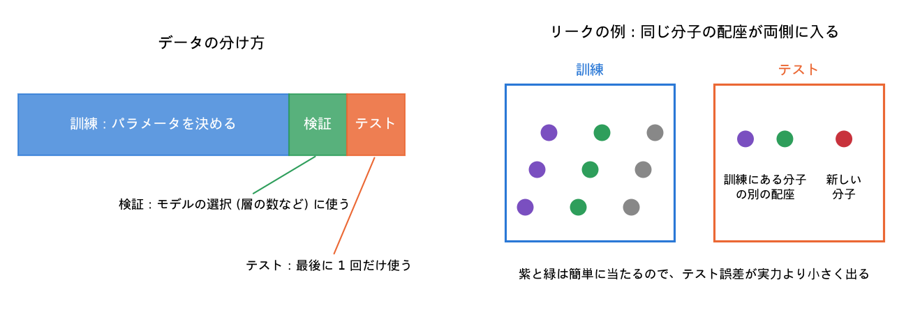
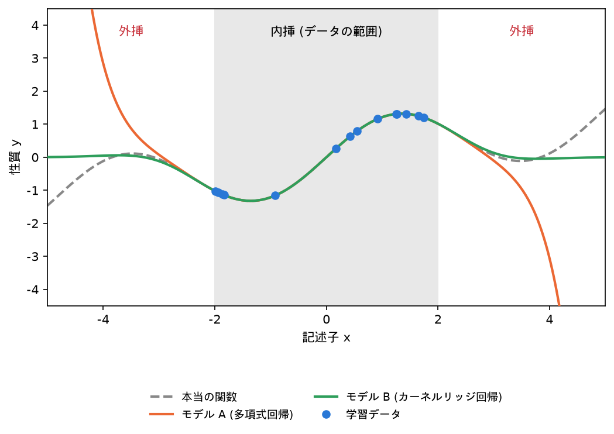

# 機械学習と量子化学：データで化学を速く、広くする研究

!!! abstract "このページで分かること"
    機械学習と量子化学を組み合わせる研究の全体像を紹介します。量子化学計算の結果を「データ」として学ばせ、同じ計算を何千倍も速く行ったり、計算できなかった数の分子を調べたりする研究です。どの小分類にも共通する常識（データの分け方、外挿、学習した値が何の理論の値か）も説明します。

    | 節 | 小分類 | ひとことで |
    |---|---|---|
    | 2 | 機械学習ポテンシャル | 原子の配置からエネルギーと力を一瞬で出す |
    | 3 | 分子の性質の予測 | 構造から HOMO-LUMO ギャップなどを予測する |
    | 4 | 反応・触媒のデータ駆動の研究 | 実験の結果と計算値を結び付ける（詳しくは反応と触媒のページ） |
    | 5 | 波動関数そのものの機械学習 | ニューラルネットワークを波動関数の形として使う |
    | 6 | 材料探索への応用 | 候補を絞り込む（詳しくは分子スクリーニングのページ） |
    | 7 | この界隈の常識 | データの分け方、リーク、外挿、参照の理論 |

!!! tip "ひとことで言うと"
    量子化学計算は、正確ですが時間のかかる「職人の手作業」です。機械学習は、職人の仕事をたくさん見て、そのこつを真似する「見習い」にあたります。見習いは職人より何千倍も速く答えを出せますが、見たことのない種類の仕事（学習データから遠い分子）では間違えます。また、見習いの腕は、お手本にした職人（学習データを作った計算方法）を超えません。この分野の研究は、よい見習いを育てる方法と、見習いを安全に使う方法を考える研究です。

## 1. この分野が答えようとしている問い

量子化学計算は、分子の構造からエネルギーや性質を計算します。
しかし、計算時間は分子が大きくなると急に増えます。
たとえば DFT では、1 つの構造の計算に数分から数時間かかります。
分子動力学（MD）で 100 万ステップの計算をしたり、10 万個の候補分子を調べたりするのは、そのままでは現実的ではありません。

そこで、量子化学計算の結果をデータとして集め、「構造 → 答え」の関係を機械学習のモデルに学ばせます（図 1）。
学習が終われば、新しい構造に対する予測は、ほぼ一瞬で済みます。
この分野が答えようとしている問いは、次のようなものです。

- 量子化学計算と同じくらい正確で、何千倍も速いモデルを作れるか。
- そのモデルは、どこまで信用できるか。どこで間違えるか。
- 計算や実験のデータから、人間が気づかなかった傾向や設計の指針を引き出せるか。
- 機械学習の道具（ニューラルネットワーク）を、量子化学の方程式を解くこと自体に使えるか。

**図 1**　この分野の全体の流れ（模式図）。上の段は「計算 → データ → モデル」の流れで、下の段がこのページで扱う小分類です。

全体を見渡す総説として、分子と材料の機械学習の総説 [Butler 2018] や、機械学習ポテンシャルの総説 [Unke 2021] がよく読まれています。

## 2. 機械学習ポテンシャル

### 2.1 何をする研究か

機械学習ポテンシャル（machine learning interatomic potential、MLIP）は、原子の配置を入力にして、エネルギーと原子にはたらく力を出すモデルです。
古典的な力場（ばねと電荷のモデル）と同じように使えて、精度は学習に使った量子化学計算に近い、というものを目指します。

多くのモデルは、全エネルギーを「原子ごとのエネルギーの和」で表します（図 2）。
各原子のエネルギーは、その原子のまわりの、半径 $R_\mathrm c$（カットオフ半径）の球の中の原子の配置だけで決まると考えます（図 3）。
球の中の配置を数の並びに変換したものを、記述子（descriptor）と呼びます。
この形は、Behler と Parrinello が 2007 年にニューラルネットワークのポテンシャルとして導入しました [Behler 2007]。

!!! question "「原子ごとのエネルギーの和にする必要がある」のはなぜ？"
    **そもそも何の話か**：分子全体の座標をそのままネットワークに入れて、エネルギーを 1 つ出させる形も考えられます。しかし実際のモデルは、まず原子 1 個ずつにエネルギーを割り当て、それを足して全エネルギーにします。

    **なぜその形にするのか**：理由は 2 つあります。1 つは、大きさの問題です。座標をそのまま入れる形だと、入力の長さが原子の数で変わるので、学習した分子と原子数の違う分子には使えません。和の形なら、原子が何個でも同じネットワークを使い回せます。もう 1 つは、対称性です。エネルギーは、分子を平行移動しても、回転しても、同じ元素の原子に付けた番号を入れ替えても変わってはいけません。和の形にして、各原子の記述子を「まわりの原子との距離と角度」だけから作れば、この 3 つが自動的に満たされます。入れずにおくと、モデルは同じ分子を向きを変えて見せられるたびに違う答えを出し、そのずれを埋めるためだけに大量のデータを必要とします。

    **どう確かめるか**：できたモデルに、同じ構造を回転させたものと、原子の番号を入れ替えたものを入れ、エネルギーが変わらないかを見ます。力については、構造を回したときに力のベクトルも同じだけ回るか（等変性）を確かめます。

**図 2**　Behler–Parrinello の形（模式図）。水分子の例です。同じ元素の原子は同じネットワークを使うので、原子の番号を入れ替えても全エネルギーは変わりません。

**図 3**　原子環境とカットオフ球（模式図）。中心の原子（赤）のエネルギーは、球の中の原子（橙）の配置だけで決まると考えます。球の外の原子（灰色）は無視します。このおかげで計算時間は原子の数に比例しますが、遠くから届く静電相互作用は表せません。

### 2.2 よく使う方法とプログラム

モデルの形は、およそ次の順に発展してきました。

| 世代 | 例 | 特徴 |
|---|---|---|
| 記述子 + ニューラルネットワーク | Behler–Parrinello [Behler 2007]、ANI-1 [Smith 2017] | 記述子を人が設計する |
| メッセージパッシング型 | SchNet [Schütt 2018] | 原子どうしが情報をやり取りして、記述子を学習で作る |
| 等変ニューラルネットワーク | NequIP [Batzner 2022]、MACE [Batatia 2022] | 回転したときのベクトルの向きの変わり方まで組み込む |
| 基盤モデル | MACE-MP-0 [Batatia 2025]、UMA [Wood 2025] | 多くの元素と系を 1 つのモデルで扱う |

ANI-1 は、H、C、N、O からなる有機分子について、約 1720 万個の構造を ωB97X/6-31G(d) で計算したデータで学習しました [Smith 2017]。
その後、DFT で学習したモデルを CCSD(T)/CBS のデータで学習し直す ANI-1ccx も作られています [Smith 2019]。
最近の基盤モデルの UMA は、材料、触媒、分子などの約 5 億個の構造で学習しています [Wood 2025]。
分子のデータには、電荷とスピン多重度の幅を大きく広げた OMol25 が使われています [Levine 2025]。

プログラムとしては、原子の構造を扱う Python のライブラリ ASE と組み合わせて使うものが多く、MD は LAMMPS などで行います。

### 2.3 代表的な研究例

- **Behler–Parrinello（2007 年）**：原子ごとのエネルギーの和と、対称関数の記述子を組み合わせ、高次元のポテンシャルエネルギー曲面をニューラルネットワークで表しました [Behler 2007]。
- **ANI-1 と ANI-1ccx**：大量の DFT のデータで有機分子に広く使えるポテンシャルを作り [Smith 2017]、さらに少数の結合クラスターのデータで学習し直して精度を上げました [Smith 2019]。後者の「大きなデータで下地を作り、少ない高精度のデータで仕上げる」考え方は、4 節の転移学習と同じです。
- **MACE-MP-0**：無機材料のデータ（PBE 汎関数）だけで学習したのに、固体、液体、界面、小さなタンパク質まで幅広い系で安定な MD を行えました。一方で、液体の水の構造は秩序が強すぎる結果になり、論文はこれを PBE によく見られる性質がデータを通して入ったものだと説明しています [Batatia 2025]。

**この界隈の常識**

- 「DFT の精度」と書かれていても、それは学習に使った DFT の値との差が小さいという意味です。モデルはお手本を超えないからです（7.4 節）。
- 学習データにない種類の構造（結合が切れる途中、高温で崩れた構造など）では、もっともらしい間違いを出します。ふつうのデータは安定な構造のまわりに偏っているので、結合が伸びきった配置はデータの外になりがちです（7.3 節）。
- 長距離の静電相互作用や電荷の移動は、カットオフの内側だけを見るモデルでは表しにくい、という問題がよく議論されます [Ko 2021]。静電相互作用は距離の逆数でしか減らないので、球の外からも効いてくるからです。これを扱うために、原子の電荷を別に予測して長距離の項を足すモデルが作られています。
- 力も学習に使うのが普通です。1 つの構造の量子化学計算から、エネルギー 1 個に加えて、原子の数 × 3 個の力の値が同時に手に入ります。つまり、同じ計算量でデータの量が何十倍にもなります。しかも力は、エネルギーの傾きを直接教えるので、構造を最適化したり MD を行ったりするのに効きます。

## 3. 分子の性質の予測

### 3.1 何をする研究か

分子の構造（または分子のグラフ）から、HOMO-LUMO ギャップ、双極子モーメント、励起エネルギー、溶解度などの性質を予測する研究です。
2 節のポテンシャルが「1 つの分子の多数の構造」を扱うのに対し、こちらは「多数の分子の代表的な構造」を扱うことが多いです。

分子を数の並びに変える方法（記述子）として、原子間のクーロン相互作用を並べたクーロン行列 [Rupp 2012]、部分構造の有無を 0 と 1 で並べたフィンガープリント、分子をグラフとして扱うグラフニューラルネットワーク（GNN）[Gilmer 2017] などがあります。
GNN では、原子を頂点、結合や近い原子の組を辺とみなし、隣どうしで情報をやり取りして、分子全体の特徴を作ります。

分子を記述子の空間の点として並べると、似た分子は近くに集まります（図 4）。
学習データの点の「中」にある分子の予測（内挿）は比較的正確です。
データから遠い分子の予測（外挿）は信用できません。

**図 4**　記述子の空間（模式図）。青い点が学習データです。緑の星はデータの中にあるので予測を信用しやすく、赤の × はデータから遠いので予測を信用できません。

### 3.2 データセットとベンチマーク

この分野では、共通のデータセットで手法を比べるのが習慣です。
代表は QM9 で、重原子（C、N、O、F）が 9 個以下の小さな有機分子 133,885 個について、B3LYP/6-31G(2df,p) で計算した構造と性質が入っています [Ramakrishnan 2014]。
いろいろな性質と課題を集めたベンチマークとして MoleculeNet もあります [Wu 2018]。

### 3.3 代表的な研究例

- **クーロン行列（2012 年）**：分子の原子化エネルギーを、カーネルリッジ回帰で予測しました。機械学習で量子化学の量を予測する研究の出発点の 1 つです [Rupp 2012]。
- **学習曲線による比較（2017 年）**：QM9 の 13 の性質について、記述子と回帰の方法の組み合わせを学習曲線で比べました。すべての性質で、モデルの予測と B3LYP の差は、B3LYP と実験の差より小さかったと報告しています。論文は、電子相関を取り入れた高精度の計算や実験のデータがあれば、モデルがハイブリッド汎関数より正確になりうると述べています [Faber 2017]。

学習曲線（learning curve）は、学習データの数 $N$ とテストの誤差を両対数のグラフに描いたものです（図 5）。
多くの場合、ほぼ直線（べき乗則）になります。
同じデータ数で誤差が小さく、傾きが急な記述子ほど、よい記述子です。

**図 5**　学習曲線の例（自作の小さな計算）。3 個の原子が Lennard-Jones ポテンシャルで相互作用する系のエネルギーを、カーネルリッジ回帰で学習しました。記述子は 3 つの原子間距離（並べ替えたもの）か、その逆数です。どちらも直線的に誤差が下がりますが、エネルギーの形（距離の逆数のべきの和）に近い「距離の逆数」の記述子のほうが、同じデータ数で誤差が小さくなります。

**この界隈の常識**

- 「化学的精度」（1 kcal/mol 程度）は、よく目標にされる誤差の大きさです。反応の速さが室温で 1 桁変わるのが、だいたいこの程度のエネルギー差だからです。ただし、その 1 kcal/mol を測る相手が何の理論の値かを必ず確かめます（7.4 節）。
- QM9 の構造は、すべてエネルギー最小の構造です。そこで学習したモデルが、ゆがんだ構造でも正しいとは限りません。ゆがんだ構造はデータの外にあり、外挿になるからです（7.3 節）。
- 性質によって、分子全体の量（エネルギーなど、原子の寄与の和で表せる）と、分子のどこか一部で決まる量（HOMO のエネルギーなど）があり、モデルの作り方を変えます。和で表せる量は原子ごとの出力を足せばよいのに対し、HOMO のエネルギーは分子のある部分だけで決まるので、素直に足すと分子が大きいほど値がずれていきます。

## 4. 反応・触媒のデータ駆動の研究

### 4.1 何をする研究か

実験で測った反応の収率や触媒の活性を「答え」にし、量子化学計算の値や分子の構造の特徴を「記述子」にして、両者の関係を機械学習で調べる研究です。
データは数十から数百件と少ないことが多く、モデルの予測だけでなく、「どの記述子が効いているか」という解釈も重視されます。

### 4.2 代表的な研究例は反応と触媒のページへ

有機光増感剤（光を吸って反応を起こす分子）の触媒活性を機械学習で予測する研究が、この小分類の代表例です。
計算した性質と構造の特徴を記述子にして活性を予測する研究、反応をまたいで知識を移す転移学習の研究、励起状態の速度定数を記述子にする研究が続いています。
個々の研究の中身は、[反応と触媒のページ](03-reactions-catalysis.md)で紹介します。

!!! question "「少ないデータでは、量子化学の値を記述子に入れる」と言われるのはなぜ？"
    **そもそも記述子とは**：分子を機械学習に入力できる数の並びに変えたものです。構造から数えるだけの記述子（環の数、部分構造の有無）と、量子化学計算で求める記述子（軌道のエネルギー、電荷、励起エネルギーなど）があります。

    **なぜ量子化学の値を入れるのか**：実験で測れる触媒の数は、ふつう数十から数百件です。この数では、構造の特徴だけから「どの構造が効くか」をモデルに一から見つけさせることはできません。入力の次元が、データの数よりはるかに多くなるからです。量子化学の値は、「酸化しやすさ」「三重項のエネルギー」のように、化学者が既に反応の鍵だと知っている量です。あらかじめ答えに近い量を入力に入れておけば、モデルが学ぶべきことが減り、少ないデータでも関係をつかめます。

    **どう確かめるか**：量子化学の記述子を入れた場合と入れない場合で、交差検証（データを何通りかに分け、片方で学習し残りで試すことをくり返す方法）の誤差を比べます。差が出なければ、その量は効いていません。さらに、どの記述子が効いたかを SHAP などで調べ、化学の言葉で説明がつくかを確かめます。

**この界隈の常識**

- データが数十件しかないので、モデルを複雑にすると過学習します。過学習とは、学習データの偶然のばらつきまで覚えてしまい、新しいデータで外すことです。データが少ないほど偶然の模様が見えやすいので、交差検証でそれを見張ります。
- 「予測が当たった」だけでなく、「なぜ当たったか」を化学の言葉で説明することが求められます。説明がつかないモデルは、次にどんな分子を作ればよいかを教えてくれないからです。実験の共同研究者が知りたいのは、順位ではなく設計の指針です。
- 実験データは、同じ条件で測られているとは限りません。別々の論文の収率を混ぜると、分子の違いではなく測定条件の違いを学んでしまいます。

## 5. 波動関数そのものの機械学習

### 5.1 何をする研究か

これまでの節は、量子化学計算の「結果」を学ぶ研究でした。
この節の研究は、ニューラルネットワークを、波動関数の形（試行関数、ansatz）として使います。
学習データは使いません。
エネルギーが最も低くなるように、変分原理でネットワークのパラメータを決めます。
「何を学ぶか」は普通の機械学習と違いますが、道具（ネットワークの形、勾配による最適化）は共通です。

!!! question "「波動関数をニューラルネットワークで表す」必要があるのはなぜ？"
    **そもそも波動関数をどう表しているのか**：正確な波動関数は、考えられる電子配置（どの軌道にどの電子を入れるかの組み合わせ）すべてに係数をつけて足し合わせた形になります。つまり「配置の番号 → 係数」という、とてつもなく長い表です。

    **なぜ別の表し方が要るのか**：この表の長さが、系の大きさに対して指数関数的に増えるからです。たとえば 16 個の軌道に 16 個の電子を入れる場合でも、配置の数はすでに 1 億を超えます。軌道を 2 個増やすたびに、表の長さはおよそ 1 桁増えます。係数を 1 つずつ覚えるやり方では、計算機の記憶が先に尽きます。そこで、「表を覚える」のをやめて、「配置を入れると係数が出てくる関数」を覚えます。ニューラルネットワークは、少ないパラメータで複雑な関数を表せる道具なので、この役にあてられます。DMRG が波動関数を行列の積の形に圧縮するのも、ねらいは同じです。

    **どう確かめるか**：この方法の良いところは、答え合わせの相手が要らないことです。変分原理により、試行関数で計算したエネルギーは必ず本当の基底状態のエネルギー以上になります。したがって、エネルギーが低いほうが良い波動関数です。小さな系では、厳密に解ける CAS-CI の値と直接比べて確かめます。

このとき、ネットワークのパラメータが作る「損失関数」（ここではエネルギー）の地形を下っていきます（図 6）。
地形には谷がいくつもあり、出発点によって行き着く谷が変わることがあります。
これは、普通の機械学習の学習でも同じです。

**図 6**　損失関数の地形と勾配降下（模式図）。左が 3 次元の地形、右が上から見た等高線です。2 つの出発点（●）から坂を下ると、別々の谷（★）に行き着きます。

### 5.2 2 つの流れ

1 つ目は、電子配置の係数をネットワークで表す流れです（図 7）。
Carleo と Troyer は、スピン系の波動関数を制限ボルツマンマシン（RBM）で表す方法（neural-network quantum state、NQS）を提案しました [Carleo 2017]。
Yang、Sugiyama、Tsuda、Yanai は、これを分子の CAS-CI の波動関数に応用しました。
電子配置の占有数（0 か 1 の並び）を入力にして、その配置の係数を出すネットワークです。
RBM に加えて、隠れユニットを持たない 2 次と 3 次のボルツマンマシン（BM2、BM3）も導入し、窒素分子の解離のポテンシャル曲線で、BM3 が CAS-CI のエネルギーを 50 μE_h 以内で再現しました [Yang 2020]。
Hagai らは、この表現を量子コンピュータの量子ゲートで用意するアルゴリズムに拡張しています [Hagai 2023]。

**図 7**　電子配置の係数をネットワークで表す考え方（模式図）。(a) 電子配置はスピン軌道ごとの占有数 0 か 1 の並びで書けます。(b) それをネットワークに入力すると、(c) その配置の係数が出てきます。係数の表を丸ごと覚える代わりに、係数を作る関数を覚えるのです。

2 つ目は、電子の座標を直接入力にする流れです。
FermiNet [Pfau 2020] と PauliNet [Hermann 2020] は、電子の座標から波動関数の値を出すネットワークで、電子の入れ替えで符号が変わる性質（反対称性）を組み込んでいます。
変分モンテカルロ法でエネルギーを下げるように学習します。
PauliNet の論文は、30 電子までの分子でほぼ厳密な解が得られたと報告しています [Hermann 2020]。
この分野の総説もあります [Hermann 2023]。

**この界隈の常識**

- 「機械学習」と呼ばれていても、学習データは使いません。エネルギーの最小化だけで決めます。そのため、7 節のリークや外挿の心配はありません。代わりに、エネルギーがどこまで下がったかが唯一の物差しになります。
- 計算時間はまだ大きく、比べる相手は CCSD(T) や DMRG などの高精度の方法です。速さではなく、同じ精度をより少ないパラメータで出せるかが論点です。
- 報告されたエネルギーを比べるときは、基底関数や活性空間の取り方をそろえます。変分原理が保証するのは、同じ設定の中での上下だけだからです。

## 6. 材料探索への応用

候補となる分子を計算機の中で大量に作り、計算と機械学習で絞り込んでから、少数を合成して確かめる研究です。
この小分類で機械学習が担うのは、「量子化学で計算できたのはごく一部なのに、候補の全部に順位をつけたい」という場面です。
たとえば、2 万個の候補のうち 1 千個だけを量子化学で計算し、その値でグラフニューラルネットワークを学習させて、残りの 1 万 9 千個に予測を広げます。
有機 EL（OLED）の発光材料、特に熱活性化遅延蛍光（TADF）の材料を探した研究が代表例です。
研究例と、絞り込みの設計の詳しい話は、[分子スクリーニングと材料探索のページ](05-screening-materials.md)で紹介します。
TADF でなぜ一重項と三重項のエネルギー差を小さくするのかという物理は、[励起状態と光化学のページ](04-excited-states.md)にあります。

**この界隈の常識**

- 計算で絞る段階と、合成と測定で確かめる段階を組み合わせるのが普通です。計算だけで「発見」とは言いません。予測は学習データの近くでしか当たらないので（7 節）、当たったことは実験でしか示せないからです。
- 機械学習を入れる価値があるのは、候補の数が量子化学で計算しきれる数を超えたときだけです。数千個なら、全部を計算してしまうほうが速く、間違いも起きません。

## 7. この界隈の常識：データの扱い方

この節の 3 つは、論文を読むときにも、自分で研究するときにも効いてきます。
どれも「報告された誤差の数字を、そのまま信じてよいか」という話です。

### 7.1 訓練・検証・テストに分ける

!!! question "「データを訓練・検証・テストに分ける」のはなぜ？"
    **そもそも 3 つの役目とは**：訓練データはモデルのパラメータを決めるのに使います。検証データは、モデルの形や設定（ネットワークの層の数、正則化の強さなど）をいくつか試して選ぶのに使います。テストデータは、選び終わったモデルの性能を最後に 1 回だけ測り、論文に報告するのに使います。

    **なぜ分けるのか**：モデルは、訓練データの上では必ず良く見えます。覚えてしまえばよいからです。だから、訓練データでの誤差は実力ではありません。では検証データで測ればよいかというと、それも実力ではありません。たとえば設定を 100 通り試し、検証データで一番良いものを選ぶと、その 1 個は「たまたま検証データに合っていた」だけかもしれません。選ぶ作業にデータを使った時点で、そのデータは実力を測る物差しではなくなります。だから、選ぶのに一度も使っていないテストデータが要ります。

    **どう確かめるか**：報告された誤差が、テストデータでの値か検証データでの値かを、論文の記述で確かめます。「ハイパーパラメータをテストセットで選んだ」と書いてあれば、その誤差は実力より小さく出ています。自分で行うときは、テストデータを最初に取り分け、最後まで開かないのが確実です。

データの分け方は図 8 の左のとおりです。

### 7.2 データのリーク

!!! question "「データのリークに注意」と言われるのはなぜ？"
    **そもそもリークとは**：データのリーク（leakage）とは、テストデータの答えやそれに近い情報が、何らかの形で訓練データに入りこんでしまうことです。分けたつもりで、分かれていない状態です。

    **なぜ注意するのか**：リークがあると、テストが「初見の問題」ではなく「練習ずみの問題」になります。モデルは新しい分子に弱くても、テストの点数だけは高く出ます。つまり、報告された誤差が実力を表さなくなります。機械学習を使った科学の研究で、再現性の問題の大きな原因になっていると指摘されています [Kapoor 2023]。化学でいちばん多いのは、同じ分子の別の配座（結合を回しただけの、よく似た構造）が訓練とテストの両方に入る場合です（図 8 の右）。構造がほとんど同じなので、モデルは訓練で覚えた値をほぼそのまま答えれば当たります。似た骨格の分子が訓練とテストに分かれて入る場合も同じです。

    **どう確かめる・どう防ぐか**：分け方を、データの 1 行ごとではなく、まとまりごとにします。配座なら分子ごと、類縁体なら骨格ごと（scaffold split）にまとめて、まとまりごと訓練かテストのどちらかに入れます。創薬では、古いデータで学習して新しいデータでテストする時間による分割も使われます。これは、実際の使い方（これから作る分子を予測する）に一番近い試験になるからです [Sheridan 2013]。目安として、分け方をまとまり単位に変えたとたんに誤差が数倍になるなら、前の分け方はリークしていました。

**図 8**　データの分け方（左）とリークの例（右、模式図）。右では、紫と緑の分子の別の配座が訓練とテストの両方に入っています。テストが簡単になり、誤差が小さく出ます。

### 7.3 外挿に注意する

!!! question "「外挿に注意」と言われるのはなぜ？"
    **そもそも内挿と外挿とは**：記述子の空間に学習データを点として並べたとき（3 節の図 4）、点の雲の内側にある分子を予測するのが内挿、雲の外にある分子を予測するのが外挿です。「外」とは、分子が大きいといった見た目の話ではなく、記述子で測った距離の話です。

    **なぜ注意するのか**：機械学習のモデルは、データに合う滑らかな関数を選んでいるだけで、背後の物理を知りません。データのある範囲では、点に挟まれているので形が決まります。範囲の外では、点が形を決めてくれないので、モデルの都合（使った関数の形、正則化の仕方）だけで値が決まります。しかも、モデルは「分かりません」とは言わず、もっともらしい数を返します。図 9 がその様子です。機械学習ポテンシャルで言えば、結合が切れる途中の構造や、高温でひしゃげた構造が外挿にあたります。そこで力を間違えると、MD の軌跡そのものが壊れます。

    **どう確かめるか**：予測したい分子が学習データの近くにあるかを、記述子の空間での距離で調べます。もう 1 つの実際的な方法が、初期値や分割を変えて複数のモデルを作り、その食い違い（アンサンブルのばらつき）を不確かさの目安にすることです。データの内側ではどのモデルもほぼ同じ値を出し、外側では食い違います。食い違いが大きい構造だけ量子化学で計算し直してデータに足すのが、能動学習です。

**図 9**　内挿と外挿の違い（自作の小さな計算）。灰色の破線が本当の関数、青の点が学習データ（灰色の帯の中にだけあります）、実線が 2 つのモデル（多項式回帰とカーネルリッジ回帰）の予測です。帯の中では 2 つの予測が重なり、本当の関数にも合っています。帯の外では、2 つの予測がたがいに離れ、本当の関数からも離れます。どちらのモデルも、外側で「自信がない」とは言いません。予測が割れること自体が、外挿を見分ける手がかりになります。

### 7.4 学習した値は何の理論の値か

!!! question "「何の理論の値を学習したのか」を確かめるのはなぜ？"
    **そもそも何の話か**：機械学習のモデルが近づけるのは、学習データのラベル（答え）です。ラベルは、たいてい誰かが選んだ方法で計算した値です。たとえば ANI-1 のラベルは ωB97X/6-31G(d) の値 [Smith 2017]、QM9 のラベルは B3LYP/6-31G(2df,p) の値です [Ramakrishnan 2014]。

    **なぜ確かめるのか**：モデルの誤差には 2 段あるからです（図 10）。1 つ目は、ラベルを作った理論と、本当の値（厳密な解や実験値）との差です。2 つ目は、モデルの予測とラベルとの差です。論文が「平均絶対誤差 1 kcal/mol」と報告するとき、ほぼ必ず 2 つ目だけを指しています。1 つ目は、どれだけ学習してもゼロになりません。モデルはお手本を超えないからです。だから「DFT の精度の機械学習ポテンシャル」という言い回しは、「その DFT の値をよく再現する」という意味であって、「実験とよく合う」という意味ではありません。基盤モデルが学習データの汎関数の癖を受け継ぐのも同じ理由です。2.3 節で紹介した MACE-MP-0 の液体の水の例が、その具体例です。

    **どう確かめる・どう対処するか**：論文を読むときは、データセットの節で汎関数と基底関数を確かめます。自分で使うときは、目的の性質について、その理論の値と実験値の差が文献でどれくらい報告されているかを調べ、モデルの誤差と足して考えます。1 つ目の誤差を減らしたいときは、高精度の方法のデータで学習し直します。ANI-1ccx は、DFT で学習したモデルを少数の CCSD(T)/CBS のデータで仕上げた例です [Smith 2019]。安い計算と高い計算の差だけを学習する Δ 学習も、同じねらいの方法です [Ramakrishnan 2015]。

**図 10**　2 種類の誤差（模式図）。テスト誤差がどれだけ小さくても、参照の理論（たとえば汎関数）の誤差は残ります。ANI-1ccx のように高精度のデータで学習し直すのは、左の誤差を小さくするためです [Smith 2019]。

## この分野でよく出てくる言葉

| 言葉 | 意味 |
|---|---|
| 記述子（descriptor） | 分子や原子環境を、機械学習に入力できる数の並びに変えたもの |
| カットオフ半径 | 原子のエネルギーを決めるときに見る範囲の半径 |
| 機械学習ポテンシャル（MLIP） | 原子の配置からエネルギーと力を出す機械学習のモデル |
| グラフニューラルネットワーク（GNN） | 分子をグラフとして扱い、隣どうしで情報をやり取りするネットワーク |
| 等変（equivariant） | 入力を回転すると、出力（力のベクトルなど）も同じだけ回転する性質 |
| 基盤モデル（foundation model） | 大量・多様なデータで学習し、多くの系に使えるモデル。必要なら追加の学習で仕上げる |
| 学習曲線 | 学習データの数と誤差の関係を両対数で描いたグラフ |
| 内挿と外挿 | 学習データの範囲の中での予測と、範囲の外での予測 |
| データのリーク | テストデータの情報が学習に入りこんで、性能が過大に見えること |
| 転移学習 | ある課題で学習した知識を、別の課題の学習に使うこと |
| Δ 学習 | 安い計算と高い計算の差を学習すること [Ramakrishnan 2015] |
| ニューラルネットワーク量子状態（NQS） | ニューラルネットワークで表した波動関数 |
| 能動学習 | モデルが自信のない構造を選んで、そこだけ量子化学計算を追加すること |

## この分野の常識：まとめ

知らないと会話についていけないことを、理由とともに挙げます。

- モデルの精度は、学習データを作った理論の精度を超えません。モデルが近づける相手はラベルだからです。「DFT の精度」は「その DFT の値との差が小さい」という意味で、実験と合うという意味ではありません。
- テストの誤差は、学習データに似た構造でしか保証されません。データのない場所では、点が関数の形を決めてくれず、モデルの都合で値が決まるからです。しかもモデルは、もっともらしい数を自信ありげに返します。
- データは訓練・検証・テストに分け、テストデータでモデルを選びません。選ぶのに使ったデータは、もう実力を測る物差しではないからです。
- 同じ分子の配座や、ほぼ同じ分子が訓練とテストに分かれて入るリークに注意します。テストが「練習ずみの問題」になり、報告する誤差が実力より小さく出るからです。分子ごと、骨格ごとに分けます。
- 手法の比較には、QM9 などの共通のデータセットと、学習曲線を使います。データの数がそろっていないと、記述子の良し悪しと、データを多く用意できたことの区別がつかないからです。
- 機械学習ポテンシャルでは、エネルギーだけでなく力も学習するのが普通です。1 つの構造から、原子の数 × 3 個の力の値がただで手に入り、同じ計算量でデータが何倍にもなるからです。
- カットオフの内側だけを見るモデルは、長距離の静電相互作用や電荷移動が苦手です。これらは球の外の原子まで含めないと決まらない量だからです。
- 基盤モデルは便利ですが、学習データの汎関数の癖も一緒に受け継ぎます。自分の系の少数の高精度な計算で追加の学習（ファインチューニング）をするのが一般的です。
- データの少ない触媒の研究では、量子化学の値を記述子に入れます。化学的に意味のある量をあらかじめ入力にしておけば、モデルが学ぶべきことが減るからです。
- 波動関数のニューラルネット表現は、データを使わず、変分原理で学習します。エネルギーが下がったかどうかで良し悪しを判定できるので、答えを知らなくても評価できます。
- 材料探索では、計算で絞り、合成と測定で確かめるまでを 1 つの研究とします。予測が当たったことは、実験でしか示せないからです。

## 最初に読むとよい文献

- K. T. Butler ら、"Machine learning for molecular and materials science"（Nature, 2018）：分子と材料の機械学習の全体像を短くまとめた総説 [Butler 2018]。
- O. T. Unke ら、"Machine Learning Force Fields"（Chem. Rev., 2021）：機械学習ポテンシャルの考え方から実践までを扱う総説 [Unke 2021]。
- J. Hermann ら、"Ab initio quantum chemistry with neural-network wavefunctions"（Nat. Rev. Chem., 2023）：5 節の波動関数の機械学習の総説 [Hermann 2023]。
- S. Kapoor、A. Narayanan、"Leakage and the reproducibility crisis in machine-learning-based science"（Patterns, 2023）：データのリークの種類と対策 [Kapoor 2023]。

## 講義ノートとの関係

- 機械学習の基礎：[第 1 回 機械学習とは](../courses/ml-basics/01-what-is-ml.md)、[第 3 回 過学習と正則化、データの分け方](../courses/ml-basics/03-overfitting-regularization.md)（7 節）、[第 6 回 最適化](../courses/ml-basics/06-optimization.md)（図 6）、[第 7 回 グラフニューラルネットワーク](../courses/ml-basics/07-graph-neural-networks.md)（3 節）、[第 8 回 不変と等変](../courses/ml-basics/08-invariance-equivariance.md)、[第 10 回 不確かさと能動学習](../courses/ml-basics/10-uncertainty-active-learning.md)
- 量子化学のための機械学習：[第 1 回 何を学習させるのか](../courses/ml-chem/01-what-to-learn.md)、[第 2 回 記述子と原子環境](../courses/ml-chem/02-descriptors.md)、[第 3 回 原子ごとのエネルギーの和](../courses/ml-chem/03-mlip-basics.md)（2 節）、[第 5 回 等変ニューラルネットワーク](../courses/ml-chem/05-equivariant-mlips.md)、[第 6 回 データセット](../courses/ml-chem/06-datasets.md)（3 節、7.3 節）、[第 7 回 基盤モデル](../courses/ml-chem/07-foundation-models.md)、[第 8 回 Δ 学習](../courses/ml-chem/08-delta-learning.md)、[第 10 回 研究で使うときの注意](../courses/ml-chem/10-cautions.md)
- 量子化学の理論：[第 12 回 CASSCF](../courses/qc-theory/12-casscf.md)（5 節の CAS-CI）、[第 19 回 TDDFT](../courses/qc-theory/19-tddft.md)（6 節の励起エネルギー）

## 参考文献

- K. T. Butler, D. W. Davies, H. Cartwright, O. Isayev, A. Walsh, "Machine learning for molecular and materials science", Nature 559, 547 (2018). DOI: [10.1038/s41586-018-0337-2](https://doi.org/10.1038/s41586-018-0337-2)
- O. T. Unke, S. Chmiela, H. E. Sauceda, M. Gastegger, I. Poltavsky, K. T. Schütt, A. Tkatchenko, K.-R. Müller, "Machine Learning Force Fields", Chem. Rev. 121, 10142 (2021). DOI: [10.1021/acs.chemrev.0c01111](https://doi.org/10.1021/acs.chemrev.0c01111)
- J. Behler, M. Parrinello, "Generalized Neural-Network Representation of High-Dimensional Potential-Energy Surfaces", Phys. Rev. Lett. 98, 146401 (2007). DOI: [10.1103/PhysRevLett.98.146401](https://doi.org/10.1103/PhysRevLett.98.146401)
- J. S. Smith, O. Isayev, A. E. Roitberg, "ANI-1: an extensible neural network potential with DFT accuracy at force field computational cost", Chem. Sci. 8, 3192 (2017). DOI: [10.1039/C6SC05720A](https://doi.org/10.1039/C6SC05720A)
- J. S. Smith, B. T. Nebgen, R. Zubatyuk, N. Lubbers, C. Devereux, K. Barros, S. Tretiak, O. Isayev, A. E. Roitberg, "Approaching coupled cluster accuracy with a general-purpose neural network potential through transfer learning", Nat. Commun. 10, 2903 (2019). DOI: [10.1038/s41467-019-10827-4](https://doi.org/10.1038/s41467-019-10827-4)
- K. T. Schütt, H. E. Sauceda, P.-J. Kindermans, A. Tkatchenko, K.-R. Müller, "SchNet – A deep learning architecture for molecules and materials", J. Chem. Phys. 148, 241722 (2018). DOI: [10.1063/1.5019779](https://doi.org/10.1063/1.5019779)
- S. Batzner, A. Musaelian, L. Sun, M. Geiger, J. P. Mailoa, M. Kornbluth, N. Molinari, T. E. Smidt, B. Kozinsky, "E(3)-equivariant graph neural networks for data-efficient and accurate interatomic potentials", Nat. Commun. 13, 2453 (2022). DOI: [10.1038/s41467-022-29939-5](https://doi.org/10.1038/s41467-022-29939-5)
- I. Batatia, D. P. Kovács, G. N. C. Simm, C. Ortner, G. Csányi, "MACE: Higher Order Equivariant Message Passing Neural Networks for Fast and Accurate Force Fields", arXiv:2206.07697 (2022).
- I. Batatia, P. Benner, Y. Chiang, A. M. Elena, D. P. Kovács, J. Riebesell, … , G. Csányi, "A foundation model for atomistic materials chemistry", J. Chem. Phys. 163, 184110 (2025). DOI: [10.1063/5.0297006](https://doi.org/10.1063/5.0297006)
- B. M. Wood, M. Dzamba, X. Fu, M. Gao, M. Shuaibi, L. Barroso-Luque, K. Abdelmaqsoud, V. Gharakhanyan, J. R. Kitchin, D. S. Levine, K. Michel, A. Sriram, T. Cohen, A. Das, A. Rizvi, S. J. Sahoo, Z. W. Ulissi, C. L. Zitnick, "UMA: A Family of Universal Models for Atoms", Advances in Neural Information Processing Systems 38, 143528 (2025). DOI: [10.52202/085713-4310](https://doi.org/10.52202/085713-4310)
- D. S. Levine, M. Shuaibi, E. W. C. Spotte-Smith, M. G. Taylor, M. R. Hasyim, K. Michel, I. Batatia, G. Csányi, M. Dzamba, P. Eastman, N. C. Frey, X. Fu, V. Gharakhanyan, A. S. Krishnapriyan, J. A. Rackers, S. Raja, A. Rizvi, A. S. Rosen, Z. Ulissi, S. Vargas, C. L. Zitnick, S. M. Blau, B. M. Wood, "The Open Molecules 2025 (OMol25) Dataset, Evaluations, and Models", arXiv:2505.08762 (2025).
- T. W. Ko, J. A. Finkler, S. Goedecker, J. Behler, "A fourth-generation high-dimensional neural network potential with accurate electrostatics including non-local charge transfer", Nat. Commun. 12, 398 (2021). DOI: [10.1038/s41467-020-20427-2](https://doi.org/10.1038/s41467-020-20427-2)
- M. Rupp, A. Tkatchenko, K.-R. Müller, O. A. von Lilienfeld, "Fast and Accurate Modeling of Molecular Atomization Energies with Machine Learning", Phys. Rev. Lett. 108, 058301 (2012). DOI: [10.1103/PhysRevLett.108.058301](https://doi.org/10.1103/PhysRevLett.108.058301)
- J. Gilmer, S. S. Schoenholz, P. F. Riley, O. Vinyals, G. E. Dahl, "Neural Message Passing for Quantum Chemistry", arXiv:1704.01212 (2017).
- R. Ramakrishnan, P. O. Dral, M. Rupp, O. A. von Lilienfeld, "Quantum chemistry structures and properties of 134 kilo molecules", Sci. Data 1, 140022 (2014). DOI: [10.1038/sdata.2014.22](https://doi.org/10.1038/sdata.2014.22)
- Z. Wu, B. Ramsundar, E. N. Feinberg, J. Gomes, C. Geniesse, A. S. Pappu, K. Leswing, V. Pande, "MoleculeNet: a benchmark for molecular machine learning", Chem. Sci. 9, 513 (2018). DOI: [10.1039/C7SC02664A](https://doi.org/10.1039/C7SC02664A)
- F. A. Faber, L. Hutchison, B. Huang, J. Gilmer, S. S. Schoenholz, G. E. Dahl, O. Vinyals, S. Kearnes, P. F. Riley, O. A. von Lilienfeld, "Prediction Errors of Molecular Machine Learning Models Lower than Hybrid DFT Error", J. Chem. Theory Comput. 13, 5255 (2017). DOI: [10.1021/acs.jctc.7b00577](https://doi.org/10.1021/acs.jctc.7b00577)
- R. Ramakrishnan, P. O. Dral, M. Rupp, O. A. von Lilienfeld, "Big Data Meets Quantum Chemistry Approximations: The Δ-Machine Learning Approach", J. Chem. Theory Comput. 11, 2087 (2015). DOI: [10.1021/acs.jctc.5b00099](https://doi.org/10.1021/acs.jctc.5b00099)
- G. Carleo, M. Troyer, "Solving the quantum many-body problem with artificial neural networks", Science 355, 602 (2017). DOI: [10.1126/science.aag2302](https://doi.org/10.1126/science.aag2302)
- P.-J. Yang, M. Sugiyama, K. Tsuda, T. Yanai, "Artificial Neural Networks Applied as Molecular Wave Function Solvers", J. Chem. Theory Comput. 16, 3513 (2020). DOI: [10.1021/acs.jctc.9b01132](https://doi.org/10.1021/acs.jctc.9b01132)
- M. Hagai, M. Sugiyama, K. Tsuda, T. Yanai, "Artificial neural network encoding of molecular wavefunctions for quantum computing", Digital Discovery 2, 634 (2023). DOI: [10.1039/D2DD00093H](https://doi.org/10.1039/D2DD00093H)
- D. Pfau, J. S. Spencer, A. G. D. G. Matthews, W. M. C. Foulkes, "Ab initio solution of the many-electron Schrödinger equation with deep neural networks", Phys. Rev. Research 2, 033429 (2020). DOI: [10.1103/PhysRevResearch.2.033429](https://doi.org/10.1103/PhysRevResearch.2.033429)
- J. Hermann, Z. Schätzle, F. Noé, "Deep-neural-network solution of the electronic Schrödinger equation", Nat. Chem. 12, 891 (2020). DOI: [10.1038/s41557-020-0544-y](https://doi.org/10.1038/s41557-020-0544-y)
- J. Hermann, J. Spencer, K. Choo, A. Mezzacapo, W. M. C. Foulkes, D. Pfau, G. Carleo, F. Noé, "Ab initio quantum chemistry with neural-network wavefunctions", Nat. Rev. Chem. 7, 692 (2023). DOI: [10.1038/s41570-023-00516-8](https://doi.org/10.1038/s41570-023-00516-8)
- S. Kapoor, A. Narayanan, "Leakage and the reproducibility crisis in machine-learning-based science", Patterns 4, 100804 (2023). DOI: [10.1016/j.patter.2023.100804](https://doi.org/10.1016/j.patter.2023.100804)
- R. P. Sheridan, "Time-Split Cross-Validation as a Method for Estimating the Goodness of Prospective Prediction", J. Chem. Inf. Model. 53, 783 (2013). DOI: [10.1021/ci400084k](https://doi.org/10.1021/ci400084k)
