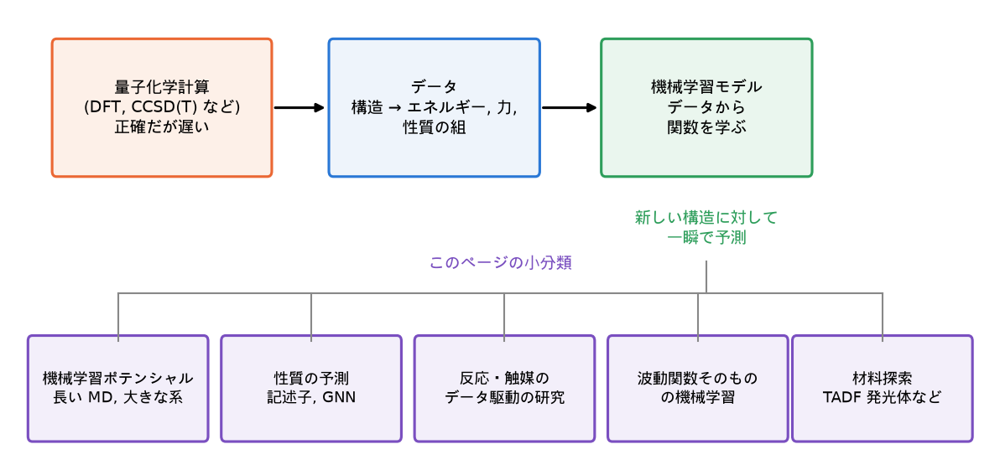
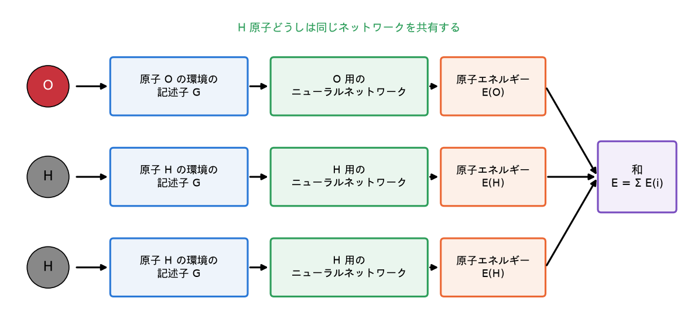
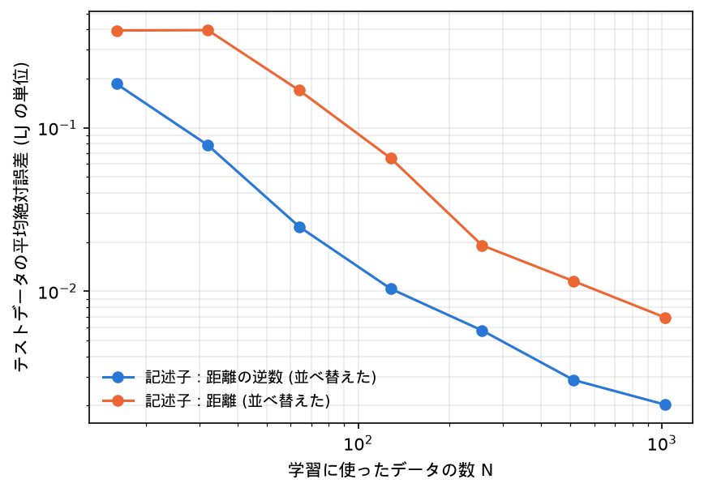
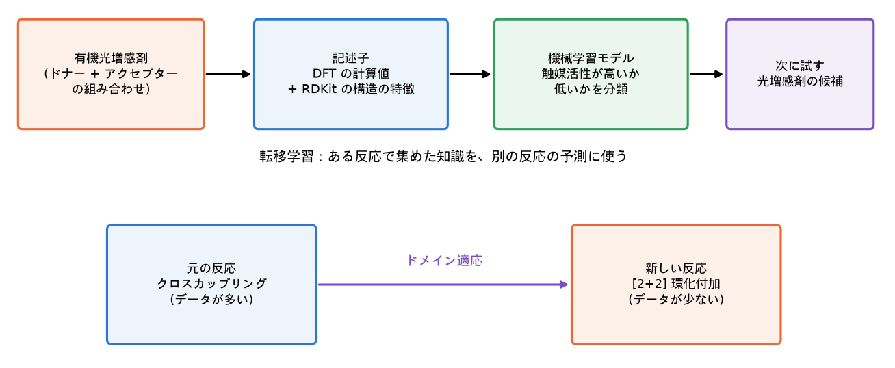
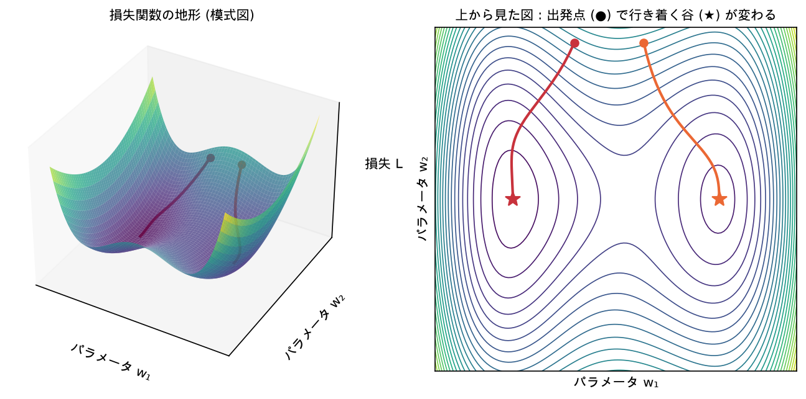
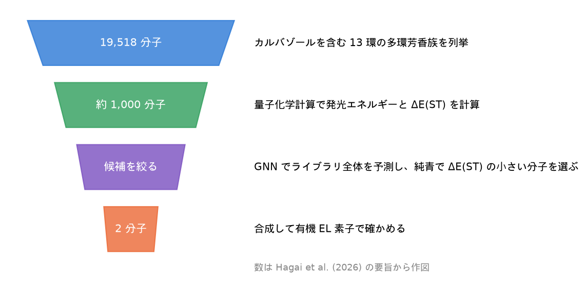
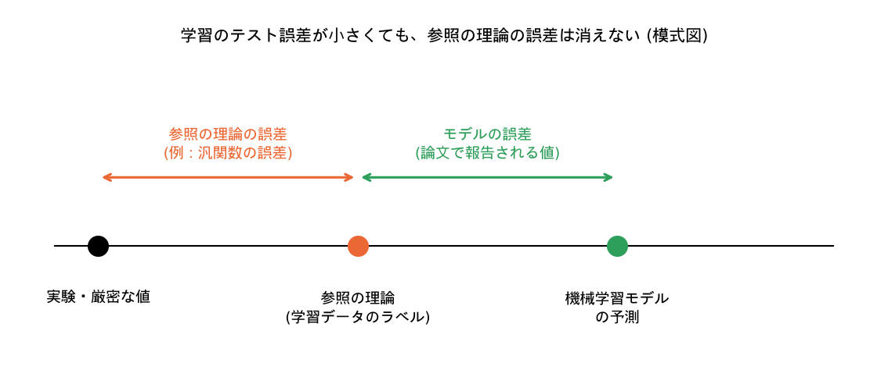

# 機械学習と量子化学：データで化学を速く、広くする研究

!!! abstract "このページで分かること"
    機械学習と量子化学を組み合わせる研究の全体像を紹介します。量子化学計算の結果を「データ」として学ばせ、同じ計算を何千倍も速く行ったり、計算できなかった数の分子を調べたりする研究です。どの小分類にも共通する常識（データの分け方、外挿、学習した値が何の理論の値か）も説明します。

    | 節 | 小分類 | ひとことで |
    |---|---|---|
    | 2 | 機械学習ポテンシャル | 原子の配置からエネルギーと力を一瞬で出す |
    | 3 | 分子の性質の予測 | 構造から HOMO-LUMO ギャップなどを予測する |
    | 4 | 反応・触媒のデータ駆動の研究 | 実験の結果と計算値を結び付けて、よい触媒を探す |
    | 5 | 波動関数そのものの機械学習 | ニューラルネットワークを波動関数の形として使う |
    | 6 | 材料探索への応用 | 何万個もの候補から発光材料を選ぶ |
    | 7 | この界隈の常識 | データの分け方、リーク、外挿、参照の理論 |

!!! tip "ひとことで言うと"
    量子化学計算は、正確ですが時間のかかる「職人の手作業」です。機械学習は、職人の仕事をたくさん見て、そのこつを真似する「見習い」にあたります。見習いは職人より何千倍も速く答えを出せますが、見たことのない種類の仕事（学習データから遠い分子）では間違えます。また、見習いの腕は、お手本にした職人（学習データを作った計算方法）を超えません。この分野の研究は、よい見習いを育てる方法と、見習いを安全に使う方法を考える研究です。

## 1. この分野が答えようとしている問い

量子化学計算は、分子の構造からエネルギーや性質を計算します。
しかし、計算時間は分子が大きくなると急に増えます。
たとえば DFT では、1 つの構造の計算に数分から数時間かかります。
分子動力学（MD）で 100 万ステップの計算をしたり、10 万個の候補分子を調べたりするのは、そのままでは現実的ではありません。

そこで、量子化学計算の結果をデータとして集め、「構造 → 答え」の関係を機械学習のモデルに学ばせます（図 1）。
学習が終われば、新しい構造に対する予測は、ほぼ一瞬で済みます。
この分野が答えようとしている問いは、次のようなものです。

- 量子化学計算と同じくらい正確で、何千倍も速いモデルを作れるか。
- そのモデルは、どこまで信用できるか。どこで間違えるか。
- 計算や実験のデータから、人間が気づかなかった傾向や設計の指針を引き出せるか。
- 機械学習の道具（ニューラルネットワーク）を、量子化学の方程式を解くこと自体に使えるか。

**図 1**　この分野の全体の流れ（模式図）。上の段は「計算 → データ → モデル」の流れで、下の段がこのページで扱う小分類です。

全体を見渡す総説として、分子と材料の機械学習の総説 [Butler 2018] や、機械学習ポテンシャルの総説 [Unke 2021] がよく読まれています。

## 2. 機械学習ポテンシャル

### 2.1 何をする研究か

機械学習ポテンシャル（machine learning interatomic potential、MLIP）は、原子の配置を入力にして、エネルギーと原子にはたらく力を出すモデルです。
古典的な力場（ばねと電荷のモデル）と同じように使えて、精度は学習に使った量子化学計算に近い、というものを目指します。

多くのモデルは、全エネルギーを「原子ごとのエネルギーの和」で表します（図 2）。
各原子のエネルギーは、その原子のまわりの、半径 $R_\mathrm c$（カットオフ半径）の球の中の原子の配置だけで決まると考えます（図 3）。
球の中の配置を数の並びに変換したものを、記述子（descriptor）と呼びます。
この形は、Behler と Parrinello が 2007 年にニューラルネットワークのポテンシャルとして導入しました [Behler 2007]。

**図 2**　Behler–Parrinello の形（模式図）。水分子の例です。同じ元素の原子は同じネットワークを使うので、原子の番号を入れ替えても全エネルギーは変わりません。

**図 3**　原子環境とカットオフ球（模式図）。中心の原子（赤）のエネルギーは、球の中の原子（橙）の配置だけで決まると考えます。球の外の原子（灰色）は無視します。このおかげで計算時間は原子の数に比例しますが、遠くから届く静電相互作用は表せません。

### 2.2 よく使う方法とプログラム

モデルの形は、およそ次の順に発展してきました。

| 世代 | 例 | 特徴 |
|---|---|---|
| 記述子 + ニューラルネットワーク | Behler–Parrinello [Behler 2007]、ANI-1 [Smith 2017] | 記述子を人が設計する |
| メッセージパッシング型 | SchNet [Schütt 2018] | 原子どうしが情報をやり取りして、記述子を学習で作る |
| 等変ニューラルネットワーク | NequIP [Batzner 2022]、MACE [Batatia 2022] | 回転したときのベクトルの向きの変わり方まで組み込む |
| 基盤モデル | MACE-MP-0 [Batatia 2025]、UMA [Wood 2025] | 多くの元素と系を 1 つのモデルで扱う |

ANI-1 は、H、C、N、O からなる有機分子について、約 1720 万個の構造を ωB97X/6-31G(d) で計算したデータで学習しました [Smith 2017]。
その後、DFT で学習したモデルを CCSD(T)/CBS のデータで学習し直す ANI-1ccx も作られています [Smith 2019]。
最近の基盤モデルの UMA は、材料、触媒、分子などの約 5 億個の構造で学習しています [Wood 2025]。
分子のデータには、電荷とスピン多重度の幅を大きく広げた OMol25 が使われています [Levine 2025]。

プログラムとしては、原子の構造を扱う Python のライブラリ ASE と組み合わせて使うものが多く、MD は LAMMPS などで行います。

### 2.3 代表的な研究例

- **Behler–Parrinello（2007 年）**：原子ごとのエネルギーの和と、対称関数の記述子を組み合わせ、高次元のポテンシャルエネルギー曲面をニューラルネットワークで表しました [Behler 2007]。
- **ANI-1 と ANI-1ccx**：大量の DFT のデータで有機分子に広く使えるポテンシャルを作り [Smith 2017]、さらに少数の結合クラスターのデータで学習し直して精度を上げました [Smith 2019]。後者の「大きなデータで下地を作り、少ない高精度のデータで仕上げる」考え方は、4 節の転移学習と同じです。
- **MACE-MP-0**：無機材料のデータ（PBE 汎関数）だけで学習したのに、固体、液体、界面、小さなタンパク質まで幅広い系で安定な MD を行えました。一方で、液体の水の構造は秩序が強すぎる結果になり、論文はこれを PBE によく見られる性質がデータを通して入ったものだと説明しています [Batatia 2025]。

**この界隈の常識**

- 「DFT の精度」と書かれていても、それは学習に使った DFT の値との差が小さいという意味です（7 節）。
- 学習データにない種類の構造（結合が切れる途中、高温で崩れた構造など）では、もっともらしい間違いを出します。
- 長距離の静電相互作用や電荷の移動は、カットオフの内側だけを見るモデルでは表しにくい、という問題がよく議論されます [Ko 2021]。
- 力も学習に使うのが普通です。1 つの構造から、原子の数 × 3 個の力の値が得られるからです。

## 3. 分子の性質の予測

### 3.1 何をする研究か

分子の構造（または分子のグラフ）から、HOMO-LUMO ギャップ、双極子モーメント、励起エネルギー、溶解度などの性質を予測する研究です。
2 節のポテンシャルが「1 つの分子の多数の構造」を扱うのに対し、こちらは「多数の分子の代表的な構造」を扱うことが多いです。

分子を数の並びに変える方法（記述子）として、原子間のクーロン相互作用を並べたクーロン行列 [Rupp 2012]、部分構造の有無を 0 と 1 で並べたフィンガープリント、分子をグラフとして扱うグラフニューラルネットワーク（GNN）[Gilmer 2017] などがあります。
GNN では、原子を頂点、結合や近い原子の組を辺とみなし、隣どうしで情報をやり取りして、分子全体の特徴を作ります。

分子を記述子の空間の点として並べると、似た分子は近くに集まります（図 4）。
学習データの点の「中」にある分子の予測（内挿）は比較的正確です。
データから遠い分子の予測（外挿）は信用できません。

**図 4**　記述子の空間（模式図）。青い点が学習データです。緑の星はデータの中にあるので予測を信用しやすく、赤の × はデータから遠いので予測を信用できません。

### 3.2 データセットとベンチマーク

この分野では、共通のデータセットで手法を比べるのが習慣です。
代表は QM9 で、重原子（C、N、O、F）が 9 個以下の小さな有機分子 133,885 個について、B3LYP/6-31G(2df,p) で計算した構造と性質が入っています [Ramakrishnan 2014]。
いろいろな性質と課題を集めたベンチマークとして MoleculeNet もあります [Wu 2018]。

### 3.3 代表的な研究例

- **クーロン行列（2012 年）**：分子の原子化エネルギーを、カーネルリッジ回帰で予測しました。機械学習で量子化学の量を予測する研究の出発点の 1 つです [Rupp 2012]。
- **学習曲線による比較（2017 年）**：QM9 の 13 の性質について、記述子と回帰の方法の組み合わせを学習曲線で比べました。すべての性質で、モデルの予測と B3LYP の差は、B3LYP と実験の差より小さかったと報告しています。論文は、電子相関を取り入れた高精度の計算や実験のデータがあれば、モデルがハイブリッド汎関数より正確になりうると述べています [Faber 2017]。

学習曲線（learning curve）は、学習データの数 $N$ とテストの誤差を両対数のグラフに描いたものです（図 5）。
多くの場合、ほぼ直線（べき乗則）になります。
同じデータ数で誤差が小さく、傾きが急な記述子ほど、よい記述子です。

**図 5**　学習曲線の例（自作の小さな計算）。3 個の原子が Lennard-Jones ポテンシャルで相互作用する系のエネルギーを、カーネルリッジ回帰で学習しました。記述子は 3 つの原子間距離（並べ替えたもの）か、その逆数です。どちらも直線的に誤差が下がりますが、エネルギーの形（距離の逆数のべきの和）に近い「距離の逆数」の記述子のほうが、同じデータ数で誤差が小さくなります。

**この界隈の常識**

- 「化学的精度」（1 kcal/mol 程度）は、よく目標にされる誤差の大きさです。ただし、その比較の相手が何の理論の値かを必ず確かめます。
- QM9 の構造は、すべてエネルギー最小の構造です。そこで学習したモデルが、ゆがんだ構造でも正しいとは限りません。
- 性質によって、分子全体の量（エネルギーなど、原子の寄与の和で表せる）と、分子のどこか一部で決まる量（HOMO のエネルギーなど）があり、モデルの作り方を変えます。

## 4. 反応・触媒のデータ駆動の研究

### 4.1 何をする研究か

実験で測った反応の収率や触媒の活性を「答え」にし、量子化学計算の値や分子の構造の特徴を「記述子」にして、両者の関係を機械学習で調べる研究です。
データは数十から数百件と少ないことが多く、モデルの予測だけでなく、「どの記述子が効いているか」という解釈も重視されます。

### 4.2 代表的な研究例：有機光増感剤の触媒活性

光で反応を進める光触媒の研究から、データ駆動の研究の流れを 3 つの論文で紹介します（図 6）。

**図 6**　有機光増感剤の触媒活性の機械学習（模式図）。上の段が基本の流れ、下の段が転移学習です。

- **分類のモデル**：Noto、Yada、Yanai、Saito は、ニッケル(II) 塩と有機光増感剤を使ってフェノールを合成する反応について、ドナーとアクセプターの部分からなる 60 個の光増感剤の触媒活性を調べました。DFT で計算した物理的な性質と、RDKit で作った構造の特徴の両方を記述子にした分類モデルを作り、2 種類の記述子を合わせると、片方だけのときより、適合率（precision）と再現率（recall）が広い探索範囲でつり合うことを示しました [Noto 2023]。
- **反応をまたぐ転移学習**：同じグループは、転移学習の一種であるドメイン適応（domain adaptation）を光触媒に使いました。クロスカップリング反応で得た光増感剤の振る舞いの知識を、種類の違う [2+2] 環化付加反応の予測に移し、通常の機械学習より予測がよくなりました。学習データが 10 点だけでも、満足できる予測性能が得られたと報告しています [Noto 2025]。
- **励起状態の速度定数を記述子に**：Kunisada らは、量子化学計算で求めた励起状態の過程の速度定数（蛍光、項間交差などの速さ）を記述子にして、触媒活性との関係を調べました。2 つの反応の収率の内挿の予測で、テストデータの決定係数 $R^2$ はそれぞれ 0.83 と 0.77 でした。計算した速度定数は、実験で測った励起状態の寿命と同等以上の記述子になりました。SHAP という解析で、T₁ 状態からの過程の速度定数が予測に大きく寄与していることが分かりました [Kunisada 2026]。

**この界隈の常識**

- データが少ないので、モデルを複雑にしすぎると過学習します。交差検証（データを何通りかに分けて検証をくり返す方法）がほぼ必須です。
- 記述子に量子化学の値を入れるのは、化学的な意味のある特徴を与えて、少ないデータでも学習できるようにするためです。
- 「予測が当たった」だけでなく、「なぜ当たったか」（どの記述子が効いたか）を化学の言葉で説明することが求められます。

## 5. 波動関数そのものの機械学習

### 5.1 何をする研究か

これまでの節は、量子化学計算の「結果」を学ぶ研究でした。
この節の研究は、ニューラルネットワークを、波動関数の形（試行関数、ansatz）として使います。
学習データは使いません。
エネルギーが最も低くなるように、変分原理でネットワークのパラメータを決めます。
「何を学ぶか」は普通の機械学習と違いますが、道具（ネットワークの形、勾配による最適化）は共通です。

このとき、ネットワークのパラメータが作る「損失関数」（ここではエネルギー）の地形を下っていきます（図 7）。
地形には谷がいくつもあり、出発点によって行き着く谷が変わることがあります。
これは、普通の機械学習の学習でも同じです。

**図 7**　損失関数の地形と勾配降下（模式図）。左が 3 次元の地形、右が上から見た等高線です。2 つの出発点（●）から坂を下ると、別々の谷（★）に行き着きます。

### 5.2 2 つの流れ

1 つ目は、電子配置の係数をネットワークで表す流れです（図 8）。
Carleo と Troyer は、スピン系の波動関数を制限ボルツマンマシン（RBM）で表す方法（neural-network quantum state、NQS）を提案しました [Carleo 2017]。
Yang、Sugiyama、Tsuda、Yanai は、これを分子の CAS-CI の波動関数に応用しました。
電子配置の占有数（0 か 1 の並び）を入力にして、その配置の係数を出すネットワークです。
RBM に加えて、隠れユニットを持たない 2 次と 3 次のボルツマンマシン（BM2、BM3）も導入し、窒素分子の解離のポテンシャル曲線で、BM3 が CAS-CI のエネルギーを 50 μE_h 以内で再現しました [Yang 2020]。
Hagai らは、この表現を量子コンピュータの量子ゲートで用意するアルゴリズムに拡張しています [Hagai 2023]。

**図 8**　電子配置の係数をネットワークで表す考え方（模式図）。(a) 電子配置はスピン軌道ごとの占有数 0 か 1 の並びで書けます。(b) それをネットワークに入力すると、(c) その配置の係数が出てきます。係数の表を丸ごと覚える代わりに、係数を作る関数を覚えるのです。

2 つ目は、電子の座標を直接入力にする流れです。
FermiNet [Pfau 2020] と PauliNet [Hermann 2020] は、電子の座標から波動関数の値を出すネットワークで、電子の入れ替えで符号が変わる性質（反対称性）を組み込んでいます。
変分モンテカルロ法でエネルギーを下げるように学習します。
PauliNet の論文は、30 電子までの分子でほぼ厳密な解が得られたと報告しています [Hermann 2020]。
この分野の総説もあります [Hermann 2023]。

**この界隈の常識**

- 「機械学習」と呼ばれていても、学習データは使わず、エネルギーの最小化だけで決めます。結果は変分原理で評価できます。
- 計算時間はまだ大きく、比べる相手は CCSD(T) や DMRG などの高精度の方法です。

## 6. 材料探索への応用

### 6.1 何をする研究か

候補となる分子を計算機の中で大量に作り、計算と機械学習で絞り込んでから、少数を合成して確かめる研究です。
有機 EL（OLED）の発光材料、特に熱活性化遅延蛍光（TADF）の材料がよく対象になります。
TADF では、一重項と三重項の励起状態のエネルギー差 $\Delta E_\mathrm{ST}$ が小さいことが重要です。
差が小さいと、三重項から一重項へ戻る逆項間交差が熱で起こり、三重項のエネルギーも光に変えられるからです。

### 6.2 代表的な研究例

- **大規模な仮想スクリーニング（2016 年）**：Gómez-Bombarelli らは、160 万個の分子の探索空間を作り、40 万個以上を TDDFT で調べて、可視光の全域で有望な OLED の分子を数千個見つけました。合成した候補の外部量子効率は最大 22% でした [Gómez-Bombarelli 2016]。
- **機械学習による青色 TADF 発光体の発見（2026 年）**：Hagai らは、カルバゾールを含む 13 環の多環芳香族炭化水素を 19,518 個列挙し、約 1,000 個について、S₁ の最適化構造での発光エネルギーと $\Delta E_\mathrm{ST}$ を量子化学計算で求めました。これで学習したグラフニューラルネットワークでライブラリ全体を予測すると、発光エネルギーと $\Delta E_\mathrm{ST}$ の間に強い負の相関（$R = -0.75$）があり、純青の領域に $\Delta E_\mathrm{ST}$ の小さい候補が多いことが分かりました。選んだ 2 つの分子を合成すると、半値全幅 17〜19 nm のとても細い深青色の発光と、0.13〜0.19 eV の小さな $\Delta E_\mathrm{ST}$ が得られました [Hagai 2026]（図 9）。
- **計算の土台**：TADF の分子で鍵になる逆項間交差の速度定数を、摂動論による励起状態のダイナミクスの枠組みで計算する方法の評価も行われています。この研究では 121 個の多重共鳴型（MR）TADF 分子を調べ、Marcus 理論の近似による誤りを明らかにしました [Hagai 2024]。スクリーニングでどの量を計算するかは、こうした理論の研究に支えられています。

**図 9**　機械学習による TADF 発光体の探索の流れ。数は Hagai et al. (2026) の要旨から作図しました。計算の費用が高い段階ほど、扱う分子の数を減らします。

**この界隈の常識**

- 計算で絞る段階と、合成と測定で確かめる段階を組み合わせるのが普通です。計算だけで「発見」とは言いません。
- 候補の数を何桁も減らす段階ごとに、使う方法の精度と費用を変えます（安い方法で広く、高い方法で狭く）。
- 詳しくは「分子スクリーニングと材料探索」のページ（準備中）でも扱います。

## 7. この界隈の常識：データの扱い方

### 7.1 訓練・検証・テストに分ける

データは、訓練（パラメータを決める）、検証（モデルの形や設定を選ぶ）、テスト（最後に性能を報告する）の 3 つに分けます（図 10 左）。
テストデータは、モデルを選ぶのに使ってはいけません。
使うと、テストデータに合わせてモデルを選んだことになり、報告する誤差が実力より小さくなります。

### 7.2 データのリーク

データのリーク（leakage）とは、テストデータの情報が、何らかの形で学習に入りこんでしまうことです。
機械学習を使った科学の研究で、再現性の問題の大きな原因になっていると指摘されています [Kapoor 2023]。
化学でよくあるのは、同じ分子の別の配座が訓練とテストの両方に入る場合です（図 10 右）。
テストの問題の「ほぼ答え」が訓練に入っているので、新しい分子に対する実力より、ずっとよい結果が出ます。
対策として、分子ごと、骨格ごと、時間ごと（古いデータで学習し、新しいデータでテストする）[Sheridan 2013] に分けます。

**図 10**　データの分け方（左）とリークの例（右、模式図）。右では、紫と緑の分子の別の配座が訓練とテストの両方に入っています。テストが簡単になり、誤差が小さく出ます。

### 7.3 学習した値は何の理論の値か

機械学習のモデルが近づけるのは、学習データのラベル（答え）です。
ラベルが DFT で計算した値なら、モデルが目指すのは DFT の値で、実験の値ではありません。
したがって、モデルの誤差を考えるときは、「参照の理論の誤差」と「モデルの誤差」の 2 つを分けて考えます（図 11）。
論文で報告されるのは、ふつう後者だけです。

**図 11**　2 種類の誤差（模式図）。テスト誤差がどれだけ小さくても、参照の理論（たとえば汎関数）の誤差は残ります。ANI-1ccx のように高精度のデータで学習し直すのは、左の誤差を小さくするためです [Smith 2019]。

## この分野でよく出てくる言葉

| 言葉 | 意味 |
|---|---|
| 記述子（descriptor） | 分子や原子環境を、機械学習に入力できる数の並びに変えたもの |
| カットオフ半径 | 原子のエネルギーを決めるときに見る範囲の半径 |
| 機械学習ポテンシャル（MLIP） | 原子の配置からエネルギーと力を出す機械学習のモデル |
| グラフニューラルネットワーク（GNN） | 分子をグラフとして扱い、隣どうしで情報をやり取りするネットワーク |
| 等変（equivariant） | 入力を回転すると、出力（力のベクトルなど）も同じだけ回転する性質 |
| 基盤モデル（foundation model） | 大量・多様なデータで学習し、多くの系に使えるモデル。必要なら追加の学習で仕上げる |
| 学習曲線 | 学習データの数と誤差の関係を両対数で描いたグラフ |
| 内挿と外挿 | 学習データの範囲の中での予測と、範囲の外での予測 |
| データのリーク | テストデータの情報が学習に入りこんで、性能が過大に見えること |
| 転移学習 | ある課題で学習した知識を、別の課題の学習に使うこと |
| Δ 学習 | 安い計算と高い計算の差を学習すること [Ramakrishnan 2015] |
| ニューラルネットワーク量子状態（NQS） | ニューラルネットワークで表した波動関数 |
| 能動学習 | モデルが自信のない構造を選んで、そこだけ量子化学計算を追加すること |

## この分野の常識：まとめ

知らないと会話についていけないことを挙げます。

- モデルの精度は、学習データを作った理論の精度を超えません。「DFT の精度」は「DFT の値との差が小さい」という意味です。
- テストの誤差は、学習データに似た構造でしか保証されません。外挿では、もっともらしい間違いを出します。
- データは訓練・検証・テストに分け、テストデータでモデルを選びません。
- 同じ分子の配座や、ほぼ同じ分子が訓練とテストに分かれて入るリークに注意します。
- 手法の比較には、QM9 などの共通のデータセットと、学習曲線を使います。
- 機械学習ポテンシャルでは、エネルギーだけでなく力も学習するのが普通です。
- カットオフの内側だけを見るモデルは、長距離の静電相互作用や電荷移動が苦手です。
- 基盤モデルは便利ですが、学習データの汎関数の癖も一緒に受け継ぎます。少数の計算で追加の学習（ファインチューニング）をするのが一般的です。
- データの少ない触媒の研究では、量子化学の値を記述子に入れて、化学的な意味を与えます。解釈（どの記述子が効いたか）も求められます。
- 波動関数のニューラルネット表現は、データを使わず、変分原理で学習します。
- 材料探索では、計算で絞り、合成と測定で確かめるまでを 1 つの研究とします。

## 最初に読むとよい文献

- K. T. Butler ら、"Machine learning for molecular and materials science"（Nature, 2018）：分子と材料の機械学習の全体像を短くまとめた総説 [Butler 2018]。
- O. T. Unke ら、"Machine Learning Force Fields"（Chem. Rev., 2021）：機械学習ポテンシャルの考え方から実践までを扱う総説 [Unke 2021]。
- J. Hermann ら、"Ab initio quantum chemistry with neural-network wavefunctions"（Nat. Rev. Chem., 2023）：5 節の波動関数の機械学習の総説 [Hermann 2023]。
- S. Kapoor、A. Narayanan、"Leakage and the reproducibility crisis in machine-learning-based science"（Patterns, 2023）：データのリークの種類と対策 [Kapoor 2023]。

## 講義ノートとの関係

- 機械学習の基礎：[第 1 回 機械学習とは](../courses/ml-basics/01-what-is-ml.md)、[第 3 回 過学習と正則化、データの分け方](../courses/ml-basics/03-overfitting-regularization.md)（7 節）、[第 6 回 最適化](../courses/ml-basics/06-optimization.md)（図 7）、[第 7 回 グラフニューラルネットワーク](../courses/ml-basics/07-graph-neural-networks.md)（3 節）、[第 8 回 不変と等変](../courses/ml-basics/08-invariance-equivariance.md)、[第 10 回 不確かさと能動学習](../courses/ml-basics/10-uncertainty-active-learning.md)
- 量子化学のための機械学習：[第 1 回 何を学習させるのか](../courses/ml-chem/01-what-to-learn.md)、[第 2 回 記述子と原子環境](../courses/ml-chem/02-descriptors.md)、[第 3 回 原子ごとのエネルギーの和](../courses/ml-chem/03-mlip-basics.md)（2 節）、[第 5 回 等変ニューラルネットワーク](../courses/ml-chem/05-equivariant-mlips.md)、[第 6 回 データセット](../courses/ml-chem/06-datasets.md)（3 節、7.3 節）、[第 7 回 基盤モデル](../courses/ml-chem/07-foundation-models.md)、[第 8 回 Δ 学習](../courses/ml-chem/08-delta-learning.md)、[第 10 回 研究で使うときの注意](../courses/ml-chem/10-cautions.md)
- 量子化学の理論：[第 12 回 CASSCF](../courses/qc-theory/12-casscf.md)（5 節の CAS-CI）、[第 19 回 TDDFT](../courses/qc-theory/19-tddft.md)（6 節の励起エネルギー）

## 参考文献

- K. T. Butler, D. W. Davies, H. Cartwright, O. Isayev, A. Walsh, "Machine learning for molecular and materials science", Nature 559, 547 (2018). DOI: [10.1038/s41586-018-0337-2](https://doi.org/10.1038/s41586-018-0337-2)
- O. T. Unke, S. Chmiela, H. E. Sauceda, M. Gastegger, I. Poltavsky, K. T. Schütt, A. Tkatchenko, K.-R. Müller, "Machine Learning Force Fields", Chem. Rev. 121, 10142 (2021). DOI: [10.1021/acs.chemrev.0c01111](https://doi.org/10.1021/acs.chemrev.0c01111)
- J. Behler, M. Parrinello, "Generalized Neural-Network Representation of High-Dimensional Potential-Energy Surfaces", Phys. Rev. Lett. 98, 146401 (2007). DOI: [10.1103/PhysRevLett.98.146401](https://doi.org/10.1103/PhysRevLett.98.146401)
- J. S. Smith, O. Isayev, A. E. Roitberg, "ANI-1: an extensible neural network potential with DFT accuracy at force field computational cost", Chem. Sci. 8, 3192 (2017). DOI: [10.1039/C6SC05720A](https://doi.org/10.1039/C6SC05720A)
- J. S. Smith, B. T. Nebgen, R. Zubatyuk, N. Lubbers, C. Devereux, K. Barros, S. Tretiak, O. Isayev, A. E. Roitberg, "Approaching coupled cluster accuracy with a general-purpose neural network potential through transfer learning", Nat. Commun. 10, 2903 (2019). DOI: [10.1038/s41467-019-10827-4](https://doi.org/10.1038/s41467-019-10827-4)
- K. T. Schütt, H. E. Sauceda, P.-J. Kindermans, A. Tkatchenko, K.-R. Müller, "SchNet – A deep learning architecture for molecules and materials", J. Chem. Phys. 148, 241722 (2018). DOI: [10.1063/1.5019779](https://doi.org/10.1063/1.5019779)
- S. Batzner, A. Musaelian, L. Sun, M. Geiger, J. P. Mailoa, M. Kornbluth, N. Molinari, T. E. Smidt, B. Kozinsky, "E(3)-equivariant graph neural networks for data-efficient and accurate interatomic potentials", Nat. Commun. 13, 2453 (2022). DOI: [10.1038/s41467-022-29939-5](https://doi.org/10.1038/s41467-022-29939-5)
- I. Batatia, D. P. Kovács, G. N. C. Simm, C. Ortner, G. Csányi, "MACE: Higher Order Equivariant Message Passing Neural Networks for Fast and Accurate Force Fields", arXiv:2206.07697 (2022).
- I. Batatia, P. Benner, Y. Chiang, A. M. Elena, D. P. Kovács, J. Riebesell, … , G. Csányi, "A foundation model for atomistic materials chemistry", J. Chem. Phys. 163, 184110 (2025). DOI: [10.1063/5.0297006](https://doi.org/10.1063/5.0297006)
- B. M. Wood, M. Dzamba, X. Fu, M. Gao, M. Shuaibi, L. Barroso-Luque, K. Abdelmaqsoud, V. Gharakhanyan, J. R. Kitchin, D. S. Levine, K. Michel, A. Sriram, T. Cohen, A. Das, A. Rizvi, S. J. Sahoo, Z. W. Ulissi, C. L. Zitnick, "UMA: A Family of Universal Models for Atoms", Advances in Neural Information Processing Systems 38, 143528 (2025). DOI: [10.52202/085713-4310](https://doi.org/10.52202/085713-4310)
- D. S. Levine, M. Shuaibi, E. W. C. Spotte-Smith, M. G. Taylor, M. R. Hasyim, K. Michel, I. Batatia, G. Csányi, M. Dzamba, P. Eastman, N. C. Frey, X. Fu, V. Gharakhanyan, A. S. Krishnapriyan, J. A. Rackers, S. Raja, A. Rizvi, A. S. Rosen, Z. Ulissi, S. Vargas, C. L. Zitnick, S. M. Blau, B. M. Wood, "The Open Molecules 2025 (OMol25) Dataset, Evaluations, and Models", arXiv:2505.08762 (2025).
- T. W. Ko, J. A. Finkler, S. Goedecker, J. Behler, "A fourth-generation high-dimensional neural network potential with accurate electrostatics including non-local charge transfer", Nat. Commun. 12, 398 (2021). DOI: [10.1038/s41467-020-20427-2](https://doi.org/10.1038/s41467-020-20427-2)
- M. Rupp, A. Tkatchenko, K.-R. Müller, O. A. von Lilienfeld, "Fast and Accurate Modeling of Molecular Atomization Energies with Machine Learning", Phys. Rev. Lett. 108, 058301 (2012). DOI: [10.1103/PhysRevLett.108.058301](https://doi.org/10.1103/PhysRevLett.108.058301)
- J. Gilmer, S. S. Schoenholz, P. F. Riley, O. Vinyals, G. E. Dahl, "Neural Message Passing for Quantum Chemistry", arXiv:1704.01212 (2017).
- R. Ramakrishnan, P. O. Dral, M. Rupp, O. A. von Lilienfeld, "Quantum chemistry structures and properties of 134 kilo molecules", Sci. Data 1, 140022 (2014). DOI: [10.1038/sdata.2014.22](https://doi.org/10.1038/sdata.2014.22)
- Z. Wu, B. Ramsundar, E. N. Feinberg, J. Gomes, C. Geniesse, A. S. Pappu, K. Leswing, V. Pande, "MoleculeNet: a benchmark for molecular machine learning", Chem. Sci. 9, 513 (2018). DOI: [10.1039/C7SC02664A](https://doi.org/10.1039/C7SC02664A)
- F. A. Faber, L. Hutchison, B. Huang, J. Gilmer, S. S. Schoenholz, G. E. Dahl, O. Vinyals, S. Kearnes, P. F. Riley, O. A. von Lilienfeld, "Prediction Errors of Molecular Machine Learning Models Lower than Hybrid DFT Error", J. Chem. Theory Comput. 13, 5255 (2017). DOI: [10.1021/acs.jctc.7b00577](https://doi.org/10.1021/acs.jctc.7b00577)
- R. Ramakrishnan, P. O. Dral, M. Rupp, O. A. von Lilienfeld, "Big Data Meets Quantum Chemistry Approximations: The Δ-Machine Learning Approach", J. Chem. Theory Comput. 11, 2087 (2015). DOI: [10.1021/acs.jctc.5b00099](https://doi.org/10.1021/acs.jctc.5b00099)
- N. Noto, A. Yada, T. Yanai, S. Saito, "Machine-Learning Classification for the Prediction of Catalytic Activity of Organic Photosensitizers in the Nickel(II)-Salt-Induced Synthesis of Phenols", Angew. Chem. Int. Ed. 62, e202219107 (2023). DOI: [10.1002/anie.202219107](https://doi.org/10.1002/anie.202219107)
- N. Noto, R. Kunisada, T. Rohlfs, M. Hayashi, R. Kojima, O. García Mancheño, T. Yanai, S. Saito, "Transfer learning across different photocatalytic organic reactions", Nat. Commun. 16, 3388 (2025). DOI: [10.1038/s41467-025-58687-5](https://doi.org/10.1038/s41467-025-58687-5)
- R. Kunisada, M. Hayashi, T. Rohlfs, T. Nagano, K. Sano, N. Inai, N. Noto, T. Ogaki, Y. Matsui, H. Ikeda, O. García Mancheño, T. Yanai, S. Saito, "Data-driven approach to elucidate the correlation between photocatalytic activity and rate constants from excited states", Chem. Sci. 17, 176 (2026). DOI: [10.1039/D5SC06465A](https://doi.org/10.1039/D5SC06465A)
- G. Carleo, M. Troyer, "Solving the quantum many-body problem with artificial neural networks", Science 355, 602 (2017). DOI: [10.1126/science.aag2302](https://doi.org/10.1126/science.aag2302)
- P.-J. Yang, M. Sugiyama, K. Tsuda, T. Yanai, "Artificial Neural Networks Applied as Molecular Wave Function Solvers", J. Chem. Theory Comput. 16, 3513 (2020). DOI: [10.1021/acs.jctc.9b01132](https://doi.org/10.1021/acs.jctc.9b01132)
- M. Hagai, M. Sugiyama, K. Tsuda, T. Yanai, "Artificial neural network encoding of molecular wavefunctions for quantum computing", Digital Discovery 2, 634 (2023). DOI: [10.1039/D2DD00093H](https://doi.org/10.1039/D2DD00093H)
- D. Pfau, J. S. Spencer, A. G. D. G. Matthews, W. M. C. Foulkes, "Ab initio solution of the many-electron Schrödinger equation with deep neural networks", Phys. Rev. Research 2, 033429 (2020). DOI: [10.1103/PhysRevResearch.2.033429](https://doi.org/10.1103/PhysRevResearch.2.033429)
- J. Hermann, Z. Schätzle, F. Noé, "Deep-neural-network solution of the electronic Schrödinger equation", Nat. Chem. 12, 891 (2020). DOI: [10.1038/s41557-020-0544-y](https://doi.org/10.1038/s41557-020-0544-y)
- J. Hermann, J. Spencer, K. Choo, A. Mezzacapo, W. M. C. Foulkes, D. Pfau, G. Carleo, F. Noé, "Ab initio quantum chemistry with neural-network wavefunctions", Nat. Rev. Chem. 7, 692 (2023). DOI: [10.1038/s41570-023-00516-8](https://doi.org/10.1038/s41570-023-00516-8)
- R. Gómez-Bombarelli, J. Aguilera-Iparraguirre, T. D. Hirzel, D. Duvenaud, D. Maclaurin, M. A. Blood-Forsythe, et al., "Design of efficient molecular organic light-emitting diodes by a high-throughput virtual screening and experimental approach", Nat. Mater. 15, 1120 (2016). DOI: [10.1038/nmat4717](https://doi.org/10.1038/nmat4717)
- M. Hagai, J. Sun, J. Lee, K. J. Fujimoto, S. Yamaguchi, T. Yasuda, T. Yanai, "Machine-Learning-Guided Discovery of Boron-Free Narrowband Blue Thermally Activated Delayed Fluorescence Emitters", Angew. Chem. Int. Ed. 65, e2731055 (2026). DOI: [10.1002/anie.2731055](https://doi.org/10.1002/anie.2731055)
- M. Hagai, N. Inai, T. Yasuda, K. J. Fujimoto, T. Yanai, "Extended theoretical modeling of reverse intersystem crossing for thermally activated delayed fluorescence materials", Sci. Adv. 10, eadk3219 (2024). DOI: [10.1126/sciadv.adk3219](https://doi.org/10.1126/sciadv.adk3219)
- S. Kapoor, A. Narayanan, "Leakage and the reproducibility crisis in machine-learning-based science", Patterns 4, 100804 (2023). DOI: [10.1016/j.patter.2023.100804](https://doi.org/10.1016/j.patter.2023.100804)
- R. P. Sheridan, "Time-Split Cross-Validation as a Method for Estimating the Goodness of Prospective Prediction", J. Chem. Inf. Model. 53, 783 (2013). DOI: [10.1021/ci400084k](https://doi.org/10.1021/ci400084k)
