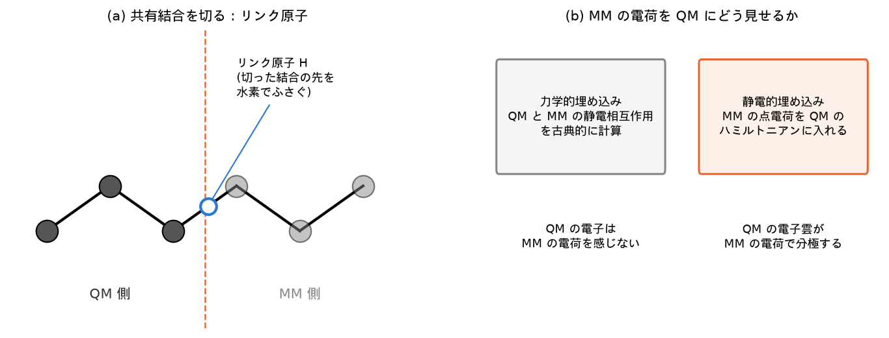
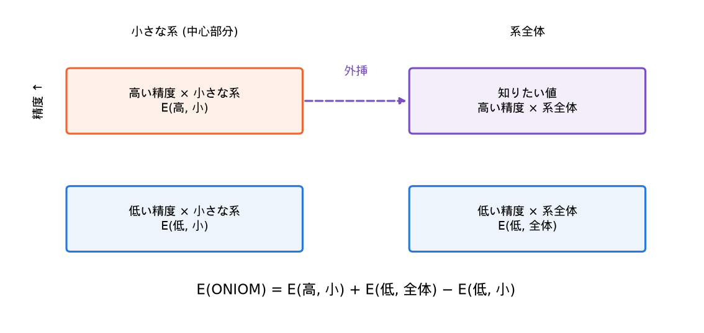
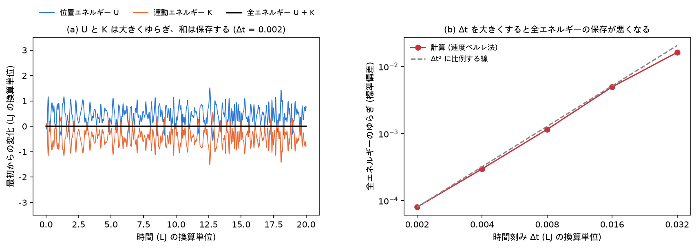
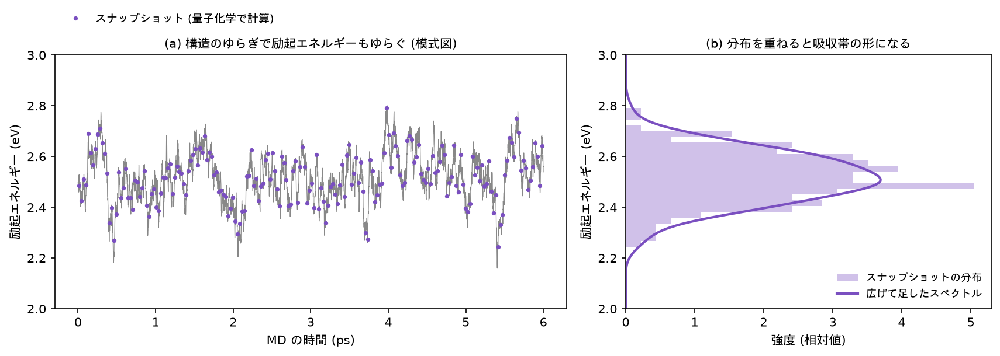
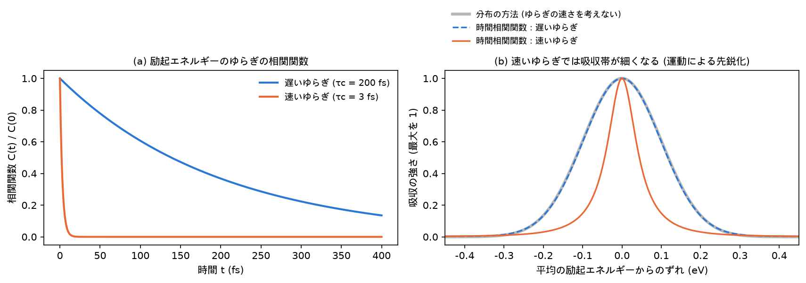
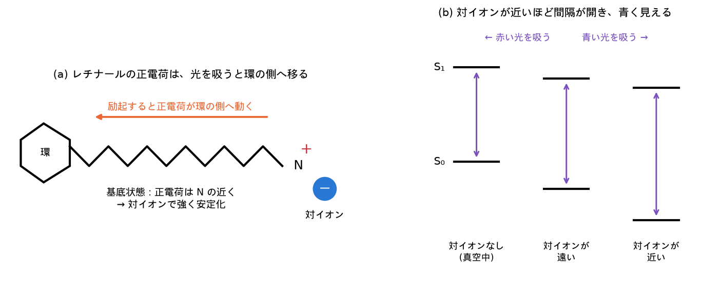
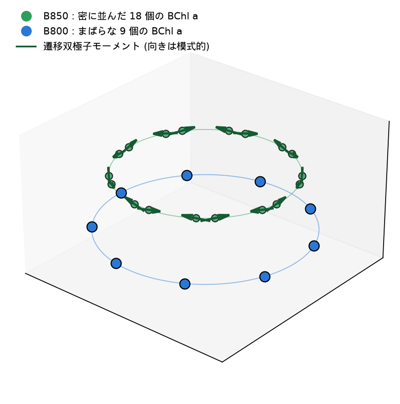
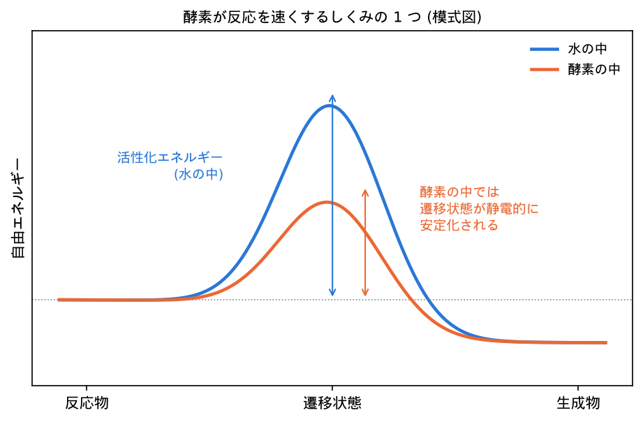

# 生体分子と溶液：タンパク質と水の中の分子の研究

!!! abstract "このページで分かること"
    実際の化学の多くは、真空中ではなく、水の中やタンパク質の中で起こります。このページでは、まわりの環境（溶媒、タンパク質）を計算に取り入れる研究を紹介します。環境の一部だけを量子化学で計算する方法、環境の動きを古典力学で追う方法、溶媒を平均的な媒質で置き換える方法の 3 つが柱です。応用として、タンパク質の中の色素の色や、酵素の反応を取り上げます。

    | 節 | 小分類 | ひとことで |
    |---|---|---|
    | 2 | QM/MM 法 | 中心だけ量子化学、まわりは古典力学 |
    | 3 | 分子動力学 | 原子の動きを追い、ゆらぎと平均を取る |
    | 4 | 溶媒和モデル | 溶媒を一様な媒質や分布関数で表す |
    | 5 | 光合成タンパク質とロドプシン | タンパク質が色素の色を変えるしくみ |
    | 6 | 酵素反応 | タンパク質が反応を速くするしくみ |

!!! tip "ひとことで言うと"
    舞台の上の主役（色素や反応する分子）だけをスポットライトで照らし、くわしく見るのがこの分野の考え方です。主役は量子化学で精密に計算し、まわりの観客（タンパク質や水）は、点電荷や一様な媒質のような簡単なモデルで表します。ただし、観客は止まっていません。ざわざわと動き、主役に影響を与え続けます。その動きを分子動力学で追い、たくさんの場面の平均を取るところまでが、この分野の仕事です。

## 1. この分野が答えようとしている問い

同じ色素の分子でも、溶媒やタンパク質が違うと、吸収する光の色が変わります。
同じ反応でも、水の中と酵素の中では、速さが何桁も違うことがあります。
この分野が答えようとしているのは、次のような問いです。

- 環境（溶媒、タンパク質）は、分子の電子状態をどう変えるか。
- タンパク質は、どのアミノ酸の、どんな相互作用で、色素の色や反応の速さを調節しているか。
- 室温でゆらいでいる環境の中で、観測される量（吸収スペクトル、反応速度）をどう計算するか。

問題は、系の大きさです。
タンパク質と水を合わせると、原子は数万から数十万個になります。
すべてを量子化学で計算することはできません。
そこで、方法ごとの得意な範囲を組み合わせます（図 1）。

**図 1**　方法ごとの守備範囲（模式図）。量子化学計算は小さな系の短い時間、古典 MD は大きな系の長い時間が得意です。QM/MM はその間をつなぎます。境界の位置は目安で、計算機と方法によって大きくずれます。

この組み合わせの考え方を作った Karplus、Levitt、Warshel の 3 人は、「複雑な化学系のマルチスケールモデルの開発」で 2013 年のノーベル化学賞を受けました。
Warshel のノーベル賞講演は、酵素から分子機械までの研究をまとめています [Warshel 2014]。

## 2. QM/MM 法

### 2.1 何をする研究か

QM/MM 法（quantum mechanics/molecular mechanics）は、系を 2 つに分けます（図 2）。
反応や光の吸収が起こる中心の部分（QM 領域）は、量子化学で計算します。
まわりのタンパク質と水（MM 領域）は、分子力学の力場で計算します。
力場とは、結合をばね、原子を点電荷とファンデルワールスの球で表す古典的なモデルです。

この考え方は、Warshel と Levitt が 1976 年に、リゾチームの酵素反応の研究で導入しました [Warshel 1976]。
その後、分子動力学と組み合わせる形が整えられました [Field 1990]。

**図 2**　QM/MM の考え方（模式図）。中央の色素（球棒）だけを量子化学で計算し、まわりのタンパク質（灰色のらせん）と水（青い点）は力場で表します。赤い球は、色素の近くにある電荷をもつ残基（たとえば対イオン）です。

### 2.2 境界の扱い

QM/MM で最も気を使うのは、2 つの領域の境界です（図 3）。

1 つ目は、共有結合を切る場所です。
色素がタンパク質のアミノ酸に結合している場合、どこかで結合を切って QM 領域を区切ります。
切った結合の先には、水素原子（リンク原子）を置いて、QM 側の結合の手をふさぐのがよく使われる方法です [Senn 2009]。
極性の大きい結合や、共役の途中で切ると誤差が大きくなるので、切る場所を選びます。

2 つ目は、MM の電荷を QM の電子にどう見せるかです。
力学的埋め込み（mechanical embedding）では、QM と MM の静電相互作用を古典的な電荷どうしで計算します。
静電的埋め込み（electrostatic embedding）では、MM の点電荷を QM のハミルトニアンに入れます。
すると、QM の電子雲が MM の電荷で分極します [Senn 2009]。
タンパク質の中の色素の色を計算するときは、静電的埋め込みが標準です。

**図 3**　境界の扱い（模式図）。(a) QM と MM の境界で切った結合の先を、リンク原子の水素でふさぎます。(b) MM の電荷の取り入れ方の 2 種類です。

### 2.3 ONIOM

ONIOM は、Morokuma らが開発した、層を重ねる方法です [Maseras 1995; Chung 2015]。
中心部分を高い精度で、系全体を低い精度で計算し、引き算でつなぎます（図 4）。

$$
E_\mathrm{ONIOM} = E(\text{高}, \text{小}) + E(\text{低}, \text{全体}) - E(\text{低}, \text{小}).
$$

右辺の第 2 項と第 3 項の差は、「中心部分のまわりを足したときのエネルギーの変化」を、低い精度で見積もったものです。
それを高い精度の中心部分のエネルギーに足すので、「高い精度 × 系全体」の値の近似になります。
低い精度の方法に力場を使えば QM/MM の一種になり、半経験的な方法や DFT を使うこともできます。

**図 4**　ONIOM の引き算（模式図）。右上の「知りたい値」を、ほかの 3 つの計算から外挿します。

### 2.4 よく使う方法とプログラム

QM の部分には DFT や TDDFT、精度が必要なときは CASPT2 や SAC-CI などの波動関数理論を使います。
MM の部分には AMBER（タンパク質の力場 ff14SB [Maier 2015] など）、CHARMM などの力場を使います。
QM/MM の計算は、量子化学のプログラムと MD のプログラムを組み合わせて行うことが多く、Gaussian の ONIOM のように 1 つのプログラムでできるものもあります。

**この界隈の常識**

- QM 領域の大きさで結果が変わります。QM 領域を広げて、結果が落ち着くかを確かめるのが作法です。
- 結晶構造は 1 つの「止まった」構造です。水素原子の位置やアミノ酸のプロトン化の状態（どこに H⁺ が付いているか）は、自分で決める必要があり、結果を大きく左右します。
- 1 つの構造の結果だけでは不十分で、MD で多数の構造を取り、平均を取ります（3 節）。

## 3. 分子動力学

### 3.1 何をする研究か

分子動力学（molecular dynamics、MD）は、原子にはたらく力から、ニュートンの運動方程式で原子の動きを少しずつ追う方法です。
タンパク質や溶液の研究では、力を力場から計算する古典 MD が主に使われます。
MD の目的は、1 本の軌跡そのものより、室温でゆらいでいる構造の集まり（アンサンブル）を作り、平均や分布を取ることです。

### 3.2 時間刻みとエネルギーの保存

MD では、時間刻み $\Delta t$ ごとに、位置と速度を更新します。
よく使われるのは速度ベルレ法です [Swope 1982]。
外からエネルギーを出し入れしない計算では、位置エネルギーと運動エネルギーは大きくゆらぎますが、その和（全エネルギー）は保存するはずです（図 5 (a)）。
$\Delta t$ を大きくすると計算は速くなりますが、全エネルギーの保存が悪くなります（図 5 (b)）。
速度ベルレ法では、全エネルギーのゆらぎはおよそ $\Delta t^2$ に比例します。

**図 5**　MD のエネルギー（自作の小さな計算）。Lennard-Jones ポテンシャルで相互作用する 13 個の原子のクラスターを、速度ベルレ法で計算しました（換算単位）。(a) 位置エネルギーと運動エネルギーは逆向きにゆらぎ、和はほぼ一定です。(b) 時間刻みを 2 倍にすると、全エネルギーのゆらぎはおよそ 4 倍になります。

実際のタンパク質の MD では、いちばん速い運動である X–H 結合の伸縮が時間刻みの上限を決めます。
そのため、H を含む結合の長さを固定する拘束をかけて、1〜2 fs 程度の時間刻みを使うのが一般的です。

### 3.3 MD のスナップショットからスペクトルを作る

溶液の中の色素の吸収帯には幅があります。
その原因の 1 つは、まわりの溶媒と色素自身の構造が絶えずゆらぎ、励起エネルギーもゆらぐことです。
よく使われる方法は、MD の軌跡から多数のスナップショット（ある時刻の構造）を取り出し、それぞれで励起エネルギーを量子化学で計算して、分布を作ることです（図 6）[Zuehlsdorff 2019]。

**図 6**　スナップショットから吸収スペクトルを作る（模式図）。(a) 構造のゆらぎで励起エネルギーがゆらぎます。紫の点が、量子化学で計算するスナップショットです。(b) その分布を、それぞれ少し広げて足し合わせると、吸収帯の形になります。

ただし、この「分布を作る」方法は、ゆらぎの速さを考えていません。
励起エネルギーのゆらぎがとても速いと、吸収帯は分布の幅より細くなります。
これは運動による先鋭化（motional narrowing）と呼ばれる現象で、時間相関関数（time correlation function、TCF）を使う理論で表せます [Mukamel 1995]。
図 7 は、ゆらぎの相関関数が指数関数で減衰する簡単な模型での計算です。
ゆらぎの幅は同じでも、ゆらぎが速いと吸収帯が細くなります。

**図 7**　時間相関関数の方法とゆらぎの速さ（自作の模型計算）。励起エネルギーのゆらぎの標準偏差を 0.1 eV とし、相関時間 τc だけを変えました。2 次のキュムラント近似の線形の式で計算しています。(b) 遅いゆらぎ（青の破線）は分布の方法（灰色）と重なりますが、速いゆらぎ（橙）では吸収帯が細くなります。

**代表的な研究例**：Sendo、Fujimoto、Miyashita、Saito、Yanai は、TDDFT と古典 MD を組み合わせ、時間相関関数にもとづく吸収スペクトルの計算法を系統的に評価しました。
近似の段階が順につながった 5 つのレベルのスペクトルの式（2 次のキュムラント近似を含む）を、2 つの色素、3,4,5,6-テトラクロロフルオレセイン（FLU）とクリスタルバイオレット（CST）で比べています。
FLU ではどの近似でも同じようなスペクトルになりましたが、CST では一部の近似が大きくずれました。
論文は、骨格の柔らかい CST では遷移双極子モーメントが速くゆらぐことが原因の可能性を挙げています [Sendo 2025]。

**この界隈の常識**

- MD の結果は、力場の質と、サンプリング（構造の集め方）の十分さで決まります。短い MD 1 本だけでは、まれにしか起こらない構造の変化を見逃します。
- 最初の構造を作ったあと、温度と圧力を合わせる「平衡化」の計算をしてから、解析に使う「本計算」を行います。
- 色素のように力場が用意されていない分子では、量子化学計算から電荷などのパラメータを自分で作ります。
- MD のプログラムには GROMACS [Abraham 2015]、AMBER、NAMD、OpenMM などがあります。

## 4. 溶媒和モデル

### 4.1 何をする研究か

溶媒の効果を、水分子を 1 個ずつ置かずに取り入れる方法です。
溶媒の表し方には、大きく 3 通りがあります（図 8）。

**図 8**　溶媒の 3 つの表し方（模式図）。(a) 水を 1 個ずつ置く露わな溶媒。(b) 溶媒を一様な誘電体とみなす連続誘電体モデル。(c) 溶媒の分布を動径分布関数で表す RISM。

### 4.2 連続誘電体モデル：PCM と SMD

連続誘電体モデルでは、溶質の分子のまわりに空洞（cavity）を作り、その外側を誘電率 $\varepsilon$ の一様な媒質とみなします（図 9）。
溶質の電荷は媒質を分極させ、空洞の表面に分極電荷が現れます。
この分極電荷がつくる電場（反応場）が、今度は溶質の電子を分極させます。
この相互作用を、溶質の波動関数と一緒に自己無撞着に解くのが、分極連続体モデル（polarizable continuum model、PCM）です [Tomasi 2005]。

**図 9**　溶媒和の空洞（模式図）。ホルムアルデヒドの各原子に、ファンデルワールス半径の 1.2 倍の球を置き、それを合わせた形です。表面の色は分極電荷の符号で、負の部分電荷をもつ O の側には正の分極電荷（赤）、C の側には負の分極電荷（青）が現れます。

SMD は、PCM の静電的な部分に、空洞を作るエネルギーや分散の相互作用などの短距離の項を加えたモデルです。
溶媒の誘電率、屈折率、表面張力などのいくつかの値だけで、どの溶媒にも使えるように作られています [Marenich 2009]。

### 4.3 RISM

RISM（reference interaction site model）は、統計力学の積分方程式で、溶質のまわりの溶媒の原子の分布（動径分布関数 $g(r)$）を求める理論です [Hirata 1981]。
連続誘電体と違って、水素結合のような溶媒の構造が分布関数に現れます。
量子化学と組み合わせた RISM-SCF 法も開発されています [Ten-no 1994]。

**代表的な研究例：RISM と多参照摂動論**

- Shimizu、Yanai、Kurashige、Yokogawa は、RISM と多参照摂動論の CASPT2（さらに DMRG の参照状態）を組み合わせ、近赤外で蛍光を出すバイオイメージングの色素の溶液中の垂直励起エネルギーを計算しました。論文は、PCM と TDDFT を組み合わせた従来の方法では実験から遠い結果になる系で、より精度の高い予測が得られたと報告しています [Shimizu 2018]。
- 同じグループは、RISM-CASSCF の軌道の最適化が収束しにくい問題を解析し、状態平均と、溶媒和の更新を緩やかにする手法（damping）で安定に計算できるようにしました [Shimizu 2020]。
- Saitow らは、PCM と RISM を、同じ (DMRG-)CASPT2 の波動関数と組み合わせて比べました。水素結合を正しく表せない点を除けば、PCM-CASPT2 の精度は多くの場合で RISM の場合と同程度でした [Saitow 2021]。

**この界隈の常識**

- 連続誘電体モデルは速くて手軽なので、まず試す方法です。ただし、溶媒と溶質の水素結合のような特定の相互作用は表せません。
- 水素結合が重要な場合は、溶媒分子を数個だけ QM 領域に入れ、その外を連続誘電体にする方法（クラスター連続体モデル）もよく使われます。
- 励起状態では、溶媒の分極が電子の速い分極と、分子の向きの遅い分極に分かれます。吸収のような速い過程では、遅い分極が基底状態のまま残ります（非平衡の溶媒和）。プログラムの設定で扱いが変わるので注意します。

## 5. 光合成タンパク質とロドプシン

### 5.1 何をする研究か

視覚のタンパク質（ロドプシン）や光合成のアンテナでは、タンパク質が色素を包み、色素の吸収する光の色を調節しています。
これを色の調節（color tuning、spectral tuning）と呼びます。
同じレチナールという色素が、人の目の赤・緑・青のセンサーではそれぞれ違う色の光を吸収します。
この分野の研究は、QM/MM と励起状態の量子化学計算で、「どの相互作用が、どれだけ色を変えているか」を分解して調べます。
SAC-CI と QM/MM を使った色の調節の研究は、総説にまとめられています [Hasegawa 2011]。

### 5.2 ロドプシン：電荷が色を変える

ロドプシンのレチナールは、末端の窒素が H⁺ を受け取った形（プロトン化シッフ塩基）でタンパク質に結合し、正の電荷をもっています。
光を吸収すると、この正電荷は分子の反対側（環の側）へ移ります（図 10 (a)）。
そのため、窒素の近くに負の電荷をもつアミノ酸（対イオン）があると、基底状態が励起状態より強く安定化され、励起エネルギーが大きくなります。
つまり、吸収する光は青い側へずれます（図 10 (b)）。
逆に、対イオンとの相互作用が弱いと、赤い側へずれます。

**図 10**　タンパク質の電荷による色の調節（模式図）。(a) 基底状態では正電荷が窒素の近くにあり、対イオンと強く引き合います。(b) 対イオンが近いほど S₀ が大きく下がるので、S₀ と S₁ の間隔が開き、短い波長（青い側）の光を吸収します。

**代表的な研究例**

- Fujimoto は、SAC-CI、QM/MM、遷移密度フラグメント相互作用（TDFI）法を組み合わせて、ロドプシンの光吸収のしくみを調べた研究を総説にまとめています。レチナールの電子状態、タンパク質の静電相互作用、色素間の電子的な結合を、それぞれの方法で扱います [Fujimoto 2021]。
- サルの緑の視物質には、塩化物イオン Cl⁻ が結合する部位があります。Fujimoto らは、タンパク質の構造をモデリングし、Cl⁻ の結合による吸収の赤方偏移を励起状態の計算で再現しました。静電エネルギーの分解から、赤方偏移の原因は His197 のプロトン化の状態と、Glu129、Ser202、Ala308 の構造であり、Cl⁻ 自身はむしろ青方偏移に寄与していることが分かりました [Fujimoto 2023]。
- 色素が 2 つ以上並ぶと、色素間の電子的な結合（励起子結合）でスペクトルの形が変わります。ナトリウムポンプ型ロドプシン KR2 の円二色性（CD）スペクトルが、励起子結合の影響で決まることが示されています [Fujimoto 2020]。

### 5.3 光合成アンテナ：色素が集まると色が変わる

紅色細菌の光合成アンテナ LH2 は、バクテリオクロロフィル a（BChl a）が環状に並んだタンパク質です（図 11）。
結晶構造から、密に並んだ 18 個の BChl a（B850 と呼ばれる、850 nm 付近に吸収をもつ環）と、まばらな 9 個の BChl a（B800）が、2 つの同心円状に並んでいることが分かっています [McDermott 1995]。
同じ BChl a なのに、2 つの環は違う波長の光を吸収します。

**図 11**　光合成アンテナ LH2 の色素の配置（模式図）。緑が密に並んだ B850、青がまばらな B800 です。矢印は遷移双極子モーメントで、隣り合う色素の向きの関係が励起子結合の強さを決めます（向きは模式的に描いています）。

**代表的な研究例**

- **色素間の結合の計算法**：色素どうしの電子的な結合を、双極子どうしの近似を使わずに、遷移密度から計算する TDFI 法が開発されました。キサントロドプシンでは、カロテノイドのアンテナからレチナールへのエネルギー移動の結合を計算し、実験とよく合う値を得ています。また、実際のタンパク質の中のカロテノイドの配置が、エネルギー移動の効率が最大になる配置になっていることを示しました [Fujimoto 2009]。この方法は、交換相互作用と電荷移動状態を通るエネルギー移動を扱えるように拡張されています [Fujimoto 2012]。
- **LH2 の色の調節**：Fujimoto、Minoda、Yanai は、2 量体に分けて励起子結合を計算する拡張した励起子モデルで、LH2 の吸収スペクトルを再現しました。B800 の赤方偏移は主にタンパク質との静電相互作用によるもの、B850 の赤方偏移は BChl 間の励起子結合によるもので、色素間の電荷移動（CT）の励起も B850 の赤方偏移に大きく寄与していることを示しました [Fujimoto 2021b]。
- **LH1 の色の調節**：LH2 より長い波長の光を吸う LH1 では、BChl a どうしの距離が LH2 より近いことによる CT の効果が、LH1 に特有の赤方偏移の主な原因（エネルギーで約 61%）でした [Fujimoto 2024]。LH1 の CD スペクトルの形は主に励起子結合で決まり、CT の効果はピークの赤方偏移に大きく寄与します [Tsuji 2025]。
- **Ca²⁺ による調節**：好熱性の紅色細菌の LH1 は、915 nm という特に長い波長に吸収をもちます。計算では、赤方偏移のうち 56.3% が CT、28.8% が励起子結合によるもので、Ca²⁺ を含む静電的な効果は 1.1% にすぎませんでした。Ca²⁺ はタンパク質を引き締めて色素どうしを近づけ、間接的に吸収を長波長にしていると結論しています [Fujimoto 2026]。
- **珪藻のアンテナ**：珪藻のアンテナ（FCPII）では、特別なフコキサンチン（fucoxanthin-S）が珪藻に特有のスペクトルとクロロフィルへのエネルギー移動に重要であることを、励起子モデルの計算で示しました [Fujimoto 2024b]。
- **FRET の配向因子**：蛍光共鳴エネルギー移動（FRET）の解析では、色素の向きの平均として配向因子 2/3 がよく使われます。人工の色素と LH2 を結んだ系で、MD のスナップショットと電子的な結合の計算から配向因子を求めると 1.55 となり、2/3 から大きく外れました [Fujimoto 2022]。

**この界隈の常識**

- 色の調節の要因は、色素の構造のゆがみ、タンパク質の静電相互作用、色素間の励起子結合、色素間の電荷移動に分けて議論するのが定番です。
- 色素が集まった系では、1 つの色素の励起ではなく、多数の色素に広がった励起（励起子）を考えます。
- 構造は結晶構造やクライオ電子顕微鏡の構造から始めますが、水素の位置やプロトン化の状態は計算で決めます。AlphaFold2 などの予測構造が、イオンの結合による細かい構造の変化まで再現するとは限りません [Fujimoto 2023]。

## 6. 酵素反応

### 6.1 何をする研究か

酵素は、水の中で起こると何年もかかる反応を、ミリ秒で進めることがあります。
この分野の研究は、QM/MM で酵素の中の反応経路と活性化エネルギーを計算し、酵素が反応を速くするしくみを調べます。
Warshel らは、酵素の中では、タンパク質の電荷や双極子があらかじめ遷移状態を安定にする向きに並んでいる（前もって組織化されている）ことが、触媒作用の主な原因だと主張してきました（図 12）[Warshel 2006]。

**図 12**　酵素が反応を速くするしくみの 1 つ（模式図）。酵素の中では遷移状態が静電的に安定化され、活性化エネルギーが小さくなります。

### 6.2 よく使う方法

- 反応経路に沿った自由エネルギーを求めるには、MD と組み合わせた QM/MM の計算（アンブレラサンプリングなど）を使います。1 つの構造の最適化だけでは、タンパク質のゆらぎの効果が入りません。
- QM の部分は、計算量の都合で DFT が中心です。結果の確かめに、小さなモデル系で高精度の波動関数理論と比べます。

**この界隈の常識**

- 「エネルギー」と「自由エネルギー」を区別します。実験の反応速度と比べるのは、活性化自由エネルギーです。
- 酵素の反応の研究は、QM/MM の発祥の地です。最初の QM/MM の論文も、リゾチームの反応を扱いました [Warshel 1976]。
- 金属を含む酵素では、金属のスピン状態や酸化数が問題になり、遷移金属錯体の計算の知識が必要です。

## この分野でよく出てくる言葉

| 言葉 | 意味 |
|---|---|
| QM/MM | 中心を量子化学（QM）、まわりを分子力学（MM）で計算する方法 |
| 力場（force field） | 結合をばね、原子を点電荷と球で表す古典的なエネルギーの式とパラメータ |
| リンク原子 | QM と MM の境界で切った結合の先を、ふさぐために置く水素原子 |
| 静電的埋め込み | MM の点電荷を QM のハミルトニアンに入れ、QM の電子を分極させる扱い |
| ONIOM | 高い精度と低い精度の計算を引き算でつなぐ、層を重ねる方法 |
| 分子動力学（MD） | 力から運動方程式で原子の動きを追う計算 |
| スナップショット | MD の軌跡のある時刻の構造 |
| サンプリング | 系がとりうる構造を十分に集めること |
| 連続誘電体モデル（PCM、SMD） | 溶媒を誘電率 ε の一様な媒質とみなすモデル |
| 空洞（cavity） | 連続誘電体の中で、溶質が入る穴 |
| RISM | 積分方程式で溶媒の分布関数を求める溶媒和の理論 |
| 色の調節（color tuning） | タンパク質などの環境が色素の吸収波長を変えること |
| 対イオン | 色素の電荷を打ち消す反対の電荷のイオンや残基 |
| 励起子結合 | 複数の色素の励起状態が混ざり合う、色素間の電子的な結合 |
| プロトン化の状態 | アミノ酸のどこに H⁺ が付いているか |

## この分野の常識：まとめ

- 環境の効果は、静電相互作用（電荷による安定化）、分極、特定の相互作用（水素結合）、構造のゆらぎに分けて考えます。
- QM/MM では、QM 領域の選び方と、境界の扱い（リンク原子、静電的埋め込み）で結果が変わります。
- 結晶構造には水素が見えません。プロトン化の状態は自分で決め、結果への影響を確かめます。
- 1 つの構造ではなく、MD で集めた多数の構造の平均で議論します。
- MD の時間刻みは、速い振動（X–H 結合）で上限が決まり、1〜2 fs 程度が普通です。
- 吸収帯の幅は、スナップショットの励起エネルギーの分布から作るのが基本です。ゆらぎが速い場合は、時間相関関数の方法が必要になります。
- 連続誘電体モデル（PCM、SMD）は手軽ですが、水素結合は表せません。
- ロドプシンでは、対イオンなどの電荷がレチナールの色を大きく変えます。
- 光合成のアンテナでは、色素の集まり方（励起子結合と電荷移動）が色を決めます。
- 酵素の触媒作用の主な原因の 1 つは、遷移状態の静電的な安定化です。比べるのは自由エネルギーです。

## 最初に読むとよい文献

- H. M. Senn、W. Thiel、"QM/MM Methods for Biomolecular Systems"（Angew. Chem. Int. Ed., 2009）：QM/MM の方法と応用の標準的な総説 [Senn 2009]。
- J. Tomasi、B. Mennucci、R. Cammi、"Quantum Mechanical Continuum Solvation Models"（Chem. Rev., 2005）：PCM を中心とする連続誘電体モデルの総説 [Tomasi 2005]。
- T. J. Zuehlsdorff、C. M. Isborn、"Modeling absorption spectra of molecules in solution"（Int. J. Quantum Chem., 2019）：溶液中の吸収スペクトルの計算の実践的な手引き [Zuehlsdorff 2019]。
- K. J. Fujimoto、"Electronic Couplings and Electrostatic Interactions Behind the Light Absorption of Retinal Proteins"（Front. Mol. Biosci., 2021）：ロドプシンの色の計算の総説 [Fujimoto 2021]。
- A. Warshel、"Multiscale Modeling of Biological Functions: From Enzymes to Molecular Machines"（Nobel Lecture, 2014）：この分野の考え方の歴史 [Warshel 2014]。

## 講義ノートとの関係

- [第 15 回 Kohn–Sham 法](../courses/qc-theory/15-kohn-sham.md)と[第 19 回 TDDFT](../courses/qc-theory/19-tddft.md)：QM 領域の基底状態と励起状態の計算（2、3、5 節）
- [第 13 回 多参照摂動論：CASPT2 と NEVPT2](../courses/qc-theory/13-caspt2-nevpt2.md)と[第 14 回 DMRG と選択的 CI](../courses/qc-theory/14-dmrg-sci.md)：RISM や PCM と組み合わせる多参照の方法（4 節）
- [第 17 回 分散力の補正](../courses/qc-theory/17-dispersion.md)：力場のファンデルワールス項と、溶媒和の分散の項の背景
- [計算化学パッケージ 第 3 回 どのプログラムにも共通すること](../courses/packages/03-common-concepts.md)：電荷とスピン多重度の指定（QM 領域を決めるとき）
- [量子化学のための機械学習 第 3 回](../courses/ml-chem/03-mlip-basics.md)：MD の力を機械学習ポテンシャルで計算する方法

## 参考文献

- A. Warshel, "Multiscale Modeling of Biological Functions: From Enzymes to Molecular Machines (Nobel Lecture)", Angew. Chem. Int. Ed. 53, 10020 (2014). DOI: [10.1002/anie.201403689](https://doi.org/10.1002/anie.201403689)
- A. Warshel, M. Levitt, "Theoretical studies of enzymic reactions: Dielectric, electrostatic and steric stabilization of the carbonium ion in the reaction of lysozyme", J. Mol. Biol. 103, 227 (1976). DOI: [10.1016/0022-2836(76)90311-9](https://doi.org/10.1016/0022-2836(76)90311-9)
- M. J. Field, P. A. Bash, M. Karplus, "A combined quantum mechanical and molecular mechanical potential for molecular dynamics simulations", J. Comput. Chem. 11, 700 (1990). DOI: [10.1002/jcc.540110605](https://doi.org/10.1002/jcc.540110605)
- H. M. Senn, W. Thiel, "QM/MM Methods for Biomolecular Systems", Angew. Chem. Int. Ed. 48, 1198 (2009). DOI: [10.1002/anie.200802019](https://doi.org/10.1002/anie.200802019)
- F. Maseras, K. Morokuma, "IMOMM: A new integrated ab initio + molecular mechanics geometry optimization scheme of equilibrium structures and transition states", J. Comput. Chem. 16, 1170 (1995). DOI: [10.1002/jcc.540160911](https://doi.org/10.1002/jcc.540160911)
- L. W. Chung, W. M. C. Sameera, R. Ramozzi, A. J. Page, M. Hatanaka, G. P. Petrova, T. V. Harris, X. Li, Z. Ke, F. Liu, H.-B. Li, L. Ding, K. Morokuma, "The ONIOM Method and Its Applications", Chem. Rev. 115, 5678 (2015). DOI: [10.1021/cr5004419](https://doi.org/10.1021/cr5004419)
- J. A. Maier, C. Martinez, K. Kasavajhala, L. Wickstrom, K. E. Hauser, C. Simmerling, "ff14SB: Improving the Accuracy of Protein Side Chain and Backbone Parameters from ff99SB", J. Chem. Theory Comput. 11, 3696 (2015). DOI: [10.1021/acs.jctc.5b00255](https://doi.org/10.1021/acs.jctc.5b00255)
- W. C. Swope, H. C. Andersen, P. H. Berens, K. R. Wilson, "A computer simulation method for the calculation of equilibrium constants for the formation of physical clusters of molecules: Application to small water clusters", J. Chem. Phys. 76, 637 (1982). DOI: [10.1063/1.442716](https://doi.org/10.1063/1.442716)
- M. J. Abraham, T. Murtola, R. Schulz, S. Páll, J. C. Smith, B. Hess, E. Lindahl, "GROMACS: High performance molecular simulations through multi-level parallelism from laptops to supercomputers", SoftwareX 1-2, 19 (2015). DOI: [10.1016/j.softx.2015.06.001](https://doi.org/10.1016/j.softx.2015.06.001)
- T. J. Zuehlsdorff, C. M. Isborn, "Modeling absorption spectra of molecules in solution", Int. J. Quantum Chem. 119, e25719 (2019). DOI: [10.1002/qua.25719](https://doi.org/10.1002/qua.25719)
- S. Mukamel, "Principles of Nonlinear Optical Spectroscopy" (Oxford University Press, 1995). ISBN: 9780195092783
- S. Sendo, K. J. Fujimoto, T. Miyashita, S. Saito, T. Yanai, "Assessment of the time correlation function-based approach for absorption spectrum calculations using time-dependent density functional theory and molecular dynamics simulations", J. Chem. Phys. 163, 134116 (2025). DOI: [10.1063/5.0281605](https://doi.org/10.1063/5.0281605)
- J. Tomasi, B. Mennucci, R. Cammi, "Quantum Mechanical Continuum Solvation Models", Chem. Rev. 105, 2999 (2005). DOI: [10.1021/cr9904009](https://doi.org/10.1021/cr9904009)
- A. V. Marenich, C. J. Cramer, D. G. Truhlar, "Universal Solvation Model Based on Solute Electron Density and on a Continuum Model of the Solvent Defined by the Bulk Dielectric Constant and Atomic Surface Tensions", J. Phys. Chem. B 113, 6378 (2009). DOI: [10.1021/jp810292n](https://doi.org/10.1021/jp810292n)
- F. Hirata, P. J. Rossky, "An extended RISM equation for molecular polar fluids", Chem. Phys. Lett. 83, 329 (1981). DOI: [10.1016/0009-2614(81)85474-7](https://doi.org/10.1016/0009-2614(81)85474-7)
- S. Ten-no, F. Hirata, S. Kato, "Reference interaction site model self-consistent field study for solvation effect on carbonyl compounds in aqueous solution", J. Chem. Phys. 100, 7443 (1994). DOI: [10.1063/1.466888](https://doi.org/10.1063/1.466888)
- R. Shimizu, T. Yanai, Y. Kurashige, D. Yokogawa, "Electronically Excited Solute Described by RISM Approach Coupled with Multireference Perturbation Theory: Vertical Excitation Energies of Bioimaging Probes", J. Chem. Theory Comput. 14, 5673 (2018). DOI: [10.1021/acs.jctc.8b00599](https://doi.org/10.1021/acs.jctc.8b00599)
- R. Shimizu, T. Yanai, D. Yokogawa, "Improved RISM-CASSCF Optimization via State-Average Treatment and Damping for Characterizing Excited Molecules in Solution with Multireference Perturbation Theory", J. Chem. Theory Comput. 16, 4865 (2020). DOI: [10.1021/acs.jctc.9b01289](https://doi.org/10.1021/acs.jctc.9b01289)
- M. Saitow, K. Hori, A. Yoshikawa, R. Shimizu, D. Yokogawa, T. Yanai, "Multireference Perturbation Theory Combined with PCM and RISM Solvation Models: A Benchmark Study for Chemical Energetics", J. Phys. Chem. A 125, 8324 (2021). DOI: [10.1021/acs.jpca.1c05944](https://doi.org/10.1021/acs.jpca.1c05944)
- J. Hasegawa, K. J. Fujimoto, H. Nakatsuji, "Color Tuning in Photofunctional Proteins", ChemPhysChem 12, 3106 (2011). DOI: [10.1002/cphc.201100452](https://doi.org/10.1002/cphc.201100452)
- K. J. Fujimoto, "Electronic Couplings and Electrostatic Interactions Behind the Light Absorption of Retinal Proteins", Front. Mol. Biosci. 8, 752700 (2021). DOI: [10.3389/fmolb.2021.752700](https://doi.org/10.3389/fmolb.2021.752700)
- K. J. Fujimoto, F. Minowa, M. Nishina, S. Nakamura, S. Ohashi, K. Katayama, H. Kandori, T. Yanai, "Molecular Mechanism of Spectral Tuning by Chloride Binding in Monkey Green Sensitive Visual Pigment", J. Phys. Chem. Lett. 14, 1784 (2023). DOI: [10.1021/acs.jpclett.2c03619](https://doi.org/10.1021/acs.jpclett.2c03619)
- K. J. Fujimoto, K. Inoue, "Excitonic coupling effect on the circular dichroism spectrum of sodium-pumping rhodopsin KR2", J. Chem. Phys. 153, 045101 (2020). DOI: [10.1063/5.0013642](https://doi.org/10.1063/5.0013642)
- G. McDermott, S. M. Prince, A. A. Freer, A. M. Hawthornthwaite-Lawless, M. Z. Papiz, R. J. Cogdell, N. W. Isaacs, "Crystal structure of an integral membrane light-harvesting complex from photosynthetic bacteria", Nature 374, 517 (1995). DOI: [10.1038/374517a0](https://doi.org/10.1038/374517a0)
- K. J. Fujimoto, S. Hayashi, "Electronic Coulombic Coupling of Excitation-Energy Transfer in Xanthorhodopsin", J. Am. Chem. Soc. 131, 14152 (2009). DOI: [10.1021/ja905697n](https://doi.org/10.1021/ja905697n)
- K. J. Fujimoto, "Transition-density-fragment interaction combined with transfer integral approach for excitation-energy transfer via charge-transfer states", J. Chem. Phys. 137, 034101 (2012). DOI: [10.1063/1.4733669](https://doi.org/10.1063/1.4733669)
- K. J. Fujimoto, T. Minoda, T. Yanai, "Spectral Tuning Mechanism of Photosynthetic Light-Harvesting Complex II Revealed by Ab Initio Dimer Exciton Model", J. Phys. Chem. B 125, 10459 (2021). DOI: [10.1021/acs.jpcb.1c04457](https://doi.org/10.1021/acs.jpcb.1c04457)　（本文の [Fujimoto 2021b]）
- K. J. Fujimoto, R. Tsuji, Z.-Y. Wang-Otomo, T. Yanai, "Prominent Role of Charge Transfer in the Spectral Tuning of Photosynthetic Light-Harvesting I Complex", ACS Phys. Chem. Au 4, 499 (2024). DOI: [10.1021/acsphyschemau.4c00022](https://doi.org/10.1021/acsphyschemau.4c00022)
- R. Tsuji, K. J. Fujimoto, N. Hiwatashi, Z.-Y. Wang-Otomo, T. Yanai, "Significant Effects of Excitonic Coupling and Charge Transfer on the Circular Dichroism Spectrum of Photosynthetic Light-Harvesting I Complex", J. Phys. Chem. B 129, 6153 (2025). DOI: [10.1021/acs.jpcb.5c02145](https://doi.org/10.1021/acs.jpcb.5c02145)
- K. J. Fujimoto, R. Tsuji, Z.-Y. Wang-Otomo, T. Yanai, "Ca²⁺-Driven Protein Compaction Tunes NIR Absorption in the Thermophilic Purple Bacterial LH1", J. Phys. Chem. Lett. 17, 4173 (2026). DOI: [10.1021/acs.jpclett.6c00317](https://doi.org/10.1021/acs.jpclett.6c00317)
- K. J. Fujimoto, T. Seki, T. Minoda, T. Yanai, "Spectral Tuning and Excitation-Energy Transfer by Unique Carotenoids in Diatom Light-Harvesting Antenna", J. Am. Chem. Soc. 146, 3984 (2024). DOI: [10.1021/jacs.3c12045](https://doi.org/10.1021/jacs.3c12045)　（本文の [Fujimoto 2024b]）
- K. J. Fujimoto, T. Miyashita, T. Dewa, T. Yanai, "Determination of FRET orientation factor between artificial fluorophore and photosynthetic light-harvesting 2 complex (LH2)", Sci. Rep. 12, 15091 (2022). DOI: [10.1038/s41598-022-19375-2](https://doi.org/10.1038/s41598-022-19375-2)
- A. Warshel, P. K. Sharma, M. Kato, Y. Xiang, H. Liu, M. H. M. Olsson, "Electrostatic Basis for Enzyme Catalysis", Chem. Rev. 106, 3210 (2006). DOI: [10.1021/cr0503106](https://doi.org/10.1021/cr0503106)
