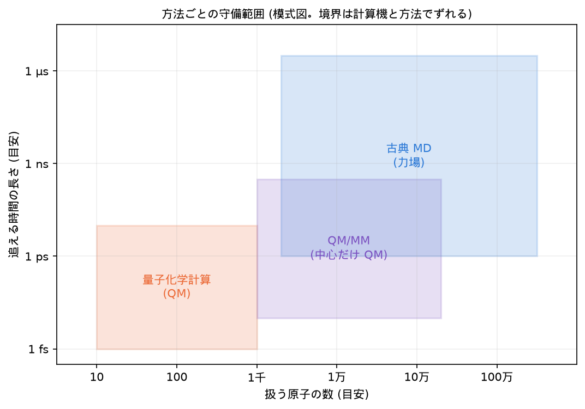
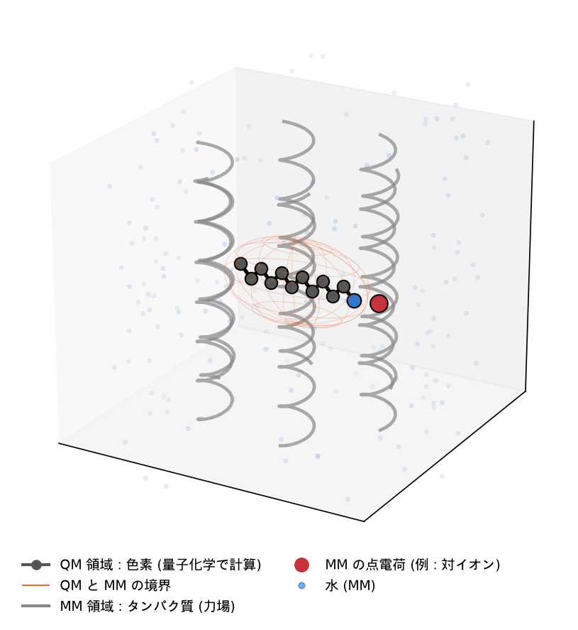
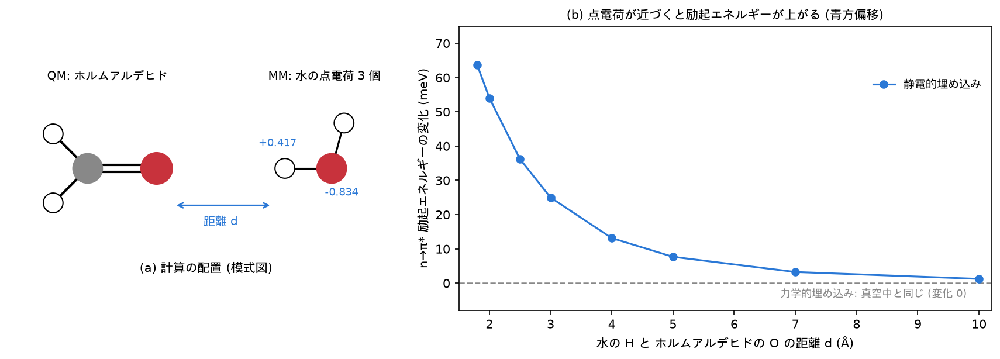
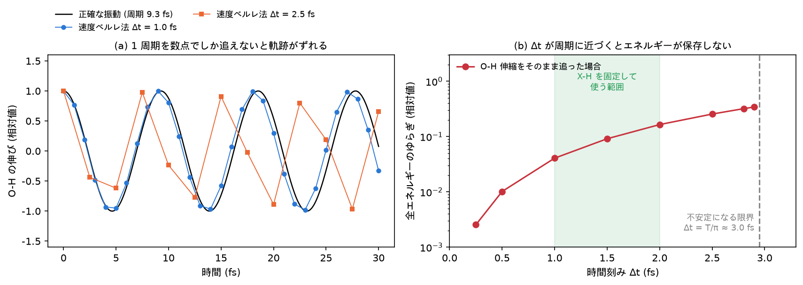
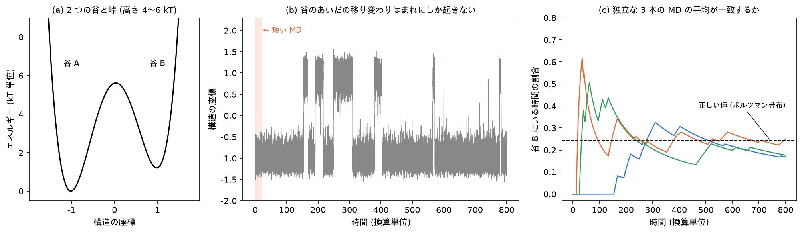
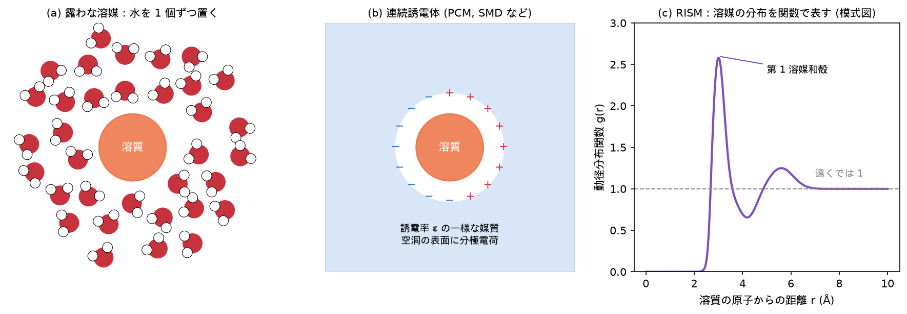
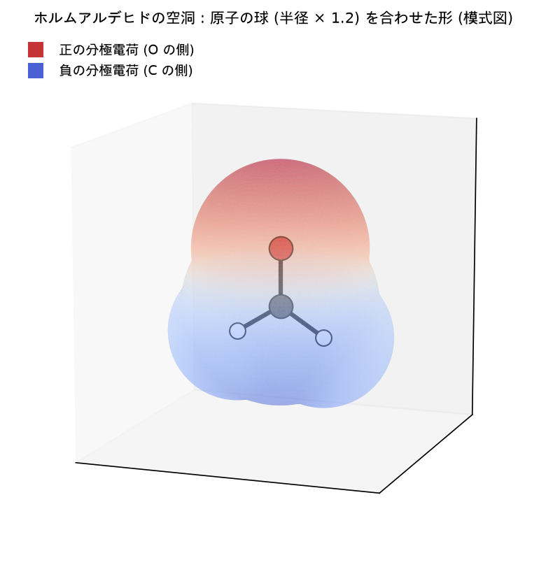
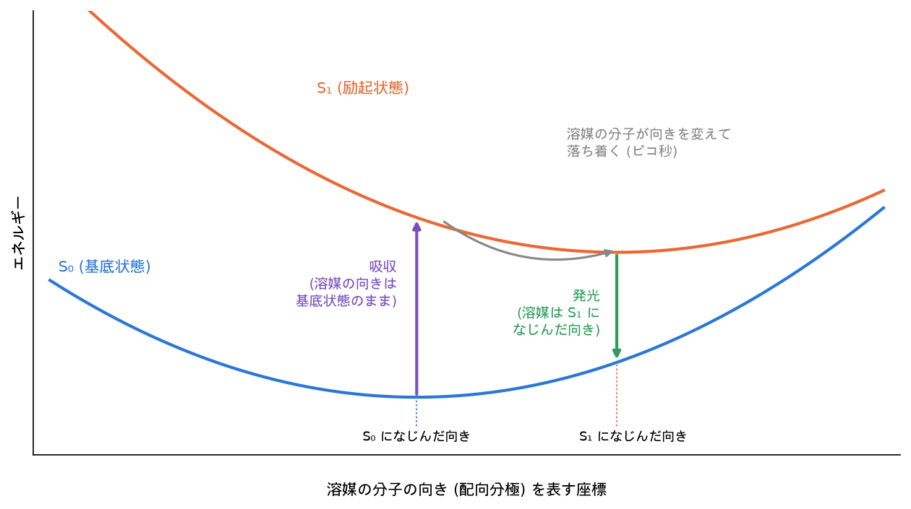

# 生体分子と溶液：タンパク質と水の中の分子の研究

!!! abstract "このページで分かること"
    実際の化学の多くは、真空中ではなく、水の中やタンパク質の中で起こります。このページでは、まわりの環境（溶媒、タンパク質）を計算に取り入れる研究を紹介します。環境の一部だけを量子化学で計算する方法、環境の動きを古典力学で追う方法、溶媒を平均的な媒質で置き換える方法の 3 つが柱です。この分野でよく言われる「静電的埋め込みが必要」「時間刻みは 1〜2 fs」「十分なサンプリングが必要」などが、なぜそう言われるのかも説明します。

    | 節 | 小分類 | ひとことで |
    |---|---|---|
    | 2 | QM/MM 法 | 中心だけ量子化学、まわりは古典力学 |
    | 3 | 分子動力学 | 原子の動きを追い、ゆらぎと平均を取る |
    | 4 | 溶媒和モデル | 溶媒を一様な媒質や分布関数で表す |
    | 5 | 応用例：タンパク質の中の色素の色 | QM/MM と MD の使いどころ（詳しくは励起状態のページ） |
    | 6 | 酵素反応 | タンパク質が反応を速くするしくみ |

!!! tip "ひとことで言うと"
    舞台の上の主役（色素や反応する分子）だけをスポットライトで照らし、くわしく見るのがこの分野の考え方です。主役は量子化学で精密に計算し、まわりの観客（タンパク質や水）は、点電荷や一様な媒質のような簡単なモデルで表します。ただし、観客は止まっていません。ざわざわと動き、主役に影響を与え続けます。その動きを分子動力学で追い、たくさんの場面の平均を取るところまでが、この分野の仕事です。

## 1. この分野が答えようとしている問い

同じ色素の分子でも、溶媒やタンパク質が違うと、吸収する光の色が変わります。
同じ反応でも、水の中と酵素の中では、速さが何桁も違うことがあります。
この分野が答えようとしているのは、次のような問いです。

- 環境（溶媒、タンパク質）は、分子の電子状態をどう変えるか。
- タンパク質は、どのアミノ酸の、どんな相互作用で、色素の色や反応の速さを調節しているか。
- 室温でゆらいでいる環境の中で、観測される量（吸収スペクトル、反応速度）をどう計算するか。

問題は、系の大きさです。
タンパク質と水を合わせると、原子は数万から数十万個になります。
すべてを量子化学で計算することはできません。
そこで、方法ごとの得意な範囲を組み合わせます（図 1）。

**図 1**　方法ごとの守備範囲（模式図）。量子化学計算は小さな系の短い時間、古典 MD は大きな系の長い時間が得意です。QM/MM はその間をつなぎます。境界の位置は目安で、計算機と方法によって大きくずれます。

この組み合わせの考え方を作った Karplus、Levitt、Warshel の 3 人は、「複雑な化学系のマルチスケールモデルの開発」で 2013 年のノーベル化学賞を受けました。
Warshel のノーベル賞講演は、酵素から分子機械までの研究をまとめています [Warshel 2014]。

## 2. QM/MM 法

### 2.1 何をする研究か

QM/MM 法（quantum mechanics/molecular mechanics）は、系を 2 つに分けます（図 2）。
反応や光の吸収が起こる中心の部分（QM 領域）は、量子化学で計算します。
まわりのタンパク質と水（MM 領域）は、分子力学の力場で計算します。
力場とは、結合をばね、原子を点電荷とファンデルワールスの球で表す古典的なモデルです。
力場では電子を考えないので、結合の組み替えや光の吸収は表せません。
そのため、それが起こる中心だけを量子化学で扱います。

この考え方は、Warshel と Levitt が 1976 年に、リゾチームの酵素反応の研究で導入しました [Warshel 1976]。
その後、分子動力学と組み合わせる形が整えられました [Field 1990]。

**図 2**　QM/MM の考え方（模式図）。中央の色素（球棒）だけを量子化学で計算し、まわりのタンパク質（灰色のらせん）と水（青い点）は力場で表します。赤い球は、色素の近くにある電荷をもつ残基（たとえば対イオン）です。

### 2.2 境界の扱い

QM/MM で最も気を使うのは、2 つの領域の境界です（図 3）。
気を使う点は 2 つあります。共有結合をどこで切るかと、MM の電荷を QM の電子にどう見せるかです。

**図 3**　境界の扱い（模式図）。(a) QM と MM の境界で切った結合の先を、リンク原子の水素でふさぎます。(b) MM の電荷の取り入れ方の 2 種類です。

**共有結合を切る場所**　色素がタンパク質のアミノ酸に結合している場合、どこかで結合を切って QM 領域を区切ります。
切った結合の先には、水素原子（リンク原子）を置いて、QM 側の結合の手をふさぐのがよく使われる方法です [Senn 2009]。

!!! question "「結合は、極性の小さい単結合で切る」と言われるのはなぜ？"
    **そもそもリンク原子とは**：切った結合の先の炭素などの代わりに置く、仮の水素原子です。QM の計算では、その水素が本物の原子のように扱われます。

    **なぜ切る場所を選ぶか**：リンク原子の水素は、もとの原子とは電気陰性度も結合の性質も違います。極性の大きい結合（C–O、C–N など）を切ると、境界のまわりの電荷の偏りが本物と変わります。共役の途中（二重結合が交互に並ぶ所）で切ると、π 電子が広がる範囲が途中で断ち切られ、励起エネルギーが大きく変わります。また、境界の MM 原子の点電荷は、リンク原子のすぐ近くにあります。そのまま QM の電子に見せると、電子が不自然に強く引き寄せられます（過分極）。そのため、境界の近くの MM の電荷を消したり、まわりに配り直したりする工夫が使われます [Senn 2009]。

    **どうするか**：極性の小さい C–C の単結合を、色素の共役系や反応する場所から 2〜3 結合ほど離れた所で切るのが目安です。切る場所を 1 つずらして計算し、注目する量（励起エネルギーなど）が変わらないことを確かめます。

**MM の電荷の見せ方**　力学的埋め込み（mechanical embedding）では、QM と MM の静電相互作用を、古典的な電荷どうしで計算します。
QM の波動関数は真空中と同じで、まわりの電荷を感じません。
静電的埋め込み（electrostatic embedding）では、MM の点電荷を QM のハミルトニアンに入れます。
すると、QM の電子雲が MM の電荷で分極します [Senn 2009]。

!!! question "「色の計算には静電的埋め込みが必要」と言われるのはなぜ？"
    **そもそも静電的埋め込みとは**：MM の各原子の点電荷 $q_A$ がつくる電位を、QM の電子が感じるようにする扱いです。QM のハミルトニアンに、電子と点電荷の引力・反発の項 $-\sum_A q_A/|\mathbf r - \mathbf R_A|$（原子単位）を足します。

    **なぜ必要か**：光を吸収すると、色素の電子の分布が変わります。まわりの電荷が基底状態と励起状態を違う量だけ安定化すると、その差だけ励起エネルギーが変わります。これが、タンパク質が色を変えるしくみの中心です。力学的埋め込みでは QM の電子がまわりの電荷を感じないので、励起エネルギーは真空中の値のままです。つまり、色の変化そのものが計算に入りません。

    **小さな計算で確かめる**：図 4 は、ホルムアルデヒドの n→π* 励起（酸素の非共有電子対から π* 軌道への励起）を TDDFT で計算し、水 1 分子を点電荷 3 個で近づけたものです。静電的埋め込みでは、水の H が O に近づくほど励起エネルギーが上がります（青方偏移）。n 軌道の電子は O の上にあり、近くの正電荷で基底状態が強く安定化されるためです。力学的埋め込みでは、この変化はすべて 0 になります。

**図 4**　静電的埋め込みの効果（自作の計算。PySCF の TDA-B3LYP/6-31+G*、水の電荷は TIP3P の値）。(a) 水の H を C=O の延長線上に置き、距離 d を変えました。(b) 水 1 分子でも、d = 1.8 Å で約 0.06 eV の青方偏移が出ます。タンパク質の中では、こうした電荷が数百〜数千個あり、その和が色を決めます。

静電的埋め込みにも限界があります。
MM の点電荷は固定されていて、QM の電子の変化に応じて MM 側が分極し返すことは入りません。
この効果まで入れるには、分極する力場を使う方法があります [Senn 2009]。

### 2.3 ONIOM

ONIOM は、Morokuma らが開発した、層を重ねる方法です [Maseras 1995; Chung 2015]。
中心部分を高い精度で、系全体を低い精度で計算し、引き算でつなぎます（図 5）。

$$
E_\mathrm{ONIOM} = E(\text{高}, \text{小}) + E(\text{低}, \text{全体}) - E(\text{低}, \text{小}).
$$

右辺の第 2 項と第 3 項の差は、「中心部分のまわりを足したときのエネルギーの変化」を、低い精度で見積もったものです。
それを高い精度の中心部分のエネルギーに足すので、「高い精度 × 系全体」の値の近似になります。
この近似がよいのは、まわりを足したときの変化を、低い精度の方法でも正しく表せる場合です。
低い精度の方法に力場を使えば QM/MM の一種になり、半経験的な方法や DFT を使うこともできます。

**図 5**　ONIOM の引き算（模式図）。右上の「知りたい値」を、ほかの 3 つの計算から外挿します。

### 2.4 よく使う方法とプログラム

QM の部分には、計算の速い DFT や TDDFT を使うことが多いです。
TDDFT は、汎関数の選び方で励起エネルギーが変わり、電荷移動を伴う励起では大きく外れることがあります（[励起状態と光化学のページ](04-excited-states.md)）。
そうした場合や、TDDFT の結果を確かめたい場合には、CASPT2 や SAC-CI などの波動関数理論を使います。
MM の部分には AMBER（タンパク質の力場 ff14SB [Maier 2015] など）、CHARMM などの力場を使います。
QM/MM の計算は、量子化学のプログラムと MD のプログラムを組み合わせて行うことが多く、Gaussian の ONIOM のように 1 つのプログラムでできるものもあります。

!!! question "「QM 領域を広げて、結果が落ち着くかを確かめる」のはなぜ？"
    **そもそも QM 領域の大きさとは**：どこまでの原子を量子化学で扱うかです。色素だけにするか、近くのアミノ酸の側鎖や水も入れるかを、自分で決めます。

    **なぜ確かめるか**：MM の点電荷は、電子の移動や、近くの原子との間の電子雲の重なり（交換反発、電荷移動）を表せません。色素と水素結合している残基や、色素と電子をやり取りしうる残基を MM に置くと、その効果が抜けます。どこまで入れれば十分かは系によって違い、事前には分かりません。

    **どう確かめるか**：色素だけ、色素と第 1 層の残基、さらに外側まで、と QM 領域を段階的に広げます。注目する量（励起エネルギーや反応のエネルギー）の変化が目標の精度より小さくなった所を、十分な大きさとみなします。

!!! question "「プロトン化の状態は自分で決める必要があり、結果を大きく左右する」のはなぜ？"
    **そもそもプロトン化の状態とは**：アミノ酸のどこに H⁺ が付いているかです。たとえばヒスチジンは、環の 2 つの N のどちらに H があるか、両方にあって正に帯電しているかで、3 通りの形をとれます。アスパラギン酸やグルタミン酸は、H⁺ を失って負に帯電しているのが普通ですが、タンパク質の内部では中性のこともあります。

    **なぜ自分で決めるのか**：X 線結晶構造解析は、電子による X 線の散乱を見ています。水素は電子を 1 個しか持たないので、ほとんど見えません。そのため、構造のファイルには水素の位置が書かれていないのが普通です。

    **なぜ結果を大きく左右するか**：H⁺ が 1 個付くか外れるかで、その残基の電荷が ±1 変わります。電荷 +1 と −1 が距離 $r$ にあるときのクーロンエネルギーは、真空中で $14.4/r$ eV（$r$ は Å）です。$r$ = 5 Å なら 2.9 eV、タンパク質の中の遮蔽を誘電率 4 で表しても 0.7 eV になります。励起エネルギーの差を 0.1 eV の単位で議論する研究では、無視できない大きさです。

    **どうするか**：pKa を予測するプログラム（PROPKA など [Olsson 2011]）と、水素結合のつながりを手がかりに候補を決めます。迷う残基は、複数の状態で計算して、結果がどれだけ変わるかを確かめます。

**この界隈の常識**

- 結晶構造は、ある条件での平均の構造を 1 つ与えるだけです。室温のタンパク質は絶えず形を変えています。そのため、1 つの構造の結果では不十分で、MD で多数の構造を取り、平均を取ります（3 節）。
- 計算の前に、水素の付加、欠けた残基の補完、水とイオンの配置が必要です。結晶構造のファイルには、そのまま計算に使える形で書かれていないからです。

## 3. 分子動力学

### 3.1 何をする研究か

分子動力学（molecular dynamics、MD）は、原子にはたらく力から、ニュートンの運動方程式で原子の動きを少しずつ追う方法です。
タンパク質や溶液の研究では、力を力場から計算する古典 MD が主に使われます。
MD の目的は、1 本の軌跡そのものより、室温でゆらいでいる構造の集まり（アンサンブル）を作り、平均や分布を取ることです。
実験で測る量（吸収スペクトル、自由エネルギー）は、膨大な数の分子の平均だからです。

### 3.2 時間刻みとエネルギーの保存

MD では、時間刻み $\Delta t$ ごとに、位置と速度を更新します。
よく使われるのは速度ベルレ法です [Swope 1982]。
外からエネルギーを出し入れしない計算では、位置エネルギーと運動エネルギーは大きくゆらぎますが、その和（全エネルギー）は保存するはずです（図 6 (a)）。
$\Delta t$ を大きくすると計算は速くなりますが、全エネルギーの保存が悪くなります（図 6 (b)）。
速度ベルレ法では、全エネルギーのゆらぎはおよそ $\Delta t^2$ に比例します。

**図 6**　MD のエネルギー（自作の小さな計算）。Lennard-Jones ポテンシャルで相互作用する 13 個の原子のクラスターを、速度ベルレ法で計算しました（換算単位）。(a) 位置エネルギーと運動エネルギーは逆向きにゆらぎ、和はほぼ一定です。(b) 時間刻みを 2 倍にすると、全エネルギーのゆらぎはおよそ 4 倍になります。

!!! question "「タンパク質の MD の時間刻みは 1〜2 fs」と言われるのはなぜ？"
    **そもそも時間刻みとは**：運動方程式を解くときに、位置と速度を更新する時間の間隔です。1 fs（フェムト秒）は $10^{-15}$ 秒です。

    **なぜ 1〜2 fs か**：時間刻みの上限は、系の中でいちばん速い運動で決まります。分子の中でいちばん速いのは、水素が付いた結合（O–H、N–H、C–H）の伸縮振動です。O–H の伸縮は約 3600 cm⁻¹ で、周期は約 9.3 fs です。1 周期を数点でしか追えないと、軌跡がずれ、エネルギーが保存しなくなります（図 7）。調和振動子では、速度ベルレ法は $\Delta t$ が周期の $1/\pi$（O–H なら約 3 fs）を超えると、計算そのものが発散します。実用には、その数分の 1 の刻みが必要です。

    **どうするか**：水素を含む結合の長さを固定する拘束（SHAKE 法 [Ryckaert 1977] など）をかけます。すると、いちばん速い運動が消え、2 fs 程度まで刻みを広げられます。拘束をかけない場合は、0.5〜1 fs を使います。選んだ刻みが十分かは、エネルギーを出し入れしない短い計算で、全エネルギーがずれていかないことで確かめます。

**図 7**　時間刻みの上限（自作の計算）。O–H 伸縮（3600 cm⁻¹、周期 9.3 fs）を調和振動子とみなし、速度ベルレ法で追いました。(a) Δt = 1 fs（青）は正確な振動（黒）に沿いますが、2.5 fs（橙）は大きくずれます。(b) Δt が周期の 1/π（約 3.0 fs、灰色の破線）に近づくと、全エネルギーのゆらぎが急に大きくなります。X–H の長さを固定すると、緑の範囲の刻みを安全に使えます。

### 3.3 サンプリングと平衡化

!!! question "「十分なサンプリングが必要」と言われるのはなぜ？"
    **そもそもサンプリングとは**：系がとりうる構造を、室温での出やすさ（ボルツマン分布）の割合どおりに集めることです。MD では、時間の経過とともに構造が集まります。

    **なぜ必要か**：タンパク質のエネルギーの地形には、いくつもの谷があります。谷と谷の間には峠（エネルギーの障壁）があり、峠を越える出来事はまれにしか起きません。峠の高さが熱エネルギー $k_\mathrm{B}T$ の数倍あるだけで、MD は長い時間 1 つの谷に閉じ込められます（図 8 (b)）。短い MD では、別の谷の構造をまったく見ないまま平均を取ってしまいます。その平均は、いくら刻みを細かくしても正しい値に近づきません。

    **どう確かめるか**：初期の速度を変えた独立な MD を何本か走らせ、注目する量の平均が一致するかを見ます（図 8 (c)）。1 本の軌跡を前半と後半に分けて比べる方法もあります。一致しなければ、計算を延ばすか、峠を越えやすくする方法（アンブレラサンプリングなど、6 節）を使います。

**図 8**　サンプリングの問題（自作の模型計算。1 次元の 2 つの谷の地形でのランジュバン動力学、換算単位）。(a) 峠の高さは、谷 A から見て約 6 kT、谷 B から見て約 4 kT です。(b) 軌跡は長い時間 1 つの谷にとどまります。橙の範囲だけの短い MD では、谷 B を一度も訪れません。(c) 独立な 3 本の MD の「谷 B にいる時間の割合」は、長い時間をかけてようやく正しい値（黒の破線、約 0.24）の近くに集まります。

**平衡化**　最初の構造を作ったあと、温度と圧力を合わせる「平衡化」の計算をしてから、解析に使う「本計算」を行います。
結晶構造に水素や水を足した直後の構造は、室温の水の中の構造ではないからです。
原子どうしが近すぎる所があったり、水の密度が合っていなかったりします。
その名残が消えるまでの部分を解析に使うと、平均が偏ります。
温度、圧力、密度、最初の構造からのずれ（RMSD）が一定の値のまわりでゆらぐようになったことを見て、平衡化が済んだと判断します。

**この界隈の常識**

- MD の結果は、力場の質と、サンプリングの十分さで決まります。力場が悪ければ正しい分布にならず、サンプリングが足りなければ分布の一部しか見ないからです。
- 色素のように力場が用意されていない分子では、パラメータを自分で作ります。標準の力場には、アミノ酸や核酸などの決まった部品のパラメータしかないからです。AMBER の系では、原子の電荷を量子化学で求めた静電ポテンシャルに合わせる RESP 法 [Bayly 1993] と、一般的な有機分子の力場 GAFF [Wang 2004] がよく使われます。電荷は静電相互作用を決め、色素とまわりの相互作用の大部分を占めるので、特に大事です。
- MD のプログラムには GROMACS [Abraham 2015]、AMBER、NAMD、OpenMM などがあります。

### 3.4 MD のスナップショットからスペクトルを作る

溶液の中の色素の吸収帯には幅があります。
その原因の 1 つは、まわりの溶媒と色素自身の構造が絶えずゆらぎ、励起エネルギーもゆらぐことです。
よく使われる方法は、MD の軌跡から多数のスナップショット（ある時刻の構造）を取り出し、それぞれで励起エネルギーを量子化学で計算して、分布を作ることです（図 9）[Zuehlsdorff 2019]。

**図 9**　スナップショットから吸収スペクトルを作る（模式図）。(a) 構造のゆらぎで励起エネルギーがゆらぎます。紫の点が、量子化学で計算するスナップショットです。(b) その分布を、それぞれ少し広げて足し合わせると、吸収帯の形になります。

!!! question "スナップショットは何個、どの間隔で取ればよいか"
    **なぜ多数必要か**：励起エネルギーがスナップショットごとに標準偏差 $\sigma$ でばらつくとき、$N$ 個の平均の誤差（標準誤差）は $\sigma/\sqrt{N}$ です。たとえば $\sigma$ = 0.1 eV なら、平均を 0.01 eV の精度で決めるのに、互いに独立なスナップショットが 100 個ほど要ります。分布の形（吸収帯の形）まで決めるには、さらに多く必要です。

    **なぜ間隔を空けるか**：すぐ隣の時刻の構造はほとんど同じで、新しい情報を持ちません。励起エネルギーのゆらぎが「覚えている」時間（相関時間）より長い間隔で取ると、それぞれが独立なサンプルになります。

    **どう確かめるか**：スナップショットの数を増やしても、平均と幅が変わらなくなることを確かめます。

ただし、この「分布を作る」方法は、ゆらぎの速さを考えていません。
励起エネルギーのゆらぎがとても速いと、吸収帯は分布の幅より細くなります。
これは運動による先鋭化（motional narrowing）と呼ばれる現象です。
速いゆらぎは光を吸う時間の間に平均されてしまい、吸収にはその平均だけが効くためです。
この現象は、時間相関関数（time correlation function、TCF）を使う理論で表せます [Mukamel 1995]。
図 10 は、ゆらぎの相関関数が指数関数で減衰する簡単な模型での計算です。
ゆらぎの幅は同じでも、ゆらぎが速いと吸収帯が細くなります。

**図 10**　時間相関関数の方法とゆらぎの速さ（自作の模型計算）。励起エネルギーのゆらぎの標準偏差を 0.1 eV とし、相関時間 τc だけを変えました。2 次のキュムラント近似の線形の式で計算しています。(b) 遅いゆらぎ（青の破線）は分布の方法（灰色）と重なりますが、速いゆらぎ（橙）では吸収帯が細くなります。

**代表的な研究例**：Sendo、Fujimoto、Miyashita、Saito、Yanai は、TDDFT と古典 MD を組み合わせ、時間相関関数にもとづく吸収スペクトルの計算法を系統的に評価しました。
近似の段階が順につながった 5 つのレベルのスペクトルの式（2 次のキュムラント近似を含む）を、2 つの色素、3,4,5,6-テトラクロロフルオレセイン（FLU）とクリスタルバイオレット（CST）で比べています。
FLU ではどの近似でも同じようなスペクトルになりましたが、CST では一部の近似が大きくずれました。
論文は、骨格の柔らかい CST では遷移双極子モーメントが速くゆらぐことが原因の可能性を挙げています [Sendo 2025]。

## 4. 溶媒和モデル

### 4.1 何をする研究か

溶媒の効果を、水分子を 1 個ずつ置かずに取り入れる方法です。
水を 1 個ずつ置くと、3 節のように水の配置をサンプリングして平均を取る必要があり、計算が大きくなります。
溶媒和モデルは、その平均を最初から取った形で溶媒を表すので、1 回の計算で済みます。
溶媒の表し方には、大きく 3 通りがあります（図 11）。

**図 11**　溶媒の 3 つの表し方（模式図）。(a) 水を 1 個ずつ置く露わな溶媒。(b) 溶媒を一様な誘電体とみなす連続誘電体モデル。(c) 溶媒の分布を動径分布関数で表す RISM。

### 4.2 連続誘電体モデル：PCM と SMD

連続誘電体モデルでは、溶質の分子のまわりに空洞（cavity）を作り、その外側を誘電率 $\varepsilon$ の一様な媒質とみなします（図 12）。
溶質の電荷は媒質を分極させ、空洞の表面に分極電荷が現れます。
この分極電荷がつくる電場（反応場）が、今度は溶質の電子を分極させます。
この相互作用を、溶質の波動関数と一緒に自己無撞着に解くのが、分極連続体モデル（polarizable continuum model、PCM）です [Tomasi 2005]。

**図 12**　溶媒和の空洞（模式図）。ホルムアルデヒドの各原子に、ファンデルワールス半径の 1.2 倍の球を置き、それを合わせた形です。表面の色は分極電荷の符号で、負の部分電荷をもつ O の側には正の分極電荷（赤）、C の側には負の分極電荷（青）が現れます。

PCM の分極電荷が表すのは、溶媒の静電的な応答だけです。
しかし、溶媒和の自由エネルギーには、溶媒の中に空洞を作るためのエネルギーや、溶質と溶媒の分散力も含まれます。
SMD は、PCM の静電的な部分に、こうした短距離の項を加えたモデルです。
溶媒の誘電率、屈折率、表面張力などのいくつかの値だけで、どの溶媒にも使えるように作られています [Marenich 2009]。
溶媒和の自由エネルギーそのもの（たとえば溶解度や pKa の計算）が必要なときに使われます。

### 4.3 RISM

RISM（reference interaction site model）は、統計力学の積分方程式で、溶質のまわりの溶媒の原子の分布（動径分布関数 $g(r)$）を求める理論です [Hirata 1981]。
連続誘電体と違って、水素結合のような溶媒の構造が分布関数に現れます。
量子化学と組み合わせた RISM-SCF 法も開発されています [Ten-no 1994]。

**代表的な研究例：RISM と多参照摂動論**

- Shimizu、Yanai、Kurashige、Yokogawa は、RISM と多参照摂動論の CASPT2（さらに DMRG の参照状態）を組み合わせ、近赤外で蛍光を出すバイオイメージングの色素の溶液中の垂直励起エネルギーを計算しました。論文は、PCM と TDDFT を組み合わせた従来の方法では実験から遠い結果になる系で、より精度の高い予測が得られたと報告しています [Shimizu 2018]。
- 同じグループは、RISM-CASSCF の軌道の最適化が収束しにくい問題を解析し、状態平均と、溶媒和の更新を緩やかにする手法（damping）で安定に計算できるようにしました [Shimizu 2020]。
- Saitow らは、PCM と RISM を、同じ (DMRG-)CASPT2 の波動関数と組み合わせて比べました。水素結合を正しく表せない点を除けば、PCM-CASPT2 の精度は多くの場合で RISM の場合と同程度でした [Saitow 2021]。

### 4.4 この界隈の常識

- 連続誘電体モデルは速くて手軽なので、まず試す方法です。ただし、溶媒と溶質の水素結合のような特定の相互作用は表せません。媒質は一様で、水素結合に必要な「どの原子が、どの向きから近づくか」という情報を持たないからです。
- 水素結合が重要な場合は、溶媒分子を数個だけ QM 領域に入れ、その外を連続誘電体にする方法（クラスター連続体モデル）もよく使われます。水素結合の方向性は露わな分子で、遠くの溶媒の平均的な分極は連続体で表す分業です。

!!! question "「励起状態では非平衡の溶媒和に注意する」と言われるのはなぜ？"
    **そもそも溶媒の分極とは**：溶媒の分極には、速さの違う 2 つの成分があります。1 つは溶媒分子の中の電子雲のずれ（電子分極）で、フェムト秒で起こります。もう 1 つは溶媒分子そのものの向きの変化（配向分極）で、ピコ秒の時間がかかります。

    **なぜ注意するか**：光の吸収はフェムト秒の出来事です。吸収の瞬間、溶媒の電子分極は励起状態に追随しますが、溶媒分子の向きは基底状態に合わせたまま残ります（図 13）。この「溶媒が溶質の新しい状態になじんでいない」状態が、非平衡の溶媒和です。水では、全体の誘電率 $\varepsilon_0$ は約 78 ですが、電子分極だけの誘電率 $\varepsilon_\infty$（屈折率 $n$ の 2 乗）は約 1.8 しかありません。どちらの誘電率で応答させるかで、励起エネルギーが変わります。

    **どう使い分けるか**：吸収（垂直励起）には非平衡の扱いを使います。励起状態で十分に時間がたってからの発光や、励起状態の構造最適化には、平衡の扱いを使います。どちらが既定になっているかはプログラムと計算の種類で違うので、入力の設定と出力を確かめます。

**図 13**　非平衡の溶媒和（模式図）。横軸は溶媒分子の向きの状態です。吸収（紫）は、溶媒の向きが基底状態になじんだまま起こります。その後、溶媒の向きが励起状態に合わせて変わり（灰色）、エネルギーが下がってから発光します（緑）。吸収と発光のエネルギーの差の一部は、この溶媒の緩和によるものです。

## 5. 応用例：タンパク質の中の色素の色

視覚のタンパク質（ロドプシン）や光合成のアンテナでは、タンパク質が色素を包み、色素が吸収する光の色を変えています。
これを色の調節（color tuning）と呼びます。
色の調節の計算は、2〜4 節の道具をすべて使う代表的な応用です。
結晶構造から始めてプロトン化の状態を決め（2.4 節）、MD で多数の構造を集め（3 節）、静電的埋め込みの QM/MM で励起エネルギーを計算します（2.2 節）。
さらに、励起エネルギーの変化を、残基ごとの静電的な寄与や構造のゆがみに分解し、「どのアミノ酸が、どれだけ色を変えているか」を調べます。
たとえばロドプシンでは、色素レチナールの正電荷の近くにある負電荷の残基（対イオン）が、図 4 と同じしくみで励起エネルギーを大きく変えます。
色素がたくさん並ぶ光合成のアンテナでは、色素どうしの電子的な結合も色を決めます。
SAC-CI と QM/MM による色の調節の研究は、総説にまとめられています [Hasegawa 2011]。
具体的な研究例と数値は、[励起状態と光化学のページの色の調節の節](04-excited-states.md#22)と[アンテナの色の節](04-excited-states.md#34)で紹介します。

## 6. 酵素反応

### 6.1 何をする研究か

酵素は、水の中で起こると何年もかかる反応を、ミリ秒で進めることがあります。
この分野の研究は、QM/MM で酵素の中の反応経路と活性化エネルギーを計算し、酵素が反応を速くするしくみを調べます。
Warshel らは、酵素の中では、タンパク質の電荷や双極子があらかじめ遷移状態を安定にする向きに並んでいる（前もって組織化されている）ことが、触媒作用の主な原因だと主張してきました（図 14）[Warshel 2006]。
水の中では、遷移状態ができるたびに水分子が向きを変えて安定化する必要があり、その並び替えにも自由エネルギーが要ります。
酵素では、その並び替えが最初から済んでいる、という考え方です。

**図 14**　酵素が反応を速くするしくみの 1 つ（模式図）。酵素の中では遷移状態が静電的に安定化され、活性化エネルギーが小さくなります。

### 6.2 よく使う方法

反応の速さを決めるのは、活性化自由エネルギーです（下の箱）。
自由エネルギーを求めるには、タンパク質のゆらぎを含めて多数の構造を集める必要があります。
ところが、反応の峠を越える出来事は、ふつうの MD ではまず起こりません。

!!! question "「酵素反応の自由エネルギーにはアンブレラサンプリングなどが必要」と言われるのはなぜ？"
    **なぜふつうの MD ではだめか**：活性化自由エネルギーが 15 kcal/mol の反応を考えます。Eyring の式 $k = (k_\mathrm{B}T/h)\,e^{-\Delta G^\ddagger/RT}$ に 298 K で入れると、$k$ はおよそ 60 s⁻¹ です。峠を越えるのは平均で十数ミリ秒に 1 回です。QM/MM の MD で追えるのは長くてもナノ秒の程度なので、峠を越える場面を一度も見られません。

    **そもそもアンブレラサンプリングとは**：反応座標（たとえば、切れる結合と できる結合の長さの差）に沿って、系を少しずつ別の位置に引き止めるばねのポテンシャルを足し、それぞれの位置で MD をする方法です [Torrie 1977]。峠の上も含めて、反応座標の全域で構造が集まります。足したばねの影響を後で取り除くと、反応座標に沿った自由エネルギーの曲線が得られます。

    **どう確かめるか**：隣どうしの窓（引き止める位置）の分布が十分に重なっていること、窓ごとの MD を延ばしても曲線が変わらないことを確かめます。

QM の部分は、計算量の都合で DFT が中心です。
たとえば 20 個の窓で、それぞれ 1 万ステップの MD をすると、QM の計算は 20 万回になります。
1 回が数分かかる方法では、現実的な時間で終わりません。
そのため、DFT や半経験的な方法で自由エネルギーの曲線を求め、小さなモデル系で高精度の波動関数理論と比べて、DFT の誤差を確かめます。
薬と標的のタンパク質の結合の自由エネルギーのように、反応を伴わない場合の自由エネルギーの計算は、[創薬のページ](06-drug-discovery.md)で紹介します。

!!! question "「エネルギーと自由エネルギーを区別する」のはなぜ？"
    **そもそも自由エネルギーとは**：1 つの構造のエネルギーではなく、室温でとりうる多数の構造の重み付きの平均から決まる量です。エネルギー（エンタルピー）の効果に加えて、とりうる構造の多さ（エントロピー）の効果を含みます。

    **なぜ区別するか**：実験で測る反応速度は、Eyring の式で活性化自由エネルギーと結びつきます。298 K では、活性化自由エネルギーが $RT\ln 10$ ≈ 1.4 kcal/mol 変わるごとに、速さが 10 倍変わります。酵素の中では、反応物と遷移状態で、タンパク質と水のとりうる構造の数が違うことがあります。1 つの構造の最適化で得たエネルギーの峠は、この差を含みません。

    **どうするか**：実験の速さと比べるときは、MD で構造を集めた自由エネルギーの曲線（6.2 節）を使います。1 つの構造の計算で議論するときは、その限界を意識して書きます。

**この界隈の常識**

- 酵素の反応の研究は、QM/MM の発祥の地です。最初の QM/MM の論文も、リゾチームの反応を扱いました [Warshel 1976]。
- 金属を含む酵素では、金属のスピン状態や酸化数が問題になります。d 軌道の電子の入り方が複数あり、DFT の汎関数によってどれが安定かが変わるからです。遷移金属錯体の電子状態の考え方は、[電子構造論のページ](02-electronic-structure.md#4)で説明します。

## この分野でよく出てくる言葉

| 言葉 | 意味 |
|---|---|
| QM/MM | 中心を量子化学（QM）、まわりを分子力学（MM）で計算する方法 |
| 力場（force field） | 結合をばね、原子を点電荷と球で表す古典的なエネルギーの式とパラメータ |
| リンク原子 | QM と MM の境界で切った結合の先を、ふさぐために置く水素原子 |
| 力学的埋め込み | QM と MM の静電相互作用を古典的な電荷どうしで計算する扱い。QM の電子はまわりを感じない |
| 静電的埋め込み | MM の点電荷を QM のハミルトニアンに入れ、QM の電子を分極させる扱い |
| ONIOM | 高い精度と低い精度の計算を引き算でつなぐ、層を重ねる方法 |
| プロトン化の状態 | アミノ酸のどこに H⁺ が付いているか |
| 分子動力学（MD） | 力から運動方程式で原子の動きを追う計算 |
| 時間刻み | MD で位置と速度を更新する時間の間隔。タンパク質では 1〜2 fs |
| 平衡化 | 解析の前に、温度・圧力・密度を目標の条件に落ち着かせる計算 |
| サンプリング | 系がとりうる構造を、ボルツマン分布の割合どおりに集めること |
| スナップショット | MD の軌跡のある時刻の構造 |
| 連続誘電体モデル（PCM、SMD） | 溶媒を誘電率 ε の一様な媒質とみなすモデル |
| 空洞（cavity） | 連続誘電体の中で、溶質が入る穴 |
| RISM | 積分方程式で溶媒の分布関数を求める溶媒和の理論 |
| 非平衡の溶媒和 | 溶媒の電子分極だけが溶質の新しい状態に追随し、分子の向きは前の状態のままの状態 |
| 色の調節（color tuning） | タンパク質などの環境が色素の吸収波長を変えること |
| 対イオン | 色素の電荷を打ち消す反対の電荷のイオンや残基 |
| アンブレラサンプリング | 反応座標に沿ってばねで系を引き止め、峠の上の構造まで集める方法 |
| 活性化自由エネルギー | 反応の速さを決める、遷移状態と反応物の自由エネルギーの差 |

## この分野の常識：まとめ

- 環境の効果は、静電相互作用（電荷による安定化）、分極、特定の相互作用（水素結合）、構造のゆらぎに分けて考えます。それぞれを表せる方法が違うので、どれが効いているかで方法を選びます。
- QM/MM では、QM 領域の選び方と、境界の扱いで結果が変わります。MM の点電荷は電子の移動や軌道の重なりを表せないので、QM 領域を広げて結果が落ち着くことを確かめます。
- 色や励起エネルギーの計算には、静電的埋め込みを使います。力学的埋め込みでは QM の電子がまわりの電荷を感じず、色の変化が計算に入らないからです。
- 結晶構造には水素がほとんど見えません。電荷 ±1 の違いは数 Å 先で 1 eV 近いエネルギーになりうるので、プロトン化の状態は自分で決め、結果への影響を確かめます。
- 1 つの構造ではなく、MD で集めた多数の構造の平均で議論します。実験で測る量は、ゆらいでいる多数の分子の平均だからです。
- MD の時間刻みは、いちばん速い X–H 結合の伸縮（周期約 10 fs）で上限が決まります。X–H の長さを固定して 1〜2 fs を使います。
- 峠を越える出来事はまれなので、短い MD は 1 つの谷に閉じ込められます。独立な複数の MD で平均が一致するかを確かめます。
- 吸収帯の幅は、スナップショットの励起エネルギーの分布から作るのが基本です。ゆらぎが速いと吸収帯は分布より細くなるので、時間相関関数の方法が必要になります。
- 連続誘電体モデル（PCM、SMD）は手軽ですが、一様な媒質なので水素結合の方向性は表せません。吸収の計算では非平衡の溶媒和の設定を確かめます。
- 酵素の触媒作用の主な原因の 1 つは、遷移状態の静電的な安定化です。実験の速さと比べるのは、エネルギーではなく活性化自由エネルギーです。

## 最初に読むとよい文献

- H. M. Senn、W. Thiel、"QM/MM Methods for Biomolecular Systems"（Angew. Chem. Int. Ed., 2009）：QM/MM の方法と応用の標準的な総説 [Senn 2009]。
- J. Tomasi、B. Mennucci、R. Cammi、"Quantum Mechanical Continuum Solvation Models"（Chem. Rev., 2005）：PCM を中心とする連続誘電体モデルの総説 [Tomasi 2005]。
- T. J. Zuehlsdorff、C. M. Isborn、"Modeling absorption spectra of molecules in solution"（Int. J. Quantum Chem., 2019）：溶液中の吸収スペクトルの計算の実践的な手引き [Zuehlsdorff 2019]。
- J. Hasegawa、K. J. Fujimoto、H. Nakatsuji、"Color Tuning in Photofunctional Proteins"（ChemPhysChem, 2011）：QM/MM による色の調節の計算の総説 [Hasegawa 2011]。
- A. Warshel、"Multiscale Modeling of Biological Functions: From Enzymes to Molecular Machines"（Nobel Lecture, 2014）：この分野の考え方の歴史 [Warshel 2014]。

## 講義ノートとの関係

- [第 15 回 Kohn–Sham 法](../courses/qc-theory/15-kohn-sham.md)と[第 19 回 TDDFT](../courses/qc-theory/19-tddft.md)：QM 領域の基底状態と励起状態の計算（2、3、5 節）
- [第 13 回 多参照摂動論：CASPT2 と NEVPT2](../courses/qc-theory/13-caspt2-nevpt2.md)と[第 14 回 DMRG と選択的 CI](../courses/qc-theory/14-dmrg-sci.md)：RISM や PCM と組み合わせる多参照の方法（4 節）
- [第 17 回 分散力の補正](../courses/qc-theory/17-dispersion.md)：力場のファンデルワールス項と、溶媒和の分散の項の背景
- [計算化学パッケージ 第 3 回 どのプログラムにも共通すること](../courses/packages/03-common-concepts.md)：電荷とスピン多重度の指定（QM 領域を決めるとき）
- [量子化学のための機械学習 第 3 回](../courses/ml-chem/03-mlip-basics.md)：MD の力を機械学習ポテンシャルで計算する方法

## 参考文献

- A. Warshel, "Multiscale Modeling of Biological Functions: From Enzymes to Molecular Machines (Nobel Lecture)", Angew. Chem. Int. Ed. 53, 10020 (2014). DOI: [10.1002/anie.201403689](https://doi.org/10.1002/anie.201403689)
- A. Warshel, M. Levitt, "Theoretical studies of enzymic reactions: Dielectric, electrostatic and steric stabilization of the carbonium ion in the reaction of lysozyme", J. Mol. Biol. 103, 227 (1976). DOI: [10.1016/0022-2836(76)90311-9](https://doi.org/10.1016/0022-2836(76)90311-9)
- M. J. Field, P. A. Bash, M. Karplus, "A combined quantum mechanical and molecular mechanical potential for molecular dynamics simulations", J. Comput. Chem. 11, 700 (1990). DOI: [10.1002/jcc.540110605](https://doi.org/10.1002/jcc.540110605)
- H. M. Senn, W. Thiel, "QM/MM Methods for Biomolecular Systems", Angew. Chem. Int. Ed. 48, 1198 (2009). DOI: [10.1002/anie.200802019](https://doi.org/10.1002/anie.200802019)
- F. Maseras, K. Morokuma, "IMOMM: A new integrated ab initio + molecular mechanics geometry optimization scheme of equilibrium structures and transition states", J. Comput. Chem. 16, 1170 (1995). DOI: [10.1002/jcc.540160911](https://doi.org/10.1002/jcc.540160911)
- L. W. Chung, W. M. C. Sameera, R. Ramozzi, A. J. Page, M. Hatanaka, G. P. Petrova, T. V. Harris, X. Li, Z. Ke, F. Liu, H.-B. Li, L. Ding, K. Morokuma, "The ONIOM Method and Its Applications", Chem. Rev. 115, 5678 (2015). DOI: [10.1021/cr5004419](https://doi.org/10.1021/cr5004419)
- J. A. Maier, C. Martinez, K. Kasavajhala, L. Wickstrom, K. E. Hauser, C. Simmerling, "ff14SB: Improving the Accuracy of Protein Side Chain and Backbone Parameters from ff99SB", J. Chem. Theory Comput. 11, 3696 (2015). DOI: [10.1021/acs.jctc.5b00255](https://doi.org/10.1021/acs.jctc.5b00255)
- M. H. M. Olsson, C. R. Søndergaard, M. Rostkowski, J. H. Jensen, "PROPKA3: Consistent Treatment of Internal and Surface Residues in Empirical pKa Predictions", J. Chem. Theory Comput. 7, 525 (2011). DOI: [10.1021/ct100578z](https://doi.org/10.1021/ct100578z)
- W. C. Swope, H. C. Andersen, P. H. Berens, K. R. Wilson, "A computer simulation method for the calculation of equilibrium constants for the formation of physical clusters of molecules: Application to small water clusters", J. Chem. Phys. 76, 637 (1982). DOI: [10.1063/1.442716](https://doi.org/10.1063/1.442716)
- J.-P. Ryckaert, G. Ciccotti, H. J. C. Berendsen, "Numerical integration of the cartesian equations of motion of a system with constraints: molecular dynamics of n-alkanes", J. Comput. Phys. 23, 327 (1977). DOI: [10.1016/0021-9991(77)90098-5](https://doi.org/10.1016/0021-9991(77)90098-5)
- C. I. Bayly, P. Cieplak, W. Cornell, P. A. Kollman, "A well-behaved electrostatic potential based method using charge restraints for deriving atomic charges: the RESP model", J. Phys. Chem. 97, 10269 (1993). DOI: [10.1021/j100142a004](https://doi.org/10.1021/j100142a004)
- J. Wang, R. M. Wolf, J. W. Caldwell, P. A. Kollman, D. A. Case, "Development and testing of a general amber force field", J. Comput. Chem. 25, 1157 (2004). DOI: [10.1002/jcc.20035](https://doi.org/10.1002/jcc.20035)
- M. J. Abraham, T. Murtola, R. Schulz, S. Páll, J. C. Smith, B. Hess, E. Lindahl, "GROMACS: High performance molecular simulations through multi-level parallelism from laptops to supercomputers", SoftwareX 1-2, 19 (2015). DOI: [10.1016/j.softx.2015.06.001](https://doi.org/10.1016/j.softx.2015.06.001)
- T. J. Zuehlsdorff, C. M. Isborn, "Modeling absorption spectra of molecules in solution", Int. J. Quantum Chem. 119, e25719 (2019). DOI: [10.1002/qua.25719](https://doi.org/10.1002/qua.25719)
- S. Mukamel, "Principles of Nonlinear Optical Spectroscopy" (Oxford University Press, 1995). ISBN: 9780195092783
- S. Sendo, K. J. Fujimoto, T. Miyashita, S. Saito, T. Yanai, "Assessment of the time correlation function-based approach for absorption spectrum calculations using time-dependent density functional theory and molecular dynamics simulations", J. Chem. Phys. 163, 134116 (2025). DOI: [10.1063/5.0281605](https://doi.org/10.1063/5.0281605)
- J. Tomasi, B. Mennucci, R. Cammi, "Quantum Mechanical Continuum Solvation Models", Chem. Rev. 105, 2999 (2005). DOI: [10.1021/cr9904009](https://doi.org/10.1021/cr9904009)
- A. V. Marenich, C. J. Cramer, D. G. Truhlar, "Universal Solvation Model Based on Solute Electron Density and on a Continuum Model of the Solvent Defined by the Bulk Dielectric Constant and Atomic Surface Tensions", J. Phys. Chem. B 113, 6378 (2009). DOI: [10.1021/jp810292n](https://doi.org/10.1021/jp810292n)
- F. Hirata, P. J. Rossky, "An extended RISM equation for molecular polar fluids", Chem. Phys. Lett. 83, 329 (1981). DOI: [10.1016/0009-2614(81)85474-7](https://doi.org/10.1016/0009-2614(81)85474-7)
- S. Ten-no, F. Hirata, S. Kato, "Reference interaction site model self-consistent field study for solvation effect on carbonyl compounds in aqueous solution", J. Chem. Phys. 100, 7443 (1994). DOI: [10.1063/1.466888](https://doi.org/10.1063/1.466888)
- R. Shimizu, T. Yanai, Y. Kurashige, D. Yokogawa, "Electronically Excited Solute Described by RISM Approach Coupled with Multireference Perturbation Theory: Vertical Excitation Energies of Bioimaging Probes", J. Chem. Theory Comput. 14, 5673 (2018). DOI: [10.1021/acs.jctc.8b00599](https://doi.org/10.1021/acs.jctc.8b00599)
- R. Shimizu, T. Yanai, D. Yokogawa, "Improved RISM-CASSCF Optimization via State-Average Treatment and Damping for Characterizing Excited Molecules in Solution with Multireference Perturbation Theory", J. Chem. Theory Comput. 16, 4865 (2020). DOI: [10.1021/acs.jctc.9b01289](https://doi.org/10.1021/acs.jctc.9b01289)
- M. Saitow, K. Hori, A. Yoshikawa, R. Shimizu, D. Yokogawa, T. Yanai, "Multireference Perturbation Theory Combined with PCM and RISM Solvation Models: A Benchmark Study for Chemical Energetics", J. Phys. Chem. A 125, 8324 (2021). DOI: [10.1021/acs.jpca.1c05944](https://doi.org/10.1021/acs.jpca.1c05944)
- J. Hasegawa, K. J. Fujimoto, H. Nakatsuji, "Color Tuning in Photofunctional Proteins", ChemPhysChem 12, 3106 (2011). DOI: [10.1002/cphc.201100452](https://doi.org/10.1002/cphc.201100452)
- G. M. Torrie, J. P. Valleau, "Nonphysical sampling distributions in Monte Carlo free-energy estimation: Umbrella sampling", J. Comput. Phys. 23, 187 (1977). DOI: [10.1016/0021-9991(77)90121-8](https://doi.org/10.1016/0021-9991(77)90121-8)
- A. Warshel, P. K. Sharma, M. Kato, Y. Xiang, H. Liu, M. H. M. Olsson, "Electrostatic Basis for Enzyme Catalysis", Chem. Rev. 106, 3210 (2006). DOI: [10.1021/cr0503106](https://doi.org/10.1021/cr0503106)
