# 固体と表面：結晶、表面、材料の計算

!!! abstract "このページで分かること"
    結晶、金属の表面、電池の電極、有機半導体のように、原子が規則正しく無限に並んだ物質を計算する分野を紹介します。分子の計算とは考え方も道具も少し違います。単位胞、ブロッホの定理、k 点、平面波、擬ポテンシャルといった言葉の意味と、この分野で「当たり前」とされている作法を、図で説明します。

    | 節 | 内容 |
    |---|---|
    | 1 | この分野が答えようとしている問い |
    | 2 | 周期系の計算の考え方：単位胞、ブロッホの定理、平面波、擬ポテンシャル、PAW 法のしくみとガウス基底の PAW |
    | 3 | バンド構造と状態密度、k 点の収束 |
    | 4 | 表面と不均一触媒：スラブ模型、吸着エネルギー、d バンド中心、火山型プロット、電極触媒の研究例 |
    | 5 | 電池・半導体・2 次元材料・熱電材料 |
    | 6 | 分子性結晶と有機半導体：電荷の移動と移動積分 |
    | 7 | よく使うプログラムと計算の作法 |

!!! tip "ひとことで言うと"
    固体の計算は「タイル張りの床」の計算です。床全体は無限に広くても、1 枚のタイル（単位胞）の模様が分かれば、床全体が分かります。固体の計算では、単位胞の中の原子だけを扱い、「隣のタイルも同じ模様だ」という条件（周期境界条件）を課して、電子の状態を求めます。電子の波は、タイルを 1 枚進むごとに位相が少しずつ回ります。その回り方を表す数が波数 k で、k ごとにエネルギーを並べたものがバンド構造です。

## 1. この分野が答えようとしている問い

分子の計算では、原子の数は有限で、周りは真空です。結晶では、同じ原子の並びが 3 方向に $10^{23}$ 個のオーダーでくり返されます。全部の原子を計算に入れることはできません。そこで、くり返しの最小単位である**単位胞**（unit cell）だけを計算し、外側には同じものが無限に続くと考えます（図 1）。

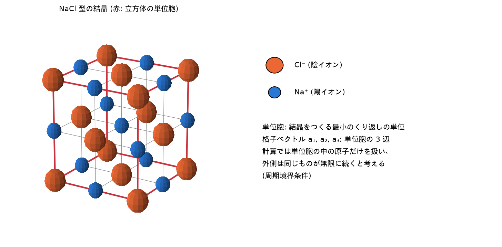

**図 1**　NaCl 型の結晶の 3D 図（模式図）。赤い立方体が単位胞で、この箱の中身を 3 方向にくり返すと結晶全体ができます。計算では、箱の中の原子だけを扱います。

この分野が答えようとする問いは、たとえば次のようなものです。

- この物質は金属か、半導体か、絶縁体か。半導体なら、バンドギャップ（電子が励起されるのに必要な最小のエネルギー）はいくらか。
- 金属の表面に分子はどれくらい強く吸着するか。どの金属が、ある反応のよい触媒になるか。
- 電池の電極の電圧はいくらか。リチウムは結晶の中をどれくらい動きやすいか。
- 有機半導体の結晶の中で、電荷や励起子（励起のエネルギーのかたまり）はどう動くか。

どれも、物質を「無限にくり返す並び」として扱う点が共通です。

## 2. 周期系の計算の考え方

### 2.1 ブロッホの定理：波の位相が回る

周期的に並んだ原子の中を動く電子の波動関数には、強い制約がかかります。これが**ブロッホの定理**です [Bloch 1929]。格子ベクトル（単位胞の辺のベクトル）を $\mathbf R$ とすると、波動関数は

$$
\psi_{\mathbf k}(\mathbf r + \mathbf R) = e^{i\mathbf k\cdot\mathbf R}\,\psi_{\mathbf k}(\mathbf r)
$$

を満たします。単位胞を 1 つ隣に移ると、波動関数の大きさは同じで、位相だけが $\mathbf k\cdot\mathbf R$ だけ回る、という意味です。同じことを、

$$
\psi_{\mathbf k}(\mathbf r) = e^{i\mathbf k\cdot\mathbf r}\,u_{\mathbf k}(\mathbf r), \qquad u_{\mathbf k}(\mathbf r + \mathbf R) = u_{\mathbf k}(\mathbf r)
$$

とも書けます。どの単位胞でも同じ形の関数 $u_{\mathbf k}$ に、平面波 $e^{i\mathbf k\cdot\mathbf r}$ をかけたものです（図 2）。

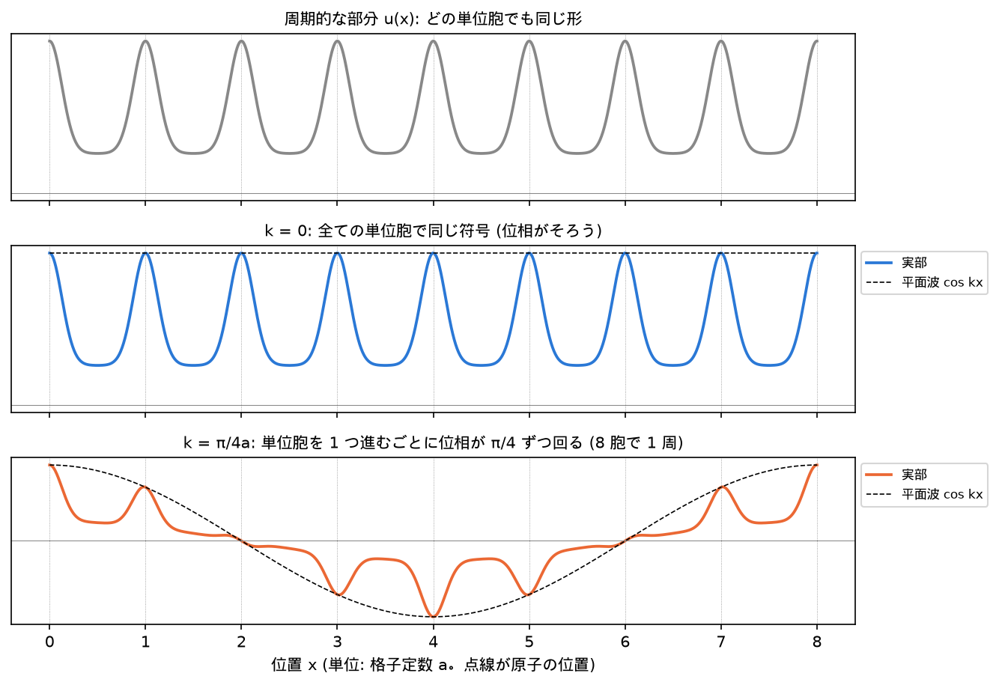

**図 2**　1 次元のブロッホ関数の例（模式図）。上：どの単位胞でも同じ形の周期関数 u(x)。中：k = 0 では、全ての単位胞で波の符号がそろいます。下：k = π/4a では、単位胞を 1 つ進むごとに位相が π/4 ずつ回り、8 胞で 1 周します。

ここから、計算の上で大事な結論が 2 つ出ます。

1. **k ごとに別々に解ける。** k が違う波どうしは混ざらないので、k を 1 つ決めるごとに、単位胞の中だけの小さな問題になります。
2. **k の範囲は有限でよい。** k に $2\pi/a$（$a$ は格子定数）の整数倍を足しても、同じ位相の回り方になります。そこで k は、ブリルアンゾーンと呼ばれる有限の範囲（1 次元なら $-\pi/a < k \le \pi/a$）だけを考えれば十分です。

実際の計算では、ブリルアンゾーンの中に**k 点**と呼ばれる点を等間隔に置き、それぞれの k で単位胞の問題を解いて、平均をとります。よく使われる k 点の置き方は Monkhorst–Pack の方法です [Monkhorst 1976]。入力ファイルに「4×4×4」のように書くのは、3 方向に 4 点ずつ k 点を置くという意味です。

### 2.2 平面波の基底と、擬ポテンシャル

分子の計算では、原子に中心を持つガウス関数を基底にします（講義ノート第 6 回）。固体の計算では、**平面波**（$e^{i\mathbf G\cdot\mathbf r}$ の形の波）を基底にすることが多いです。平面波は、もともと周期的なので周期境界条件と相性がよく、空間のどこにも偏らないので、表面や真空を含む系も同じ精度で表せます。精度は、平面波の最大の運動エネルギー（**カットオフエネルギー**、「ENCUT」「ecutwfc」などの名前で入力します）1 つで決まり、これを上げれば系統的に完全な基底に近づきます。

困るのは、原子核の近くです。

!!! question "「平面波の計算には擬ポテンシャルか PAW が必要」と言われるのはなぜ？"
    **そもそも何が困るのか**：価電子の軌道は、内殻電子の軌道と直交しなければなりません。そのため、原子核の近くでは、価電子の波動関数も節を持って細かく振動します（図 3 の青）。たとえば Si の 3s 軌道は、1s、2s と直交するために、原子核の近くに 2 つの節を持ちます。

    **なぜ必要か**：平面波で細かい振動を表すには、波長の短い（運動エネルギーの大きい）平面波が要ります。波長を半分にするとカットオフエネルギーは 4 倍になり、平面波の数はカットオフエネルギーの 3/2 乗に比例して増えます。原子核の近くの鋭い節をそのまま表そうとすると、平面波の数が現実的な計算の範囲を大きく超えてしまいます。しかも、化学結合に効くのは原子と原子の間の部分で、原子核のごく近くの細かい形はほとんど効きません。

    **どうするか**：原子核の近くだけ、波動関数を滑らかなものに置き換えます。その置き換え方が、次の 2 つです。どちらを使っても、カットオフエネルギーを上げて結果が変わらないことを確かめるのは同じです。

- **擬ポテンシャル**（pseudopotential）：内殻電子を計算から除き、原子核と内殻電子の作るポテンシャルを、滑らかな「擬ポテンシャル」で置き換えます。価電子の波動関数は、ある半径（切断半径 rc）より内側で節のない滑らかな形になり、外側では本当の波動関数と一致します（図 3 の橙）。内側の本当の形の情報は捨ててしまいます。分子の計算で使う有効内殻ポテンシャル（ECP）も、同じ考え方です。
- **PAW 法**（projector augmented wave）：Blöchl が提案した方法です [Blöchl 1994]。計算は滑らかな波動関数で行いますが、原子のまわりの球の中で、滑らかな関数を本当の（全電子の）波動関数に戻す変換を持っています。そのため、擬ポテンシャルの効率と、全電子の計算の正確さを両立できます。VASP では、Kresse と Joubert による PAW の実装 [Kresse 1999] が標準です。

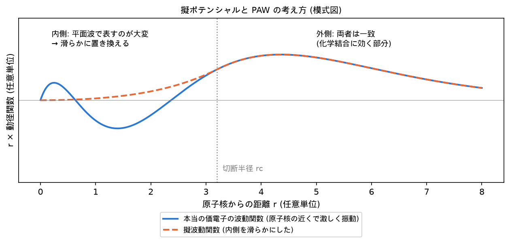

**図 3**　擬ポテンシャルと PAW の考え方（模式図）。青：本当の価電子の波動関数で、原子核の近くで振動します。橙：切断半径 rc より内側を滑らかにした擬波動関数。外側では両者が一致するので、化学結合の記述は変わりません。

### 2.3 PAW 法のしくみ

PAW 法の中心は、滑らかな波動関数 $\tilde\psi$ から、全電子の波動関数 $\psi$ を取り戻す次の式です [Blöchl 1994]。

$$
\psi(\mathbf r) = \tilde\psi(\mathbf r) + \sum_i \big[\phi_i(\mathbf r) - \tilde\phi_i(\mathbf r)\big]\,\langle \tilde p_i|\tilde\psi\rangle
$$

記号の意味は次のとおりです。

- $\phi_i$：孤立した原子で求めた、本当の（全電子の）原子の軌道。原子核の近くに節を持ちます。$i$ は原子と軌道（3s、3p など）を区別する番号です。
- $\tilde\phi_i$：$\phi_i$ を、球（半径 rc）の中だけ滑らかにした関数。球の外では $\phi_i$ と同じです。
- $\tilde p_i$：射影関数（projector）。球の中だけで値を持ち、$\langle \tilde p_i|\tilde\phi_j\rangle = \delta_{ij}$ を満たすように作ります。$\langle \tilde p_i|\tilde\psi\rangle$ は、「$\tilde\psi$ の中に $\tilde\phi_i$ がどれだけ含まれているか」を表す係数です。

式の意味を言葉で書くと、「球の中で、滑らかな部品 $\tilde\phi_i$ を、同じ量だけ本当の部品 $\phi_i$ に取り替える」です。
球の外では $\phi_i - \tilde\phi_i = 0$ なので、$\psi = \tilde\psi$ のままです（図 4）。
平面波で表すのは滑らかな $\tilde\psi$ だけなので、カットオフエネルギーは小さくて済みます。
球の中の細かい部分は、原子ごとに 1 次元の動径の格子の上で、あらかじめ用意した $\phi_i$ と $\tilde\phi_i$ を使って計算します。

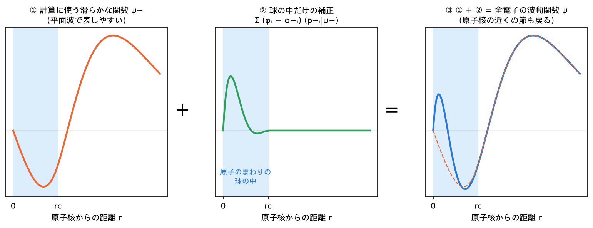

**図 4**　PAW の変換の模式図（1 次元の動径関数の模型）。① 計算に使う滑らかな関数 ψ~ は、原子のまわりの球（水色、半径 rc）の中でも節がありません。② 球の中だけで値を持つ補正の項。③ 2 つを足すと、原子核の近くの節を持つ全電子の波動関数（青）に戻ります。橙の破線は ① です。

擬ポテンシャルとの違いは、球の中の本当の形を捨てずに持っていることです。
そのため、全電子の電子密度や、原子核の近くの密度が効く量も計算できます。

### 2.4 代表的な研究例：ガウス基底の上の PAW 法

PAW 法は平面波と組み合わせて使うのが普通ですが、式を見れば分かるとおり、$\tilde\psi$ を何で表すかには本来よらない方法です。
Xiong と Yanai は、PAW 法を、分子の量子化学で広く使われるガウス型の基底関数（GTF）の DFT に組み込みました（GTF-PAW）[Xiong 2017]。

ガウス基底でも、原子核の近くの節は悩みの種です。
節を表すには、指数の大きな（原子核の近くで鋭い）ガウス関数がたくさん要り、数値積分の格子点も原子核の近くに密に置く必要があります。
PAW で原子核の近くの節を滑らかにすると、指数の大きなガウス関数を基底から除くことができ、数値積分の格子点も減らせます。
有効内殻ポテンシャル（ECP）も内殻を置き換えて計算を軽くしますが、PAW では全電子の波動関数の情報を取り戻せる点が違います。
要旨によれば、cc-pVQZ 程度のほぼ完全な基底では、PAW を使った全エネルギーが、全電子のガウス基底の計算と小さな誤差で一致しました [Xiong 2017]。

続く論文では、交換相関汎関数を LDA から GGA に広げ、数値積分に、分子の計算で普通に使われる Becke の格子の代わりに一様なメッシュの格子を使えることを示しました [Xiong 2020]。

Phung、Hagai、Xiong、Yanai は、GTF-PAW の使い道を広げるため、PAW と組み合わせて使う、コンパクトな一般縮約の分極無撞着基底関数の系列 PAW-Ln を開発しました [Phung 2020]。
分極無撞着基底は、基底関数を大きくするにつれて DFT の結果が系統的に基底関数の極限へ近づくように設計された基底関数の系列です。
PAW-Ln は、原始ガウス関数の数が少ないにもかかわらず、ECP より性能がよく、より大きな全電子の基底関数と比べても精度がよく、基底関数を大きくしたときの収束も系統的でした。
ふだんの DFT の計算で、全電子のやり方と ECP のやり方のどちらに対してもよい代わりになりうる、と結論しています [Phung 2020]。
固体の計算で育った道具を分子の計算に持ち込む、という方向の研究です。

**この界隈の常識**

- 平面波の計算の精度は、カットオフエネルギーと k 点の数の 2 つで決まります。平面波の基底は、カットオフを上げれば系統的に完全に近づき、k 点を増やせばブリルアンゾーンの平均が正確になるからです。どちらも、結果が変わらなくなるまで増やして確かめます（3 節）。
- 擬ポテンシャルや PAW のデータは、プログラムに付いてくるものを使い、どのデータを使ったか（どの元素で何個の電子を価電子として扱ったか）を論文に書きます。たとえば遷移金属で、すぐ下の殻（3s、3p）を価電子に含めるかどうかで、結果が変わることがあるからです。
- 平面波の計算では、真空の部分にも基底がかかります。平面波は空間全体に一様に広がる関数なので、分子 1 個を大きな箱に入れて計算することもできますが、箱を大きくするほど平面波の数が増えて計算が重くなります。

## 3. バンド構造と状態密度

### 3.1 1 次元の鎖で見るバンド

バンド構造の意味を、いちばん簡単な模型で見ます。原子が間隔 $a$ で 1 列に並び、各原子に軌道が 1 個ずつあり、隣どうしの間だけに移動積分 $-t$（$t > 0$）がある、という**強結合模型**（tight-binding model。ヒュッケル法を無限の鎖にしたもの）を考えます。ブロッホの定理から、k ごとのエネルギーは

$$
E(k) = -2t\cos(ka)
$$

になります（図 5a）。k = 0 では全ての原子の軌道が同じ符号で重なるので、最も安定（$-2t$）です。区間の端 $k = \pi/a$ では隣どうしが逆の符号になり、最も不安定（$+2t$）です。このように、k を動かしたときに連続的につながるエネルギーの帯を**バンド**と呼びます。

原子 1 個あたり電子が 1 個なら、バンドの下半分（$E < 0$）が電子で埋まります。埋まった状態のいちばん上が**フェルミ準位**です。フェルミ準位のすぐ上に空いた状態があるので、小さな電場でも電子が動けます。これが金属です。

次に、結合が長い・短いと交互になった鎖を考えます。単位胞には原子が 2 個入り、移動積分は $-t_1$ と $-t_2$ が交互に並びます。k ごとのハミルトニアン行列は 2×2 で、

$$
\mathbf H(k) =
\begin{pmatrix}
0 & -(t_1 + t_2 e^{-ik\cdot 2a}) \\
-(t_1 + t_2 e^{ik\cdot 2a}) & 0
\end{pmatrix}
$$

です（対角は原子の軌道のエネルギーで、0 にとりました。$2a$ は単位胞の長さです）。固有値は $E_\pm(k) = \pm|t_1 + t_2 e^{ik\cdot 2a}|$ で、バンドが 2 本になります。区間の端では $E_\pm = \pm|t_1 - t_2|$ となり、2 本のバンドの間に幅 $2|t_1 - t_2|$ の**バンドギャップ**が開きます（図 5b）。単位胞あたり電子 2 個で下のバンドがちょうど埋まるので、この鎖は絶縁体（ギャップが小さければ半導体）です。ポリアセチレンが金属にならないのは、これと同じしくみ（結合の交替）によります。

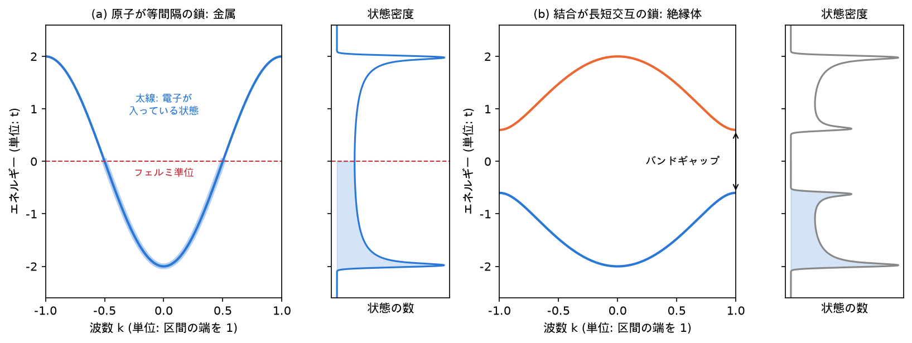

**図 5**　1 次元の強結合模型で計算したバンド構造と状態密度。(a) 原子が等間隔の鎖：バンドが 1 本で、フェルミ準位がバンドの途中にあるので金属です。(b) 結合が長短交互の鎖（t₁ = 1.3t、t₂ = 0.7t）：バンドが 2 本に分かれ、間にギャップが開くので絶縁体です。状態密度の青く塗った部分が、電子が入っている状態です。

**状態密度**（density of states、DOS）は、エネルギーごとに状態がいくつあるかを数えたヒストグラムです（図 5 の細い図）。バンドが平らなところ（E(k) の傾きが小さいところ）では、同じエネルギーに多くの k が集まるので、状態密度が大きくなります。3 次元の実際の物質では、バンド構造は「特別な点（Γ、X、L など）を結ぶ線の上の E(k)」として描き、状態密度と並べて示すのが定番です。軌道や原子ごとに分けた状態密度（部分状態密度、PDOS）もよく使います。

### 3.2 k 点の収束：金属は難しい

全エネルギーは、ブリルアンゾーン全体で、電子が入った状態のエネルギーを平均したものです。実際の計算では、この平均を有限個の k 点の和で近似します。図 5 の 2 つの鎖で、k 点の数を増やしたときの誤差を計算すると、図 6 のようになります。

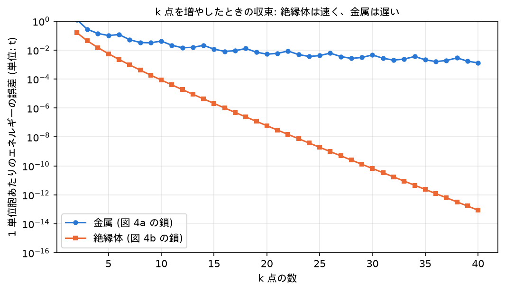

**図 6**　図 5 の 2 つの鎖で、1 単位胞あたりのエネルギーを等間隔の k 点の和で計算したときの誤差（k 点 20 万個の値を基準にしました）。絶縁体では誤差が指数関数的に減り、k 点 20 個で 10⁻⁷ t より小さくなります。金属では、k 点 20 個でも誤差が 10⁻³〜10⁻² t 程度残り、ゆっくりとしか減りません。

!!! question "「k 点の収束を確かめる必要がある」と言われるのはなぜ？"
    **そもそも k 点とは**：ブリルアンゾーンの中の、波数 k の標本点です。全エネルギーや電子密度は、ブリルアンゾーンの中のすべての k についての平均（積分）ですが、計算機ではそれを有限個の k 点の和で近似します。数値積分の格子点と同じものです。

    **なぜ必要か**：k 点が少なすぎると、積分の誤差がそのまま全エネルギーの誤差になります。図 6 のとおり、絶縁体では少ない k 点で誤差が急に減りますが、金属では誤差がゆっくりとしか減りません。反応エネルギーや吸着エネルギーは全エネルギーの差なので、比べる 2 つの計算で k 点の誤差の大きさが違うと、差に誤差が残ります。

    **どう確かめるか**：k 点を 4×4×4、6×6×6、8×8×8 と増やし、知りたいエネルギーの差が、目標の精度（たとえば 0.01 eV）より小さくしか変わらなくなるまで増やします。単位胞の大きさが違う計算どうしでは、k 点の数ではなく、k 点の間隔（逆格子の長さを k 点の数で割ったもの）をそろえます。

金属で収束が遅いのは、フェルミ準位のところで「電子が入っている・入っていない」が k について不連続に切り替わるからです。段差のある関数を等間隔の点で平均すると、点の置き方によって段差の位置が粗くしか拾えません。そのため金属の計算では、k 点を多くとるだけでなく、フェルミ準位の付近の占有数を少しぼかす**スメアリング**（smearing）という工夫を使うのが普通です。段差を、幅 σ のなめらかな坂に置き換えると、少ない点の平均でも段差の位置をよく拾えるようになるからです。ぼかした分だけエネルギーは本当の値からずれるので、σ を小さくしたときの外挿値を報告するか、σ を変えて結果が変わらないことを確かめます。

**この界隈の常識**

- 金属は絶縁体より多くの k 点が要ります。フェルミ準位での占有数の段差を拾う必要があるからです（図 6）。単位胞が大きいほど、ブリルアンゾーンは小さくなるので、同じ間隔に必要な k 点は少なくて済みます。
- バンドギャップは、バンド構造の図で「価電子帯のいちばん上」と「伝導帯のいちばん下」の差として読みます。両者が同じ k にあれば直接ギャップ、違う k にあれば間接ギャップです。間接ギャップの物質（Si など）は、光を吸うのに格子振動の助けが要るので、光の吸収や発光が弱くなります。
- バンド構造の図に使う k の線と、全エネルギーの計算に使う k 点の格子は別物です。全エネルギーと電子密度にはブリルアンゾーン全体の平均が要り、バンドの図には特別な点を結ぶ線の上の値が要るからです。まず格子の k 点で自己無撞着な計算をし、その密度を固定して、線の上の k で固有値だけを求めます。

## 4. 表面と不均一触媒

### 4.1 スラブ模型

不均一触媒（固体の表面で進む触媒反応）の計算では、表面を**スラブ模型**で表します。結晶を何層か切り出した「板」（スラブ）を作り、その上に分子を置きます。周期境界条件は 3 方向にかかるので、板は上下にもくり返されます。そこで、板と板の間に十分厚い**真空の層**を入れ、上の板の像と相互作用しないようにします（図 7）。

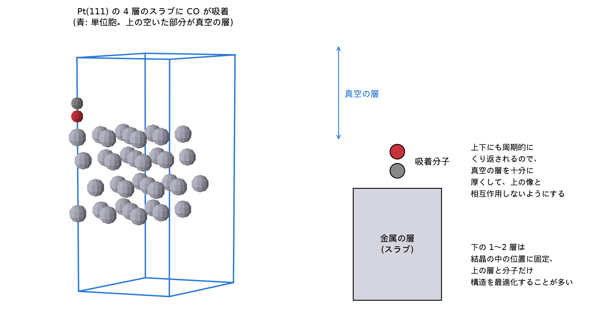

**図 7**　Pt(111) 面の 4 層のスラブに、CO 分子が真上（on-top）の位置に吸着した模型の 3D 図（ASE で作った構造）。青の枠が単位胞で、スラブの上の空いた部分が真空の層です。右は、計算の作法の模式図。

吸着の強さは、**吸着エネルギー**

$$
E_\mathrm{ads} = E[\text{スラブ} + \text{分子}] - E[\text{スラブ}] - E[\text{分子}]
$$

で表します。負の値ほど強く吸着します。

!!! question "「スラブの厚さと真空の厚さを確かめ、3 つのエネルギーを同じ条件で計算する」と言われるのはなぜ？"
    **そもそも何を近似しているか**：本物の表面は、下に無限に厚い結晶があり、上に無限の真空がある半無限の物体です。スラブ模型は、それを有限の厚さの板と有限の真空で近似しています。

    **なぜ確かめる必要があるか**：板が薄すぎると、表面の下の原子が「結晶の内部」の状態にならず、上の面と下の面が互いに影響し合います。真空が薄すぎると、周期境界条件でくり返された上の板の像と、吸着分子が相互作用してしまいます。どちらも本物の表面にはない誤差です。また、全エネルギーそのものには、基底関数（カットオフ）や k 点の有限さによる大きな誤差が含まれます。3 つの計算を同じ汎関数・同じカットオフ・同じ単位胞と k 点でそろえると、この誤差がほぼ同じ大きさになり、引き算で打ち消し合います。条件がばらばらだと、打ち消しが起こらず、差に誤差が残ります。

    **どう確かめるか**：層の数を 3、4、5、6 と増やし、真空を 10、15、20 Å と厚くして、吸着エネルギーが変わらなくなるのを確かめます。下の数層は結晶の内部の位置に固定し、上の層だけを動かすのがふつうです。極性のある吸着分子を片面だけに置くと、板に双極子ができ、上下の像の間に人工の電場が生じるので、双極子補正を使います。

### 4.2 d バンド中心

遷移金属の表面で、分子がどれくらい強く吸着するかを、金属の電子構造から理解する考え方が **d バンドモデル**です。Hammer と Nørskov は、金が最も貴な（反応しにくい）金属である理由を、吸着したときにできる反結合性の状態がどれだけ埋まるかと、吸着分子との軌道の重なりの大きさで説明しました [Hammer 1995]。

物理的な絵は次のとおりです（図 8）。吸着分子の軌道は、金属の d バンドと相互作用して、結合性の準位と反結合性の準位に分かれます。d バンドの中心（d バンドの状態密度の重心のエネルギー、$\varepsilon_d$）が高いと、反結合性の準位もフェルミ準位より上に押し上げられて空になり、結合が強くなります。$\varepsilon_d$ が低いと、反結合性の準位も埋まってしまい、結合が弱くなります。Nørskov らの総説は、d バンド中心を「結合の強さの最初の目安」と位置づけています [Nørskov 2011]。

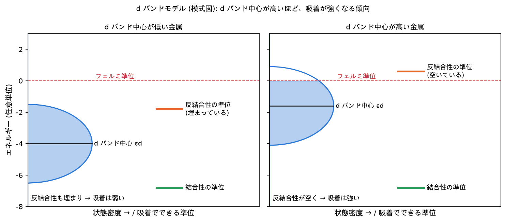

**図 8**　d バンドモデル（模式図）。左：d バンド中心が低い金属では、吸着でできる反結合性の準位（橙）がフェルミ準位より下にあって埋まり、吸着は弱くなります。右：d バンド中心が高い金属では、反結合性の準位が空になり、吸着は強くなります。

### 4.3 記述子と火山型プロット

触媒の研究では、「どの金属がいちばんよく働くか」を、少数の量（**記述子**、descriptor）で整理します。遷移金属の表面では、いろいろな中間体の吸着エネルギーが互いに直線的に相関し（スケーリング関係）、遷移状態のエネルギーも吸着エネルギーと相関します（Brønsted–Evans–Polanyi 関係）。そのため、反応に出てくる多くのエネルギーを、1〜2 個の記述子で表せることが多いのです [Nørskov 2011]。

触媒の活性を記述子に対してプロットすると、山の形になります。これが**火山型プロット**です（図 9）。吸着が弱すぎると反応物が活性化されず、強すぎると生成物や中間体が表面から離れません。ちょうどよい強さのところで活性が最大になります（サバティエの原理）。Nørskov らは、酸素の還元反応（燃料電池の正極の反応）の活性の金属による傾向を、酸素と水酸基の吸着エネルギーで説明しました [Nørskov 2004]。

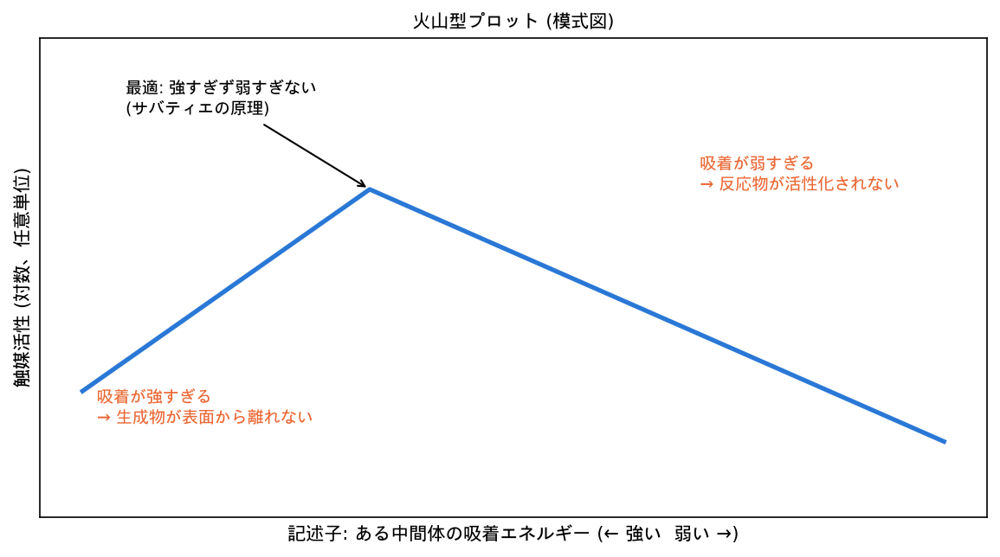

**図 9**　火山型プロット（模式図）。横軸は記述子（ある中間体の吸着エネルギー）、縦軸は触媒の活性の対数です。山の頂上が、強すぎず弱すぎない最適な吸着の強さです。新しい触媒の探索では、記述子が頂上の近くに来る材料を計算で探します。

### 4.4 代表的な研究例：実験との共同研究で DFT が担う役割

電極触媒の研究では、実験のグループが材料を合成して性能を測り、計算のグループが DFT で「なぜよく働くのか」を説明する、という分担がよく見られます。
計算が担うのは、主に次の 3 つです。
表面のどの場所に中間体がどれだけ強く吸着するか（4.1 節の吸着エネルギー）、反応の各段階の自由エネルギーと障壁、そして電荷の移り方です。
ここでは、Q. M. Phung と H. N. Nam らが実験のグループと組んで DFT を担当した例を紹介します。

**高エントロピー合金の電極触媒**：**高エントロピー合金**（high-entropy alloy、HEA）は、5 種類以上の元素をほぼ同じ割合で混ぜた合金です。
表面には、隣り合う原子の組み合わせが違う、さまざまな吸着の場所が現れます（図 10）。
場所ごとに吸着の強さが違うので、反応の段階ごとに都合のよい場所を使い分けられる可能性があります。
一方で、元素の選び方と割合の組み合わせは膨大で、実験の試行錯誤だけで探すのは大変です。

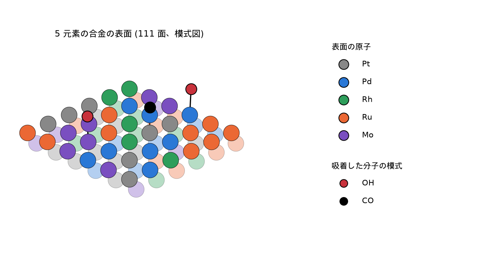

**図 10**　5 元素（Pt、Pd、Rh、Ru、Mo）の高エントロピー合金の (111) 表面の 3D 模式図。元素はランダムに置きました。濃い色が最上層、薄い色が 2 層目の原子です。上に立っている球は、吸着した OH や CO の模式です。隣り合う原子の組み合わせが場所ごとに違うので、吸着の強さも場所ごとに違います。

- Nam, Yanai, Phung, Yamauchi ら（2025）は、機械学習を補助に使った第一原理計算で、5 元素の HEA を、多電子が移る反応（メタノールの酸化）に向けて設計しました。メタノールの酸化では、CH₃OH が CO₂ まで酸化される途中で CO が表面に強く付き、触媒を「被毒」させることが問題になります。計算から選ばれた PtPdRhRuMo では、5 番目の元素 Mo が表面の特定の場所を活性化し、メタノールの吸着と、とくに水の解離を強めることが分かりました。水の解離でできる OH が CO の付着を和らげ、別の経路でメタノールを CO₂ まで完全に酸化させます。この予測に従って合成されたメソポーラス（数 nm の細孔をもつ）PtPdRhRuMo は、最大 18.20 mA cm⁻² の電流密度と 9.89 A mg⁻¹ の質量活性（Pt の質量あたり）を示しました [Nam 2025]。
- Fu, Nam, Phung, Yamauchi ら（2024）は、Pt、Pd、Rh、Ru、Cu を均一に含むメソポーラス HEA の膜を電析で作りました。メタノールの酸化の質量活性（Pt の質量あたり）は 4.2 A mg⁻¹ で、メソポーラス Pt の膜の 7.2 倍、市販の Pt ブラックの 35 倍でした。理論計算は、多元素の HEA の上にある多様な吸着の場所が、メタノールの酸化の途中の経路（要旨の言葉では dehydration pathway）と \*CO（表面に吸着した CO）の除去の障壁を下げることを示しました [Fu 2024]。

**グラフェンで覆った白金の酸素還元反応**：燃料電池の正極で起こる**酸素還元反応**（ORR）は、O₂ が 4 個のプロトンと 4 個の電子を受け取って 2 個の H₂O になる反応です。
計算では、Nørskov らの方法 [Nørskov 2004] に従い、OOH\*、O\*、OH\*（\* は表面に吸着していることを表します）を経る 4 段階の自由エネルギーを求めます（図 11）。
電極の電位 U をかけると、各段階の自由エネルギーは、そこで移る電子 1 個あたり eU だけ下がります。
理想的な触媒では、平衡電位 1.23 V で 4 段階がすべて平らになります。
現実の触媒では、上り坂の段階が残ります。
それが下り坂になるまで電位を下げる必要があり、その差が過電圧です。

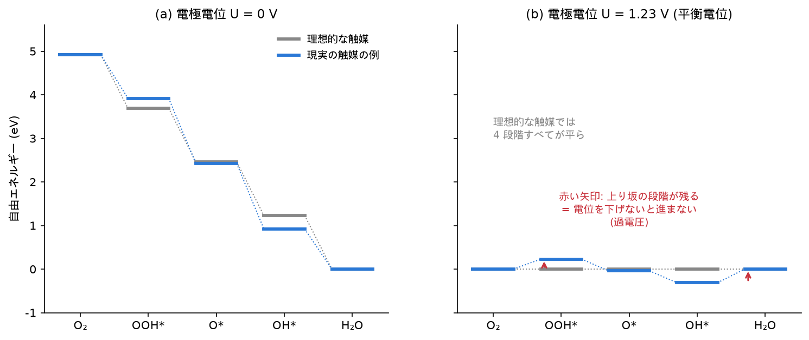

**図 11**　酸素還元反応の 4 電子の経路の自由エネルギー図（模式図。「現実の触媒の例」の値は説明のために選んだもので、特定の論文の値ではありません）。(a) 電位 0 V では全段階が下り坂です。(b) 平衡電位 1.23 V では、理想的な触媒（灰色）は全段階が平らになりますが、現実の触媒の例（青）では、赤い矢印の段階が上り坂のまま残ります。

- Nam, Phung, Yamauchi, Saito ら（2024）は、実験で保護層として使われているグラフェンの被覆が、白金の ORR の活性にどう影響するかを DFT で調べました。Pt(100)、Pt(110)、Pt(111) の表面と、それをグラフェンで覆った表面を比べ、O₂ の吸着の仕方が表面ごとに違うことを示しました。ORR の律速段階は表面ごとに違い、活性は Pt(111)、Pt(110)、Pt(100) の順に高くなりました。グラフェンの被覆は表面からの電荷の移動を強め、O₂ の吸着を変えます。被覆した表面も、被覆しない表面に劣らない活性を示し、被覆した表面の中では、グラフェンで覆った Pt(111) の活性化エネルギーが最も低くなりました。また、ORR はグラフェンの欠陥で露出した Pt だけでなく、欠陥のないグラフェンで覆った表面の上でも直接進みうること、グラフェンに窒素をドープすると活性がさらに高まりうることも示しています [Nam 2024a]。

**この界隈の常識**

- 吸着エネルギーの絶対値は、汎関数によって無視できないほど変わることがあります。GGA の汎関数は、分子の多重結合や、金属の d 電子と吸着分子の軌道の混ざり方を、系統的に少しずつ間違えるからです。誤差の多くは金属が変わってもほぼ同じ向きに出るので、絶対値より「金属による傾向」を議論することが多いです。
- 電気化学の反応では、電極の電位の効果を、プロトンと電子の組の自由エネルギーを電位でずらす簡便な方法で取り込むのが定番です [Nørskov 2004]。電極と溶液の界面そのもの（電気二重層や溶媒）を正面から計算するのは非常に重いので、電子 1 個が移るごとに $-eU$ だけ自由エネルギーが変わる、という部分だけを取り出して扱うのです（図 11）。
- スラブの層の数、表面の単位胞の大きさ（吸着分子の被覆率）、固定する層の数は、結果が変わらないことを確かめて決めます（4.1 節の箱）。単位胞を小さくすると、隣の単位胞の吸着分子どうしが近づき、実際より高い被覆率の計算になるからです。
- 実験との共同研究では、計算は「なぜその材料がよく働くのか」を、吸着の場所、反応の各段階の自由エネルギー、電荷の移り方で説明する役を担います（例：[Nam 2025]、[Nam 2024a]）。

## 5. 電池・半導体・2 次元材料

### 5.1 バンドギャップの過小評価

半導体の研究で最初に知っておくべきことは、**LDA や GGA（PBE など）の汎関数では、バンドギャップが小さく出る**ということです。Perdew と Levy は、LDA の交換相関ポテンシャルが半導体と絶縁体の基本ギャップを約 40% 過小評価することを指摘し、その原因が近似だけでなく、厳密な Kohn–Sham 理論の性質（交換相関エネルギーの微分の不連続性）にもあることを論じました [Perdew 1983]。

ギャップを正しく見積もるには、ハートリー–フォックの交換を一部混ぜた混成汎関数を使います。固体でよく使われるのが、遠くの交換を遮蔽して計算を軽くした **HSE** です [Heyd 2003]。40 種類の半導体で比べた研究では、純粋な汎関数のギャップの平均絶対誤差が 1.0〜1.3 eV だったのに対し、HSE は 0.3 eV より小さい誤差でした [Heyd 2005]（図 12）。さらに正確な値が必要なときは、GW 近似などの多体摂動論が使われます。

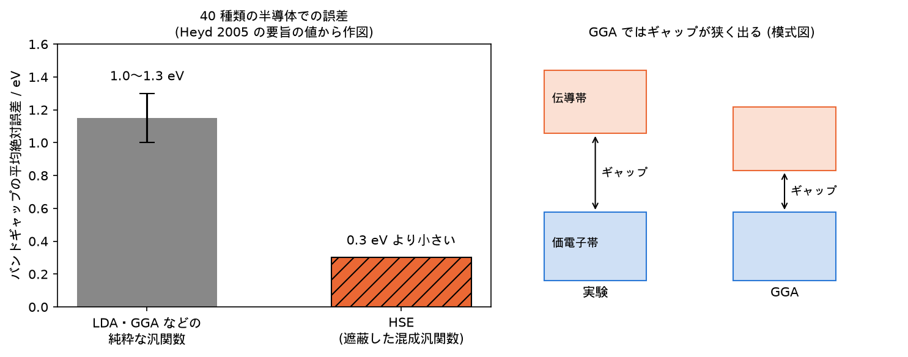

**図 12**　左：40 種類の半導体のバンドギャップの平均絶対誤差（Heyd ら 2005 年の要旨の値から作図。純粋な汎関数は 1.0〜1.3 eV の幅で示しました）。右：GGA ではギャップが狭く出ることの模式図。

### 5.2 電池の電極

リチウムイオン電池の電極の研究では、周期系の DFT で全エネルギーを計算し、熱力学と組み合わせて電圧を見積もります。Aydinol らは、金属酸化物にリチウムを挿入したときの平均の電圧を、実験値を使わずに全エネルギーから予測する方法を示しました [Aydinol 1997]。考え方は単純で、リチウムが負極の金属から正極の結晶の中に移るときのエネルギーの変化が、電池の電圧になります（図 13）。

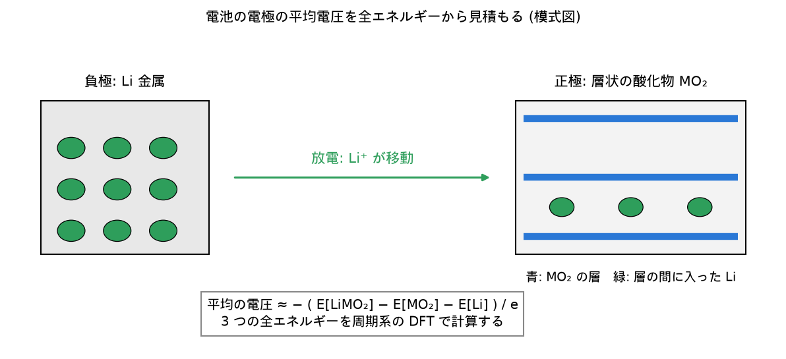

**図 13**　電池の電極の平均電圧を、3 つの全エネルギーから見積もる考え方（模式図）。リチウム 1 個が負極（Li 金属）から正極（MO₂ の層の間）に移るときのエネルギーの低下を、電子 1 個の電荷 e で割ったものが電圧です。

!!! question "「遷移金属の酸化物では DFT+U が必要」と言われるのはなぜ？"
    **そもそも何が問題か**：LDA や GGA の汎関数には、電子が自分自身と反発してしまう自己相互作用誤差があります（[講義ノート第 18 回](../courses/qc-theory/18-dft-errors.md)）。この誤差があると、電子は自分との反発を減らそうとして、必要以上に広がって（非局在化して）しまいます。

    **なぜ必要か**：遷移金属の酸化物の d 電子は、本当は金属の原子の上に局在しています。GGA ではそれが広がりすぎるので、Li を出し入れしたときに電子がどの金属の原子に入るか（酸化数の変化）が正しく出ず、電圧や構造が実験とずれることがあります。

    **どう使うか**：DFT+U は、d 軌道の占有数が整数（0 か 1）から外れるとエネルギーが上がる罰則の項 U を加え、d 電子を原子の上に局在させる方法です。U の値は、実験値に合わせて決めるか、線形応答などの方法で計算から決めます。U を変えると結果も変わるので、どの U を使ったかを必ず書き、比べる計算どうしでは同じ U を使います。

### 5.3 材料のデータベースと 2 次元材料

この分野では、多数の物質を自動で計算してデータベースにする研究が盛んです。Materials Project は、既知の無機物質の性質をハイスループット（大量の自動）計算で求め、公開しています [Jain 2013]。

2 次元材料（グラフェンのように、原子 1 層から数層の厚さのシート）も大きな研究対象です。Mounet らは、実験で知られている 108,423 種類の 3 次元の化合物から、層状に見える 5,619 種類を選び、ファンデルワールス相互作用を含む DFT で層の間の結合エネルギーを計算して、1,825 種類が簡単に、または条件しだいで剥がせる（1 層にできる）と判定しました [Mounet 2018]。

グラフェンを細く切ったナノリボンの縁に現れるラジカル性は、周期系の DFT では扱いにくい強い電子相関の問題で、有限の分子として DMRG で調べた研究 [Mizukami 2013] は[電子構造論のページ](02-electronic-structure.md)で紹介しています。

### 5.4 熱電材料と電気伝導

**熱電材料**は、温度差を電気に変える（あるいは電気で熱を運ぶ）材料です。
性能は、無次元の性能指数 ZT = S²σT/κ で表します。
S はゼーベック係数（温度差 1 K あたりに生じる電圧）、σ は電気伝導率、κ は熱伝導率、T は温度です。
電気はよく流すが、熱は流しにくい材料ほど ZT が大きくなります。
計算では、DFT のバンド構造から、電子の散乱の効果を入れたボルツマン輸送方程式で S と σ を求めるのが標準的なやり方です。

- Nam, Phung, Sato ら（2023）は、曲げられる熱電素子の候補として、低温相の α-AgCuS の延性、電子構造、輸送特性を、第一原理計算とボルツマン輸送理論で調べました。延性の半導体として知られる Ag₂S と似た層状のジグザグ構造をもち、金属のような延性があると判定しました。いくつかの散乱の機構を比べると、電子と極性光学フォノン（イオンが逆向きに振動する格子振動）の相互作用が、輸送に最も大きく影響しました。室温で正孔の濃度を 2 × 10¹⁹ cm⁻³ に調節すると、ZT が最大 0.592 になると予測し、p 型の熱電材料の有望な候補だとしています [Nam 2023]。
- 合金のように原子がランダムに並んだ固体は、小さな単位胞のくり返しでは表せません。Nam, Phung, Sato ら（2024）は、乱れた合金を平均的な媒質で置きかえて扱う KKR-CPA 法（Korringa–Kohn–Rostoker のグリーン関数法と、コヒーレントポテンシャル近似の組み合わせ）と、電気伝導率を与える Kubo–Greenwood の式を組み合わせました。この方法で、CoSi と、それに 3d 遷移金属（Cr、Mn、Fe、Ni）を加えた合金の有限温度での電気抵抗率を、定量的に再現しました [Nam 2024b]。

**この界隈の常識**

- 「PBE のバンドギャップ」は、実験のギャップと直接比べる量ではありません。5.1 節のとおり、半局所汎関数のギャップは系統的に小さく出るからです。傾向を見るのに使い、定量的な値には HSE や GW を使います。
- 遷移金属の酸化物では、磁性（スピンの向きの並び方）を自分で指定しないと、正しい基底状態が得られないことがあります。自己無撞着な計算は、出発点のスピンの配置に近い解（局所的な極小）に落ち着くので、反強磁性の物質を、何も指定せずに強磁性や非磁性の状態から始めると、その状態のまま収束してしまうからです。候補のスピンの配置をいくつか試し、エネルギーを比べます。
- 層状の物質や分子性結晶では、ファンデルワールス相互作用（分散力）の補正が欠かせません（[講義ノート第 17 回](../courses/qc-theory/17-dispersion.md)）。分散力は、離れた電子どうしの揺らぎが連動して生じる長距離の相関の効果で、その場の密度とその勾配だけを見る LDA や GGA には入っていないからです。補正がないと、層と層や分子と分子をつなぐ力のかなりの部分が抜け落ち、層の間隔や結晶の密度、剥離のエネルギーが大きくずれます。

## 6. 分子性結晶と有機半導体

### 6.1 電荷の移動と移動積分

有機半導体（有機 EL、有機トランジスタ、有機太陽電池の材料）は、分子どうしが弱い分散力で集まった**分子性結晶**や薄膜です。分子の間の電子のやりとりが弱いので、電荷は分子から分子へ「飛び移る」（ホッピング）ように動くことが多く、その動きやすさ（**移動度**）は主に 2 つの量で決まります [Coropceanu 2007]。

- **移動積分** $t$：隣の分子の軌道（正孔なら HOMO、電子なら LUMO）どうしの電子的な結合の強さ。大きいほど飛び移りやすくなります。
- **再配向エネルギー** $\lambda$：電荷が乗ったときに、分子の形が変わることによるエネルギーの損失。小さいほど飛び移りやすくなります。

移動積分の簡単な見積もり方の 1 つは、同じ分子 2 個の二量体を計算し、2 つの HOMO のエネルギーの分裂の半分を $|t|$ の目安にする方法です。図 14 の右は、この方法で、エチレン 2 個を平行に重ねた二量体の $|t|$ を、間隔を変えて計算したものです。間隔が 1 Å 広がるごとに、$|t|$ は数分の 1 から 10 分の 1 程度に減ります。分子の重なり方（間隔、ずれ、向き）が少し変わるだけで移動度が大きく変わるのは、このためです。

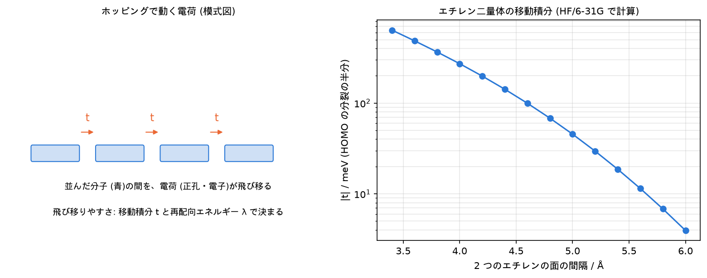

**図 14**　左：分子の間を電荷がホッピングで移る様子（模式図）。右：エチレンの二量体（2 つの分子を面を平行にして重ねた配置）の移動積分 |t|。HF/6-31G で計算した、2 つの HOMO のエネルギーの分裂の半分です（PySCF [Sun 2020] で計算。縦軸は対数）。

代表的な研究例として、Morinaka らは、小さな非平面のナノグラフェン（ヘキサベンゾテトラセン）が、炭化水素だけでできた正孔輸送材料として、従来のトリアリールアミン系の材料に匹敵する性能を持つことを報告しました [Morinaka 2024]。X 線構造解析と理論計算から、この分子では多方向に軌道の相互作用と移動積分が働くことが示され、この分子を使った有機 EL 素子は、従来の材料を使った素子より長い寿命を示しました。

### 6.2 分子性結晶の励起状態

分子性結晶の中の励起状態の代表的な研究対象が、1 つの一重項励起子が 2 つの三重項励起子に分かれる一重項分裂です。ルブレンの結晶で、分子の間の対称性を破る振動が速い一重項分裂の経路を開くことを示した研究 [Miyata 2017] を含め、[励起状態と光化学のページの 7 節](04-excited-states.md#7)で紹介しています。

**この界隈の常識**

- 分子性結晶では、分子の並び方（結晶多形）がわずかに違うだけで、性質が大きく変わります。移動積分のように分子の重なりで決まる量は、並び方に敏感だからです（図 14）。しかも多形どうしのエネルギー差は小さいことが多く、どの多形ができるかの予測には高い精度が要ります。結晶の構造とエネルギーの計算には、分散力の補正を入れた周期系の DFT や、分子の断片に分けて計算する方法などが使われます [Beran 2016]。
- 移動積分は、計算の方法（二量体の分裂から求めるか、断片の軌道から直接求めるか）で値が変わることがあります。二量体の分裂から求める方法では、2 つの分子のエネルギーのずれや、ほかの軌道との混ざりも分裂に入ってしまうからです。比べるときは同じ方法にそろえます。
- 有機半導体の励起状態は、1 分子の励起ではなく、複数の分子に広がった励起子や、電荷移動の性格を持つことがあります。分子どうしが近く、隣の分子との電子的な結合が無視できないからです。1 分子の計算だけで結晶の吸収を議論すると、こうした状態を見落とします。

## 7. よく使うプログラムと計算の作法

### 7.1 プログラム

| プログラム | 基底 | 特徴 |
|---|---|---|
| VASP | 平面波 + PAW | 固体と表面の計算で最も広く使われる商用のプログラム [Kresse 1996] |
| Quantum ESPRESSO | 平面波 + 擬ポテンシャル・PAW | オープンソース（GPL）の総合的なプログラム群 [Giannozzi 2009] |
| CP2K | ガウス基底と平面波の併用（GPW） | オープンソース。大きな系の DFT と第一原理分子動力学が得意 [Kühne 2020] |

このほか、全電子の計算（FLAPW 法など）や、原子軌道を基底とするプログラムもあります。結晶の構造を作ったり、計算を自動化したりするには、Python のライブラリ ASE や pymatgen がよく使われます。

### 7.2 汎関数の選び方

- **PBE**（GGA）[Perdew 1996]：固体の構造最適化とエネルギーの標準。構造や相対的なエネルギーには十分なことが多いですが、バンドギャップは小さく出ます（5.1 節）。
- **HSE**（遮蔽した混成汎関数）[Heyd 2003]：バンドギャップや欠陥の準位など、電子構造が大事なときに使います。平面波の基底で厳密な交換を計算するのは重いので、PBE より計算はかなり重くなります。HSE は、遠くの交換を遮蔽して計算を軽くしたものです。
- **分散力の補正**：層状物質、分子性結晶、表面への分子の吸着では必須です。PBE には分散力が入っていないからです（5.4 節の常識）。

### 7.3 収束の確認と再現性

周期系の計算で、結果を論文に出す前に必ず確かめるのが**収束**です。
カットオフ、k 点、スラブの厚さは、どれも「本当は無限にとるべきものを有限で打ち切った」近似のパラメータです。
打ち切りの誤差が、知りたいエネルギーの差より小さいことを示さないと、結果が物理なのか打ち切りの誤差なのか区別できません。

- カットオフエネルギーを上げても、エネルギーの差（反応エネルギー、吸着エネルギー）が変わらないこと。
- k 点を増やしても変わらないこと（図 6）。
- スラブの層の数や真空の厚さ、表面の単位胞の大きさを変えても変わらないこと。

収束を確かめれば、プログラムが違っても結果はよく一致します。15 種類の固体のプログラムと 40 種類の擬ポテンシャル・基底を使って、71 種類の元素の結晶の PBE の状態方程式を比べた共同研究では、最近のプログラムと擬ポテンシャルの予測は、精度の高い実験どうしの差と同程度によく一致しました [Lejaeghere 2016]。

## この分野でよく出てくる言葉

| 言葉 | 意味 |
|---|---|
| 単位胞 | 結晶をつくるくり返しの最小の単位。計算ではこの中の原子だけを扱う |
| 周期境界条件 | 単位胞の外側に、同じものが無限に続くとする条件 |
| ブロッホの定理 | 周期的な系の波動関数は、単位胞を 1 つ移ると位相が e^{ik·R} だけ回る、という定理 |
| 波数 k、k 点 | 位相の回り方を表す量と、計算でブリルアンゾーンに置くその標本点 |
| ブリルアンゾーン | 考えればよい k の有限の範囲 |
| 平面波、カットオフエネルギー | 周期的な基底関数と、その数を決める最大の運動エネルギー |
| 擬ポテンシャル | 内殻電子を除き、原子核の近くを滑らかにしたポテンシャル |
| PAW 法 | 滑らかな波動関数で計算し、原子の近くで全電子の波動関数に戻せる方法 |
| バンド構造 | k ごとのエネルギー固有値を線でつないだ図 |
| 状態密度（DOS、PDOS） | エネルギーごとの状態の数。軌道や原子ごとに分けたものが PDOS |
| フェルミ準位 | 電子が入った状態のいちばん上のエネルギー |
| バンドギャップ | 価電子帯の上端と伝導帯の下端の差。直接・間接がある |
| スメアリング | 金属の計算で、フェルミ準位の付近の占有数をぼかす工夫 |
| スラブ模型 | 表面を、真空の層をはさんだ数層の板で表す模型 |
| 吸着エネルギー | 表面と分子がくっつくときのエネルギーの変化 |
| d バンド中心 | 遷移金属の d バンドの状態密度の重心。吸着の強さの目安 |
| 記述子、火山型プロット | 活性を整理する少数の量と、活性をそれに対して描いた山形の図 |
| 高エントロピー合金（HEA） | 5 種類以上の元素をほぼ同じ割合で混ぜた合金。表面に多様な吸着の場所がある |
| 酸素還元反応（ORR） | O₂ + 4H⁺ + 4e⁻ → 2H₂O。燃料電池の正極の反応 |
| 熱電性能指数 ZT | S²σT/κ。熱電材料の性能を表す無次元の量 |
| 移動積分、再配向エネルギー | 有機半導体の電荷の移動を決める 2 つの量 |

## この分野の常識：まとめ

- 固体の計算は、単位胞と周期境界条件で行います。10²³ 個の原子は計算できないので、くり返しの最小単位だけを扱います。電子の状態は k ごとに求め（ブロッホの定理で k ごとに分かれるため）、k 点で平均します。
- 平面波の基底の精度はカットオフエネルギー 1 つで決まります。原子核の近くは、平面波では節を表しきれないので、擬ポテンシャルか PAW で滑らかにします。PAW は、球の中の全電子の形を取り戻せます。
- 金属は絶縁体より多くの k 点が要り、スメアリングを使います。フェルミ準位で占有数が段差になり、少ない k 点ではその位置を拾えないからです。
- 結果を出す前に、カットオフ、k 点、スラブの厚さ、真空の厚さの収束を確かめます。どれも無限を有限で打ち切ったパラメータで、打ち切りの誤差が知りたい差より小さいことを示す必要があるからです。
- PBE などの GGA はバンドギャップを過小評価します。自己相互作用誤差と、交換相関ポテンシャルの微分の不連続性が抜けていることが原因です。ギャップが大事なら HSE や GW を使います。
- 表面の計算はスラブ模型で、吸着エネルギーは 3 つの全エネルギーの差で求めます。条件をそろえて、全エネルギーの誤差を打ち消し合わせます。
- 遷移金属の表面の吸着の強さは d バンド中心で整理でき（反結合性の準位がどれだけ埋まるかで決まるため）、触媒の活性は記述子に対する火山型プロットで整理できます（吸着は強すぎても弱すぎてもよくないため）。
- 層状物質、分子性結晶、吸着では分散力の補正が必須です。GGA には長距離の相関である分散力が入っていないからです。
- 遷移金属の酸化物では、DFT+U と磁性の指定に注意します。d 電子が広がりすぎる誤差を U で抑え、SCF が出発点のスピン配置に引きずられるのを、配置を変えて試すことで避けます。
- 有機半導体の電荷の移動は、移動積分と再配向エネルギーで考えます。移動積分は分子の重なりで指数関数的に変わるので、分子の並び方が少し違うだけで大きく変わります。
- VASP、Quantum ESPRESSO、CP2K が代表的なプログラムで、ASE や pymatgen で構造を作り計算を自動化します。

## 最初に読むとよい文献

- D. S. Sholl と J. A. Steckel の教科書 [Sholl 2009]：平面波の DFT で固体と表面を計算するための実践的な入門書。k 点、カットオフ、スラブ模型の収束の確かめ方が具体的に書かれています。
- R. M. Martin の教科書 [Martin 2004]：固体の電子構造の理論の標準的な教科書。ブロッホの定理、平面波、擬ポテンシャル、PAW を体系的に学べます。
- J. K. Nørskov らの総説 [Nørskov 2011]：表面化学と触媒への DFT の応用。d バンドモデル、スケーリング関係、火山型プロットの考え方が短くまとまっています。
- V. Coropceanu らの総説 [Coropceanu 2007]：有機半導体の電荷の移動の理論。移動積分と再配向エネルギーの意味が分かります。
- K. Lejaeghere らの論文 [Lejaeghere 2016]：固体の DFT のプログラムの再現性。収束を確かめることの意味が分かります。

## 講義ノートとの関係

- [量子化学の理論 第 6 回　基底関数](../courses/qc-theory/06-basis-sets.md)：ガウス基底と、平面波の基底の違いを考えるときの前提です。
- [量子化学の理論 第 15 回　Hohenberg–Kohn の定理と Kohn–Sham 法](../courses/qc-theory/15-kohn-sham.md)：固体の計算のほとんどは Kohn–Sham 法です。
- [量子化学の理論 第 16 回　汎関数の階段](../courses/qc-theory/16-functionals.md)：PBE（GGA）と、範囲分離の考え方（HSE の遮蔽）。
- [量子化学の理論 第 17 回　分散力の補正](../courses/qc-theory/17-dispersion.md)：層状物質、分子性結晶、吸着に必須の補正です。
- [量子化学の理論 第 18 回　DFT の誤差](../courses/qc-theory/18-dft-errors.md)：バンドギャップの過小評価や、遷移金属の酸化物の問題の背景にある誤差です。
- [量子化学のための機械学習 第 7 回　基盤モデル](../courses/ml-chem/07-foundation-models.md)：周期系の DFT のデータで学習した機械学習ポテンシャルは、材料の計算でも広く使われ始めています。

## 参考文献

- F. Bloch, "Über die Quantenmechanik der Elektronen in Kristallgittern", Z. Phys. 52, 555 (1929). DOI: [10.1007/BF01339455](https://doi.org/10.1007/BF01339455)
- H. J. Monkhorst, J. D. Pack, "Special points for Brillouin-zone integrations", Phys. Rev. B 13, 5188 (1976). DOI: [10.1103/PhysRevB.13.5188](https://doi.org/10.1103/PhysRevB.13.5188)
- P. E. Blöchl, "Projector augmented-wave method", Phys. Rev. B 50, 17953 (1994). DOI: [10.1103/PhysRevB.50.17953](https://doi.org/10.1103/PhysRevB.50.17953)
- G. Kresse, D. Joubert, "From ultrasoft pseudopotentials to the projector augmented-wave method", Phys. Rev. B 59, 1758 (1999). DOI: [10.1103/PhysRevB.59.1758](https://doi.org/10.1103/PhysRevB.59.1758)
- G. Kresse, J. Furthmüller, "Efficient iterative schemes for ab initio total-energy calculations using a plane-wave basis set", Phys. Rev. B 54, 11169 (1996). DOI: [10.1103/PhysRevB.54.11169](https://doi.org/10.1103/PhysRevB.54.11169)
- P. Giannozzi et al., "QUANTUM ESPRESSO: a modular and open-source software project for quantum simulations of materials", J. Phys.: Condens. Matter 21, 395502 (2009). DOI: [10.1088/0953-8984/21/39/395502](https://doi.org/10.1088/0953-8984/21/39/395502)
- T. D. Kühne et al., "CP2K: An electronic structure and molecular dynamics software package - Quickstep: Efficient and accurate electronic structure calculations", J. Chem. Phys. 152, 194103 (2020). DOI: [10.1063/5.0007045](https://doi.org/10.1063/5.0007045)
- X.-G. Xiong, T. Yanai, "Projector Augmented Wave Method Incorporated into Gauss-Type Atomic Orbital Based Density Functional Theory", J. Chem. Theory Comput. 13, 3236 (2017). DOI: [10.1021/acs.jctc.7b00404](https://doi.org/10.1021/acs.jctc.7b00404)
- X.-G. Xiong, A. Sugiura, T. Yanai, "Projector Augmented Wave Method with Gauss-Type Atomic Orbital Basis: Implementation of the Generalized Gradient Approximation and Mesh Grid Quadrature", J. Chem. Theory Comput. 16, 4883 (2020). DOI: [10.1021/acs.jctc.0c00137](https://doi.org/10.1021/acs.jctc.0c00137)
- Q. M. Phung, M. Hagai, X.-G. Xiong, T. Yanai, "Polarization consistent basis sets using the projector augmented wave method: a renovation brought by PAW into Gaussian basis sets", Phys. Chem. Chem. Phys. 22, 27037 (2020). DOI: [10.1039/d0cp05229a](https://doi.org/10.1039/d0cp05229a)
- J. P. Perdew, K. Burke, M. Ernzerhof, "Generalized Gradient Approximation Made Simple", Phys. Rev. Lett. 77, 3865 (1996). DOI: [10.1103/PhysRevLett.77.3865](https://doi.org/10.1103/PhysRevLett.77.3865)
- J. Heyd, G. E. Scuseria, M. Ernzerhof, "Hybrid functionals based on a screened Coulomb potential", J. Chem. Phys. 118, 8207 (2003). DOI: [10.1063/1.1564060](https://doi.org/10.1063/1.1564060)
- J. Heyd, J. E. Peralta, G. E. Scuseria, R. L. Martin, "Energy band gaps and lattice parameters evaluated with the Heyd-Scuseria-Ernzerhof screened hybrid functional", J. Chem. Phys. 123, 174101 (2005). DOI: [10.1063/1.2085170](https://doi.org/10.1063/1.2085170)
- J. P. Perdew, M. Levy, "Physical Content of the Exact Kohn-Sham Orbital Energies: Band Gaps and Derivative Discontinuities", Phys. Rev. Lett. 51, 1884 (1983). DOI: [10.1103/PhysRevLett.51.1884](https://doi.org/10.1103/PhysRevLett.51.1884)
- H. N. Nam, Q. M. Phung, K. Suzuki, A. Masago, H. Shinya, T. Fukushima, K. Sato, "Insight into Scattering Mechanisms and Transport Properties of AgCuS for Flexible Thermoelectric Applications", ACS Appl. Mater. Interfaces 15, 43871 (2023). DOI: [10.1021/acsami.3c09437](https://doi.org/10.1021/acsami.3c09437)
- H. N. Nam, Q. M. Phung, K. Suzuki, H. Shinya, A. Masago, T. Fukushima, K. Sato, "Exploring finite-temperature electronic transport in CoSi alloys with transition metals (Cr, Mn, Fe, and Ni) using the KKR-CPA method", J. Mater. Chem. A 12, 451 (2024). DOI: [10.1039/d3ta06259g](https://doi.org/10.1039/d3ta06259g)
- B. Hammer, J. K. Nørskov, "Why gold is the noblest of all the metals", Nature 376, 238 (1995). DOI: [10.1038/376238a0](https://doi.org/10.1038/376238a0)
- J. K. Nørskov, J. Rossmeisl, A. Logadottir, L. Lindqvist, J. R. Kitchin, T. Bligaard, H. Jónsson, "Origin of the Overpotential for Oxygen Reduction at a Fuel-Cell Cathode", J. Phys. Chem. B 108, 17886 (2004). DOI: [10.1021/jp047349j](https://doi.org/10.1021/jp047349j)
- J. K. Nørskov, F. Abild-Pedersen, F. Studt, T. Bligaard, "Density functional theory in surface chemistry and catalysis", Proc. Natl. Acad. Sci. U.S.A. 108, 937 (2011). DOI: [10.1073/pnas.1006652108](https://doi.org/10.1073/pnas.1006652108)
- H. N. Nam, R. Nandan, L. Fu, Y. Zhao, Y. Kang, T. Fukushima, K. Sato, Y. Asakura, O. Cretu, J. Kikkawa, J. Henzie, J. P. Hill, T. Yanai, Q. M. Phung, Y. Yamauchi, "Modeling-Making-Modulating High-Entropy Alloy with Activated Water-Dissociation Centers for Superior Electrocatalysis", J. Am. Chem. Soc. 147, 33545 (2025). DOI: [10.1021/jacs.5c08012](https://doi.org/10.1021/jacs.5c08012)
- L. Fu, H. N. Nam, J. Zhou, Y. Kang, K. Wang, Z. Zhou, Y. Zhao, L. Zhu, R. Nandan, M. Eguchi, Q. M. Phung, T. Yokoshima, K. Wu, Y. Yamauchi, "Mesoporous High-Entropy Alloy Films", ACS Nano 18, 27617 (2024). DOI: [10.1021/acsnano.4c08929](https://doi.org/10.1021/acsnano.4c08929)
- H. N. Nam, Q. M. Phung, P. Choeichom, Y. Yamauchi, N. Saito, "First-principles studies of enhanced oxygen reduction reactions on graphene- and nitrogen-doped graphene-coated platinum surfaces", Phys. Chem. Chem. Phys. 26, 10711 (2024). DOI: [10.1039/d4cp00269e](https://doi.org/10.1039/d4cp00269e)
- M. K. Aydinol, A. F. Kohan, G. Ceder, K. Cho, J. Joannopoulos, "Ab initio study of lithium intercalation in metal oxides and metal dichalcogenides", Phys. Rev. B 56, 1354 (1997). DOI: [10.1103/PhysRevB.56.1354](https://doi.org/10.1103/PhysRevB.56.1354)
- A. Jain et al., "Commentary: The Materials Project: A materials genome approach to accelerating materials innovation", APL Mater. 1, 011002 (2013). DOI: [10.1063/1.4812323](https://doi.org/10.1063/1.4812323)
- N. Mounet et al., "Two-dimensional materials from high-throughput computational exfoliation of experimentally known compounds", Nat. Nanotechnol. 13, 246 (2018). DOI: [10.1038/s41565-017-0035-5](https://doi.org/10.1038/s41565-017-0035-5)
- W. Mizukami, Y. Kurashige, T. Yanai, "More π Electrons Make a Difference: Emergence of Many Radicals on Graphene Nanoribbons Studied by Ab Initio DMRG Theory", J. Chem. Theory Comput. 9, 401 (2013). DOI: [10.1021/ct3008974](https://doi.org/10.1021/ct3008974)
- V. Coropceanu, J. Cornil, D. A. da Silva Filho, Y. Olivier, R. Silbey, J.-L. Brédas, "Charge Transport in Organic Semiconductors", Chem. Rev. 107, 926 (2007). DOI: [10.1021/cr050140x](https://doi.org/10.1021/cr050140x)
- Y. Morinaka, H. Ito, K. J. Fujimoto, T. Yanai, Y. Ono, T. Tanaka, K. Itami, "Nonplanar Nanographene: A Hydrocarbon Hole-Transporting Material That Competes with Triarylamines", Angew. Chem. Int. Ed. 63, e202409619 (2024). DOI: [10.1002/anie.202409619](https://doi.org/10.1002/anie.202409619)
- K. Miyata, Y. Kurashige, K. Watanabe, T. Sugimoto, S. Takahashi, S. Tanaka, J. Takeya, T. Yanai, Y. Matsumoto, "Coherent singlet fission activated by symmetry breaking", Nat. Chem. 9, 983 (2017). DOI: [10.1038/nchem.2784](https://doi.org/10.1038/nchem.2784)
- G. J. O. Beran, "Modeling Polymorphic Molecular Crystals with Electronic Structure Theory", Chem. Rev. 116, 5567 (2016). DOI: [10.1021/acs.chemrev.5b00648](https://doi.org/10.1021/acs.chemrev.5b00648)
- K. Lejaeghere et al., "Reproducibility in density functional theory calculations of solids", Science 351, aad3000 (2016). DOI: [10.1126/science.aad3000](https://doi.org/10.1126/science.aad3000)
- D. S. Sholl, J. A. Steckel, "Density Functional Theory: A Practical Introduction" (Wiley, 2009). ISBN: 9780470373170
- R. M. Martin, "Electronic Structure: Basic Theory and Practical Methods" (Cambridge University Press, 2004). ISBN: 9780521782852
- Q. Sun et al., "Recent developments in the PySCF program package", J. Chem. Phys. 153, 024109 (2020). DOI: [10.1063/5.0006074](https://doi.org/10.1063/5.0006074)

## 関連リンク

- VASP：https://www.vasp.at/
- Quantum ESPRESSO：https://www.quantum-espresso.org/
- CP2K：https://www.cp2k.org/
- ASE（Atomic Simulation Environment）：https://wiki.fysik.dtu.dk/ase/
- Materials Project：https://materialsproject.org/
