# 量子コンピュータと量子化学：新しい計算機で電子状態を解く研究

!!! abstract "このページで分かること"
    量子コンピュータで分子の電子状態を解く研究を紹介します。なぜ量子化学が量子コンピュータの有望な応用と言われるのか、量子ビットと量子回路とは何か、VQE と量子位相推定（QPE）はどう違うのか、実用にはどれくらいの量子コンピュータが必要と見積もられているのかを、初めての人向けに説明します。この分野でよく言われる「誤り耐性が必要」「量子優位性の主張は慎重に読む」などが、なぜそう言われるのかも説明します。

    | 節 | 内容 |
    |---|---|
    | 1 | この分野が答えようとしている問い：FCI の壁 |
    | 2 | 量子ビットと量子回路の基本 |
    | 3 | 分子を量子ビットに載せる：Jordan–Wigner 変換 |
    | 4 | VQE（変分量子固有値ソルバー） |
    | 5 | 量子位相推定と誤り耐性量子計算、リソース見積もり |
    | 6 | 量子計算と古典計算の組み合わせ：活性空間と古典の競争相手 |
    | 7 | この界隈の常識：NISQ、ノイズ、量子優位性の読み方 |

!!! tip "ひとことで言うと"
    分子の波動関数は、電子の入り方の組み合わせの数だけ係数を持ち、その数は軌道の数とともに指数関数的に増えます。古典計算機では、係数を 1 つずつメモリに書くしかありません。量子コンピュータでは、量子ビット $n$ 個の状態がそのまま $2^n$ 個の係数を持つので、「波動関数を、波動関数のまま」計算機の中に置けます。たとえるなら、古典計算機は楽譜（係数の表）を紙に書き写して演奏を予想し、量子コンピュータは楽器そのものを鳴らして音（エネルギー）を聴きます。ただし、鳴らした音は 1 回聴くと消えてしまう（測定すると状態が壊れる）ので、何度も鳴らして聴き分ける必要があります。

## 1. この分野が答えようとしている問い

量子化学で最も正確な計算は、決められた基底関数の中で、電子の入り方の全ての組み合わせを考える **FCI**（完全配置間相互作用、講義ノート第 8 回）です。ところが、FCI の決定子（電子の入り方の 1 通り）の数は、軌道の数とともに爆発的に増えます。$n$ 個の電子を $n$ 個の軌道に入れる場合、α 電子の入り方が $\binom{n}{n/2}$ 通り、β 電子も同じなので、決定子の数は $\binom{n}{n/2}^2$ です（図 1）。

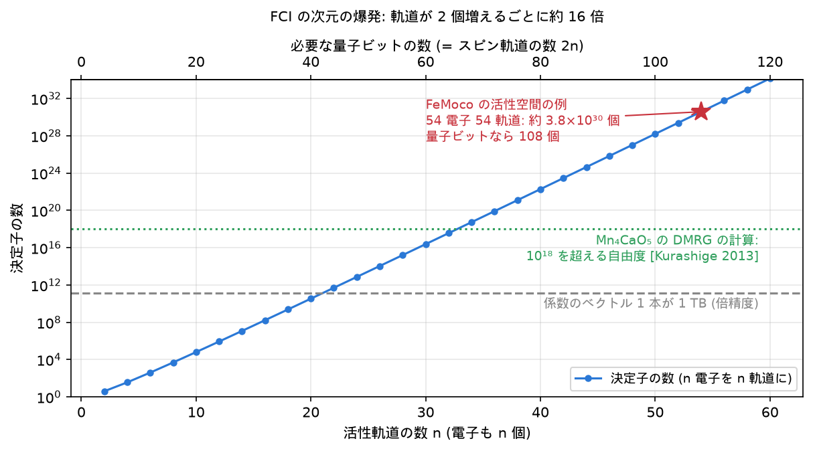

**図 1**　FCI の決定子の数（n 電子を n 軌道に入れる場合、自分で計算）。軌道が 2 個増えるごとに約 16 倍になり、軌道 22 個で係数のベクトル 1 本が 1 TB を超えます。上の横軸は、同じ問題を量子コンピュータに載せるのに必要な量子ビットの数（スピン軌道の数）で、こちらは軌道の数に比例してしか増えません。

この「指数関数的な壁」を越えるため、古典計算機の上では、DMRG や選択的 CI（講義ノート第 14 回）のように、重要な部分だけを残す近似が工夫されてきました。DMRG で光化学系 II の Mn₄CaO₅ クラスターの波動関数を求めた例は、[電子構造論のページ](02-electronic-structure.md#32-ii-mn4cao5)で紹介します [Kurashige 2013]。

一方、量子コンピュータでは、量子ビットの数は軌道の数に比例するだけです（図 1 の上の軸）。量子化学のエネルギーの計算時間は古典計算機では系の大きさに対して指数関数的に増えるが、量子アルゴリズムでは多項式的にしか増えない、という見通しは、Aspuru-Guzik らが 2005 年に、水と水素化リチウムの基底状態のエネルギーを量子コンピュータのシミュレーターで計算して示しました [Aspuru-Guzik 2005]。その基礎になったのは、固有値と固有ベクトルを求める Abrams と Lloyd の量子アルゴリズムです [Abrams 1999]。

この分野が答えようとしている問いは、次のようなものです。

- 量子コンピュータで、分子のエネルギーをどうやって計算するのか（アルゴリズム）。
- 古典計算機では解けない大きさの問題を、どれくらいの量子コンピュータで解けるのか（リソース見積もり）。
- 今ある、ノイズの多い量子コンピュータで、何ができるのか（実証実験）。
- 量子コンピュータは、本当に古典計算機より速いのか（量子優位性の検証）。

## 2. 量子ビットと量子回路の基本

### 2.1 量子ビット

古典的なビットは 0 か 1 のどちらかです。**量子ビット**（qubit）は、$|0\rangle$ と $|1\rangle$ の重ね合わせの状態

$$
|\psi\rangle = \alpha|0\rangle + \beta|1\rangle, \qquad |\alpha|^2 + |\beta|^2 = 1
$$

をとれます。$\alpha$ と $\beta$ は複素数です。全体の位相は意味を持たないので、1 量子ビットの状態は球面上の 1 点（**ブロッホ球**）で表せます（図 2）。北極が $|0\rangle$、南極が $|1\rangle$ です。測定すると、確率 $|\alpha|^2$ で 0、確率 $|\beta|^2$ で 1 が出て、状態はその結果の状態に変わります。

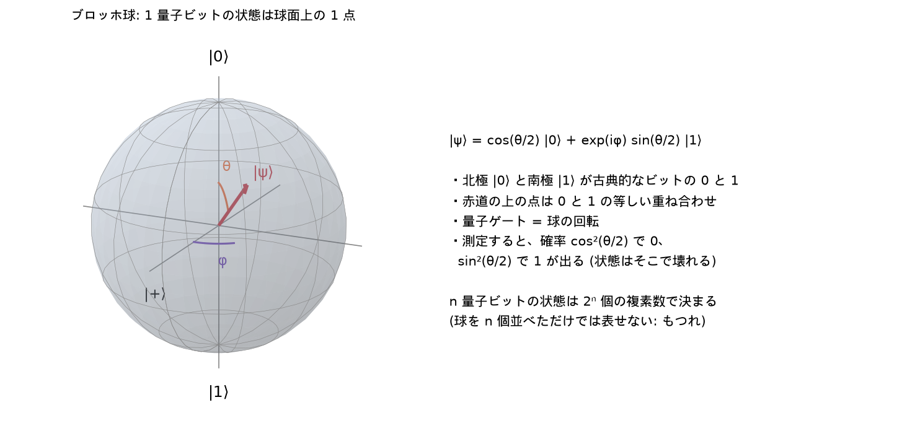

**図 2**　ブロッホ球の 3D 図。1 量子ビットの状態は、角度 θ と φ で決まる球面上の 1 点（赤の矢印）で表せます。量子ゲートは、この球の回転として働きます。

量子ビットが $n$ 個あると、状態は $2^n$ 通りの 0 と 1 の並び（$|00\cdots0\rangle$ から $|11\cdots1\rangle$ まで）の重ね合わせになり、$2^n$ 個の複素数の係数を持ちます。2 量子ビットなら

$$
|\Psi\rangle = c_{00}|00\rangle + c_{01}|01\rangle + c_{10}|10\rangle + c_{11}|11\rangle
$$

です。$c_{00}c_{11} \ne c_{01}c_{10}$ のとき、この状態は 1 量子ビットの状態の積に分解できず、**もつれている**（entangled）と言います。もつれた状態は、ブロッホ球を $n$ 個並べるだけでは表せません。

### 2.2 量子回路

量子コンピュータの計算は、量子ビットに**量子ゲート**（状態を回転させるユニタリ変換）を順に作用させ、最後に測定することで行います。この手順を図にしたものが**量子回路**です（図 3）。横線が量子ビットで、時間は左から右へ流れます。

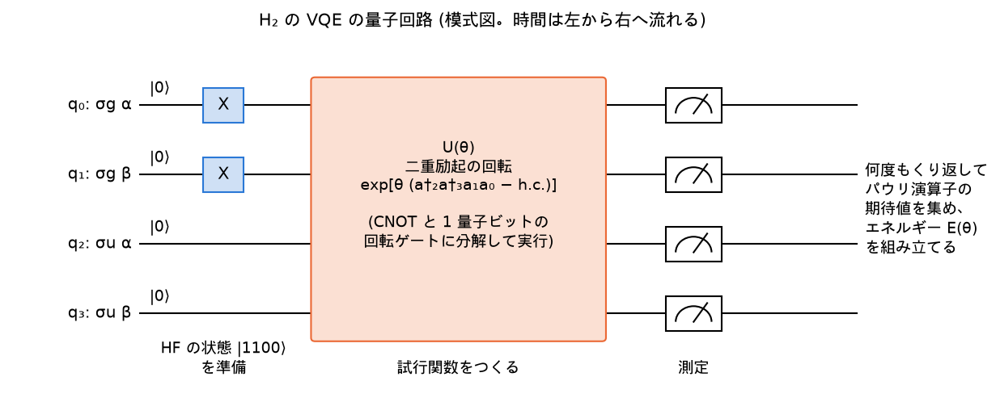

**図 3**　H₂ の VQE の量子回路（模式図）。X ゲート（ビット反転）で HF の状態を準備し、パラメータ θ を持つゲートの組 U(θ) で試行関数を作り、最後に測定します。測定で得られるのは 0 と 1 の列だけなので、同じ回路を何度もくり返してエネルギーの期待値を組み立てます。

よく出てくるゲートは次のとおりです。

- **X ゲート**：$|0\rangle$ と $|1\rangle$ を入れ替える（古典の NOT）。
- **回転ゲート**（$R_x(\theta)$、$R_y(\theta)$、$R_z(\theta)$）：ブロッホ球を、ある軸の周りに角度 θ だけ回す。
- **CNOT ゲート**：2 量子ビットのゲート。1 つ目（制御ビット）が $|1\rangle$ のときだけ、2 つ目を反転する。もつれを作るのに使う。

任意のユニタリ変換は、1 量子ビットのゲートと CNOT の組み合わせで（近似的に）作れます。量子回路の基礎は、Nielsen と Chuang の教科書 [Nielsen 2010] が標準です。

**この界隈の常識**

- 測定で得られるのは 0 と 1 の列だけです。1 回の測定は、確率 $|c|^2$ に従って 1 つの結果を出すだけで、確率そのものは教えてくれないからです。期待値は、同じ回路を何千回、何万回とくり返した統計から求めます（ショット数。4.3 節）。
- 状態ベクトルの $2^n$ 個の係数を、全部読み出すことはできません。測定すると状態が壊れるので、係数を知るには同じ状態を何度も作り直して測るしかありません。$2^n$ 個の確率を推定するには指数関数的な回数が必要で、指数関数的な壁が測定の側に戻ってきます。読み出すのは、エネルギーのような少数の量の期待値だけにします。
- 2 量子ビットのゲート（CNOT など）は、1 量子ビットのゲートより誤りが起こりやすいです。2 つの量子ビットを互いに作用させる必要があり、操作が長く複雑になるからです。誤りは回路の「深さ」（ゲートの数）とともに積み重なります（図 4）。

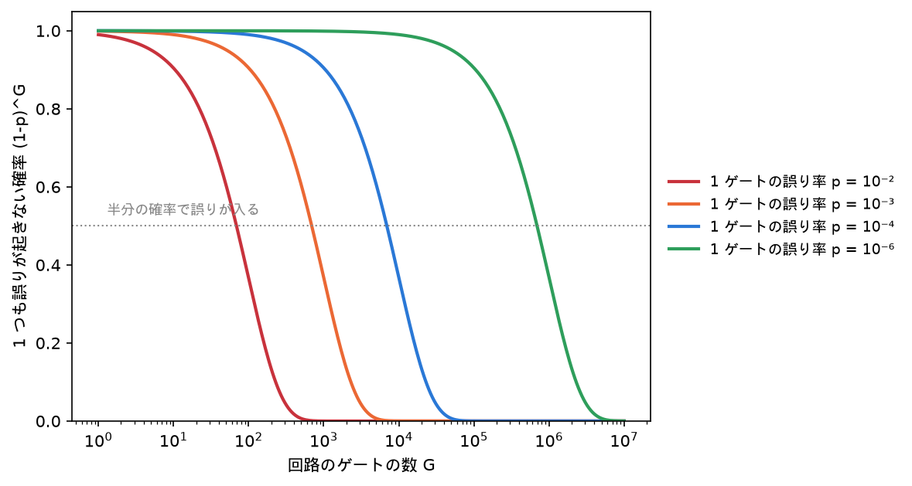

**図 4**　ゲートの誤りの積み重なり（自分で計算した単純な模型）。1 ゲートあたり確率 p で誤りが起き、誤りは互いに独立と仮定すると、G 個のゲートで 1 つも誤りが起きない確率は (1−p)^G です。p = 10⁻³ でも、ゲートが約 700 個を超えると、半分以上の確率で誤りが入ります。

## 3. 分子を量子ビットに載せる：Jordan–Wigner 変換

分子の電子状態を量子コンピュータで扱うには、第二量子化（講義ノート第 3 回）のハミルトニアン

$$
\hat H = \sum_{pq} h_{pq}\, a_p^\dagger a_q + \frac12 \sum_{pqrs} \langle pq|rs\rangle\, a_p^\dagger a_q^\dagger a_s a_r
$$

を、量子ビットの演算子に書き直します（$\langle pq|rs\rangle$ は物理学者の表記の電子反発積分で、$p, q, r, s$ はスピン軌道です）。最も素朴な方法が **Jordan–Wigner 変換**です [Jordan 1928]。

考え方は単純で、スピン軌道 $j$ が占有されていれば量子ビット $j$ を $|1\rangle$、空なら $|0\rangle$ にします（図 5）。H₂ の最小基底（STO-3G）では、σg α、σg β、σu α、σu β の 4 つのスピン軌道があり、4 量子ビットで表せます。HF の状態（σg に電子 2 個）は $|1100\rangle$ です。

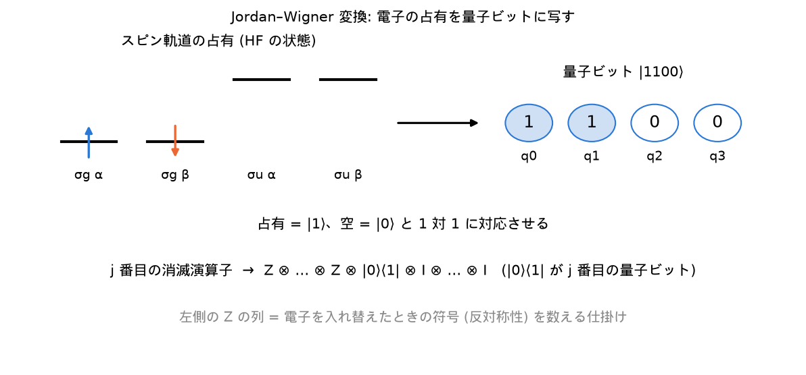

**図 5**　Jordan–Wigner 変換の考え方（模式図）。スピン軌道の占有（左）を、量子ビットの 0 と 1（右）に 1 対 1 に対応させます。消滅演算子は、左側の量子ビットに Z（$|0\rangle$ はそのまま、$|1\rangle$ は符号を反転）を並べた形になります。

消滅演算子 $a_j$ は、$j$ 番目の量子ビットを $|1\rangle$ から $|0\rangle$ に変える演算子 $|0\rangle\langle 1|$ に、$j$ より左の全ての量子ビットに作用する $Z = \begin{pmatrix} 1 & 0 \\ 0 & -1 \end{pmatrix}$ をかけた形になります。

$$
a_j \;\to\; Z_0 \otimes Z_1 \otimes \cdots \otimes Z_{j-1} \otimes \begin{pmatrix} 0 & 1 \\ 0 & 0 \end{pmatrix}_j \otimes I \otimes \cdots \otimes I
$$

$Z$ の列は、「$j$ より左にある電子の数が奇数なら符号を $-1$ にする」という仕掛けです。電子は入れ替えると符号が変わる（反対称性）ので、この符号がないと、量子ビットの演算子が電子の性質を正しく表せません。

変換すると、ハミルトニアンはパウリ演算子（$I$、$X$、$Y$、$Z$ の積）の重みつきの和になります。この形なら、各項の期待値を量子コンピュータで測定できます。各量子ビットを $X$、$Y$、$Z$ のどれかの向きで測れば、パウリ演算子の積の値（+1 か −1）が 1 回の測定で決まるからです。H₂ の最小基底では、恒等演算子を含めて 15 個の項になりました（このページの計算）。項の数は、スピン軌道の数 $N$ に対しておよそ $N^4$ で増えます。2 電子積分 $\langle pq|rs\rangle$ の添字が 4 つあるためです。Jordan–Wigner 変換では $Z$ の列が長くなる（量子ビットの数に比例する）ので、その長さを $\log n$ 程度に抑える Bravyi–Kitaev 変換なども使われます [Bravyi 2002]。

このページの H₂ の計算では、PySCF [Sun 2020] で求めた分子軌道の積分から、Jordan–Wigner 変換で 16×16 の量子ビットのハミルトニアン行列を作りました。電子 2 個の状態の中での最低固有値は −1.137284 $E_\mathrm{h}$（0.74 Å）で、PySCF の FCI のエネルギーと一致しました。

## 4. VQE（変分量子固有値ソルバー）

### 4.1 量子と古典の分業

**VQE**（variational quantum eigensolver）は、Peruzzo らが 2014 年に提案し、光子を使った量子プロセッサで HeH⁺ の基底状態のエネルギーを計算して実証した方法です [Peruzzo 2014]。量子位相推定（5 節）より、量子状態を長い時間ノイズなく保つ必要（コヒーレンス時間の要求）が大幅に小さいのが特徴です。VQE の量子回路は、試行関数を 1 つ作って測るだけの短い回路で、それを何度もくり返すからです。長い計算は、古典計算機の側の最適化のループが受け持ちます。

VQE の考え方は、変分法（講義ノート第 1 回）そのものです（図 6）。

1. パラメータ θ を持つ量子回路 $U(\boldsymbol\theta)$ で、試行関数 $|\psi(\boldsymbol\theta)\rangle = U(\boldsymbol\theta)|\mathrm{HF}\rangle$ を量子コンピュータの上に作る。
2. ハミルトニアンの各パウリ演算子の期待値を測定し、エネルギー $E(\boldsymbol\theta) = \langle\psi(\boldsymbol\theta)|\hat H|\psi(\boldsymbol\theta)\rangle$ を組み立てる。
3. 古典計算機の最適化の方法で、$E(\boldsymbol\theta)$ が下がるように θ を更新し、1 に戻る。

変分原理から、$E(\boldsymbol\theta)$ は真の基底状態のエネルギー以上なので、最小にした値が近似の答えになります。

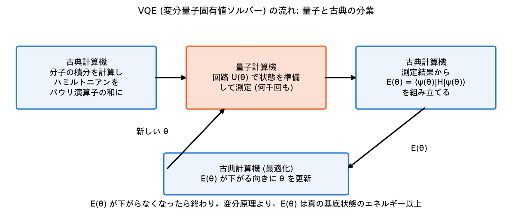

**図 6**　VQE の流れ（模式図）。量子コンピュータは「状態を作って測る」部分だけを担い、積分の計算、エネルギーの組み立て、パラメータの最適化は古典計算機が行います。

試行関数の回路には、量子化学の結合クラスター法（講義ノート第 10 回）をユニタリにした **UCCSD** の形や、量子コンピュータのハードウェアで実行しやすいゲートを並べた**ハードウェア効率型**の形などが使われます [Kandala 2017]。2 つの型は、互いの弱点を補う関係にあります。UCCSD は化学の考え方に基づき、電子の数を保ちますが、量子ビットの間をつなぐゲートが多く、回路が深くなります。ハードウェア効率型は回路が浅いのでノイズに強い一方、電子の数やスピンが保たれるとは限らず、化学的な意味が読みにくくなります。VQE の方法と注意点は、Tilly らの総説に詳しくまとめられています [Tilly 2022]。

### 4.2 H₂ で見る VQE のエネルギーの地形

H₂ の最小基底の VQE を、量子コンピュータのシミュレーター（状態ベクトルを numpy で直接計算）で試します。試行関数として、HF の状態に 2 種類の「回転」をかけたものを使います。

$$
|\psi(\theta_1, \theta_2)\rangle = e^{\theta_2 (\hat S - \hat S^\dagger)}\, e^{\theta_1 (\hat D - \hat D^\dagger)}\, |1100\rangle
$$

$\hat D = a_{3}^\dagger a_{2}^\dagger a_{1} a_{0}$ は σg² から σu² への二重励起、$\hat S$ は σg から σu への一重項の一電子励起です。$\hat D - \hat D^\dagger$ は反エルミートなので、$e^{\theta_1(\hat D - \hat D^\dagger)}$ はユニタリ（量子ゲートで実行できる変換）です。

エネルギーを 2 つのパラメータの関数として描くと、図 7 のような地形になります。

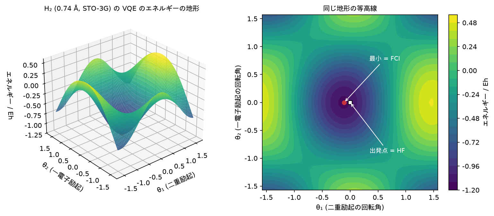

**図 7**　H₂（0.74 Å、STO-3G）の VQE のエネルギーの地形（Jordan–Wigner 変換したハミルトニアンで自分で計算）。左：3D の曲面。右：等高線。出発点 θ₁ = θ₂ = 0 が HF のエネルギーで、谷の底（赤い点）が FCI のエネルギーです。一電子励起の向き（θ₂）に動くとエネルギーは上がるだけです。

谷の底が θ₂ = 0 の線の上にあるのは、σg → σu の一電子励起が、基底状態（g の対称性）とは対称性が違う状態を混ぜるからです。θ₂ = 0 に固定すると、試行関数は 2 つの決定子だけの重ね合わせ

$$
|\psi(\theta_1)\rangle = c_1(\theta_1)\, |1100\rangle + c_2(\theta_1)\, |0011\rangle
$$

になります。この 2 つの決定子の間のハミルトニアン行列（0.74 Å、単位は $E_\mathrm{h}$、PySCF の積分から計算）は

$$
\mathbf H =
\begin{pmatrix}
\langle 1100|\hat H|1100\rangle & \langle 1100|\hat H|0011\rangle \\
\langle 0011|\hat H|1100\rangle & \langle 0011|\hat H|0011\rangle
\end{pmatrix}
=
\begin{pmatrix}
-1.116759 & 0.181210 \\
0.181210 & 0.462618
\end{pmatrix}
$$

です。左上が HF のエネルギー、右下が σu² の配置のエネルギー、非対角が 2 つをつなぐ積分（σg と σu の交換積分）です。この行列の低い方の固有値 −1.137284 $E_\mathrm{h}$ が FCI のエネルギーで、固有ベクトルは $c_1 = 0.994$、$c_2 = -0.113$ です。VQE は、この固有ベクトルを、θ₁ を動かして「探し当てる」計算です。

### 4.3 ポテンシャルエネルギー曲線とノイズ

θ₁ を最適化して、H₂ のポテンシャルエネルギー曲線を描くと図 8 になります。ノイズのないシミュレーターでは、VQE のエネルギーは全ての距離で FCI と $10^{-14}\ E_\mathrm{h}$ 以下の差で一致しました。この簡単な系では、試行関数が FCI の波動関数を正確に表せるからです。

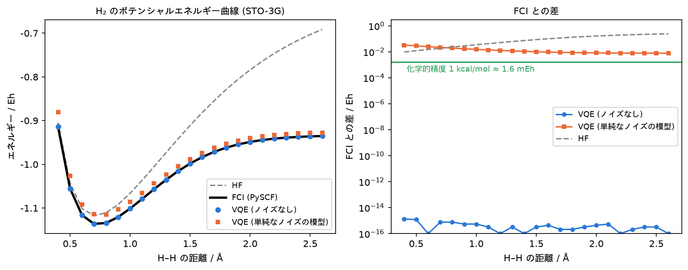

**図 8**　H₂ のポテンシャルエネルギー曲線（STO-3G、自分で計算）。左：HF（灰色の破線）は解離の極限で大きく外れますが、VQE（青の点）は FCI（黒の線）と重なります。橙の四角は、量子ビット全体に 2% の脱分極ノイズ（状態が確率 p で完全にでたらめになる、という単純な模型）を入れたときの値です。右：FCI との差。ノイズがあると、差が化学的精度（1 kcal/mol ≈ 1.6 m$E_\mathrm{h}$）を大きく超えます。

実際の量子コンピュータでは、ゲートの誤り、量子ビットの状態の減衰、測定の誤りといった**ノイズ**が避けられません。図 8 の単純な模型でも、2% のノイズでエネルギーは 8〜33 m$E_\mathrm{h}$ ずれました。超伝導量子ビットの実機では、O'Malley らが H₂ のポテンシャルエネルギー曲線を VQE と量子位相推定の両方で計算し、VQE で解離エネルギーを化学的精度で再現して、VQE がある種の誤りに強いことを示しました [O'Malley 2016]。Google のグループは最大 12 量子ビット・72 個の 2 量子ビットゲートで水素の鎖（H₁₂ まで）などの VQE を行い、誤りの緩和（error mitigation）を組み合わせると化学的精度が得られることを示しました [Google 2020]。

**この界隈の常識**

- VQE のエネルギーは、試行関数の回路の表現力、最適化、測定の統計誤差、ノイズの 4 つで決まります。どれが精度を制限しているのかを区別して読みます。原因によって打つ手が違うからです。表現力が足りなければ回路を変え、最適化が止まっていれば出発点や方法を変え、統計誤差ならショットを増やし、ノイズなら誤りの緩和を使います。ノイズのないシミュレーターの結果と比べると、ノイズの寄与を切り分けられます。
- ランダムに近い回路を試行関数にすると、量子ビットが増えるにつれて勾配が指数関数的に小さくなり、最適化が進まなくなることがあります（不毛な台地、barren plateau）[McClean 2018]。勾配も測定の統計から求めるので、勾配がショットの統計誤差より小さくなると、どちらに進めばよいかが分からなくなります。

!!! question "「ショット数が膨大になる」と言われるのはなぜ？"
    **そもそもショット数とは**：期待値を求めるために、同じ回路を実行して測定する回数です。

    **なぜ膨大になるか**：測定の結果はばらつくので、$N$ 回の平均の統計誤差は $\sigma/\sqrt{N}$ です（$\sigma$ は 1 回の測定のばらつき）。誤差を半分にするには、回数を 4 倍にする必要があります。このページの H₂ で、15 個の項を別々に測り、回数を最適に配分するとして見積もると、$\sigma$ は約 0.35 $E_\mathrm{h}$ でした。化学的精度 1.6 m$E_\mathrm{h}$ に届くには、約 5 万回が必要です（図 9）。大きな分子では、項の数が $N^4$ で増え、係数も大きくなるので、$\sigma$ が大きくなり、回数は 2 乗で効いてきます。

    **どう減らすか**：同時に測れる項をまとめて測る、ハミルトニアンを分解して項を減らす、などの工夫が研究されています [Tilly 2022]。

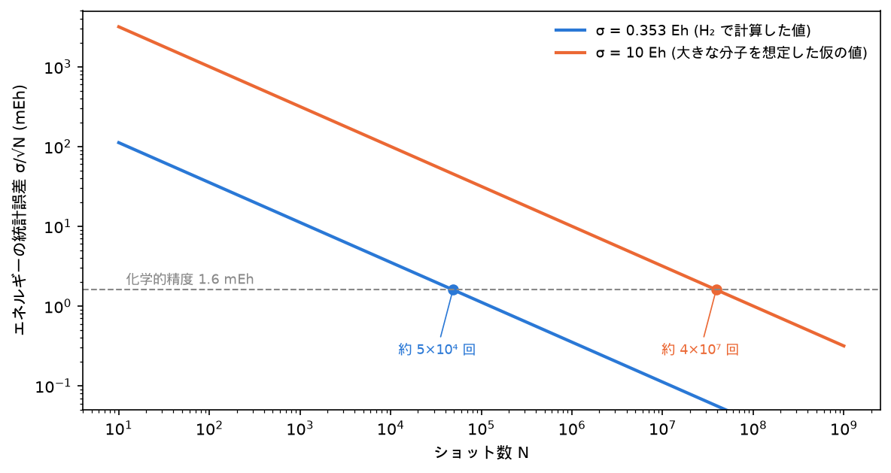

**図 9**　測定の統計誤差とショット数（自分で計算）。青は、このページの H₂（0.74 Å）の FCI 状態で、15 個の項を別々に測るとして求めた σ です。橙は、σ がその約 30 倍の場合の目安です。統計誤差は 1/√N でしか減らないので、σ が 30 倍になると、必要な回数は約 900 倍になります。

## 5. 量子位相推定と誤り耐性量子計算

### 5.1 量子位相推定（QPE）

量子コンピュータで分子のエネルギーを求める「本命」のアルゴリズムが、**量子位相推定**（quantum phase estimation、QPE）です。ハミルトニアン $\hat H$ の固有状態 $|\psi\rangle$（エネルギー $E$）に、時間発展の演算子 $e^{-i\hat H t}$ をかけると、

$$
e^{-i\hat H t}|\psi\rangle = e^{-iEt}|\psi\rangle
$$

のように、状態は変わらず位相 $-Et$ だけが付きます。QPE は、この位相を、補助の量子ビット（$t$ 個）と量子フーリエ変換を使って 2 進数の桁として読み出す方法です。補助の量子ビットを増やすほど、位相（つまりエネルギー）が細かく読めます（図 10）。

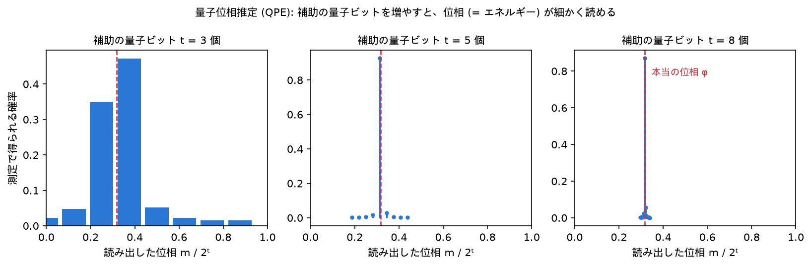

**図 10**　量子位相推定で読み出される位相の確率分布（理想的な場合を自分で計算。本当の位相は φ = 0.3172 としました）。補助の量子ビットが 3 個だと分布は広く、5 個、8 個と増やすと、本当の位相の近くに鋭く集まります。

QPE の利点は、試行関数の最適化が要らず、準備した状態が基底状態と十分に重なっていれば、そのエネルギーを原理的にいくらでも正確に読めることです。欠点は、回路がとても深く（長く）なることです。時間発展 $e^{-i\hat H t}$ を、長い時間にわたって何度も精密に実行する必要があるからです。そのため、ノイズのある今の量子コンピュータでは大きな分子に使えません。

### 5.2 誤り耐性量子計算とリソース見積もり

!!! question "「QPE には誤り耐性量子計算が必要」と言われるのはなぜ？"
    **そもそも誤り訂正とは**：多数の物理的な量子ビット（**物理量子ビット**）に 1 個分の情報を広げて持たせ、どこかに誤りが起きても、その誤りを検出して直せるようにすることです。こうして作った、誤りにくい 1 個分の量子ビットを**論理量子ビット**と呼びます。誤り訂正を備えた量子コンピュータを**誤り耐性量子計算機**（fault-tolerant quantum computer、FTQC）と呼びます。

    **なぜ必要か**：図 4 のように、誤りのない確率は、ゲートの数とともに指数関数的に減ります。分子のエネルギーを QPE で精密に読む回路では、下で見るように、T ゲートだけで $10^{14}$ 個に及ぶという見積もりがあります。今の物理量子ビットの誤り率（$10^{-3}$ 程度）では、このような回路が誤りなしに終わる確率は事実上 0 です。1 回の実行で起きる誤りの数を 1 個以下に抑えるには、1 ゲートあたりの誤り率をゲートの数の逆数（$10^{-14}$ 程度）より小さくする必要があります。物理量子ビットをいくら改良しても、ここまでは下げられません。

    **どうするか**：表面符号のような誤り訂正符号では、物理量子ビットの誤り率がある値（しきい値）より小さければ、符号を大きくする（符号距離 $d$ を大きくする）ほど、論理量子ビットの誤り率が指数関数的に下がります。Google のグループは、超伝導量子ビットでこれを実証しました。距離 7 の表面符号（101 量子ビット）で 1 サイクルあたりの論理誤り率 0.143% を達成し、距離を 2 増やすごとに誤り率が 2.14 分の 1 になりました [Google 2025]。その代わり、論理量子ビット 1 個に多数の物理量子ビットを使います（図 11）。

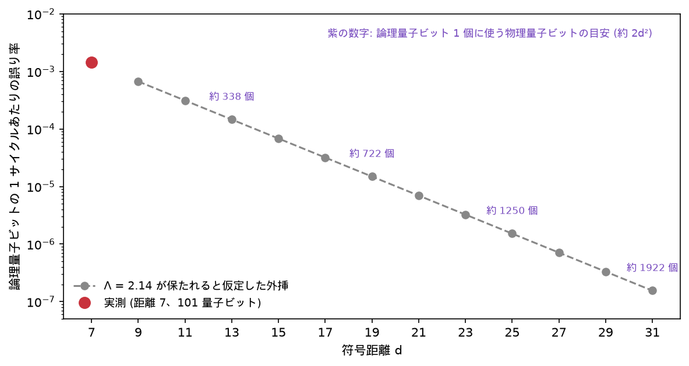

**図 11**　表面符号の論理誤り率と符号距離。赤は実測の値、灰色はその比 2.14 が大きな距離でも保たれると仮定した外挿です（[Google 2025] の要旨の値から作図）。紫の数字は、距離 d の表面符号が使う物理量子ビットの目安（約 2d² 個）です。誤り率を 1 桁下げるごとに、物理量子ビットの数が数百個単位で増えていきます。

この分野では、「ある分子のエネルギーを、誤り耐性量子計算機でどれくらいの量子ビットと時間で計算できるか」という**リソース見積もり**が重要な研究テーマです。代表例が、窒素固定酵素ニトロゲナーゼの活性中心 **FeMoco**（鉄とモリブデンを含むクラスター）です。

- Reiher らは、FeMoco の反応機構を量子コンピュータで調べる道筋を示しました [Reiher 2017]。arXiv 版の表では、54 電子・54 空間軌道の活性空間の構造について、誤り訂正の負担を含めても、論理量子ビット 111 個、T ゲート（誤り訂正で最もコストのかかるゲート）約 $10^{14}$ 個で 1 m$E_\mathrm{h}$ の精度に達すると見積もられています（実行の仕方による）。
- Li らは、この活性空間の模型が FeMoco の基底状態の電子構造を代表していないことを指摘し、より代表的な活性空間を提案しました [Li 2019]。見積もりは、活性空間の選び方に敏感です。
- Lee らは、ハミルトニアンをテンソル超縮約（tensor hypercontraction）で分解する方法により、FeMoco を約 400 万個の物理量子ビットで 4 日以内に計算できると見積もりました（1 μs のサイクル時間、物理ゲートの誤り率 0.1% 以下を仮定）[Lee 2021]。

このほか、二酸化炭素をメタノールに変えるルテニウム触媒 [von Burg 2021]、シトクロム P450 [Goings 2022] についても、古典計算（DMRG や CCSD(T)）と量子計算のコストを比べるリソース見積もりが行われています。アルゴリズムの改良で、必要なリソースは年々小さくなってきました。図 12 は、これまでの化学の実証実験で使われた量子ビットの数と、FeMoco の見積もりを並べたものです。

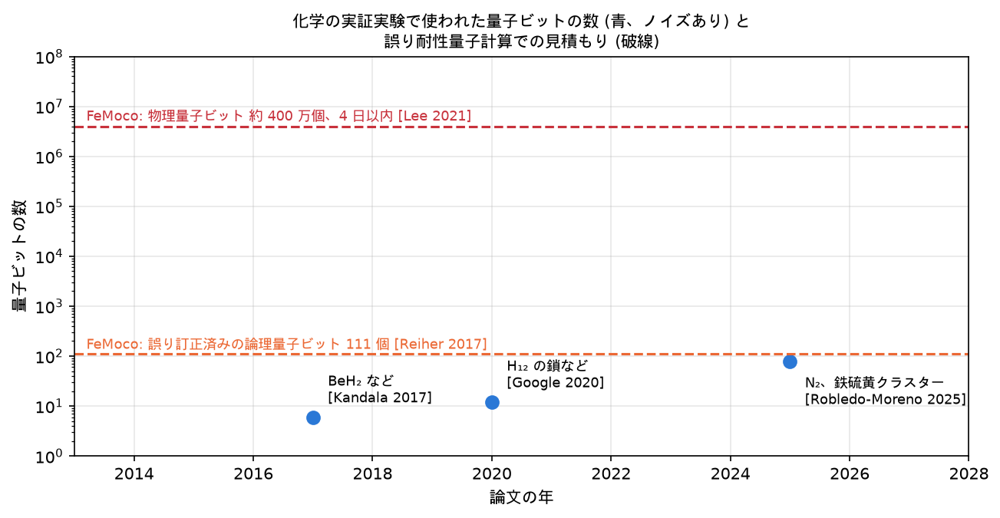

**図 12**　化学の実証実験で使われた量子ビットの数（青、ノイズのある物理量子ビット）と、FeMoco の誤り耐性量子計算での見積もり（破線）。各論文の要旨と本文の値から作図しました [Kandala 2017; Google 2020; Robledo-Moreno 2025; Reiher 2017; Lee 2021]。論理量子ビットと物理量子ビットは別の量なので、縦軸の同じ高さでも意味が違うことに注意してください。

**この界隈の常識**

- 「量子ビット何個」と言うときは、物理量子ビットか論理量子ビットかを必ず確かめます。たとえば Reiher らの見積もりでは、論理量子ビット 111 個の計算に、物理ゲートの誤り率を 10⁻⁶〜10⁻⁹ と仮定しても、物理量子ビットが 10⁵〜10⁶ 個必要でした [Reiher 2017]。
- 「量子ビット何個」の数字は、上の 2 つの量で桁が違います。物理量子ビットの数は、論理量子ビットの数に誤り訂正の負担（1 個あたり数百〜数千個）をかけた量になるからです。
- リソース見積もりの結果は、活性空間の選び方、目標の精度、ハードウェアの仮定（誤り率、ゲートの速さ）で大きく変わります。活性空間が大きいほどハミルトニアンの項が増え、誤り率が高いほど誤り訂正の負担が増えるからです。見積もりを比べるときは、これらの仮定がそろっているかを確かめます。

!!! question "「QPE には、基底状態とよく重なる初期状態が必要」と言われるのはなぜ？"
    **そもそも重なりとは**：準備した初期状態 $|\Phi\rangle$ と、本当の基底状態 $|\Psi_0\rangle$ の内積の大きさ $S = |\langle\Phi|\Psi_0\rangle|$ です。

    **なぜ必要か**：QPE は、初期状態を固有状態に射影し、その固有状態のエネルギーを読み出します。基底状態のエネルギーが出る確率は $S^2$ です。そのため、基底状態を得るまでに、平均で $1/S^2$ 回くり返す必要があります [Lee 2023]。$S$ が小さいと、QPE の回路がどれだけ効率的でも、全体の計算時間はくり返しの回数で決まってしまいます。

    **どこが難しいか**：Lee らは、鉄硫黄クラスターの模型で、最も重みの大きい 1 つの電子配置と基底状態の重なりの 2 乗（重み）が、金属の数とともに指数関数的に小さくなることを示しました [Lee 2023]。強い相関のある系では、HF の状態のような簡単な初期状態では足りず、よい初期状態を作ること自体が難しい問題です。そして、よい初期状態を古典計算で作れる系では、古典計算だけでエネルギーも求められる可能性があります。この点が、量子優位性の議論につながります（7 節）。

## 6. 量子計算と古典計算の組み合わせ

### 6.1 活性空間と古典の競争相手

量子コンピュータで扱えるのは、当面、数十〜百個程度の軌道です。分子全体を cc-pVTZ のような基底関数で表すと、軌道は数百個を超え、スピン軌道の数だけ論理量子ビットが要ります。そのため実際には、古典計算で分子全体の軌道を求め、強い相関を持つ軌道だけを**活性空間**として選び（講義ノート第 12 回）、その中の問題を量子コンピュータで解く、という分業になります（図 13）。活性空間の外の電子の効果（動的相関）は、古典計算の摂動論などで足します。動的相関は多数の小さな寄与の和で、摂動論でよく近似できるので、量子コンピュータを使うまでもないからです。

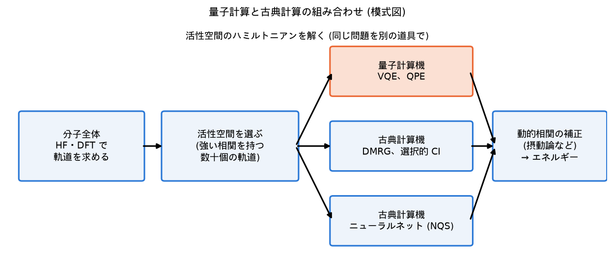

**図 13**　量子計算と古典計算の組み合わせ（模式図）。活性空間のハミルトニアンを解く部分は、量子コンピュータ（VQE、QPE）でも、古典計算機の DMRG や選択的 CI、ニューラルネットでも解けます。量子コンピュータの価値は、同じ問題を古典の方法より速く、または正確に解けるかどうかで決まります。

ここで大事なのは、活性空間の問題には、古典計算機の強力な方法（DMRG、選択的 CI）がすでにあることです。たとえば DMRG では、Cr₂ の 24 電子・30 軌道の活性空間で FCI のエネルギーが精度よく予測されています [Kurashige 2009]。DMRG の方法そのものは、[計算理論のページ](01-theory-development.md#23-dmrg)で説明します。量子コンピュータの研究では、こうした古典の方法がどこまで届くかを正しく見極めることが、量子優位性を議論する前提になります。

最近は、量子コンピュータで得たサンプル（測定で出てきた電子配置）を古典計算機に渡し、その配置の空間でハミルトニアンを対角化する方法も試されています。Robledo-Moreno らは、IBM の超伝導量子プロセッサ Heron とスーパーコンピュータ「富岳」を組み合わせ、最大 77 量子ビット・10,570 ゲートの回路で、N₂ の解離や [2Fe-2S]、[4Fe-4S] クラスターの基底状態を計算しました [Robledo-Moreno 2025]。

### 6.2 ニューラルネットによる波動関数の表現

活性空間の波動関数を、古典計算機の上でニューラルネットワークで表す方法も発展しています [Yang 2020]。
Hagai らは、そのように表した波動関数を量子コンピュータの上に準備する量子アルゴリズムを提案し、2 つの道具をつなぎました [Hagai 2023]。
方法の考え方と研究例は、[機械学習のページの「波動関数そのものの機械学習」の節](07-machine-learning.md#5)で紹介します。

**この界隈の常識**

- 量子コンピュータの論文を読むときは、比べている古典の方法が最善のもの（DMRG、選択的 CI、CCSD(T) など）かを確かめます。HF や小さな CI のような弱い方法と比べれば、量子コンピュータが勝つのは当然で、何も示していないからです。
- 活性空間の選び方は、量子計算でも古典計算でも結果を大きく左右します。強い相関を持つ軌道が活性空間から漏れると、その相関は外の摂動論では正しく表せないからです。FeMoco の見積もりが活性空間の選び方で変わったのは、その例です（5.2 節）。
- 「量子と古典の組み合わせ」は、当面の量子コンピュータを使う現実的な方法として、多くの研究で採られています。量子ビットの数とノイズに限りがあるので、量子コンピュータにしかできない部分だけを任せるのが得だからです。

## 7. この界隈の常識：NISQ、ノイズ、量子優位性の読み方

### 7.1 NISQ

Preskill は、今の量子コンピュータを **NISQ**（Noisy Intermediate-Scale Quantum、ノイズのある中規模の量子デバイス）と呼びました [Preskill 2018]。50〜100 量子ビットの量子コンピュータは古典計算機を超える計算ができる可能性がある一方、ゲートのノイズが、確実に実行できる回路の大きさを制限する、という整理です。VQE は、この NISQ のための方法として研究されてきました。

### 7.2 量子優位性の主張を慎重に読む

「量子コンピュータが古典計算機を超えた」という主張は、これまで何度も出され、そのたびに古典計算の側から検証されてきました。

- Google のグループは、53 量子ビットの Sycamore で、ランダムな量子回路の出力をサンプリングする課題を約 200 秒で行い、スーパーコンピュータでは約 1 万年かかると見積もりました [Arute 2019]。その後、Pan らは、テンソルネットワークを使った古典計算で、この課題を 512 個の GPU の計算機で約 15 時間で解きました [Pan 2022]。
- IBM のグループは、127 量子ビットのプロセッサで、総当たりの古典計算では届かない規模の期待値を正確に測定できたと報告しました [Kim 2023]。これに対し、Tindall らは、格子の形を反映したテンソルネットワークの方法で、同じ系を量子プロセッサより正確に古典計算でシミュレートできることを示しました [Tindall 2024]。

量子化学の基底状態のエネルギーについても、Lee らは、化学の問題全般で指数関数的な量子優位性があるという証拠はまだ見つかっていないと結論し、多項式的な高速化はありうるが、指数関数的な高速化が一般に得られるとは考えない方が慎重だ、と述べています [Lee 2023]。

!!! question "「量子優位性の主張は慎重に読む」と言われるのはなぜ？"
    **そもそも量子優位性とは**：ある課題で、量子コンピュータが古典計算機より速く（または正確に）答えを出せることです。「古典計算機では何年かかる」という数字は、実験の結果ではなく、その時点で知られている古典の方法での見積もりです。

    **なぜ慎重に読むか**：理由は 3 つあります。1 つ目は、比べる相手が動くことです。上の 2 つの例のように、主張のあとで古典の方法が改良され、差が縮んだり逆転したりしてきました。2 つ目は、課題の選び方です。ランダムな回路のサンプリングのように、量子コンピュータに有利になるように選んだ課題は、化学として意味のある問題とは限りません。3 つ目は、量子化学に特有の事情です。指数関数的な高速化には、よい初期状態が必要です（5.2 節）。しかし、よい初期状態を作れる系では、古典の方法もよく効く可能性があります [Lee 2023]。

    **どう読むか**：次の 3 点を確かめます。比べている古典の方法は、その課題で最善のものか（DMRG、選択的 CI、テンソルネットワーク、CCSD(T) など）。課題は、化学的精度が必要な、化学として意味のある問題か（反応のエネルギー、スピン状態の順番など）。速さの比較は、同じ精度で行われているか。少なくとも Lee らの 2023 年の検証の時点では、この 3 点をすべて満たす化学の例は確立していませんでした [Lee 2023]。

それでも、誤り耐性量子計算機が実現したときに何が解けるかを見積もる研究や、古典の方法の限界を明らかにする研究は、分野全体を前に進めています。量子コンピュータとの競争が、DMRG やテンソルネットワークのような古典の方法の改良を促してきた面もあります。

## この分野でよく出てくる言葉

| 言葉 | 意味 |
|---|---|
| 量子ビット（qubit） | 0 と 1 の重ね合わせをとれる、量子コンピュータの情報の単位 |
| ブロッホ球 | 1 量子ビットの状態を球面上の点で表す図 |
| もつれ（エンタングルメント） | 複数の量子ビットの状態が、個々の状態の積に分解できないこと |
| 量子ゲート、量子回路 | 量子ビットに作用するユニタリ変換と、その並びを表した図 |
| CNOT | 2 量子ビットのゲート。制御ビットが 1 のとき標的ビットを反転する |
| ショット数 | 期待値を求めるために、回路をくり返して測定する回数 |
| Jordan–Wigner 変換 | フェルミオンの生成・消滅演算子を量子ビットの演算子に写す方法 |
| パウリ演算子 | I、X、Y、Z とその積。量子ビットのハミルトニアンはこれの和で書く |
| VQE | パラメータつきの量子回路と古典の最適化を組み合わせる変分法 |
| UCCSD、ハードウェア効率型 | VQE の試行関数の回路の代表的な 2 つの型 |
| 量子位相推定（QPE） | 時間発展で付く位相からエネルギーを読み出すアルゴリズム |
| 物理量子ビット、論理量子ビット | ハードウェアの量子ビットと、誤り訂正で作られた信頼できる量子ビット |
| 誤り耐性量子計算（FTQC） | 量子誤り訂正を備えた量子計算 |
| 表面符号、符号距離 | 代表的な誤り訂正符号と、その大きさ。距離が大きいほど論理量子ビットの誤り率が下がる |
| T ゲート | 誤り耐性量子計算で最もコストのかかるゲート。その数が計算時間の目安 |
| リソース見積もり | ある計算に必要な量子ビットの数と時間の見積もり |
| NISQ | ノイズのある中規模の量子デバイス。今の量子コンピュータ |
| 誤りの緩和（error mitigation） | 誤り訂正をせずに、ノイズの影響を後処理などで減らす工夫 |
| 不毛な台地（barren plateau） | VQE の地形が平らになり、勾配が消えて最適化が進まない現象 |
| 量子優位性 | 量子コンピュータが、ある課題で古典計算機より優れていること |
| 重なり（overlap） | QPE の初期状態と本当の基底状態の内積の大きさ。小さいとくり返しが増える |
| NQS | ニューラルネットワークで表した量子状態（波動関数） |

## この分野の常識：まとめ

- FCI の次元は軌道の数とともに指数関数的に増えますが、量子ビットの数は軌道の数に比例するだけです。これが、量子化学が有望な応用と言われる理由です。
- 分子のハミルトニアンは、Jordan–Wigner 変換などでパウリ演算子の和に直して量子コンピュータに載せます。パウリ演算子の積なら、量子ビットごとの測定で値が決まるからです。
- 測定で読めるのは期待値だけです。1 回の測定は 1 つの結果しか出さないので、くり返しの測定（ショット）が必要で、統計誤差は 1/√N でしか減りません。
- VQE は NISQ 向けの変分法で、量子は状態を作って測り、古典は最適化します。量子回路を短くして、ノイズの影響を抑えるための分業です。
- QPE は誤り耐性量子計算機向けの本命のアルゴリズムです。回路は深いですが、よい初期状態があればエネルギーを正確に読めます。
- 深い回路では誤りが積み重なるので、誤り訂正が必要です。そのため「量子ビット何個」は、物理量子ビットか論理量子ビットかを区別します。
- FeMoco のリソース見積もりは、活性空間とハードウェアの仮定で大きく変わり、アルゴリズムの改良で年々小さくなってきました。
- 当面は、活性空間の問題だけを量子で解き、残りを古典で補う分業になります。量子ビットの数に限りがあり、動的相関は古典の摂動論で十分に近似できるからです。
- 量子計算の結果は、DMRG や選択的 CI などの最善の古典の方法と比べて評価します。弱い方法との比較は何も示さないからです。
- 量子優位性の主張は、その後の古典計算の進歩で覆されたことが何度もあります。化学の問題での量子優位性は、まだ確立していません。
- ノイズは避けられず、誤りの緩和と誤り訂正が研究の大きなテーマです。

## 最初に読むとよい文献

- S. McArdle らの総説 [McArdle 2020]：量子計算化学の総説。アルゴリズムの全体像を、量子化学者にも分かるように整理しています。
- Y. Cao らの総説 [Cao 2019]：量子化学者と量子計算の研究者の両方を読者として想定した総説です。
- B. Bauer らの総説 [Bauer 2020]：量子化学と物質科学のための量子アルゴリズム。どこに量子優位性がありうるかを慎重に議論しています。
- S. Lee らの論文 [Lee 2023]：量子化学の基底状態で、指数関数的な量子優位性の証拠を検証した論文。この分野の主張を冷静に読むために役立ちます。
- M. A. Nielsen と I. L. Chuang の教科書 [Nielsen 2010]：量子計算と量子情報の標準的な教科書です。

## 講義ノートとの関係

- [量子化学の理論 第 1 回　量子化学のための数学](../courses/qc-theory/01-mathematics.md)：VQE の土台になる変分法です。
- [量子化学の理論 第 3 回　演算子と行列要素：Slater–Condon 則と第二量子化](../courses/qc-theory/03-second-quantization.md)：Jordan–Wigner 変換の出発点になる第二量子化のハミルトニアンです。
- [量子化学の理論 第 8 回　配置間相互作用（CI）](../courses/qc-theory/08-configuration-interaction.md)：FCI と、その次元の爆発です。
- [量子化学の理論 第 10 回　結合クラスター法：CCSD(T)](../courses/qc-theory/10-coupled-cluster.md)：VQE の試行関数 UCCSD のもとになる考え方です。
- [量子化学の理論 第 12 回　多配置 SCF：CASSCF と活性空間の選び方](../courses/qc-theory/12-casscf.md)：量子コンピュータに載せる活性空間の選び方です。
- [量子化学の理論 第 14 回　大きな活性空間：DMRG と選択的 CI](../courses/qc-theory/14-dmrg-sci.md)：量子コンピュータと比べられる、古典の最善の方法です。
- [機械学習の基礎 第 5 回　ニューラルネットワークと誤差逆伝播](../courses/ml-basics/05-neural-networks.md)：NQS の土台になるニューラルネットワークです。

## 参考文献

- A. Aspuru-Guzik, A. D. Dutoi, P. J. Love, M. Head-Gordon, "Simulated Quantum Computation of Molecular Energies", Science 309, 1704 (2005). DOI: [10.1126/science.1113479](https://doi.org/10.1126/science.1113479)
- D. S. Abrams, S. Lloyd, "Quantum Algorithm Providing Exponential Speed Increase for Finding Eigenvalues and Eigenvectors", Phys. Rev. Lett. 83, 5162 (1999). DOI: [10.1103/PhysRevLett.83.5162](https://doi.org/10.1103/PhysRevLett.83.5162)
- Y. Kurashige, G. K.-L. Chan, T. Yanai, "Entangled quantum electronic wavefunctions of the Mn4CaO5 cluster in photosystem II", Nat. Chem. 5, 660 (2013). DOI: [10.1038/nchem.1677](https://doi.org/10.1038/nchem.1677)
- Y. Kurashige, T. Yanai, "High-performance ab initio density matrix renormalization group method: Applicability to large-scale multireference problems for metal compounds", J. Chem. Phys. 130, 234114 (2009). DOI: [10.1063/1.3152576](https://doi.org/10.1063/1.3152576)
- M. A. Nielsen, I. L. Chuang, "Quantum Computation and Quantum Information" (Cambridge University Press, 10th anniversary ed., 2010). ISBN: 9781107002173
- P. Jordan, E. Wigner, "Über das Paulische Äquivalenzverbot", Z. Phys. 47, 631 (1928). DOI: [10.1007/BF01331938](https://doi.org/10.1007/BF01331938)
- S. B. Bravyi, A. Yu. Kitaev, "Fermionic Quantum Computation", Ann. Phys. 298, 210 (2002). DOI: [10.1006/aphy.2002.6254](https://doi.org/10.1006/aphy.2002.6254)
- Q. Sun et al., "Recent developments in the PySCF program package", J. Chem. Phys. 153, 024109 (2020). DOI: [10.1063/5.0006074](https://doi.org/10.1063/5.0006074)
- A. Peruzzo, J. McClean, P. Shadbolt, M.-H. Yung, X.-Q. Zhou, P. J. Love, A. Aspuru-Guzik, J. L. O'Brien, "A variational eigenvalue solver on a photonic quantum processor", Nat. Commun. 5, 4213 (2014). DOI: [10.1038/ncomms5213](https://doi.org/10.1038/ncomms5213)
- A. Kandala, A. Mezzacapo, K. Temme, M. Takita, M. Brink, J. M. Chow, J. M. Gambetta, "Hardware-efficient variational quantum eigensolver for small molecules and quantum magnets", Nature 549, 242 (2017). DOI: [10.1038/nature23879](https://doi.org/10.1038/nature23879)
- J. Tilly et al., "The Variational Quantum Eigensolver: A review of methods and best practices", Phys. Rep. 986, 1 (2022). DOI: [10.1016/j.physrep.2022.08.003](https://doi.org/10.1016/j.physrep.2022.08.003)
- P. J. J. O'Malley et al., "Scalable Quantum Simulation of Molecular Energies", Phys. Rev. X 6, 031007 (2016). DOI: [10.1103/PhysRevX.6.031007](https://doi.org/10.1103/PhysRevX.6.031007)
- Google AI Quantum and Collaborators, "Hartree-Fock on a superconducting qubit quantum computer", Science 369, 1084 (2020). DOI: [10.1126/science.abb9811](https://doi.org/10.1126/science.abb9811)
- J. R. McClean, S. Boixo, V. N. Smelyanskiy, R. Babbush, H. Neven, "Barren plateaus in quantum neural network training landscapes", Nat. Commun. 9, 4812 (2018). DOI: [10.1038/s41467-018-07090-4](https://doi.org/10.1038/s41467-018-07090-4)
- Google Quantum AI and Collaborators (R. Acharya et al.), "Quantum error correction below the surface code threshold", Nature 638, 920 (2025). DOI: [10.1038/s41586-024-08449-y](https://doi.org/10.1038/s41586-024-08449-y)
- M. Reiher, N. Wiebe, K. M. Svore, D. Wecker, M. Troyer, "Elucidating reaction mechanisms on quantum computers", Proc. Natl. Acad. Sci. U.S.A. 114, 7555 (2017). DOI: [10.1073/pnas.1619152114](https://doi.org/10.1073/pnas.1619152114)
- Z. Li, J. Li, N. S. Dattani, C. J. Umrigar, G. K.-L. Chan, "The electronic complexity of the ground-state of the FeMo cofactor of nitrogenase as relevant to quantum simulations", J. Chem. Phys. 150, 024302 (2019). DOI: [10.1063/1.5063376](https://doi.org/10.1063/1.5063376)
- J. Lee, D. W. Berry, C. Gidney, W. J. Huggins, J. R. McClean, N. Wiebe, R. Babbush, "Even More Efficient Quantum Computations of Chemistry Through Tensor Hypercontraction", PRX Quantum 2, 030305 (2021). DOI: [10.1103/PRXQuantum.2.030305](https://doi.org/10.1103/PRXQuantum.2.030305)
- V. von Burg, G. H. Low, T. Häner, D. S. Steiger, M. Reiher, M. Roetteler, M. Troyer, "Quantum computing enhanced computational catalysis", Phys. Rev. Res. 3, 033055 (2021). DOI: [10.1103/PhysRevResearch.3.033055](https://doi.org/10.1103/PhysRevResearch.3.033055)
- J. J. Goings et al., "Reliably assessing the electronic structure of cytochrome P450 on today's classical computers and tomorrow's quantum computers", Proc. Natl. Acad. Sci. U.S.A. 119, e2203533119 (2022). DOI: [10.1073/pnas.2203533119](https://doi.org/10.1073/pnas.2203533119)
- J. Robledo-Moreno et al., "Chemistry beyond the scale of exact diagonalization on a quantum-centric supercomputer", Sci. Adv. 11, eadu9991 (2025). DOI: [10.1126/sciadv.adu9991](https://doi.org/10.1126/sciadv.adu9991)
- P. Yang, M. Sugiyama, K. Tsuda, T. Yanai, "Artificial Neural Networks Applied as Molecular Wave Function Solvers", J. Chem. Theory Comput. 16, 3513 (2020). DOI: [10.1021/acs.jctc.9b01132](https://doi.org/10.1021/acs.jctc.9b01132)
- M. Hagai, M. Sugiyama, K. Tsuda, T. Yanai, "Artificial neural network encoding of molecular wavefunctions for quantum computing", Digital Discovery 2, 634 (2023). DOI: [10.1039/d2dd00093h](https://doi.org/10.1039/d2dd00093h)
- J. Preskill, "Quantum Computing in the NISQ era and beyond", Quantum 2, 79 (2018). DOI: [10.22331/q-2018-08-06-79](https://doi.org/10.22331/q-2018-08-06-79)
- F. Arute et al., "Quantum supremacy using a programmable superconducting processor", Nature 574, 505 (2019). DOI: [10.1038/s41586-019-1666-5](https://doi.org/10.1038/s41586-019-1666-5)
- F. Pan, K. Chen, P. Zhang, "Solving the Sampling Problem of the Sycamore Quantum Circuits", Phys. Rev. Lett. 129, 090502 (2022). DOI: [10.1103/PhysRevLett.129.090502](https://doi.org/10.1103/PhysRevLett.129.090502)
- Y. Kim et al., "Evidence for the utility of quantum computing before fault tolerance", Nature 618, 500 (2023). DOI: [10.1038/s41586-023-06096-3](https://doi.org/10.1038/s41586-023-06096-3)
- J. Tindall, M. Fishman, E. M. Stoudenmire, D. Sels, "Efficient Tensor Network Simulation of IBM's Eagle Kicked Ising Experiment", PRX Quantum 5, 010308 (2024). DOI: [10.1103/PRXQuantum.5.010308](https://doi.org/10.1103/PRXQuantum.5.010308)
- S. Lee et al., "Evaluating the evidence for exponential quantum advantage in ground-state quantum chemistry", Nat. Commun. 14, 1952 (2023). DOI: [10.1038/s41467-023-37587-6](https://doi.org/10.1038/s41467-023-37587-6)
- S. McArdle, S. Endo, A. Aspuru-Guzik, S. C. Benjamin, X. Yuan, "Quantum computational chemistry", Rev. Mod. Phys. 92, 015003 (2020). DOI: [10.1103/RevModPhys.92.015003](https://doi.org/10.1103/RevModPhys.92.015003)
- Y. Cao et al., "Quantum Chemistry in the Age of Quantum Computing", Chem. Rev. 119, 10856 (2019). DOI: [10.1021/acs.chemrev.8b00803](https://doi.org/10.1021/acs.chemrev.8b00803)
- B. Bauer, S. Bravyi, M. Motta, G. K.-L. Chan, "Quantum Algorithms for Quantum Chemistry and Quantum Materials Science", Chem. Rev. 120, 12685 (2020). DOI: [10.1021/acs.chemrev.9b00829](https://doi.org/10.1021/acs.chemrev.9b00829)

## 関連リンク

- Qiskit（IBM の量子計算のソフトウェア）：https://www.ibm.com/quantum/qiskit
- OpenFermion（フェルミオンの問題を量子回路に変換するライブラリ）：https://quantumai.google/openfermion
- PennyLane（量子機械学習と量子化学のライブラリ）：https://pennylane.ai/
