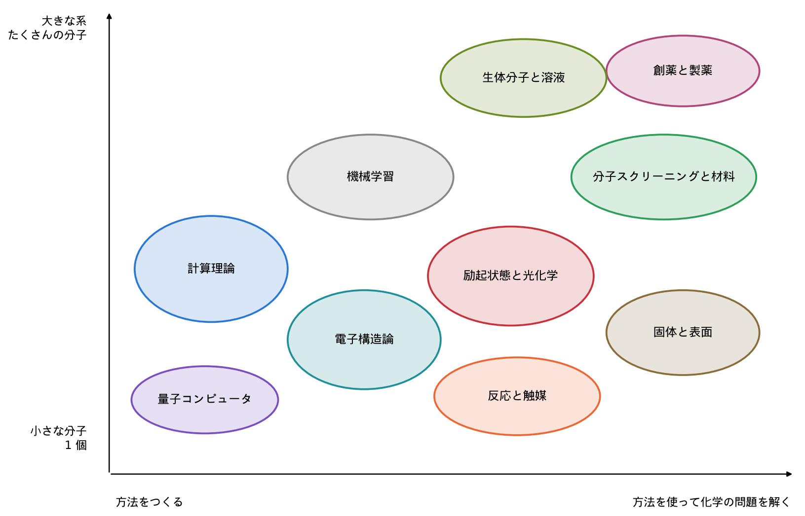

# 量子化学の研究分野：分野ごとの雰囲気と常識

同じ量子化学の研究室でも、隣の人の研究分野のことはよく知らない、ということがよくあります。
このページ群では、量子化学の研究室でよく行われている研究を分野ごとに分け、それぞれの分野が何を目指しているか、どんな道具を使うか、その界隈で「常識」とされていることは何かを紹介します。
講義ノートのように式を追うのではなく、研究の背景知識（教養）として、分野の雰囲気をつかむためのページです。
研究室に入ったばかりの人にも読めるように、式はできるだけ使わず、図をたくさん使って説明します。

## 分野の地図

**図**　模式図。横軸は「新しい方法をつくる研究」から「方法を使って化学の問題を解く研究」まで、縦軸は扱う系の大きさ（小さな分子 1 個から、タンパク質や結晶のような大きな系まで）です。実際の研究は、いくつもの分野にまたがることがほとんどです。たとえば、光合成のタンパク質の色を調べる研究は、「励起状態と光化学」と「生体分子と溶液」の両方に入ります。

## 分野の一覧

| 分野 | ページ | 中で扱う小分類 |
|---|---|---|
| 計算理論 | [新しい計算方法をつくる研究](01-theory-development.md) | 波動関数理論、密度汎関数、解析的微分、環境を取り込む方法、プログラム開発の文化 |
| 電子構造論 | [分子の電子状態を調べ、解釈する研究](02-electronic-structure.md) | 電子状態を読む道具、多参照系と強相関、遷移金属錯体のスピン状態、化学結合の解析、π 電子系とラジカル |
| 反応と触媒 | [反応のしくみを計算で解き明かす研究](03-reactions-catalysis.md) | 有機反応と遷移状態、遷移金属触媒、光触媒、プロトン共役電子移動、金属酵素とゼオライト、反応経路の自動探索 |
| 励起状態と光化学 | [光と分子の研究](04-excited-states.md) | 色と吸収、励起エネルギー移動、円二色性、無輻射失活と項間交差、TADF、一重項分裂 |
| 分子スクリーニングと材料探索 | [たくさんの候補から、よい分子を選ぶ研究](05-screening-materials.md) | スクリーニングの考え方、化学空間とデータベース、記述子、有機エレクトロニクス、ベイズ最適化と生成モデル、ハイスループット計算 |
| 創薬と製薬 | [薬の候補を計算で探す研究](06-drug-discovery.md) | 標的とポケット、ドッキング、結合の強さの表し方、結合自由エネルギー、共有結合する薬と量子化学、ADMET |
| 機械学習 | [データで化学を速く、広くする研究](07-machine-learning.md) | 機械学習ポテンシャル、性質の予測、反応・触媒のデータ駆動、波動関数の機械学習、材料探索、データの扱い方 |
| 生体分子と溶液 | [タンパク質と水の中の分子の研究](08-biomolecules-solution.md) | QM/MM 法、分子動力学、溶媒和モデル、光合成タンパク質とロドプシン、酵素反応 |
| 固体と表面 | [結晶、表面、材料の計算](09-solids-surfaces.md) | 周期系の考え方、バンド構造、表面と不均一触媒、電池と半導体、分子性結晶と有機半導体 |
| 量子コンピュータ | [新しい計算機で電子状態を解く研究](10-quantum-computing.md) | 量子ビットと量子回路、Jordan–Wigner 変換、VQE、量子位相推定、量子と古典の組み合わせ |

## 各ページの読み方

各ページは、次の順に書いています。

- その分野が答えようとしている問い
- 小分類ごとに、何をする研究か、よく使う方法とプログラム、代表的な研究例、その界隈の常識
- その分野でよく出てくる言葉の表
- 「知らないと会話についていけないこと」をまとめた、常識のまとめ
- 最初に読むとよい総説や教科書
- 講義ノートのどの回と関係が深いか

紹介する研究例は、公開された論文の要旨や本文で内容を確かめたものです。数値を書くときは、出典を付けています。
