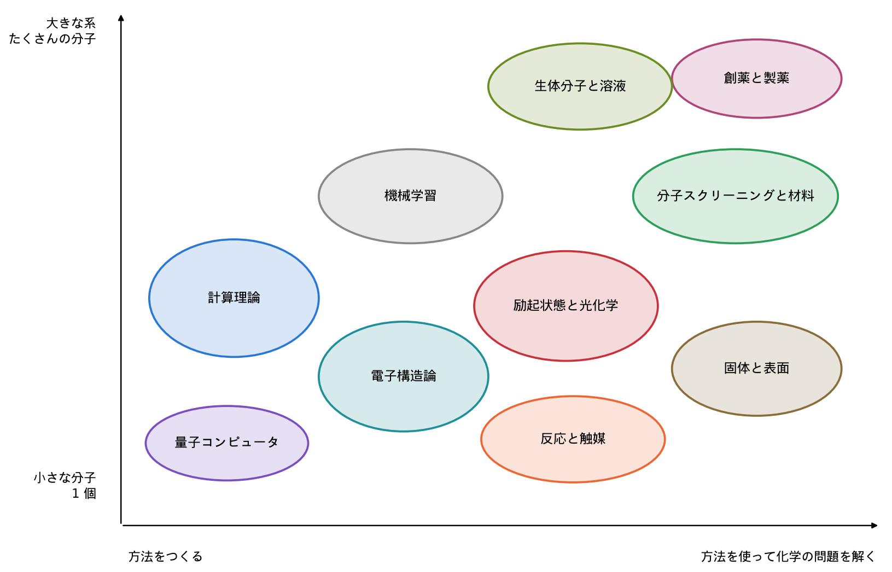

<h1 class="qc-sr-only">QCLab</h1>

<section class="qc-hero2">
<canvas id="qc-mol" aria-hidden="true"></canvas>

PAPERS &amp; LECTURES IN QUANTUM CHEMISTRY

Quantum Chemistry Lab

QCLAB

量子化学を、入門から最先端まで。 毎日の論文紹介、積み上げ式の講義ノート、研究分野の教養。

<a class="qc-btn2" href="papers/">今日の論文を読む</a><a class="qc-btn2 qc-btn2--ghost" href="courses/">講義ノート</a><a class="qc-btn2 qc-btn2--ghost" href="fields/">研究分野</a>

ベンゼンの π 軌道 点は電子の分布 |ψ|²、色は波動関数の符号 (RHF/6-31G で計算)

SCROLL

</section>

PICKUP今日の論文

<!-- PICKUP:START -->

論文紹介

<a href="papers/2026/2026-11-25/">TAO-DFT の仮想温度を、スピン対称性から決める</a>

2026.11.25　arXiv（プレプリント、査読前）

<!-- PICKUP:END -->

NEWS新着

<!-- NEWS:START -->
<ul class="qc-news">
<li>2026.11.25論文紹介<a href="papers/2026/2026-11-25/">TAO-DFT の仮想温度を、スピン対称性から決める</a></li>
<li>2026.11.24論文紹介<a href="papers/2026/2026-11-24/">スピン対称性の制約で結合クラスター法を強相関へ</a></li>
<li>2026.11.23論文紹介<a href="papers/2026/2026-11-23/">吸着エネルギーを 1 回で予測する局所グラフ型 GNN</a></li>
<li>2026.11.22論文紹介<a href="papers/2026/2026-11-22/">基盤ポテンシャルは疲労き裂の挙動を再現するか</a></li>
<li>2026.11.20論文紹介<a href="papers/2026/2026-11-20/">遷移金属錯体の軌道エネルギーを少ないデータで学習する</a></li>
<li>2026.11.19論文紹介<a href="papers/2026/2026-11-19/">MRSF-TDDFT の解析的ヘッセ行列と励起状態ラマン</a></li>
<li>2026.11.19講義ノート<a href="courses/qc-theory/24-spin-orbit-coupling/">量子化学の理論 第 24 回「スピン軌道相互作用と項間交差」を公開しました（全 24 回がそろいました）</a></li>
<li>2026.11.19新しいページ<a href="fields/">「研究分野」を公開しました（10 分野の雰囲気と常識を、図と 3D 図で紹介）</a></li>
</ul>
<!-- NEWS:END -->

<a href="papers/">論文紹介の一覧 →</a>

FIELDS研究分野

FIELD MAP

隣の研究の「常識」が分かる。

量子化学の研究室で行われている研究を 10 の分野に分け、それぞれが何を目指し、どんな道具を使い、どんなことが常識なのかを、図と 3D 図で紹介します。研究室に入ったばかりの人のための教養のページです。

<a class="qc-btn" href="fields/">分野の地図を見る</a>

<a class="qc-field" href="fields/01-theory-development/" style="--qc-f: #2a78d6">01Method Development計算理論新しい計算方法をつくる</a>
<a class="qc-field" href="fields/02-electronic-structure/" style="--qc-f: #1f8f9b">02Electronic Structure電子構造論電子状態を調べ、解釈する</a>
<a class="qc-field" href="fields/03-reactions-catalysis/" style="--qc-f: #eb6834">03Reactions & Catalysis反応と触媒反応のしくみを解き明かす</a>
<a class="qc-field" href="fields/04-excited-states/" style="--qc-f: #c8323c">04Photochemistry励起状態と光化学光と分子</a>
<a class="qc-field" href="fields/05-screening-materials/" style="--qc-f: #2e9e5b">05Screening & Materials分子スクリーニングと材料候補から、よい分子を選ぶ</a>
<a class="qc-field" href="fields/06-drug-discovery/" style="--qc-f: #b0457a">06Drug Discovery創薬と製薬薬の候補を計算で探す</a>
<a class="qc-field" href="fields/07-machine-learning/" style="--qc-f: #5b6475">07Machine Learning機械学習データで速く、広く</a>
<a class="qc-field" href="fields/08-biomolecules-solution/" style="--qc-f: #6b8e23">08Biomolecules生体分子と溶液タンパク質と水の中の分子</a>
<a class="qc-field" href="fields/09-solids-surfaces/" style="--qc-f: #8a6d3b">09Solids & Surfaces固体と表面結晶、表面、材料</a>
<a class="qc-field" href="fields/10-quantum-computing/" style="--qc-f: #7a4fc0">10Quantum Computing量子コンピュータ新しい計算機で電子状態を解く</a>

COURSES講義ノート

<a class="qc-tile" href="courses/qc-theory/">Quantum Chemistry量子化学の理論波動関数理論、密度汎関数理論、励起状態、多参照理論</a>
<a class="qc-tile" href="courses/reactions/">Chemical Reactions化学反応の理論遷移状態、反応速度、フロンティア軌道、Marcus 理論</a>
<a class="qc-tile" href="courses/tm-complexes/">Transition Metals遷移金属錯体の計算d 電子、スピン状態、触媒反応</a>
<a class="qc-tile" href="courses/ml-basics/">Machine Learning機械学習の基礎回帰からニューラルネットワーク、等変ネットワークまで</a>
<a class="qc-tile" href="courses/ml-chem/">ML for Chemistry量子化学のための機械学習機械学習ポテンシャル、UMA などの基盤モデル</a>
<a class="qc-tile" href="courses/packages/">Software計算パッケージの使い方PySCF、ORCA、xtb、ASE</a>
<a class="qc-tile" href="courses/tools/">Tools研究の道具Linux、Python、Git、Markdown</a>

